# CNN round 02: `auto` augmentation, no Mixup/CutMix, and a regularization search

      

Round 01 ([`../01_strongaug_mixup_cutmix`](../01_strongaug_mixup_cutmix)) trained two ResNet-style CNNs **from scratch** on 5,394 photos (about 27 per species) and found that both **memorize** their training photos: about 100 % right on them, 44 to 46 % on new ones. This round asks one question, for **both** CNNs: **which training changes reduce that memorizing, without hurting accuracy?**

It changes the base recipe (one augmentation at a time, no photo mixing), then tries one regularizer per run, and finally combines the ones that helped. Both CNNs go through exactly the same runs, so their results can be compared directly. The ViT and PatchVision-X will go through the same round later, with the same settings, so the CNN-vs-ViT comparison stays fair.

> **Jump to:** [Result in one minute](#1-the-result-in-one-minute) · [The models](#2-the-two-models) · [What changed](#3-what-changed-from-round-01) · [The plan](#4-the-plan-three-rounds-of-training) · [Every run](#5-results-every-run-for-both-models) · [Learning](#6-how-training-went) · [Small vs large](#7-cnn-small-vs-cnn-large-in-detail) · [Did it improve?](#8-did-it-improve-round-02-vs-round-01) · [Round 3: r8](#9-round-3-r8-the-winners-combined) · [What we learned](#10-what-we-learned) · [Limits](#11-limits) · [Run it](#12-run-it-yourself)

---

## 1. The result in one minute

<table>
<tr>
<td width="56%">

| Model | Params | GFLOPs | Round 01 | **Round 02 final** | Test top-5 | Macro-F1 | Gap |
|---|---|---|---|---|---|---|---|
| **CNN small** (r8 combined) | 4.22 M | 1.40 | 43.65 % | **47.65 %** | 74.63 % | 47.46 % | 51.5 pts |
| **CNN large** (r6 weight decay 0.2)* | 11.28 M | 3.63 | 45.86 % | **50.28 %** | 73.85 % | 49.92 % | 50.0 pts |

Test top-1 unless stated. One seed (42), 5,794 unseen test photos, sampling noise about ±1.3 points. "Final" = the run with the best **validation** accuracy.

\* CNN large's r8 (its winners combined) has not been run yet, so its best run so far, r6, stands in for it.

</td>
<td>

1. **Both CNNs improved by about 4 points**: CNN small +4.0, CNN large +4.4 over round 01. On the same test photos both gains are far beyond chance (p ≈ 1e-12 and 1e-15).
2. **The same change did it for both: weight decay 0.2** (+3.7 and +4.3 test points alone). Removing Mixup/CutMix on its own changed accuracy by almost nothing.
3. **CNN large is still the better CNN**, by 2.6 points (significant, p ≈ 1e-6), at 2.7× the parameters and 2.6× the compute. The lead grew a little (2.2 points in round 01).
4. **The gap moved, but did not close**: both still get about 100 % of their training photos right, with a 50 to 52 point gap.

</td>
</tr>
</table>

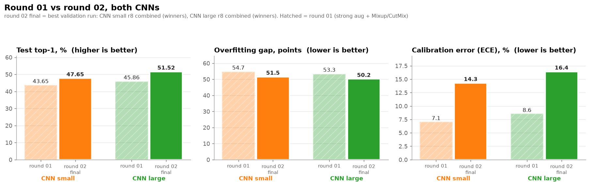

*Hatched = round 01, solid = round 02 final. Accuracy and gap improved for both models; calibration got worse (both final models are under-confident, see [section 7.3](#73-are-the-confidence-numbers-honest)).*

---

## 2. The two models

The models are the same as in round 01, plus one new option (drop-path, off unless a run turns it on).

| | `cnn_small` | `cnn_large` |
|---|---|---|
| Purpose | **Matched** to PatchVision-X's size (4.27 M): the fair comparison | ResNet-18 layout: *what does extra CNN capacity buy?* |
| Stage widths (channels) | 39, 78, 156, 312 | 64, 128, 256, 512 |
| Blocks per stage | 2, 2, 2, 2 | 2, 2, 2, 2 |
| Parameters | **4.217 M** | **11.279 M** |
| Compute per photo | 1.40 GFLOPs | 3.63 GFLOPs |
| Inference, 1 photo (RTX 5090) | 1.54 ms | 1.49 ms |
| Pretrained weights | none | none |

Both share the same design: a 7×7 stem with max-pooling, four stages of two residual blocks (3×3 convolutions with BatchNorm and ReLU, plus a shortcut), global average pooling, and a 200-way linear layer. Written from scratch in [`cnn/model.py`](cnn/model.py). The only difference between the two is the stage widths.

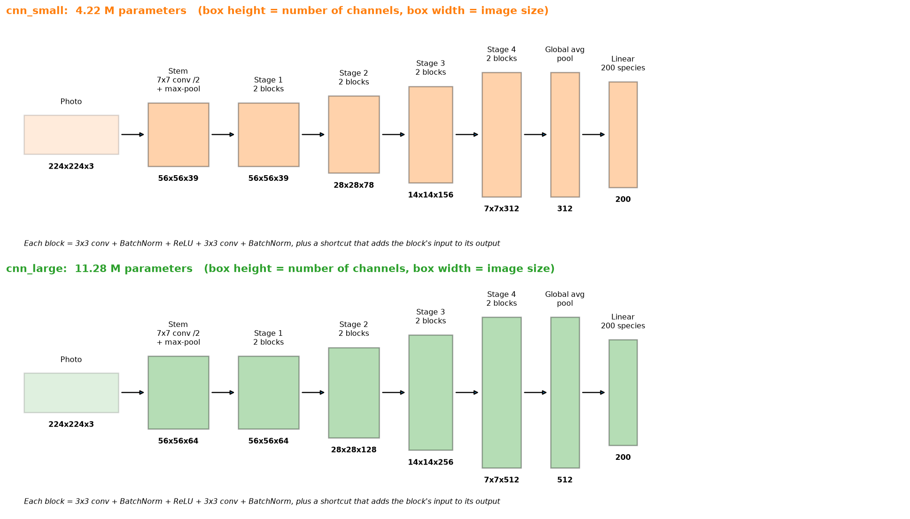

<details>
<summary><b>Where the parameters are, and the full model summaries (click to open)</b></summary>

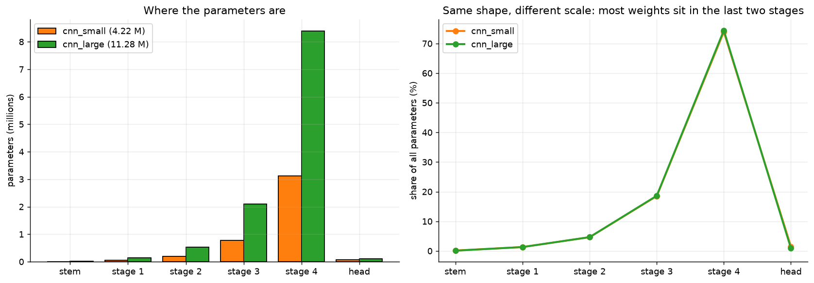

In both models **92 to 93 %** of the weights sit in the last two stages; stage 4 alone holds about 74 %. Widening those late stages is what makes `cnn_large` so much bigger.

Every layer, parameter count, loss, optimizer and training setting is written out in [`../CNN_small_model_summary.md`](../CNN_small_model_summary.md) and [`../CNN_large_model_summary.md`](../CNN_large_model_summary.md).

</details>

---

## 3. What changed from round 01

| Setting | Round 01 | **Round 02 base recipe (r0)** |
|---|---|---|
| Augmentation | `strong`: random crop + flip + rotate + colour jitter + random erase, **all stacked on every photo** | `auto` (from the [preprocessing notebook](../../patchvision_advanced_preprocessing.ipynb), section E): random crop (35 to 100 %) + flip + **one** random TrivialAugment operation + random erase (25 %) |
| Mixup / CutMix | on (one of the two on every batch) | **off: photos are never mixed** |
| Stopping | early stopping, patience 60 | **off: every run trains the full 300 epochs**, so all runs get the same budget |
| Everything else | AdamW 5e-4, weight decay 0.05, label smoothing 0.1, 10 warm-up epochs + cosine, batch 64, EMA, bf16 | unchanged |

**Switched off, as in round 01**, because they need attention maps or a token grid, which a CNN doesn't have: the bird-box attention loss, the flip-consistency loss, and the box-guided crop. The CNN never sees the bird bounding boxes. Data pipeline, optimizer, schedule, EMA and metrics are imported from `../../ViT_PatchVisionX/patchvision`, so both studies are measured identically.

Two **new tools** were added to the CNN code for this round (both off in r0):

<details>
<summary><b>Drop-path (stochastic depth), in simple words (click to open)</b></summary>

The CNN is a stack of 8 residual blocks. With drop-path, **during training only**, each block is skipped for a random subset of the photos in a batch (the photo just takes the shortcut around it). The network can't lean on any single block, so it memorizes less. **At test time every block is used.** The skip probability grows from 0 at the first block to the chosen value at the last one, exactly like the ViT's drop-path. Code: [`cnn/model.py`](cnn/model.py).

</details>

<details>
<summary><b>SAM (Sharpness-Aware Minimization), in simple words (click to open)</b></summary>

Normal training moves the weights downhill on the loss. SAM first takes a small step to the **worst nearby point**, measures the slope there, comes back, and moves using that slope. This prefers "flat valleys", where small changes to the weights don't hurt, which tend to generalize better. It costs two forward/backward passes per batch. Code: the SAM step in [`cnn/engine.py`](cnn/engine.py) (Foret et al., ICLR 2021, rho 0.05).

</details>

---

## 4. The plan: three rounds of training

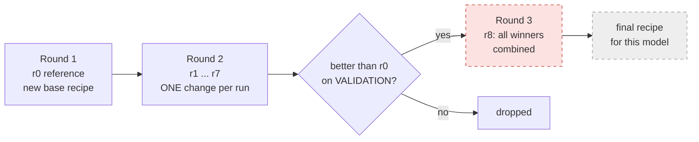

| Run | The one change (on top of r0) | Why |
|---|---|---|
| r0_reference | nothing | the new reference every run is compared to |
| r1 / r2 / r3 | drop-path 0.2 / 0.4 / 0.5 | 0.3 won for the ViT in E4; 0.4 to 0.5 might suit a small model less, so three values |
| r4 | label smoothing 0.1 → 0.2 | softer targets, less over-confident memorizing |
| r5 / r6 | weight decay 0.05 → 0.1 / 0.2 | keep weights small, a classic anti-memorizing penalty |
| r7 | SAM optimizer | prefers flat minima, reported to help small-data training from scratch |
| r8 | **winners of r1 to r7 combined** | do the gains add up? ([section 9](#9-round-3-r8-the-winners-combined)) |

Rules: **one seed (42)**; winners are picked on **validation only** (600 photos); the test set is read once per run, at the end, for the record. Each model gets **its own** best combination, after the same search with the same budget.

| | CNN small | CNN large |
|---|---|---|
| r0 to r7 | done | done |
| r8 combined | done | **not run yet** |

---

## 5. Results: every run, for both models

### 5.1 CNN small

| Run | What changes | Best epoch | **Val top-1** | vs r0 | Gap (pts) | Test top-1 | Test top-5 | Test macro-F1 | Test ECE |
|---|---|---|---|---|---|---|---|---|---|
| r0_reference | nothing (new base recipe) | 185 | 44.67 % |  | 55.3 | 43.75 % | 69.69 % | 43.42 % | 2.22 % |
| r1_droppath0.2 | drop-path 0 → 0.2 | 227 | 46.33 % | +1.67 | 54.0 | 43.82 % | 70.31 % | 43.62 % | 2.28 % |
| r2_droppath0.4 | drop-path 0 → 0.4 | 227 | 42.67 % | −2.00 | 55.7 | 42.30 % | 69.80 % | 42.23 % | 2.02 % |
| r3_droppath0.5 | drop-path 0 → 0.5 | 231 | 40.67 % | −4.00 | 53.7 | 40.16 % | 67.79 % | 39.98 % | 1.80 % |
| r4_labelsmooth0.2 | label smoothing 0.1 → 0.2 | 227 | 46.83 % | +2.17 | 54.2 | 45.32 % | 70.02 % | 44.75 % | 15.71 % |
| r5_wd0.1 | weight decay 0.05 → 0.1 | 231 | 46.67 % | +2.00 | 53.5 | 45.03 % | 69.66 % | 44.79 % | 6.09 % |
| r6_wd0.2 | weight decay 0.05 → 0.2 | 188 | 48.00 % | +3.33 | 52.3 | 47.43 % | 73.39 % | 47.02 % | 3.87 % |
| r7_sam | SAM optimizer (rho 0.05) | 113 | 44.83 % | +0.17 | 53.3 | 43.11 % | 71.11 % | 42.89 % | 1.98 % |
| **r8_combined** | weight decay 0.2 + label smoothing 0.2 + drop-path 0.2 | 236 | **48.67 %** | **+4.00** | **51.5** | **47.65 %** | **74.63 %** | **47.46 %** | 14.27 % |

### 5.2 CNN large

| Run | What changes | Best epoch | **Val top-1** | vs r0 | Gap (pts) | Test top-1 | Test top-5 | Test macro-F1 | Test ECE |
|---|---|---|---|---|---|---|---|---|---|
| r0_reference | nothing (new base recipe) | 165 | 45.83 % |  | 54.2 | 46.03 % | 71.87 % | 45.65 % | 4.74 % |
| r1_droppath0.2 | drop-path 0 → 0.2 | 194 | 46.50 % | +0.67 | 53.8 | 46.62 % | 72.02 % | 46.39 % | 3.67 % |
| r2_droppath0.4 | drop-path 0 → 0.4 | 216 | 45.00 % | −0.83 | 55.2 | 44.62 % | 71.16 % | 44.64 % | 2.33 % |
| r3_droppath0.5 | drop-path 0 → 0.5 | 276 | 43.17 % | −2.67 | 56.7 | 43.55 % | 70.42 % | 43.71 % | 1.99 % |
| r4_labelsmooth0.2 | label smoothing 0.1 → 0.2 | 237 | 48.50 % | +2.67 | 52.0 | 47.89 % | 71.56 % | 47.47 % | 23.01 % |
| r5_wd0.1 | weight decay 0.05 → 0.1 | 199 | 47.67 % | +1.83 | 52.8 | 47.89 % | 71.97 % | 47.49 % | 9.86 % |
| **r6_wd0.2** | weight decay 0.05 → 0.2 | 211 | **50.50 %** | **+4.67** | **50.0** | **50.28 %** | **73.85 %** | **49.92 %** | 12.62 % |
| r7_sam | SAM optimizer (rho 0.05) | 150 | 47.33 % | +1.50 | 52.7 | 46.82 % | 71.80 % | 46.60 % | 4.64 % |
| r8_combined | *not run yet* | | | | | | | | |

*Gap = accuracy on augmentation-free training photos minus validation accuracy, at the chosen epoch. ECE = calibration error, lower is better. Every run: 300 epochs, about 31 to 32 minutes on the RTX 5090.*

### 5.3 Are the differences real? Paired test on the same test photos

Each run against its own model's r0, on the 5,794 test photos:

| Run vs r0 | CNN small: change | only run right / only r0 right | p | CNN large: change | only run right / only r0 right | p |
|---|---|---|---|---|---|---|
| r1 drop-path 0.2 | +0.09 | 438 / 433 | 0.89 | +0.60 | 415 / 380 | 0.23 |
| r2 drop-path 0.4 | −1.38 | 426 / 506 | **0.010** (worse) | −1.42 | 402 / 484 | **0.007** (worse) |
| r3 drop-path 0.5 | −3.52 | 407 / 611 | **< 0.0001** (worse) | −2.49 | 399 / 543 | **< 0.0001** (worse) |
| r4 label smoothing 0.2 | +1.62 | 502 / 408 | **0.002** | +1.86 | 465 / 357 | **0.0002** |
| r5 weight decay 0.1 | +1.33 | 512 / 435 | **0.014** | +1.86 | 429 / 321 | **0.0001** |
| **r6 weight decay 0.2** | **+3.71** | 518 / 303 | **< 0.0001** | **+4.26** | 534 / 287 | **< 0.0001** |
| r7 SAM | −0.62 | 469 / 505 | 0.26 | +0.81 | 418 / 371 | 0.10 |
| r8 combined | +3.94 | 595 / 367 | **< 0.0001** | *pending* | | |

Bold p = significant at 5 %. This shows the differences are not caused by which test photos happened to be drawn. It does **not** show they survive a different random seed; that needs the three-seed runs. Tables: [`docs/tables/`](docs/tables).

### 5.4 Does each change help both models the same way?

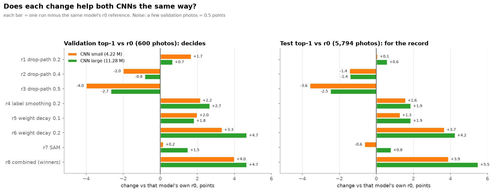

* **Yes, mostly.** The ranking of the changes is almost the same for both CNNs: weight decay 0.2 best, then label smoothing 0.2 and weight decay 0.1, drop-path 0.2 small, drop-path 0.4 and 0.5 harmful.
* **Weight decay 0.2 helps the larger model more** (+4.7 vs +3.3 on validation). A model with more weights has more to gain from keeping them small.
* **Drop-path hurts the larger model less** (−2.7 vs −4.0 at 0.5), but it still doesn't help either one.
* **SAM is the one disagreement:** +1.5 validation points for CNN large (9 photos, enough to count as a winner) but +0.2 for CNN small (one photo). On test, neither gain is significant.

### 5.5 Which changes reduce memorizing without hurting accuracy?

The goal is **up and to the left**: more accurate *and* a smaller gap.

| CNN small | CNN large |
|---|---|
|  | 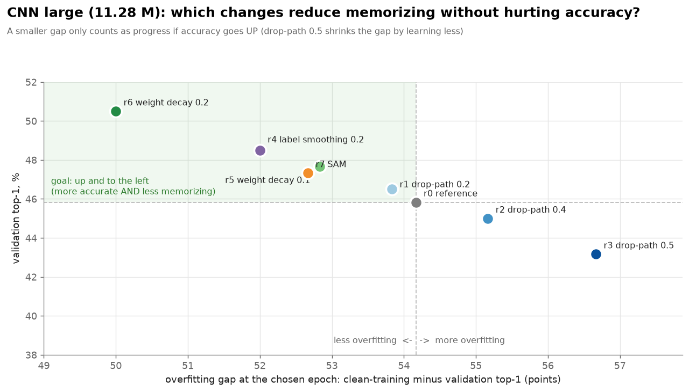 |

For both models, weight decay 0.2 is furthest up and left (for CNN small together with r8). Drop-path 0.5 shrinks the gap for CNN small only because it learns **less** overall, which is not progress; for CNN large it even makes the gap bigger.

### 5.6 How strong should each setting be?

| CNN small | CNN large |
|---|---|
|  | 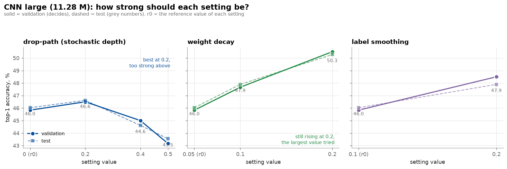 |

The same picture for both models:
* **Drop-path:** best at 0.2, harmful at 0.4 and 0.5. Skipping blocks that often is too much for a CNN with only 8 blocks.
* **Weight decay:** better at every step (0.05 → 0.1 → 0.2) and **still rising at 0.2, the largest value tried**, for both models. A larger value might help more; this is an open question ([section 9](#9-round-3-r8-the-winners-combined)).
* **Label smoothing:** 0.2 beats 0.1.

---

## 6. How training went

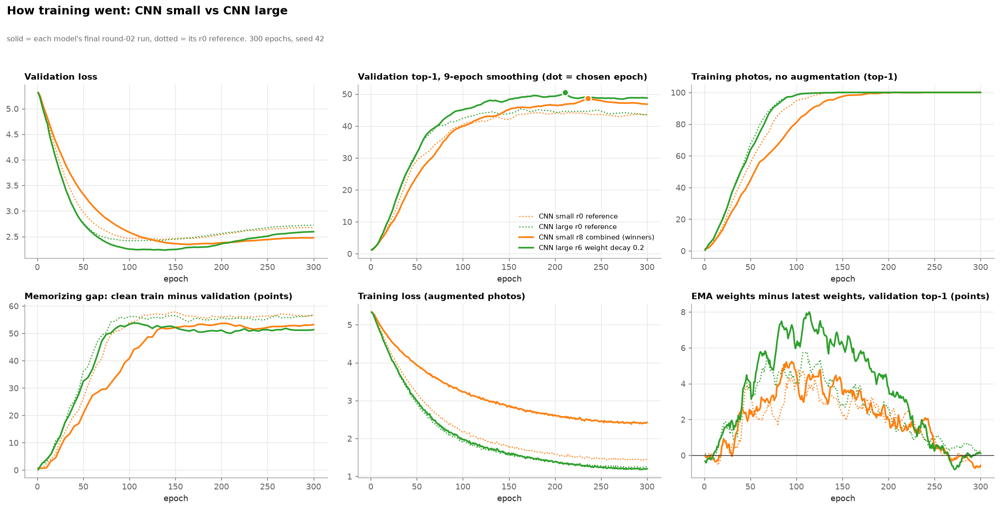

What the six panels show (solid = each model's final run, dotted = its r0 reference):
* **Validation loss (top left):** with weight decay, both final runs reach a lower minimum than their r0 (CNN small 2.35 at epoch 164, CNN large 2.24 at epoch 138; round 01's were 2.50 and 2.44) and rise less afterwards.
* **Validation top-1 (top middle):** CNN large is ahead of CNN small throughout. Both final runs keep climbing until epoch 200+ (chosen epochs 236 and 211), later than their r0 (185 and 165).
* **Training photos (top right) and gap (bottom left):** every run still reaches **100 %** on the training photos. CNN small's r8 gets there more slowly (its regularizers slow the memorizing down), but in the end its gap is only a few points smaller than r0's.
* **Training loss (bottom middle):** r8's training loss stays high because label smoothing 0.2 makes the targets softer, not because it learns less.
* **EMA (bottom right):** evaluating the averaged weights instead of the latest ones is worth up to 8 points in the middle of training (on average +2.4 for CNN small and +4.0 for CNN large after epoch 50). By the end, when the learning rate is tiny, the two are the same.

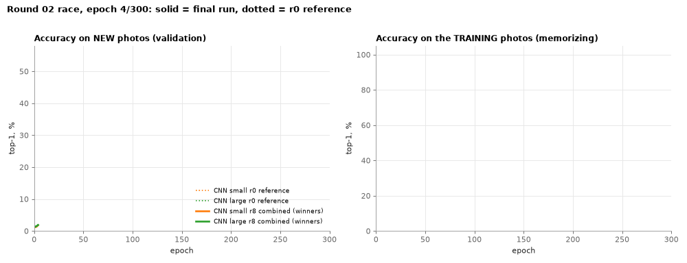

*The race: validation accuracy (left) and accuracy on the training photos (right). Dotted = r0 reference, solid = final run.*

<details>
<summary><b>Every run's learning curves and race, per model (click to open)</b></summary>

| CNN small | CNN large |
|---|---|
| 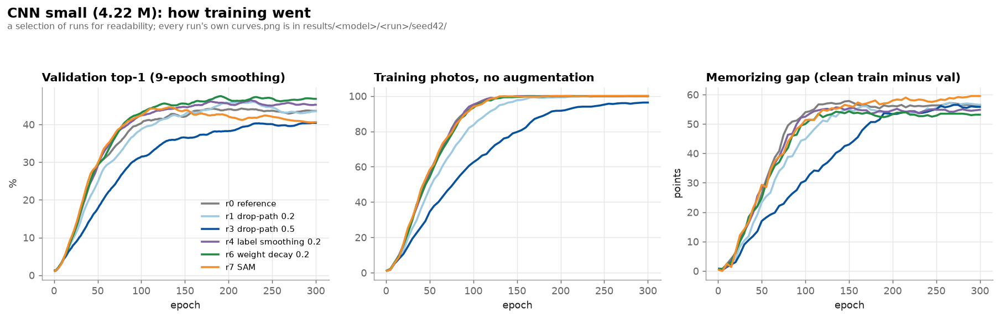 | 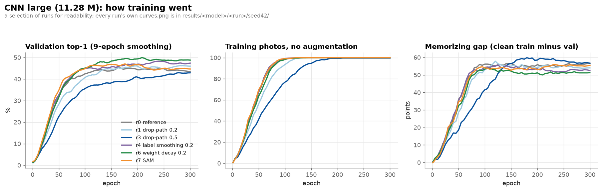 |
| 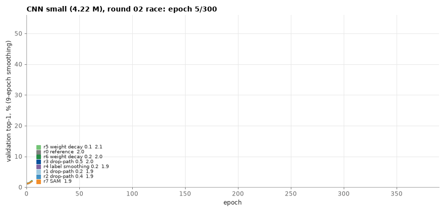 | 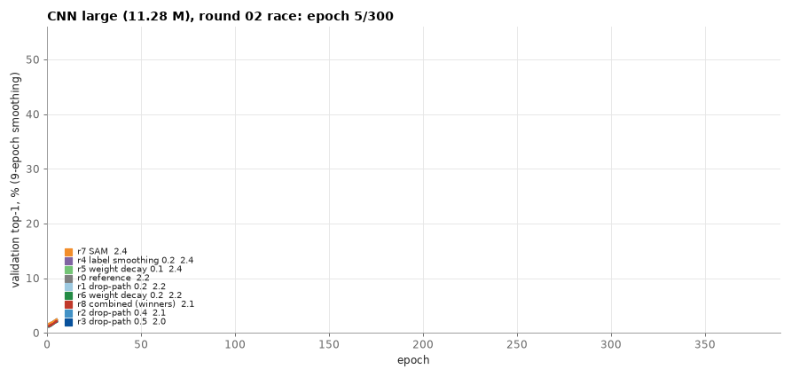 |

The run-by-run overviews (validation and test top-1 of every run against r0):


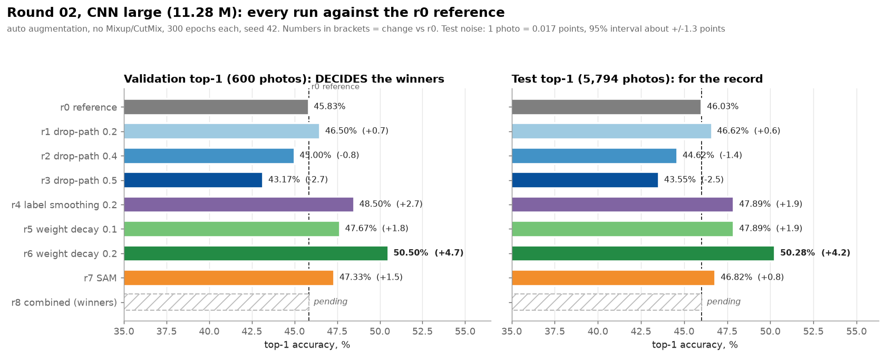

</details>

---

## 7. CNN small vs CNN large in detail

### 7.1 Numbers

The final run of each model, all on the same test photos:

| | `cnn_small` (r8 combined) | `cnn_large` (r6 weight decay 0.2)* |
|---|---|---|
| **Test top-1** | 47.65 % | **50.28 %** |
| Test top-5 | **74.63 %** | 73.85 % |
| Test macro-F1 | 47.46 % | **49.92 %** |
| Validation top-1 at the chosen epoch | 48.67 % | **50.50 %** |
| Calibration error (ECE, lower is better) | 14.27 % | **12.62 %** |
| Memorizing gap (clean-train minus validation) | 51.5 pts | **50.0 pts** |
| Chosen epoch / epochs run | 236 / 300 | 211 / 300 |
| Training time (RTX 5090) | 31.1 min | 31.9 min |
| Time per epoch | 6.2 s | 6.4 s |
| Inference, 1 photo (RTX 5090) | 1.54 ms | 1.49 ms |

\* until CNN large's r8 is run.

`cnn_large` wins on top-1, macro-F1, gap and calibration; `cnn_small` is slightly ahead on top-5. Both take the same time per epoch because data loading, not the network, limits speed at this size. Proper speed measurements are in [`../../Inference_Optimization`](../../Inference_Optimization).

### 7.2 Is CNN large really better? Paired test

| Comparison | Large minus small | Only large right | Only small right | p |
|---|---|---|---|---|
| Round 01 | +2.2 | | | significant (see [round 01](../01_strongaug_mixup_cutmix)) |
| Round 02 r0 vs r0 (same recipe) | +2.28 | 547 | 413 | **1.7e-5** |
| Round 02 final vs final | **+2.63** | 570 | 417 | **1.3e-6** |

Over all 5,794 test photos, the two final models are both right on **2,344** and both wrong on **2,463**. The larger model's lead is real and stays at 2 to 3 points whatever the recipe.

### 7.3 Are the confidence numbers honest?

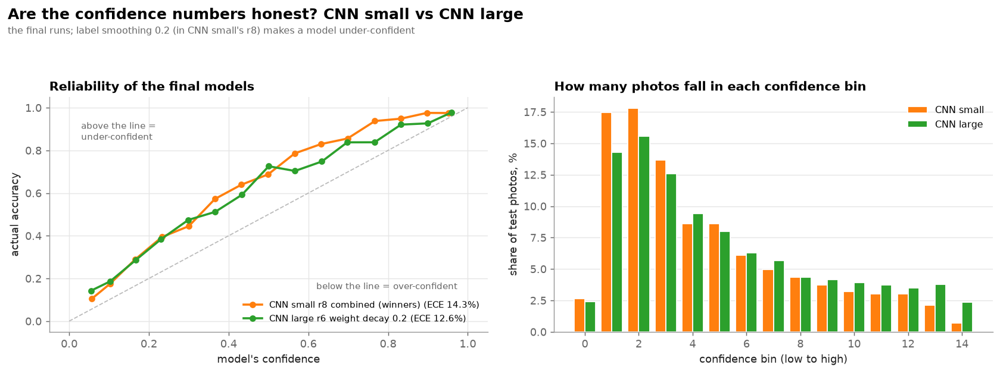

Both final models sit **above** the diagonal, meaning **under-confident**: they are right more often than they say. On average CNN small's r8 says 33 % but is right 48 % of the time; CNN large's r6 says 38 % but is right 50 % of the time.
* For CNN small this comes from **label smoothing 0.2** (r6, weight decay alone, is well calibrated: ECE 3.9 %).
* For CNN large, **weight decay 0.2 alone already does it** (ECE 12.6 %; its r0 was 4.7 %).

Accuracy is unaffected, and this kind of error can be fixed after training with temperature scaling.

<details>
<summary><b>Calibration of every run, per model (click to open)</b></summary>


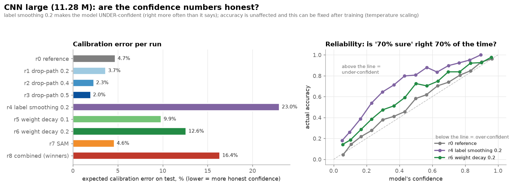

</details>

### 7.4 Which species are easy and which are hard?

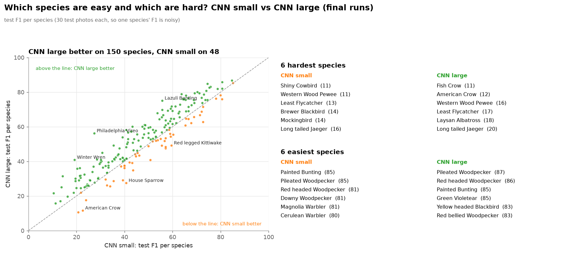

* **CNN large has the higher F1 on 132 of 200 species**, CNN small on 66, with 2 ties (round 01: 123 vs 73). The typical species is 2.7 F1 points better with the larger model.
* **Easiest species** have a distinctive colour or pattern, for both models: Painted Bunting (F1 85 / 87), Pileated Woodpecker (85 / 85), Red headed Woodpecker (81 / 83).
* **Hardest species** are plain look-alikes: flycatchers, pewees, cowbirds, blackbirds and crows. Least Flycatcher (13 / 4) and Western Wood Pewee (11 / 12) are near the bottom for both.
* **Biggest differences:** CNN large is much better on Black throated Blue Warbler, Louisiana Waterthrush and Mockingbird (+15 to +17); CNN small is much better on Cape May Warbler, Indigo Bunting and Boat tailed Grackle (−16 to −17). With 30 test photos per species, single-species differences like these are noisy.

### 7.5 What do the models confuse?

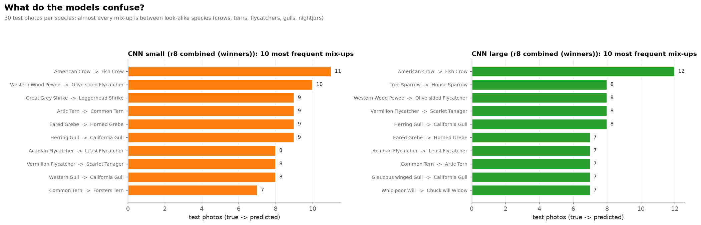

The mix-ups are what a human birder would struggle with too: **Western Wood Pewee → Olive sided Flycatcher** (top two for both models), **American Crow → Fish Crow**, **Arctic / Least / Caspian Tern ↔ Common / Forster's / Elegant Tern**, **Eared Grebe → Horned Grebe**, **Whip poor Will ↔ Chuck will Widow**, **Indigo Bunting → Blue Grosbeak**.

### 7.6 Sample predictions

Twelve test photos spread evenly through the test set (**not hand-picked**). Green = correct, red = wrong. On these 12, `cnn_small` is right on 7 and `cnn_large` on 6, which shows how little a dozen photos can tell you; over all 5,794, CNN large is 2.6 points ahead.

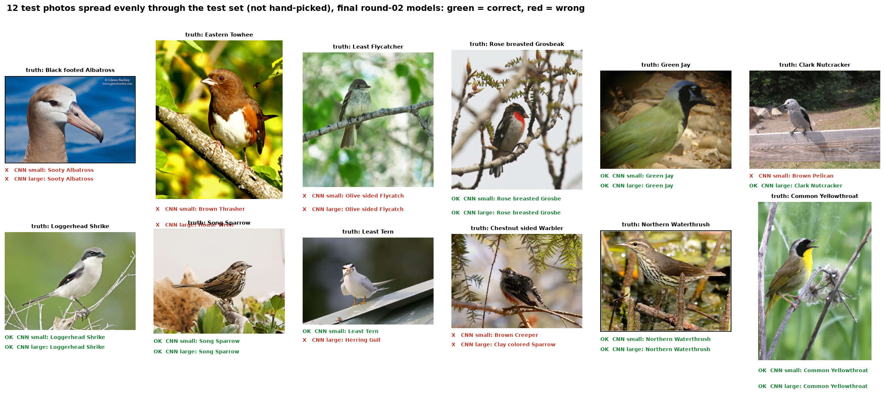

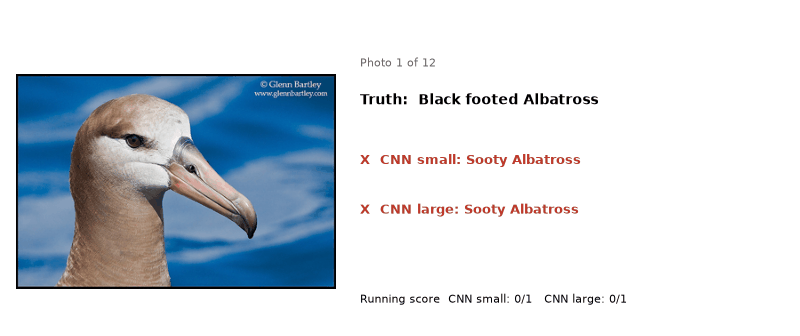

<details>
<summary><b>Each run's own plots, as saved by the trainer (click to open)</b></summary>

| Run | CNN small | CNN large |
|---|---|---|
| r0_reference | [curves](results/cnn_small/r0_reference/seed42/curves.png) · [confusion](results/cnn_small/r0_reference/seed42/test_confusion_matrix.png) · [reliability](results/cnn_small/r0_reference/seed42/test_reliability.png) | [curves](results/cnn_large/r0_reference/seed42/curves.png) · [confusion](results/cnn_large/r0_reference/seed42/test_confusion_matrix.png) · [reliability](results/cnn_large/r0_reference/seed42/test_reliability.png) |
| r1_droppath0.2 | [curves](results/cnn_small/r1_droppath0.2/seed42/curves.png) · [confusion](results/cnn_small/r1_droppath0.2/seed42/test_confusion_matrix.png) · [reliability](results/cnn_small/r1_droppath0.2/seed42/test_reliability.png) | [curves](results/cnn_large/r1_droppath0.2/seed42/curves.png) · [confusion](results/cnn_large/r1_droppath0.2/seed42/test_confusion_matrix.png) · [reliability](results/cnn_large/r1_droppath0.2/seed42/test_reliability.png) |
| r2_droppath0.4 | [curves](results/cnn_small/r2_droppath0.4/seed42/curves.png) · [confusion](results/cnn_small/r2_droppath0.4/seed42/test_confusion_matrix.png) · [reliability](results/cnn_small/r2_droppath0.4/seed42/test_reliability.png) | [curves](results/cnn_large/r2_droppath0.4/seed42/curves.png) · [confusion](results/cnn_large/r2_droppath0.4/seed42/test_confusion_matrix.png) · [reliability](results/cnn_large/r2_droppath0.4/seed42/test_reliability.png) |
| r3_droppath0.5 | [curves](results/cnn_small/r3_droppath0.5/seed42/curves.png) · [confusion](results/cnn_small/r3_droppath0.5/seed42/test_confusion_matrix.png) · [reliability](results/cnn_small/r3_droppath0.5/seed42/test_reliability.png) | [curves](results/cnn_large/r3_droppath0.5/seed42/curves.png) · [confusion](results/cnn_large/r3_droppath0.5/seed42/test_confusion_matrix.png) · [reliability](results/cnn_large/r3_droppath0.5/seed42/test_reliability.png) |
| r4_labelsmooth0.2 | [curves](results/cnn_small/r4_labelsmooth0.2/seed42/curves.png) · [confusion](results/cnn_small/r4_labelsmooth0.2/seed42/test_confusion_matrix.png) · [reliability](results/cnn_small/r4_labelsmooth0.2/seed42/test_reliability.png) | [curves](results/cnn_large/r4_labelsmooth0.2/seed42/curves.png) · [confusion](results/cnn_large/r4_labelsmooth0.2/seed42/test_confusion_matrix.png) · [reliability](results/cnn_large/r4_labelsmooth0.2/seed42/test_reliability.png) |
| r5_wd0.1 | [curves](results/cnn_small/r5_wd0.1/seed42/curves.png) · [confusion](results/cnn_small/r5_wd0.1/seed42/test_confusion_matrix.png) · [reliability](results/cnn_small/r5_wd0.1/seed42/test_reliability.png) | [curves](results/cnn_large/r5_wd0.1/seed42/curves.png) · [confusion](results/cnn_large/r5_wd0.1/seed42/test_confusion_matrix.png) · [reliability](results/cnn_large/r5_wd0.1/seed42/test_reliability.png) |
| r6_wd0.2 | [curves](results/cnn_small/r6_wd0.2/seed42/curves.png) · [confusion](results/cnn_small/r6_wd0.2/seed42/test_confusion_matrix.png) · [reliability](results/cnn_small/r6_wd0.2/seed42/test_reliability.png) | [curves](results/cnn_large/r6_wd0.2/seed42/curves.png) · [confusion](results/cnn_large/r6_wd0.2/seed42/test_confusion_matrix.png) · [reliability](results/cnn_large/r6_wd0.2/seed42/test_reliability.png) |
| r7_sam | [curves](results/cnn_small/r7_sam/seed42/curves.png) · [confusion](results/cnn_small/r7_sam/seed42/test_confusion_matrix.png) · [reliability](results/cnn_small/r7_sam/seed42/test_reliability.png) | [curves](results/cnn_large/r7_sam/seed42/curves.png) · [confusion](results/cnn_large/r7_sam/seed42/test_confusion_matrix.png) · [reliability](results/cnn_large/r7_sam/seed42/test_reliability.png) |
| r8_combined | [curves](results/cnn_small/r8_combined/seed42/curves.png) · [confusion](results/cnn_small/r8_combined/seed42/test_confusion_matrix.png) · [reliability](results/cnn_small/r8_combined/seed42/test_reliability.png) | *not run yet* |

Full per-species tables, predictions for every test photo, per-epoch histories and logs are in `results/<model>/<run>/seed42/`. A one-line summary of every finished run is in [`results/cnn_small/queue_summary.csv`](results/cnn_small/queue_summary.csv) and [`results/cnn_large/queue_summary.csv`](results/cnn_large/queue_summary.csv).

</details>

---

## 8. Did it improve? Round 02 vs round 01

Each model's final round-02 run against the **original** model from round 01, on the same 5,794 test photos:

| | CNN small: round 01 | **CNN small: r8** | Change | CNN large: round 01 | **CNN large: r6*** | Change |
|---|---|---|---|---|---|---|
| Test top-1 | 43.65 % | **47.65 %** | **+4.00** | 45.86 % | **50.28 %** | **+4.42** |
| Test top-5 | 69.02 % | **74.63 %** | +5.61 | 71.16 % | **73.85 %** | +2.69 |
| Test macro-F1 | 43.54 % | **47.46 %** | +3.92 | 45.79 % | **49.92 %** | +4.13 |
| Validation top-1 | 44.50 % | **48.67 %** | +4.17 | 46.67 % | **50.50 %** | +3.83 |
| Overfitting gap | 54.7 pts | **51.5 pts** | −3.2 | 53.3 pts | **50.0 pts** | −3.3 |
| Lowest validation loss | 2.50 | **2.35** | better | 2.44 | **2.24** | better |
| Calibration error (ECE) | **7.07 %** | 14.27 % | worse | **8.56 %** | 12.62 % | worse |
| Photos only new right / only old right | | 655 / 422 | p ≈ 1e-12 | | 651 / 393 | p ≈ 1e-15 |
| Species better / worse / same (F1) | | 132 / 63 / 5 | median +3.1 | | 138 / 59 / 3 | median +4.0 |

\* until CNN large's r8 is run.

| CNN small | CNN large |
|---|---|
| 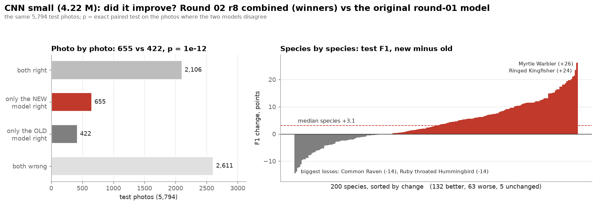 | 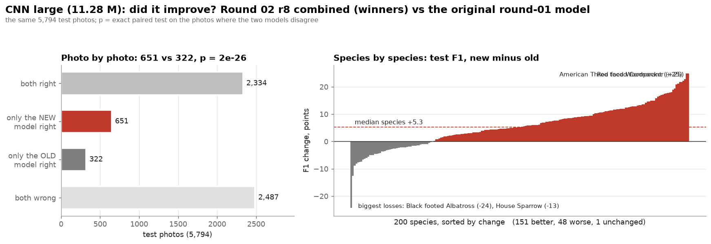 |

* **Both models improved by about 4 points**, and on the same test photos both gains are far beyond chance.
* **Where the gain came from:** the new base recipe alone (r0) is no better than round 01 for either model (CNN small 533 vs 528 photos, p = 0.90; CNN large 517 vs 506, p = 0.75). The gain comes from the **regularization search**, mainly weight decay 0.2.
* **What did not improve:** both models still get 100 % of their training photos right, and their confidence is less honest than before (fixable after training with temperature scaling).

<details>
<summary><b>Round 01 vs round 02 per model, with the r0 reference in between (click to open)</b></summary>


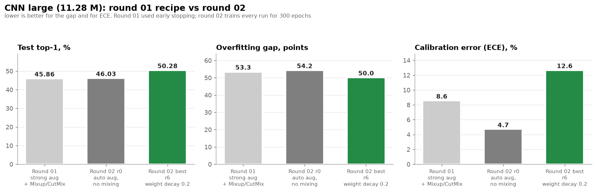

</details>

---

## 9. Round 3: r8, the winners combined

Each setting's best value goes into r8 if it beat that model's own r0 on validation by more than one photo (0.17 points).

| Setting | CNN small: gain alone (val) | In CNN small's r8? | CNN large: gain alone (val) | In CNN large's r8? |
|---|---|---|---|---|
| weight decay | **0.2**: +3.33 (better than 0.1) | yes | **0.2**: +4.67 (better than 0.1) | yes |
| label smoothing | **0.2**: +2.17 | yes | **0.2**: +2.67 | yes |
| drop-path | **0.2**: +1.67 (0.4 and 0.5 worse) | yes | **0.2**: +0.67 (0.4 and 0.5 worse) | yes |
| SAM | +0.17 (one photo; −0.62 on test) | **no** | +1.50 (9 photos) | **yes** |

### CNN small: done

| Run | Val top-1 | vs r0 | Gap | Test top-1 | Test top-5 | Test macro-F1 | Test ECE |
|---|---|---|---|---|---|---|---|
| r6_wd0.2 (best single change) | 48.00 % | +3.33 | 52.3 | 47.43 % | 73.39 % | 47.02 % | **3.87 %** |
| **r8_combined** | **48.67 %** | **+4.00** | **51.5** | **47.65 %** | **74.63 %** | **47.46 %** | 14.27 % |

* By the rule of this study (best on validation), **r8 is the final CNN small recipe**.
* The winners **add up only a little**: r8 is +0.22 test points above r6 alone, which is not significant (p = 0.69). Almost all of the gain comes from weight decay.
* r8 is **under-confident** (ECE 14.3 %), a side effect of label smoothing 0.2. If honest confidence matters, r6 is the simpler alternative with nearly the same accuracy.

The exact settings are in [`cnn/config.py`](cnn/config.py) (`COMBINED`) and in [`results/cnn_small/r8_combined/seed42/config.json`](results/cnn_small/r8_combined/seed42/config.json).

### CNN large: not run yet

> **Status: pending.** CNN large's r8 will combine **weight decay 0.2 + label smoothing 0.2 + drop-path 0.2 + SAM**. Unlike CNN small, SAM qualifies here. Until it is run, r6 (weight decay 0.2, 50.28 % test) is CNN large's best run and stands in for its final model everywhere on this page.

| Run | Val top-1 | vs r0 | Gap | Test top-1 | Test top-5 | Test macro-F1 | Test ECE |
|---|---|---|---|---|---|---|---|
| r6_wd0.2 (best single change) | 50.50 % | +4.67 | 50.0 | 50.28 % | 73.85 % | 49.92 % | 12.62 % |
| r8_combined | *pending* | | | | | | |

**Still open, for both models:** weight decay was improving at 0.2, the largest value tried, so a larger value (0.3, 0.5) might help more. Testing it would be an extra run for every model.

---

## 10. What we learned

1. **Mixup/CutMix were not doing much for accuracy here.** For both CNNs, the new base recipe (r0) is within 0.2 points of round 01 (not significant). Without Mixup/CutMix the reference models are much better calibrated (ECE 7.1 → 2.2 % for CNN small, 8.6 → 4.7 % for CNN large).
2. **Weight decay was the most under-tuned setting, for both models.** Round 01 used 0.05 (the ViT's value); 0.2 gives +3.7 (small) and +4.3 (large) test points, and the smallest gap. It helps the larger model more.
3. **Label smoothing 0.2 and weight decay 0.1 help too**, for both models (+1.3 to +1.9 test points, all significant).
4. **Drop-path barely helps a CNN with 8 blocks.** 0.2 is not significant on test for either model; 0.4 and 0.5 hurt both.
5. **SAM gave no measurable gain on test** for either model (−0.6 and +0.8, neither significant), though it passed the validation bar for CNN large.
6. **The winners add up only a little** (CNN small: r8 +0.2 over weight decay alone, not significant; CNN large: r8 pending).
7. **CNN large stays 2 to 3 points ahead of CNN small**, in every round and with every recipe, and is ahead on 132 of 200 species. Its extra capacity is a steady, real gain.
8. **Memorizing is reduced, not solved.** The best gap is still 50 to 52 points: both CNNs still get about 100 % of their training photos right.

---

## 11. Limits

- **One seed.** Every number is seed 42. Gains of 1 to 2 points could move with another seed; the final recipes need three seeds.
- **CNN large's r8 is not run yet.** Its "final" numbers on this page are r6's.
- **Small validation set.** 600 photos decide the winners, so a difference of 1 to 2 validation points (6 to 12 photos) is within noise. r1 is the example: +1.7 on validation for CNN small, +0.1 on test.
- **Test set seen.** All test results were read. Decisions are still made on validation only.
- **The weight-decay search stopped at its best value.** 0.2 was the largest value tried and the best for both models, so the true optimum may be higher.
- **Calibration got worse.** Both final models are under-confident; this page reports raw confidences, without temperature scaling.
- **Training-time numbers are not a speed benchmark.** Data loading, not the GPU, limits the speed at this model size; proper speed measurements are in [`../../Inference_Optimization`](../../Inference_Optimization).

---

## 12. Run it yourself

Run everything from inside this folder. The shared data is read from the repository root (two levels up); results are written to `results/<model>/<run>/seed<seed>/`.

```powershell
cd CNN_Baseline/02_autoaug_nomix_regularization
python run_queue.py cnn_small                    # r0 ... r7 one after another, every step and epoch printed
python run_queue.py cnn_large                    # the same for CNN large
python train.py cnn_large r6_wd0.2 42            # a single run
python run_queue.py cnn_small r8_combined        # the combined run (its settings are in cnn/config.py, COMBINED)
python watch_training.py cnn_large r6_wd0.2 42   # live monitor, in a second terminal
python docs/make_figures.py                      # rebuild every figure, animation and table on this page
```

A finished run is skipped, and an interrupted one resumes from `last.pt`. Model weights (`*.pt`) are not stored in Git.

<details>
<summary><b>Load a trained model and predict (click to open)</b></summary>

```python
import sys, torch
sys.path.insert(0, ".")                                   # run from inside CNN_Baseline/02_autoaug_nomix_regularization/
from cnn.config import get_experiment
from cnn.model import build_model

exp = get_experiment("cnn_large", "r6_wd0.2")             # or ("cnn_small", "r8_combined")
model = build_model(exp.model)
ck = torch.load("results/cnn_large/r6_wd0.2/seed42/best_model.pt", map_location="cpu", weights_only=False)
model.load_state_dict(ck["state"])                        # the EMA weights of the chosen epoch
model.eval()
# model(x) takes a normalised (B, 3, 224, 224) tensor and returns (B, 200) species scores
```

</details>

### Layout

```
CNN_Baseline/02_autoaug_nomix_regularization/
├── README.md               this page
├── train.py                one run:   python train.py <model> <run> [seed]
├── run_queue.py            several runs in one terminal (r0 ... r7 by default)
├── watch_training.py       live monitor
├── cnn/
│   ├── config.py           base recipe, the run list (r0 ... r7), and each model's r8 winners (COMBINED)
│   ├── model.py            the CNN, now with drop-path (stochastic depth)
│   ├── engine.py           training / validation / test loop, now with the SAM step
│   ├── experiment.py       one-batch dry run
│   └── _vit.py             makes ../../ViT_PatchVisionX/patchvision importable (data, metrics, optimizer)
├── docs/
│   ├── make_figures.py     rebuilds every figure, animation and table on this page
│   ├── figures/  animations/  tables/  facts.txt
└── results/
    ├── cnn_small/<run>/seed42/   logs, curves, metrics, confusion matrix, predictions (+ queue_summary.csv)
    └── cnn_large/<run>/seed42/   the same for CNN large
```
