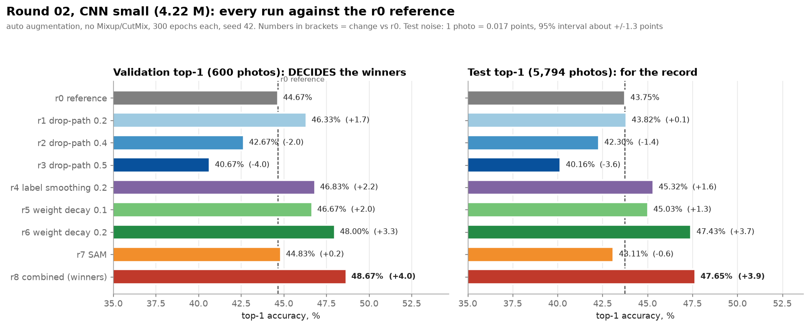
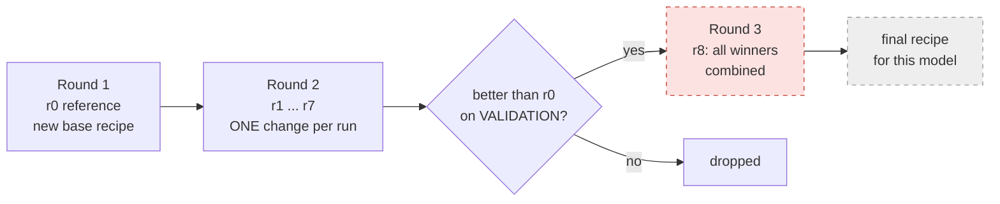
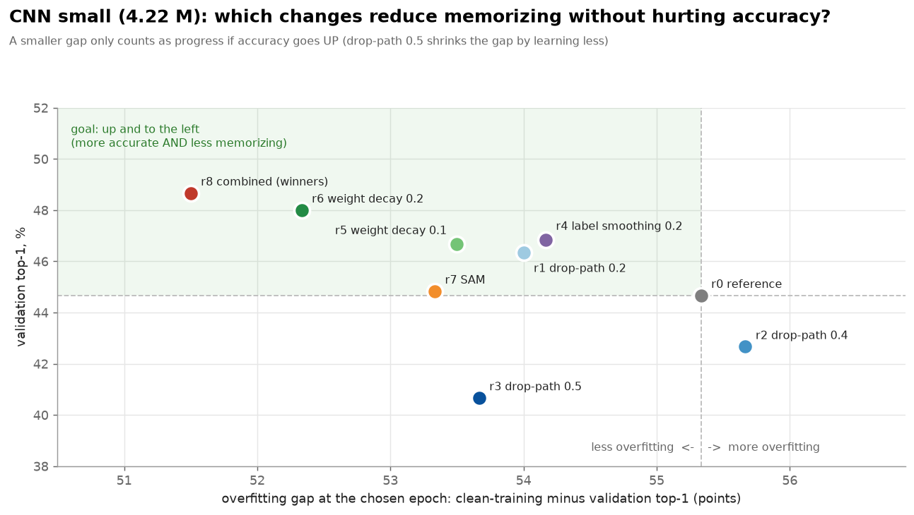
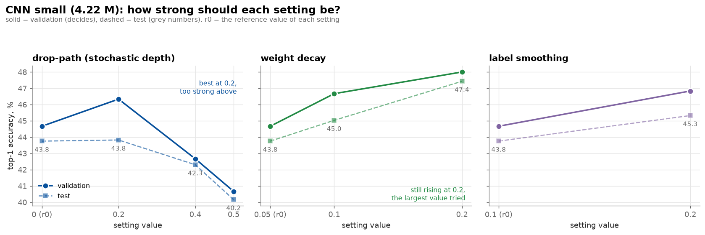
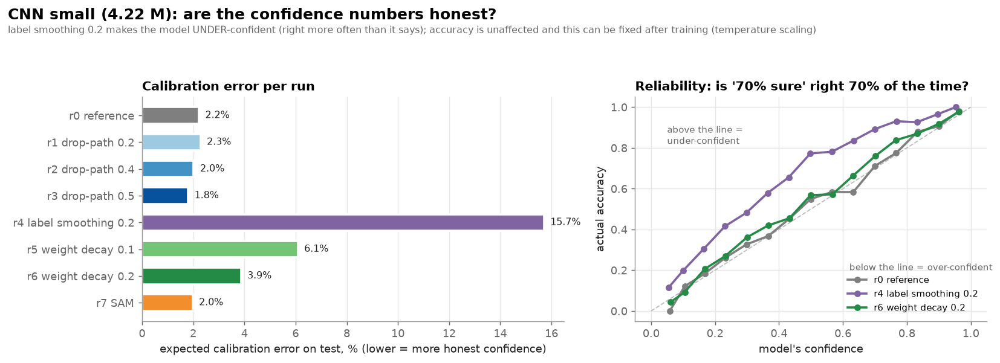
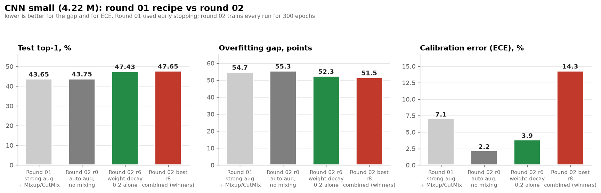
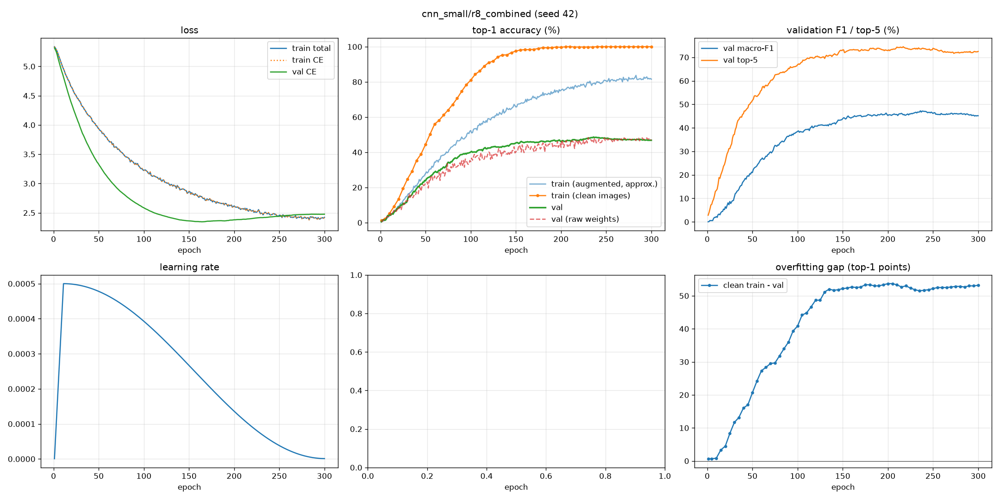
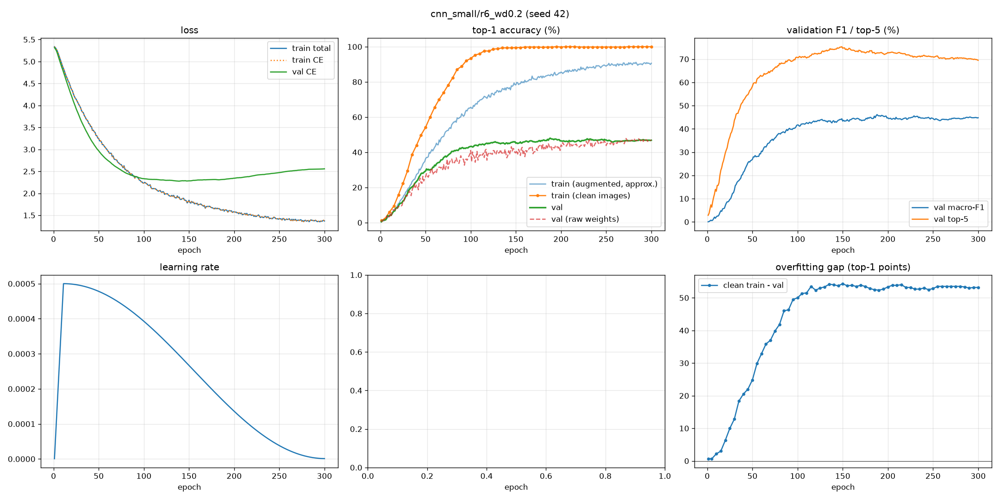

# CNN round 02: `auto` augmentation, no Mixup/CutMix, and a regularization search

     

Round 01 ([`../01_strongaug_mixup_cutmix`](../01_strongaug_mixup_cutmix)) showed that both CNNs **memorize** their training photos: about 100 % right on them, 44 to 46 % on new ones. This round asks one question: **which training changes reduce that memorizing, without hurting accuracy?**

It changes the base recipe (one augmentation at a time, no photo mixing), then tries one regularizer per run, and finally combines the ones that helped. The ViT and PatchVision-X will go through exactly the same round later, with the same settings, so the CNN-vs-ViT comparison stays fair.

> **Jump to:** [Result in one minute](#1-the-result-in-one-minute) · [What changed](#2-what-changed-from-round-01) · [The plan](#3-the-plan-three-rounds-of-training) · [Results](#4-results-cnn-small) · [Did it improve?](#48-did-it-improve-final-model-vs-the-original) · [What we learned](#5-what-we-learned-cnn-small) · [Round 3: r8](#6-round-3-r8-the-winners-combined) · [CNN large](#7-cnn-large) · [Limits](#8-limits) · [Run it](#9-run-it-yourself)

---

## 1. The result in one minute

<table>
<tr>
<td width="56%">

**CNN small (4.22 M parameters)**: the original model, the new reference, the best single change and the final combined recipe:

| Run | Val top-1 | **Test top-1** | Test top-5 | Gap |
|---|---|---|---|---|
| Round 01 recipe (original) | 44.5 % | 43.65 % | 69.02 % | 54.7 pts |
| r0 new reference | 44.67 % | 43.75 % | 69.69 % | 55.3 pts |
| r6 weight decay 0.2 | 48.00 % | 47.43 % | 73.39 % | 52.3 pts |
| **r8 combined (final)** | **48.67 %** | **47.65 %** | **74.63 %** | **51.5 pts** |

One seed (42), 5,794 unseen test photos, sampling noise about ±1.3 points.

</td>
<td>

1. **It improved: +4.0 test points over the original CNN small** (43.65 → 47.65 %), with 3.2 points less memorizing. On the same test photos the gain is far beyond chance (p ≈ 1e-12), and 132 of 200 species got better ([section 4.8](#48-did-it-improve-final-model-vs-the-original)).
2. **Stronger weight decay did almost all of it**: alone it gives +3.7 test points. Combining it with label smoothing 0.2 and drop-path 0.2 (r8) adds only +0.2 more, which is not significant.
3. **Removing Mixup/CutMix changed accuracy by almost nothing** (43.65 → 43.75 %) but made the confidence numbers far more honest (calibration error 7.1 → 2.2 %).
4. **The gap moved, but did not close**: 51.5 points is still a lot of memorizing.

</td>
</tr>
</table>



---

## 2. What changed from round 01

| Setting | Round 01 | **Round 02 base recipe (r0)** |
|---|---|---|
| Augmentation | `strong`: random crop + flip + rotate + colour jitter + random erase, **all stacked on every photo** | `auto` (from the [preprocessing notebook](../../patchvision_advanced_preprocessing.ipynb), section E): random crop (35 to 100 %) + flip + **one** random TrivialAugment operation + random erase (25 %) |
| Mixup / CutMix | on (one of the two on every batch) | **off: photos are never mixed** |
| Stopping | early stopping, patience 60 | **off: every run trains the full 300 epochs**, so all runs get the same budget |
| Everything else | AdamW 5e-4, weight decay 0.05, label smoothing 0.1, 10 warm-up epochs + cosine, batch 64, EMA, bf16 | unchanged |

Two **new tools** were added to the CNN code for this round (both off in r0):

<details>
<summary><b>Drop-path (stochastic depth), in simple words (click to open)</b></summary>

The CNN is a stack of 8 residual blocks. With drop-path, **during training only**, each block is skipped for a random subset of the photos in a batch (the photo just takes the shortcut around it). The network can't lean on any single block, so it memorizes less. **At test time every block is used.** The skip probability grows from 0 at the first block to the chosen value at the last one, exactly like the ViT's drop-path. Code: [`cnn/model.py`](cnn/model.py).

</details>

<details>
<summary><b>SAM (Sharpness-Aware Minimization), in simple words (click to open)</b></summary>

Normal training moves the weights downhill on the loss. SAM first takes a small step to the **worst nearby point**, measures the slope there, comes back, and moves using that slope. This prefers "flat valleys", where small changes to the weights don't hurt, which tend to generalize better. It costs two forward/backward passes per batch. Code: the SAM step in [`cnn/engine.py`](cnn/engine.py) (Foret et al., ICLR 2021, rho 0.05).

</details>

---

## 3. The plan: three rounds of training



| Run | The one change (on top of r0) | Why |
|---|---|---|
| r0_reference | nothing | the new reference every run is compared to |
| r1 / r2 / r3 | drop-path 0.2 / 0.4 / 0.5 | 0.3 won for the ViT in E4; 0.4 to 0.5 might suit a small model less, so three values |
| r4 | label smoothing 0.1 → 0.2 | softer targets, less over-confident memorizing |
| r5 / r6 | weight decay 0.05 → 0.1 / 0.2 | keep weights small, a classic anti-memorizing penalty |
| r7 | SAM optimizer | prefers flat minima, reported to help small-data training from scratch |
| r8 | **winners of r1 to r7 combined** | do the gains add up? (section 6) |

Rules: **one seed (42)**; winners are picked on **validation only** (600 photos); the test set is read once per run, at the end, for the record. Each model (CNN small, CNN large, later the ViTs) gets **its own** best combination, after the same search with the same budget.

---

## 4. Results: CNN small

### 4.1 Every run

| Run | What changes | Best epoch | **Val top-1** | vs r0 | Gap (pts) | Test top-1 | Test top-5 | Test macro-F1 | Test ECE |
|---|---|---|---|---|---|---|---|---|---|
| r0_reference | nothing (new base recipe) | 185 | 44.67 % |  | 55.3 | 43.75 % | 69.69 % | 43.42 % | 2.22 % |
| r1_droppath0.2 | drop-path 0 → 0.2 | 227 | 46.33 % | +1.67 | 54.0 | 43.82 % | 70.31 % | 43.62 % | 2.28 % |
| r2_droppath0.4 | drop-path 0 → 0.4 | 227 | 42.67 % | −2.00 | 55.7 | 42.30 % | 69.80 % | 42.23 % | 2.02 % |
| r3_droppath0.5 | drop-path 0 → 0.5 | 231 | 40.67 % | −4.00 | 53.7 | 40.16 % | 67.79 % | 39.98 % | 1.80 % |
| r4_labelsmooth0.2 | label smoothing 0.1 → 0.2 | 227 | 46.83 % | +2.17 | 54.2 | 45.32 % | 70.02 % | 44.75 % | 15.71 % |
| r5_wd0.1 | weight decay 0.05 → 0.1 | 231 | 46.67 % | +2.00 | 53.5 | 45.03 % | 69.66 % | 44.79 % | 6.09 % |
| **r6_wd0.2** | weight decay 0.05 → 0.2 | 188 | **48.00 %** | **+3.33** | **52.3** | **47.43 %** | **73.39 %** | **47.02 %** | 3.87 % |
| r7_sam | SAM optimizer (rho 0.05) | 113 | 44.83 % | +0.17 | 53.3 | 43.11 % | 71.11 % | 42.89 % | 1.98 % |
| **r8_combined** | weight decay 0.2 + label smoothing 0.2 + drop-path 0.2 | 236 | **48.67 %** | **+4.00** | **51.5** | **47.65 %** | **74.63 %** | **47.46 %** | 14.27 % |

*Gap = accuracy on augmentation-free training photos minus validation accuracy, at the chosen epoch. ECE = calibration error, lower is better. Every run: 300 epochs, about 31 minutes on the RTX 5090.*

### 4.2 Are the differences real? Paired test on the same test photos

| Comparison (A vs B) | A minus B, test top-1 (pts) | Photos only A right | Photos only B right | p-value (exact paired test) | Significant at 5 %? |
|---|---|---|---|---|---|
| r1_droppath0.2 vs r0_reference | +0.09 | 438 | 433 | 0.8922 | no |
| r2_droppath0.4 vs r0_reference | −1.38 | 426 | 506 | 0.0096 | yes (worse) |
| r3_droppath0.5 vs r0_reference | −3.52 | 407 | 611 | < 0.0001 | yes (worse) |
| r4_labelsmooth0.2 vs r0_reference | +1.62 | 502 | 408 | 0.0020 | yes |
| r5_wd0.1 vs r0_reference | +1.33 | 512 | 435 | 0.0135 | yes |
| **r6_wd0.2 vs r0_reference** | **+3.71** | **518** | **303** | **< 0.0001** | **yes** |
| r7_sam vs r0_reference | −0.62 | 469 | 505 | 0.2621 | no |
| **r8_combined vs r0_reference** | **+3.94** | **595** | **367** | **< 0.0001** | **yes** |
| r8_combined vs r6_wd0.2 | +0.22 | 460 | 447 | 0.6903 | no |

This shows the differences are not caused by which test photos happened to be drawn. It does **not** show they survive a different random seed; that needs the three-seed runs.

### 4.3 Which changes reduce memorizing without hurting accuracy?



The goal is **up and to the left**: more accurate *and* a smaller gap. The combined run r8 is furthest in that direction, with weight decay 0.2 alone close behind. Drop-path 0.5 also has a smaller gap than r0, but only because it learns **less** overall (lower accuracy), which is not progress.

### 4.4 How strong should each setting be?



* **Drop-path:** best at 0.2, and clearly harmful at 0.4 and 0.5. Skipping blocks that often is too much for a small CNN with only 8 blocks.
* **Weight decay:** better at every step (0.05 → 0.1 → 0.2) and **still rising at 0.2, the largest value tried**. A larger value might help more; this is an open question for section 6.
* **Label smoothing:** 0.2 beats 0.1.

### 4.5 How training went


<p align="center">
  
</p>

*The race: validation accuracy of every run over 300 epochs. Weight decay 0.2 (dark green) leads from about epoch 110 on and the combined run r8 (red) joins it in the second half. Drop-path 0.5 (dark blue) learns more slowly throughout.*

Every run still reaches about **100 % on the training photos** (middle panel); only drop-path 0.5 stays below, at 96 %. SAM's gap keeps growing late in training, which is why its best epoch (113) is so early.

### 4.6 Are the confidence numbers honest?



Without Mixup/CutMix the reference is well calibrated (2.2 %). **Label smoothing 0.2 makes the model under-confident** (15.7 % in r4, 14.3 % in r8, which also uses it): it is right more often than it says. Accuracy is unaffected, and this kind of error can be fixed after training with temperature scaling. Weight decay 0.2 alone stays well calibrated (3.9 %).

### 4.7 Round 01 vs round 02



*r6 (weight decay 0.2 alone) is shown beside the final r8: almost the same accuracy and gap, but much better calibrated, because r8's label smoothing 0.2 makes it under-confident.*

<details>
<summary><b>Each run's own plots, as saved by the trainer (click to open)</b></summary>

| Run | Curves | Confusion matrix | Reliability |
|---|---|---|---|
| r0_reference | [curves](results/cnn_small/r0_reference/seed42/curves.png) | [confusion](results/cnn_small/r0_reference/seed42/test_confusion_matrix.png) | [reliability](results/cnn_small/r0_reference/seed42/test_reliability.png) |
| r1_droppath0.2 | [curves](results/cnn_small/r1_droppath0.2/seed42/curves.png) | [confusion](results/cnn_small/r1_droppath0.2/seed42/test_confusion_matrix.png) | [reliability](results/cnn_small/r1_droppath0.2/seed42/test_reliability.png) |
| r2_droppath0.4 | [curves](results/cnn_small/r2_droppath0.4/seed42/curves.png) | [confusion](results/cnn_small/r2_droppath0.4/seed42/test_confusion_matrix.png) | [reliability](results/cnn_small/r2_droppath0.4/seed42/test_reliability.png) |
| r3_droppath0.5 | [curves](results/cnn_small/r3_droppath0.5/seed42/curves.png) | [confusion](results/cnn_small/r3_droppath0.5/seed42/test_confusion_matrix.png) | [reliability](results/cnn_small/r3_droppath0.5/seed42/test_reliability.png) |
| r4_labelsmooth0.2 | [curves](results/cnn_small/r4_labelsmooth0.2/seed42/curves.png) | [confusion](results/cnn_small/r4_labelsmooth0.2/seed42/test_confusion_matrix.png) | [reliability](results/cnn_small/r4_labelsmooth0.2/seed42/test_reliability.png) |
| r5_wd0.1 | [curves](results/cnn_small/r5_wd0.1/seed42/curves.png) | [confusion](results/cnn_small/r5_wd0.1/seed42/test_confusion_matrix.png) | [reliability](results/cnn_small/r5_wd0.1/seed42/test_reliability.png) |
| r6_wd0.2 | [curves](results/cnn_small/r6_wd0.2/seed42/curves.png) | [confusion](results/cnn_small/r6_wd0.2/seed42/test_confusion_matrix.png) | [reliability](results/cnn_small/r6_wd0.2/seed42/test_reliability.png) |
| r7_sam | [curves](results/cnn_small/r7_sam/seed42/curves.png) | [confusion](results/cnn_small/r7_sam/seed42/test_confusion_matrix.png) | [reliability](results/cnn_small/r7_sam/seed42/test_reliability.png) |
| r8_combined | [curves](results/cnn_small/r8_combined/seed42/curves.png) | [confusion](results/cnn_small/r8_combined/seed42/test_confusion_matrix.png) | [reliability](results/cnn_small/r8_combined/seed42/test_reliability.png) |

**The final recipe, r8 combined:**



**The best single change, r6 weight decay 0.2:**



Full per-species tables, predictions for every test photo, per-epoch histories and logs are in `results/cnn_small/<run>/seed42/`. A one-line summary of every finished run is in [`results/cnn_small/queue_summary.csv`](results/cnn_small/queue_summary.csv).

</details>

### 4.8 Did it improve? Final model vs the original

The final CNN small (r8) against the **original** CNN small from round 01, on the same 5,794 test photos:

| | Original (round 01) | **Final (r8)** | Change |
|---|---|---|---|
| Test top-1 | 43.65 % | **47.65 %** | **+4.00** |
| Test top-5 | 69.02 % | **74.63 %** | **+5.61** |
| Test macro-F1 | 43.54 % | **47.46 %** | **+3.92** |
| Validation top-1 | 44.50 % | **48.67 %** | +4.17 |
| Overfitting gap | 54.7 pts | **51.5 pts** | **−3.2** (less memorizing) |
| Lowest validation loss | 2.50 | **2.35** | better |
| Calibration error (ECE) | **7.07 %** | 14.27 % | worse (label smoothing, see 4.6) |


* **Photo by photo:** 655 test photos are right only with the new model and 422 only with the old one. The exact paired test gives p ≈ 1e-12, so the gain is not caused by which photos happened to be in the test set.
* **Species by species:** 132 of 200 species improved, 63 got worse and 5 stayed the same; the typical (median) species gained 3.1 F1 points. Biggest gains: Myrtle Warbler (+26), Ringed Kingfisher (+24), White throated Sparrow (+21). Biggest losses: Common Raven (−14), Ruby throated Hummingbird (−14), Rock Wren (−13).
* **What did not improve:** the model still gets 100 % of its training photos right, and its confidence is less honest than before. The second can be fixed after training (temperature scaling), or avoided by using r6 (weight decay 0.2 alone: 47.43 %, ECE 3.9 %).

---

## 5. What we learned (CNN small)

1. **Mixup/CutMix were not doing much for accuracy here.** Removing them left test accuracy unchanged (43.65 → 43.75 %) and the gap slightly larger (54.7 → 55.3), but made confidence much more honest (ECE 7.1 → 2.2 %).
2. **Weight decay was the most under-tuned setting.** Round 01 used 0.05 (the ViT's value); 0.2 gives +3.7 test points, the smallest gap (52.3), and good calibration.
3. **Label smoothing 0.2 and weight decay 0.1 help too** (+1.6 and +1.3 test points, both significant).
4. **Drop-path barely helps a small CNN.** 0.2 gains on validation but not on test (+0.09, not significant); 0.4 and 0.5 hurt.
5. **SAM gave no measurable gain** (+0.17 validation = one photo; −0.62 test, not significant).
6. **The winners add up only a little.** r8 (weight decay 0.2 + label smoothing 0.2 + drop-path 0.2) is the best run on every accuracy measure, but only +0.2 test points above weight decay 0.2 alone (not significant), and it inherits label smoothing's under-confidence.
7. **Memorizing is reduced, not solved.** The best gap is still 51.5 points: the CNN still gets about 100 % of training photos right.

---

## 6. Round 3: r8, the winners combined

> **Status: done for CNN small.** r8 is the final CNN small recipe.

**What went into r8** (each setting's best value, if it beat r0 on validation by more than one photo):

| Setting | Value in r8 | Validation gain alone | In r8? |
|---|---|---|---|
| weight decay | **0.2** (better than 0.1) | +3.33 | yes |
| label smoothing | **0.2** | +2.17 | yes |
| drop-path | **0.2** (0.4 and 0.5 were worse) | +1.67 | yes |
| SAM | – | +0.17 (one photo; −0.62 on test) | **no** |

The exact settings are in [`cnn/config.py`](cnn/config.py) (`COMBINED`) and in [`results/cnn_small/r8_combined/seed42/config.json`](results/cnn_small/r8_combined/seed42/config.json).

| Run | Val top-1 | vs r0 | Gap | Test top-1 | Test top-5 | Test macro-F1 | Test ECE |
|---|---|---|---|---|---|---|---|
| r6_wd0.2 (best single change) | 48.00 % | +3.33 | 52.3 | 47.43 % | 73.39 % | 47.02 % | **3.87 %** |
| **r8_combined** | **48.67 %** | **+4.00** | **51.5** | **47.65 %** | **74.63 %** | **47.46 %** | 14.27 % |

**Reading it:**
* By the rule of this study (best on validation), **r8 is the final CNN small recipe**: best validation, test top-1, top-5, macro-F1 and smallest gap of all nine runs.
* The winners **add up only a little**: r8 is +0.22 test points above r6 alone, which is not significant (p = 0.69). Almost all of the gain comes from weight decay.
* r8 is **under-confident** (ECE 14.3 %), a side effect of label smoothing 0.2. If honest confidence matters, r6 is the simpler alternative with nearly the same accuracy.
* **Still open:** weight decay was improving at 0.2, the largest value tried, so a larger value (0.3, 0.5) might help more. Testing it would be an extra run for every model.

---

## 7. CNN large

> **Status: not started.** CNN large (11.28 M parameters, ResNet-18 layout) will go through exactly the same nine runs (r0 to r8), in this same folder, with results in `results/cnn_large/`. It picks its **own** winners for r8 on its own validation results.

| Run | Val top-1 | Gap | Test top-1 | Test top-5 | Test macro-F1 | Test ECE |
|---|---|---|---|---|---|---|
| r0 to r8 | *pending* | *pending* | *pending* | *pending* | *pending* | *pending* |

---

## 8. Limits

- **One seed.** Every number is seed 42. Gains of 1 to 2 points could move with another seed; the final recipe needs three seeds.
- **Small validation set.** 600 photos decide the winners, so a difference of 1 to 2 validation points (6 to 12 photos) is within noise. r1 is the example: +1.7 on validation, +0.1 on test.
- **Test set seen.** All test results were read. Decisions are still made on validation only.
- **The weight-decay search stopped at its best value.** 0.2 was the largest value tried and the best, so the true optimum may be higher.
- **Training-time numbers are not a speed benchmark.** Data loading, not the GPU, limits the speed at this model size; proper speed measurements are in [`../../Inference_Optimization`](../../Inference_Optimization).

---

## 9. Run it yourself

Run everything from inside this folder. The shared data is read from the repository root (two levels up); results are written to `results/<model>/<run>/seed<seed>/`.

```powershell
cd CNN_Baseline/02_autoaug_nomix_regularization
python run_queue.py cnn_small                    # r0 ... r7 one after another, every step and epoch printed
python train.py cnn_small r6_wd0.2 42            # a single run
python run_queue.py cnn_small r8_combined        # the combined run (its settings are in cnn/config.py, COMBINED)
python watch_training.py cnn_small r6_wd0.2 42   # live monitor, in a second terminal
python docs/make_figures.py                      # rebuild every figure, animation and table on this page
```

A finished run is skipped, and an interrupted one resumes from `last.pt`. Model weights (`*.pt`) are not stored in Git.

<details>
<summary><b>Load a trained model and predict (click to open)</b></summary>

```python
import sys, torch
sys.path.insert(0, ".")                                   # run from inside CNN_Baseline/02_autoaug_nomix_regularization/
from cnn.config import get_experiment
from cnn.model import build_model

exp = get_experiment("cnn_small", "r6_wd0.2")
model = build_model(exp.model)
ck = torch.load("results/cnn_small/r6_wd0.2/seed42/best_model.pt", map_location="cpu", weights_only=False)
model.load_state_dict(ck["state"])                        # the EMA weights of the chosen epoch
model.eval()
# model(x) takes a normalised (B, 3, 224, 224) tensor and returns (B, 200) species scores
```

</details>

### Layout

```
CNN_Baseline/02_autoaug_nomix_regularization/
├── README.md               this page
├── train.py                one run:   python train.py <model> <run> [seed]
├── run_queue.py            several runs in one terminal (r0 ... r7 by default)
├── watch_training.py       live monitor
├── cnn/
│   ├── config.py           base recipe, the run list (r0 ... r7), and each model's r8 winners (COMBINED)
│   ├── model.py            the CNN, now with drop-path (stochastic depth)
│   ├── engine.py           training / validation / test loop, now with the SAM step
│   ├── experiment.py       one-batch dry run
│   └── _vit.py             makes ../../ViT_PatchVisionX/patchvision importable (data, metrics, optimizer)
├── docs/
│   ├── make_figures.py     rebuilds every figure, animation and table on this page
│   ├── figures/  animations/  tables/
└── results/
    ├── cnn_small/<run>/seed42/   logs, curves, metrics, confusion matrix, predictions (+ queue_summary.csv)
    └── cnn_large/<run>/seed42/   (not started)
```
