# CNN baselines: compact ResNets trained from scratch on 200 bird species

    

This folder is the **CNN side** of the PatchVision study. It trains two ResNet-style CNNs **from scratch** on 5,394 photos (about 27 per species) and measures them exactly like the Vision Transformer in [`../ViT_PatchVisionX`](../ViT_PatchVisionX), so the two architectures can be compared fairly. The side-by-side comparison and the overall winner are in the [top-level README](../README.md); this page documents the CNNs themselves.

> **Jump to:** [Result in one minute](#1-the-result-in-one-minute) · [The models](#2-the-two-models) · [Training recipe](#3-how-they-were-trained) · [Learning](#4-how-training-went) · [Results](#5-results-in-detail) · [Against the ViT](#6-against-the-vision-transformer) · [Limits](#7-limits) · [Run it](#8-run-it-yourself)

---

## 1. The result in one minute

<table>
<tr>
<td width="58%">

| Model | Params | GFLOPs | **Top-1** | Top-5 | Macro-F1 |
|---|---|---|---|---|---|
| **CNN small** | 4.22 M | 1.40 | **43.65 %** | 69.02 % | 43.54 % |
| **CNN large** | 11.28 M | 3.63 | **45.86 %** | 71.16 % | 45.79 % |
| *PatchVision-X (ViT), reference* | *4.27 M* | *1.55* | *47.39 %* | *73.59 %* | *47.05 %* |

One seed (42), 5,794 unseen test photos, sampling noise about ±1.3 points.

</td>
<td>

1. **CNN large is the better CNN**, by 2.2 points over CNN small (statistically significant on the test photos), at 2.7× the parameters and 2.6× the compute.
2. **Both CNNs memorize the training photos**: about 100 % on them, 44 to 47 % on new ones, a gap of 53 to 55 points.
3. **The ViT with its extras is ahead** of both CNNs; see [section 6](#6-against-the-vision-transformer) for how far, and the caveats.

</td>
</tr>
</table>

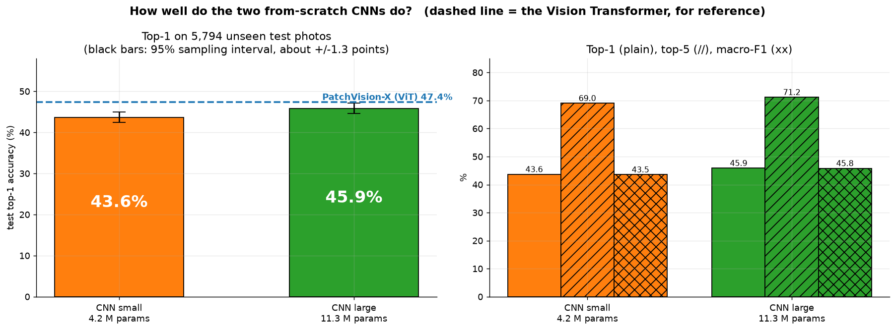

*The dashed line marks the Vision Transformer (PatchVision-X) so you can see where the CNNs sit relative to it.*

---

## 2. The two models

| | `cnn_small` | `cnn_large` |
|---|---|---|
| Purpose | **Matched** to PatchVision-X's size (4.27 M): the fair comparison | ResNet-18 layout: *what does extra CNN capacity buy?* |
| Stage widths (channels) | 39, 78, 156, 312 | 64, 128, 256, 512 |
| Blocks per stage | 2, 2, 2, 2 | 2, 2, 2, 2 |
| Parameters | **4.217 M** | **11.279 M** |
| Compute per photo | 1.40 GFLOPs | 3.63 GFLOPs |
| Pretrained weights | none | none |

Both share the same design: a 7×7 stem with max-pooling, four stages of two residual blocks (3×3 convolutions with BatchNorm and ReLU, plus a shortcut), global average pooling, and a 200-way linear layer. Written from scratch in [`cnn/model.py`](cnn/model.py).

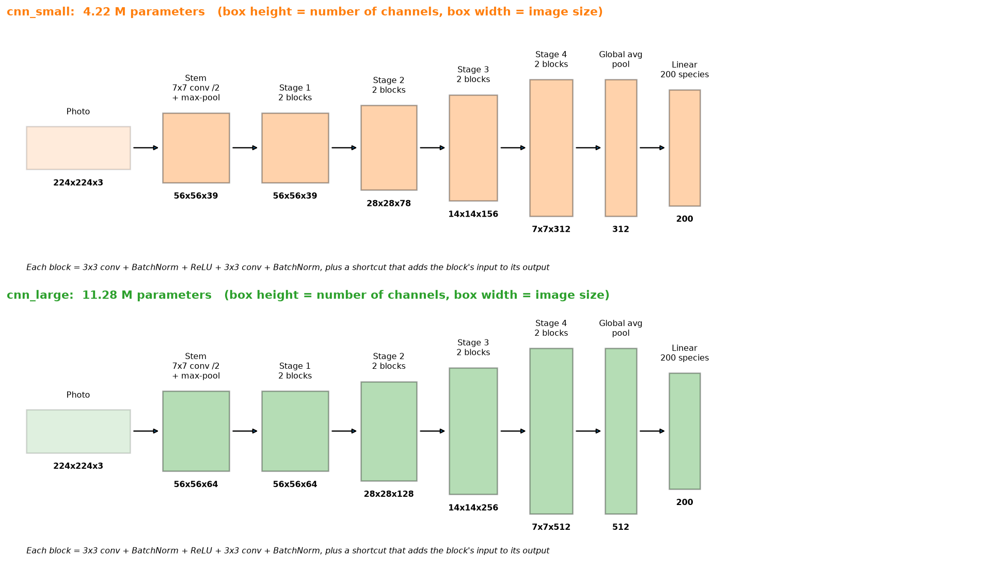

<details>
<summary><b>The same thing as a flowchart (click to open)</b></summary>

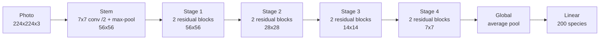

Each residual block: `3x3 conv → BatchNorm → ReLU → 3x3 conv → BatchNorm`, then **add the block's input** and apply ReLU. The last BatchNorm of every block starts at zero, so each block begins as an identity, a standard trick that makes early training stable.

</details>

### Where the parameters are

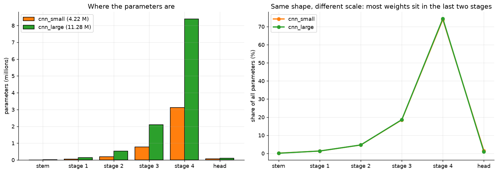

In `cnn_small`, **92 %** of the weights sit in the last two stages (stage 3: 0.78 M, stage 4: 3.12 M); the stem and first stage together have under 0.1 M. That is why widening the late stages is what makes `cnn_large` so much bigger.

---

## 3. How they were trained

The recipe is deliberately the same as the ViT's `full` run, so differences in the results come from the architecture, not from the training.

| Setting | Value |
|---|---|
| Data | the shared split in [`../DataPreprocessing_Results`](../DataPreprocessing_Results): 5,394 train / 600 validation / 5,794 test |
| Augmentation | `strong` tier (random crop, flip, rotate, colour jitter, random erase) + mixup / CutMix |
| Loss | cross-entropy with label smoothing 0.1 |
| Optimizer | AdamW, learning rate 5e-4, weight decay 0.05, gradient clipping 1.0 |
| Schedule | 10 warm-up epochs, then cosine decay to 1e-6; batch 64; up to 300 epochs; bf16 |
| EMA weights | on (decay 0.999); the averaged weights are the ones evaluated |
| Stopping | early stopping on **validation** (patience 60); best epoch chosen on validation only |
| Test set | read once, at the end, with the chosen epoch |
| Seed | 42 |
| Hardware | RTX 5090, PyTorch 2.11 (the ViT runs used an RTX 4090 and PyTorch 2.5.1) |

**Switched off** because they need attention maps or a token grid, which a CNN doesn't have: the bird-box attention loss, the flip-consistency loss, and the box-guided crop. So the CNN never sees the bird bounding boxes.

The data pipeline, optimizer, schedule, EMA, early stopping and metrics are **imported from `../ViT_PatchVisionX/patchvision`** (via [`cnn/_vit.py`](cnn/_vit.py)), so both studies are measured identically. Nothing in the ViT folder was modified.

---

## 4. How training went

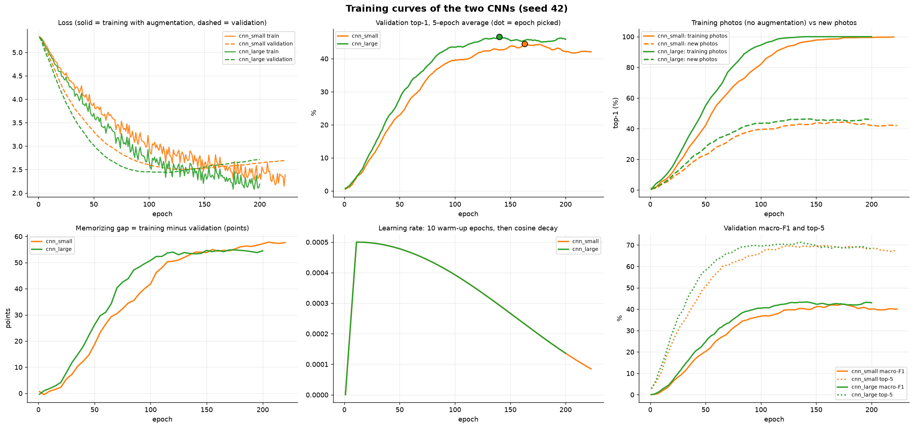

What the six panels show:
* **Top left, loss:** training loss keeps falling, but validation loss bottoms out early (`cnn_small` at epoch 128 with 2.50, `cnn_large` at epoch 116 with 2.44) and then **rises** (to 2.69 and 2.72 by the end). The model is still getting better at the training photos while getting worse at new ones.
* **Top middle, accuracy on new photos:** peaks around epochs 140 to 165 (dots), after the loss has already turned. Early stopping and "best epoch" selection protect the final numbers from the later decline.
* **Top right and bottom left:** accuracy on the training photos goes to **99.8 % / 100 %**, while new photos plateau at 44 to 47 %. The memorizing gap climbs to 53 to 58 points.
* **Bottom middle:** the learning-rate schedule (10-epoch warm-up, then cosine decay).

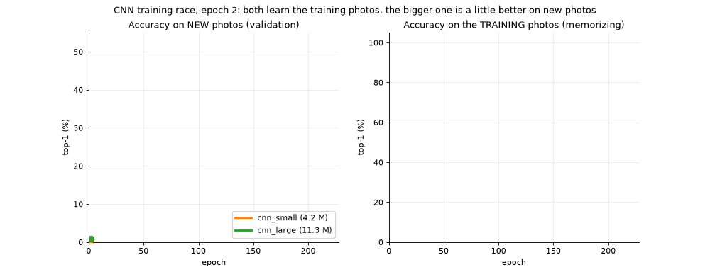

*The race: validation accuracy (left) separates the two CNNs a little; training accuracy (right) reaches 100 % for both.*

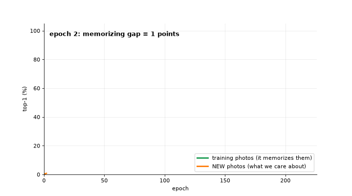

*The pink area is the memorizing gap for `cnn_small`: the distance between "photos it studied" and "photos it has never seen".*

### EMA weights help a lot

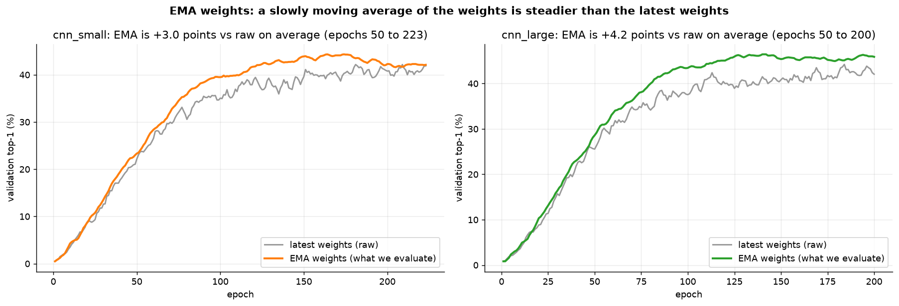

Evaluating a slow-moving average of the weights instead of the latest weights is **+3.0 points** for `cnn_small` and **+4.2 points** for `cnn_large` on validation accuracy (average over epochs 50 to the end). It is a free, training-time-only trick, and it is on for both CNNs.

---

## 5. Results in detail

### Numbers

| | `cnn_small` | `cnn_large` |
|---|---|---|
| **Test top-1** | 43.65 % | **45.86 %** |
| Test top-5 | 69.02 % | **71.16 %** |
| Test macro-F1 | 43.54 % | **45.79 %** |
| Validation top-1 at the chosen epoch | 44.5 % | 46.7 % |
| Calibration error (ECE, lower is better) | **7.07 %** | 8.56 % |
| Memorizing gap (clean-train minus validation) | 54.7 pts | **53.3 pts** |
| Chosen epoch / epochs run | 163 / 223 | 140 / 200 |
| Training time (RTX 5090) | 33.5 min | 30.0 min |
| Time per epoch | 9.0 s | 9.0 s |
| Inference, 1 photo (RTX 5090) | 1.55 ms | 1.95 ms |

`cnn_large` wins on accuracy but is **less well calibrated** (more over-confident). The two models take the same time per epoch here because data loading, not the network, is the bottleneck at this size. Timings are on a different GPU than the ViT's, so do not compare them with the ViT's numbers.

### Calibration: are the confidence numbers honest?

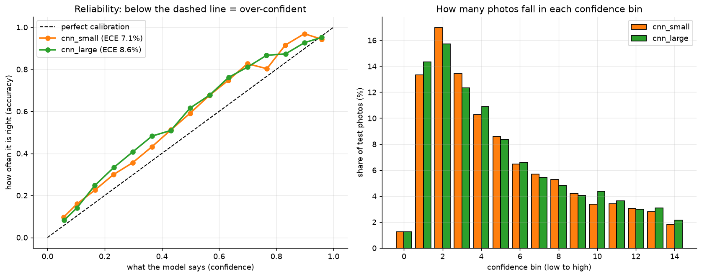

Left: when a model says "80 % sure", is it right 80 % of the time? Both CNNs sit below the diagonal, meaning over-confident, and `cnn_large` more so. Right: how many photos fall in each confidence bin.

<details>
<summary><b>Each run's own plots, as saved by the trainer (click to open)</b></summary>

**cnn_small**


**cnn_large**

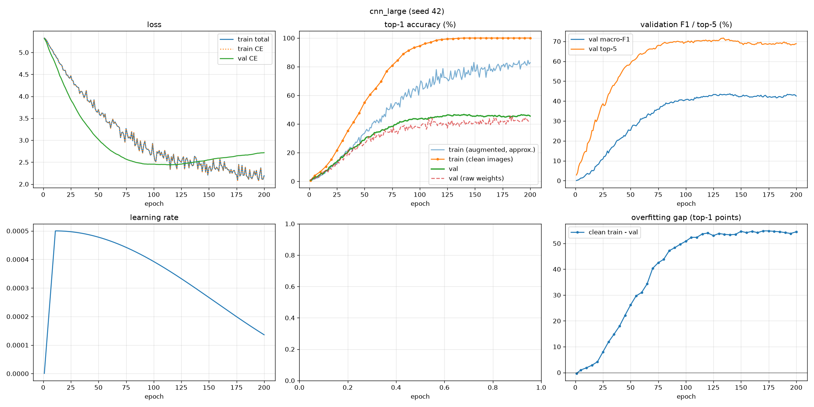
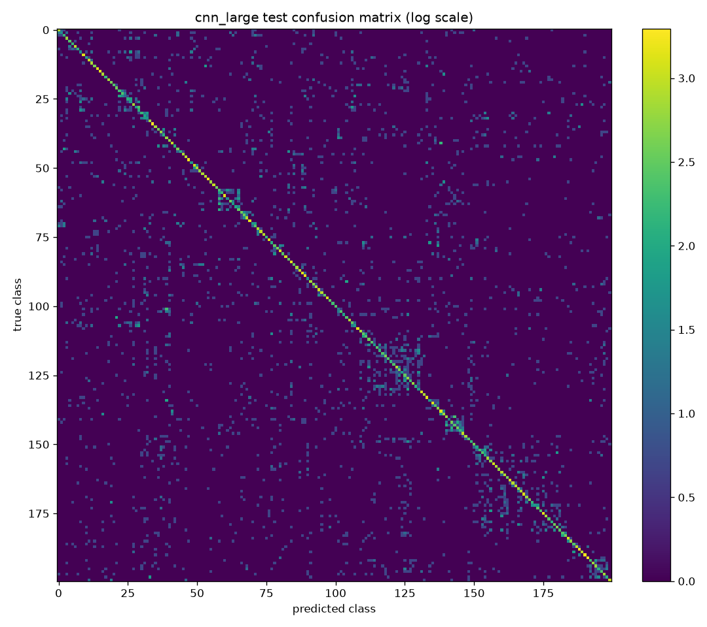
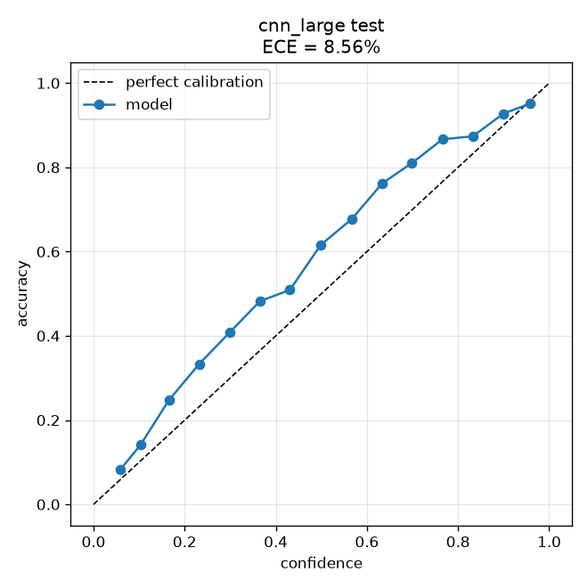

Full per-species tables, predictions for every test photo, and logs are in `results/<run>/seed42/`.

</details>

### Which species are easy and which are hard?

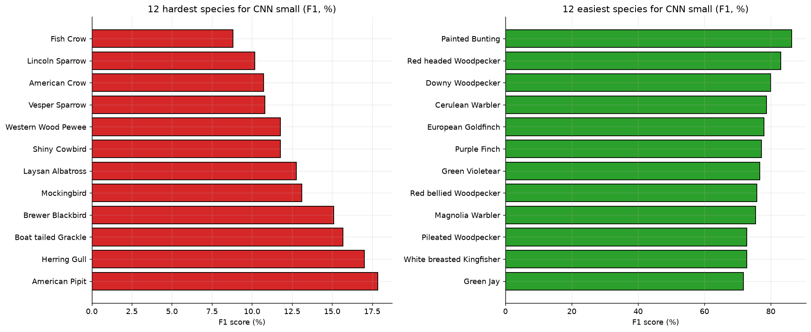

For `cnn_small` the easiest species have a distinctive colour or pattern: Painted Bunting (F1 86), Red headed Woodpecker (83), Downy Woodpecker (80). The hardest are look-alike corvids and sparrows: Fish Crow (9), Lincoln Sparrow (10), American Crow (11).

For `cnn_large`: easiest are Painted Bunting (90), Downy Woodpecker (83), Purple Finch (83); hardest are Pelagic Cormorant (7), Western Wood Pewee (11), Black Tern (12).

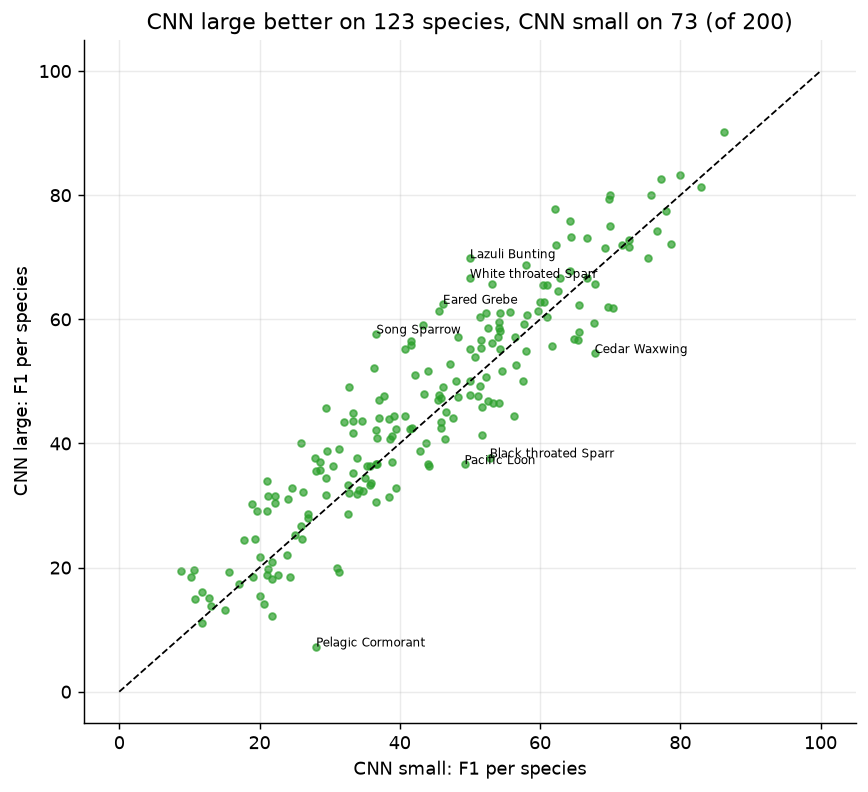

`cnn_large` has the higher F1 on **123 of 200** species, `cnn_small` on 73, with 4 ties. So the bigger model is better overall but not everywhere.

### What do the models confuse?

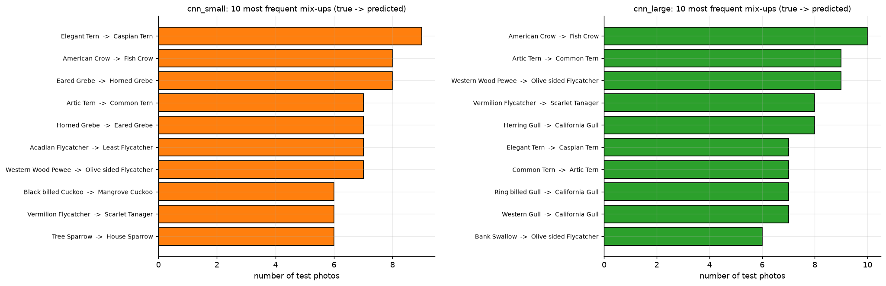

The mix-ups are what a human birder would struggle with too: **American Crow ↔ Fish Crow**, **Arctic Tern ↔ Common Tern**, **Eared Grebe ↔ Horned Grebe**, **Herring Gull → California Gull**, **Elegant Tern → Caspian Tern**.

### Sample predictions

Twelve test photos spread evenly through the test set (**not hand-picked**). Green = correct, red = wrong. On these 12, `cnn_small` is right on 7 and `cnn_large` on 6, which shows how little a dozen photos can tell you.

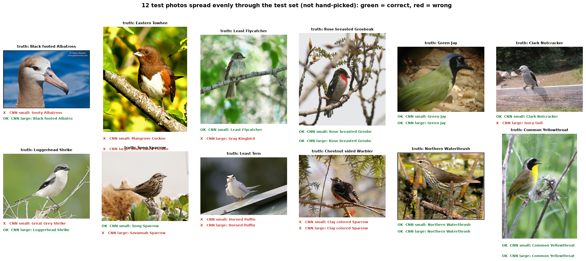

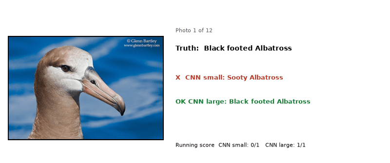

Over all 5,794 test photos: both CNNs are right on **2,178** and both are wrong on **2,788**; only `cnn_small` is right on 350, only `cnn_large` on 478. The larger model's gain is real but modest.

---

## 6. Against the Vision Transformer

| Model | Params | GFLOPs | Top-1 | Top-5 | Macro-F1 | Gap |
|---|---|---|---|---|---|---|
| ViT `base` (extras off) | 4.31 M | 1.55 | 39.52 % | 65.12 % | 39.12 % | 59.8 pts |
| **CNN small** | 4.22 M | 1.40 | 43.65 % | 69.02 % | 43.54 % | 54.7 pts |
| **CNN large** | 11.28 M | 3.63 | 45.86 % | 71.16 % | 45.79 % | 53.3 pts |
| **PatchVision-X** (ViT `full`) | 4.27 M | 1.55 | **47.39 %** | **73.59 %** | **47.05 %** | **49.8 pts** |

* **A plain ViT loses to CNNs on this little data.** The ViT with its extras switched off (`base`) is the worst of the four, 4.1 points behind the same-size CNN.
* **PatchVision-X is ahead of both CNNs:** +3.8 points over `cnn_small` and +1.5 over `cnn_large`, both significant on the test photos (paired test; details in the [top-level README](../README.md#45-is-the-lead-real-paired-significance-test)).
* **But the comparison is not perfectly even.** PatchVision-X also trains with bird bounding boxes and flip-consistency, which the CNN doesn't get, and it has had a regularization search that the CNNs haven't.

Full comparison, charts, per-species analysis and the winner discussion: **[top-level README](../README.md)**. A notebook version with live tables is in [`training.ipynb`](training.ipynb).

---

## 7. Limits

- **One seed.** Every number is seed 42. The proposal needs three seeds; seeds 43 and 44 are not run yet.
- **Not tuned for the CNN.** It uses the ViT's learning rate (5e-4) and weight decay (0.05) unchanged. A CNN may prefer different values, and a CNN regularization search (stronger augmentation, drop-path, more weight decay) has not been run.
- **Different hardware for timings.** CNN runs: RTX 5090, PyTorch 2.11. ViT runs: RTX 4090, PyTorch 2.5.1. Accuracy is unaffected; training and inference times are not comparable between the two studies.
- **Small validation set.** 600 photos (3 per species) decide the best epoch and the early stop, so that choice is noisy.
- **Test set seen.** All test results were read; any further tuning should use validation only.

---

## 8. Run it yourself

Run everything from inside this folder. The shared data is read from the repository root (one level up); results are written to `results/<experiment>/seed<seed>/`.

```powershell
cd CNN_Baseline
python train.py cnn_small 42
python train.py cnn_large 42
python watch_training.py cnn_small 42     # live monitor, in a second terminal
python docs/make_figures.py               # rebuild every figure and animation on this page
```

Or open [`training.ipynb`](training.ipynb) (start Jupyter inside `CNN_Baseline/`). It holds the smoke test, a one-batch dry run, the training, and the CNN-vs-ViT tables and figures. Keep `SMOKE_TEST = True` for a first pass (2 epochs on tiny synthetic data), then set it to `False`.

A finished run is skipped, and an interrupted one resumes from `last.pt`. Model weights (`*.pt`) are not stored in Git, so train a model first before loading it.

<details>
<summary><b>Load a trained model and predict (click to open)</b></summary>

```python
import sys, torch
sys.path.insert(0, ".")                                   # run from inside CNN_Baseline/
from cnn.config import get_experiment
from cnn.model import build_model

exp = get_experiment("cnn_small")
model = build_model(exp.model)
ck = torch.load("results/cnn_small/seed42/best_model.pt", map_location="cpu", weights_only=False)
model.load_state_dict(ck["state"])                        # the EMA weights of the chosen epoch
model.eval()
# model(x) takes a normalised (B, 3, 224, 224) tensor and returns (B, 200) species scores
```

</details>

### Layout

```
CNN_Baseline/
├── README.md               this page
├── training.ipynb          run + results + CNN vs ViT comparison
├── train.py  watch_training.py
├── cnn/
│   ├── config.py           experiments (cnn_small, cnn_large) and settings
│   ├── model.py            the CNN
│   ├── engine.py           training / validation / test loop and everything it saves
│   ├── experiment.py       one-batch dry run
│   ├── compare.py          CNN-vs-ViT table and figures
│   └── _vit.py             makes ../ViT_PatchVisionX/patchvision importable
├── docs/
│   ├── make_figures.py     rebuilds every figure and animation on this page
│   ├── figures/  animations/  facts.txt
└── results/<experiment>/seed<seed>/    logs, curves, metrics, confusion matrix, predictions
```
