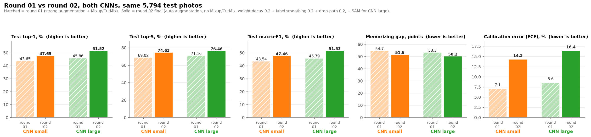
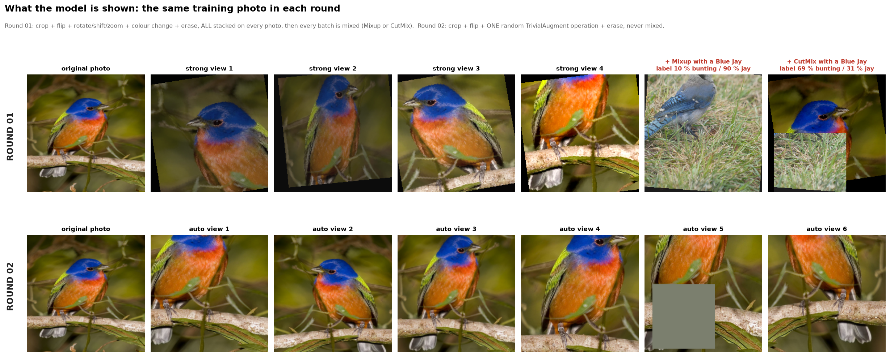
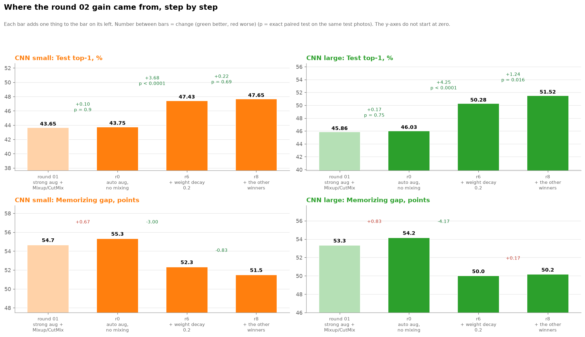
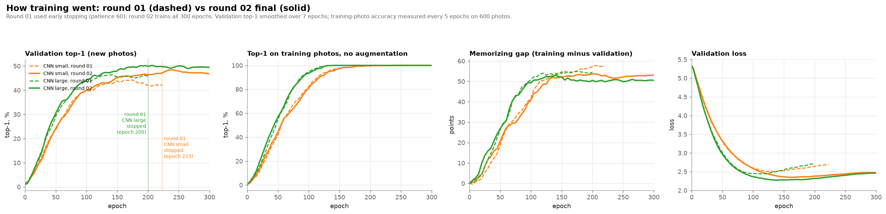
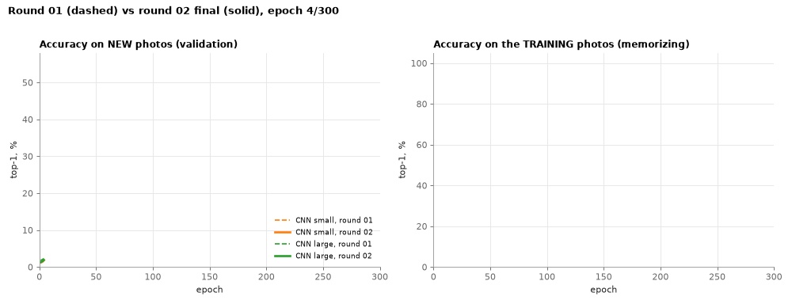
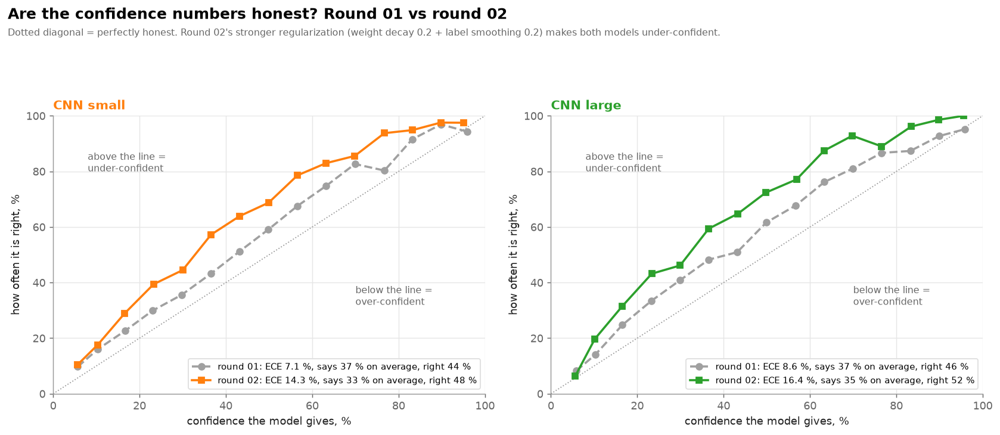
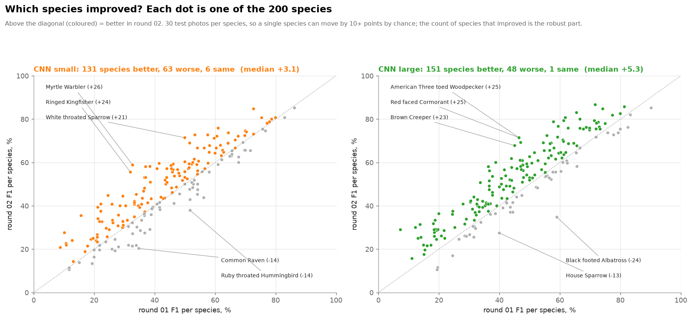
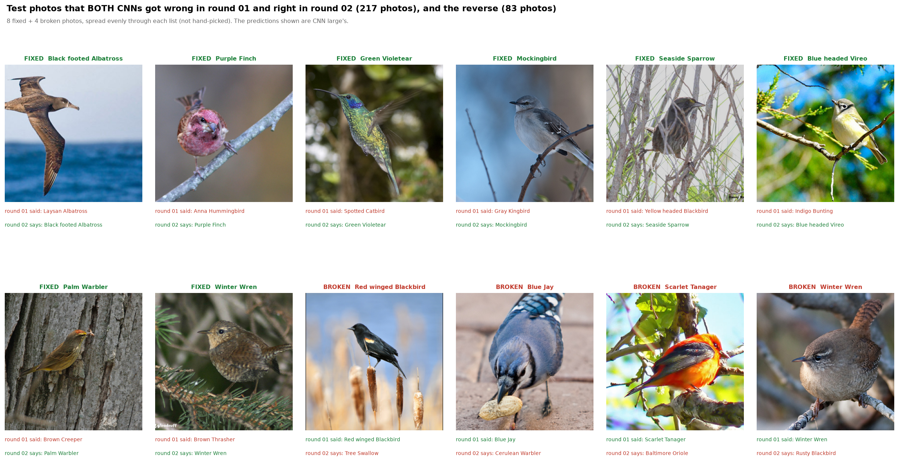

# CNN baselines: round 01 vs round 02

     

The CNN side of the PatchVision study: two compact ResNets trained **from scratch** on CUB-200-2011 (5,394 training photos, about 27 per species). Each experiment round has its own folder with its own detailed README. **This page compares the two rounds**: what changed in the training recipe, what it did to accuracy, memorizing and confidence, and where the gain came from.

| Folder | Training recipe | Result (test top-1) |
|---|---|---|
| [`01_strongaug_mixup_cutmix/`](01_strongaug_mixup_cutmix) | `strong` augmentation (all operations stacked) + Mixup/CutMix, label smoothing 0.1, weight decay 0.05, early stopping. The recipe of the original ViT-vs-CNN comparison. | CNN small 43.65 %, CNN large 45.86 % |
| [`02_autoaug_nomix_regularization/`](02_autoaug_nomix_regularization) | `auto` augmentation (one TrivialAugment operation), **no Mixup/CutMix**, 300 epochs, then a one-change-at-a-time search (drop-path, label smoothing, weight decay, SAM) and the winners combined (r8) | CNN small **47.65 %**, CNN large **51.52 %** |

Model details: [`CNN_small_model_summary.md`](CNN_small_model_summary.md) · [`CNN_large_model_summary.md`](CNN_large_model_summary.md). Shared data (`CUB_200_2011/`, `DataPreprocessing_Results/`) is read from the repository root.

> **Jump to:** [Result in one minute](#1-the-result-in-one-minute) · [The two recipes](#2-the-two-recipes) · [Where the gain came from](#3-where-the-gain-came-from) · [Training](#4-how-training-went) · [Results in detail](#5-results-in-detail) · [Takeaways](#6-what-we-learned) · [Limits](#7-limits) · [Reproduce](#8-reproduce-the-figures)

---

## 1. The result in one minute

<table>
<tr>
<td width="56%">

| | CNN small: round 01 | CNN small: **round 02** | CNN large: round 01 | CNN large: **round 02** |
|---|---|---|---|---|
| Test top-1 | 43.65 % | **47.65 %** | 45.86 % | **51.52 %** |
| Test top-5 | 69.02 % | **74.63 %** | 71.16 % | **76.46 %** |
| Test macro-F1 | 43.54 % | **47.46 %** | 45.79 % | **51.53 %** |
| Memorizing gap | 54.7 pts | **51.5 pts** | 53.3 pts | **50.2 pts** |
| Calibration error (ECE) | **7.07 %** | 14.27 % | **8.56 %** | 16.39 % |
| Change in top-1 | | **+4.02** (p ≈ 1e-12) | | **+5.68** (p ≈ 1e-26) |

One seed (42), the same 5,794 unseen test photos, sampling noise about ±1.3 points. p = exact paired (McNemar) test on the same photos. Round 02 = each model's final run (r8, best on validation).

</td>
<td>

1. **Both CNNs got clearly better**: +4.0 (small) and +5.7 (large) test points, on top-1, top-5 and macro-F1 alike.
2. **The gain came from weight decay, not from the augmentation change.** Switching to `auto` augmentation and dropping Mixup/CutMix alone changed accuracy by +0.1 to +0.2 points (not significant). Weight decay 0.05 → 0.2 then gave +3.7 / +4.3.
3. **The larger model gains more**: its lead over CNN small grew from 2.2 to 3.9 points.
4. **Memorizing went down only a little** (about 3 points). Both models still get about 100 % of their training photos right.
5. **The price is confidence**: round 02 models are under-confident (ECE doubled).

</td>
</tr>
</table>



*Hatched = round 01, solid = round 02. Higher is better for the first three panels, lower for the last two.*

---

## 2. The two recipes

The two models (widths, blocks, parameters), the data split, the optimizer (AdamW, lr 5e-4, 10 warm-up epochs + cosine), batch size 64, EMA weights and bf16 are **identical** in both rounds. Only the training recipe changed:

| Setting | Round 01 | Round 02 (final r8) | Why it was changed |
|---|---|---|---|
| Augmentation | `strong`: random crop + flip + rotate/shift/zoom + colour change + random erase, **all stacked on every photo** | `auto`: random crop + flip + **one** random TrivialAugment operation + random erase | lighter, more varied changes per photo |
| Mixup / CutMix | on, every batch (50/50) | **off**, photos are never mixed | test whether mixing helps a CNN at this data size |
| Label smoothing | 0.1 | **0.2** | won on validation (r4) |
| Weight decay | 0.05 (the ViT's value) | **0.2** | won on validation (r6), the biggest single gain |
| Drop-path (stochastic depth) | none | **0.2** | won on validation (r1) |
| SAM optimizer | no | CNN small: no · **CNN large: yes** | passed the validation bar only for CNN large (r7) |
| Stopping | early stopping, patience 60 (stopped at 223 / 200 epochs) | **all 300 epochs** | every run gets the same budget |
| Runs | 1 per model | 9 per model (r0 base, r1–r7 one change each, r8 winners combined) | find what helps, one change at a time |

How the round 02 search worked, and every run's numbers, are in the [round 02 README](02_autoaug_nomix_regularization/README.md). A step-by-step description of the round 01 augmentation is in the [round 01 README](01_strongaug_mixup_cutmix/README.md#3-how-they-were-trained).

### What the model actually sees



*The same Painted Bunting photo through each round's real training code. Round 01 stacks every operation on every photo and then mixes it with another photo in the batch: the model is asked to answer "10 % bunting, 90 % jay" or "69 % bunting, 31 % jay". Round 02 changes one thing at a time and never mixes, so every photo keeps one clear label. In both rounds the model sees only the changed version, never the plain original, during training.*

---

## 3. Where the gain came from

Going from round 01 to round 02 changed several things at once. The round 02 runs let us take them apart, one step at a time, on the same test photos:



| Step | CNN small: test top-1 change | only new right / only old right | p | CNN large: test top-1 change | only new right / only old right | p |
|---|---|---|---|---|---|---|
| round 01 → r0 (`auto` aug, no Mixup/CutMix, 300 epochs) | +0.10 | 533 / 528 | 0.90 | +0.17 | 517 / 506 | 0.75 |
| r0 → r6 (+ weight decay 0.2) | **+3.68** | 518 / 303 | **< 0.0001** | **+4.25** | 534 / 287 | **< 0.0001** |
| r6 → r8 (+ label smoothing 0.2, drop-path 0.2, SAM for large) | +0.22 | 460 / 447 | 0.69 | **+1.24** | 459 / 388 | **0.016** |
| **round 01 → round 02 final** | **+4.02** | 655 / 422 | **< 0.0001** | **+5.68** | 651 / 322 | **< 0.0001** |

* **The new augmentation recipe on its own is a draw.** Removing Mixup/CutMix and switching to `auto` augmentation gave the same accuracy (+0.1 / +0.2, far from significant). It even made the gap slightly larger (+0.7 / +0.8 points), so Mixup/CutMix was holding back memorizing a little, without turning that into accuracy.
* **Weight decay is the real fix**: about **90 %** of CNN small's total gain and **75 %** of CNN large's. Round 01 had borrowed weight decay 0.05 from the ViT; for these CNNs it was far too low.
* **The other winners add a little**: nothing measurable for CNN small, +1.2 points for CNN large (its r8 includes SAM).

---

## 4. How training went



* **Validation top-1 (left):** for the first 100 epochs the two rounds are almost the same. After that round 01 levels off at 42 to 46 % and early stopping ends it (epoch 223 / 200), while round 02 keeps climbing to 48 to 50 %.
* **Training photos (second panel):** both rounds reach about **100 %** on the training photos, round 02 at about the same speed. Neither recipe stops the memorizing.
* **Gap (third panel):** round 01's gap keeps growing to the end (CNN small reaches 57 points); round 02's levels off at 50 to 53.
* **Validation loss (right):** round 02 reaches a lower minimum (CNN small 2.35 vs 2.50, CNN large 2.27 vs 2.44) and rises much less afterwards. Round 01's loss turns up from about epoch 120: the classic sign of over-fitting, which is why early stopping fired.



*The race: validation accuracy (left) and accuracy on the training photos (right). Dashed = round 01, solid = round 02.*

| | CNN small: round 01 | CNN small: round 02 | CNN large: round 01 | CNN large: round 02 |
|---|---|---|---|---|
| Epochs run / chosen epoch | 223 / 163 | 300 / 236 | 200 / 140 | 300 / 188 |
| Training time (RTX 5090) | 33.5 min | 31.1 min | 30.0 min | 31.4 min |
| Runs needed to get there | 1 | 9 (about 4.7 h) | 1 | 9 (about 4.8 h) |

---

## 5. Results in detail

### 5.1 Confidence: are the numbers honest?



| | CNN small: round 01 | CNN small: round 02 | CNN large: round 01 | CNN large: round 02 |
|---|---|---|---|---|
| Average confidence | 36.6 % | 33.4 % | 37.3 % | 35.1 % |
| Actual accuracy | 43.7 % | 47.7 % | 45.9 % | 51.5 % |
| ECE | **7.1 %** | 14.3 % | **8.6 %** | 16.4 % |

* Both rounds are **under-confident** (the curves sit above the diagonal): the models are right more often than they say.
* Round 02 makes this **twice as bad**. Round 02 models are **more accurate but less confident**: label smoothing 0.2 trains them to never put more than 80 % on one species, and weight decay 0.2 keeps their outputs small.
* Without Mixup/CutMix and with the round 01 settings (round 02's r0), calibration was actually very good (ECE 2.2 % / 4.7 %). The confidence loss comes from the new regularizers, not from dropping Mixup/CutMix.
* Accuracy is not affected, and this kind of error can be corrected after training with temperature scaling.

### 5.2 Which species improved?



* **CNN small: 131 of 200 species improved**, 63 got worse, 6 stayed the same (median +3.1 F1 points).
* **CNN large: 151 of 200 species improved**, 48 got worse, 1 stayed the same (median +5.3 F1 points).
* The improvement is broad: low, middle and high scorers all move up. It is not a few species carrying the average.
* Single species move a lot in both directions (+26 for Myrtle Warbler with CNN small, −24 for Black footed Albatross with CNN large). With 30 test photos per species, such single-species swings are mostly noise; the count of improved species is the reliable signal.

### 5.3 Photos fixed and broken



* **217 test photos** were wrong for **both** CNNs in round 01 and right for both in round 02; only **83** went the other way.
* Per model (round 02 vs round 01): CNN small fixed 655 photos and broke 422; CNN large fixed 651 and broke 322. Most photos keep their answer: the change is a net shift of 233 (small) and 329 (large) photos, out of 5,794.

### 5.4 CNN small vs CNN large, in each round

| | Round 01 | Round 02 |
|---|---|---|
| Large minus small, test top-1 | +2.21 | **+3.87** |
| Only large right / only small right | 478 / 350 | 558 / 334 |
| p (paired) | 9.8e-6 | **6.1e-14** |

CNN large was ahead in both rounds; the better recipe **widened** its lead. With 2.7× the parameters it gains more from stronger regularization (weight decay 0.2 helped it +4.3 vs +3.7 points). Details in the round READMEs: [round 01, section 5](01_strongaug_mixup_cutmix/README.md#5-results-in-detail) and [round 02, section 7](02_autoaug_nomix_regularization/README.md#7-cnn-small-vs-cnn-large-in-detail).

---

## 6. What we learned

1. **Round 01's weak point was weight decay, not augmentation.** 0.05 was borrowed from the ViT; at 0.2 both CNNs gain about 4 points. This is the single most useful finding of the comparison.
2. **Mixup/CutMix did not help these CNNs.** Removing them (together with the switch to `auto` augmentation) left accuracy unchanged and improved calibration. Stacked augmentation + mixing is not necessary at this data size.
3. **The combined recipe helps the larger model more** (+5.7 vs +4.0), and CNN large's lead over CNN small grew from 2.2 to 3.9 points.
4. **Memorizing is reduced, not solved.** The gap fell by only about 3 points; both models still reach about 100 % on their training photos with every recipe tried so far.
5. **More accurate came with less honest confidence.** Round 02's final models are under-confident (ECE 14 to 16 %); if confidence numbers matter, temperature scaling or the simpler r6 (weight decay 0.2 only) is the choice.
6. **Running a search costs more**: round 01 was one run per model, round 02 nine. Most of the gain could have been found with two runs (r0 and r6).

**Next**: the ViT and PatchVision-X go through the same round 02 search with the same settings, so the CNN-vs-ViT comparison stays fair. After that, an augmentation experiment that also trains on the original, unchanged photos.

---

## 7. Limits

- **One seed.** All numbers are seed 42. The +4 to +6 point gains are large and highly significant on the test photos, but smaller steps (e.g. r6 → r8) could move with another seed.
- **Not a clean A/B test.** Round 01 → round 02 changed augmentation, mixing, stopping and regularization together; section 3 separates them using round 02's own runs, which shows the order of the steps, not every possible combination.
- **Round 01 stopped early, round 02 ran 300 epochs.** Round 01's validation was flat or falling when it stopped, so more epochs would not have helped it, but the budgets are not identical.
- **Test set seen.** All test results were read. Every decision (winners, final run) was made on validation only.

---

## 8. Reproduce the figures

```bash
python CNN_Baseline/docs/make_comparison.py
```

It reads only finished results (`01_strongaug_mixup_cutmix/results/` and `02_autoaug_nomix_regularization/results/`) and writes `docs/figures/x01 … x07`, `docs/animations/x_race_round01_vs_round02.gif` and `docs/facts.txt` (every number quoted on this page). Model weights (`*.pt`) are not stored in Git.

```
CNN_Baseline/
├── README.md                         this page: round 01 vs round 02
├── CNN_small_model_summary.md        architecture, parameters, loss, optimizer, settings, results
├── CNN_large_model_summary.md
├── docs/
│   ├── make_comparison.py            figures + facts for this page
│   ├── facts.txt
│   ├── figures/                      x01 ... x07
│   └── animations/                   x_race_round01_vs_round02.gif
├── 01_strongaug_mixup_cutmix/        round 01: code, results, README
└── 02_autoaug_nomix_regularization/  round 02: code, results, README
```
