# PatchVision: a Vision Transformer vs a CNN, both trained from scratch on 200 bird species

    -orange)

**The question.** With only about 27 training photos per species, can a Vision Transformer learned from scratch keep up with a CNN? We built a small hybrid Vision Transformer (**PatchVision-X**), a matched **CNN baseline**, trained both under the same recipe, and compared them on the same 5,794 unseen test photos.

> **Jump to:** [Result in one minute](#1-the-result-in-one-minute) · [The two models](#3-the-two-models-side-by-side) · [Results](#4-results) · [Winner and why](#5-the-winner-and-why) · [E4 study](#7-e4-the-regularization-study-running) · [What is left](#9-what-is-left-from-the-proposal) · [Reproduce](#10-how-to-reproduce)

---

## 1. The result in one minute

<table>
<tr>
<td width="62%">

### PatchVision-X wins on accuracy

| Model | Params | **Top-1** | Top-5 | Macro-F1 |
|---|---|---|---|---|
| ViT base (no extras) | 4.31 M | 39.52 % | 65.12 % | 39.12 % |
| **PatchVision-X** (ours) | 4.27 M | **47.39 %** | **73.59 %** | **47.05 %** |
| CNN small (matched size) | 4.22 M | 43.65 % | 69.02 % | 43.54 % |
| CNN large (ResNet-18 size) | 11.28 M | 45.86 % | 71.16 % | 45.79 % |

One seed (42), 5,794 test photos, sampling noise about ±1.3 points.

</td>
<td>

**Three things to remember**

1. PatchVision-X beats the same-size CNN by **3.8 points** and the 2.6× larger CNN by **1.5 points**. Both gaps are statistically significant on the test photos (paired test, [section 4.5](#45-is-the-lead-real-paired-significance-test)).
2. The plain ViT (`base`) is the **worst** of the four. A transformer without the extras really does lose to CNNs on this little data, which is the worry in the project proposal.
3. **Every** model memorizes the training photos (about 100 % right on them, 40 to 48 % on new photos). The gap is about 50 points for all of them.

</td>
</tr>
</table>

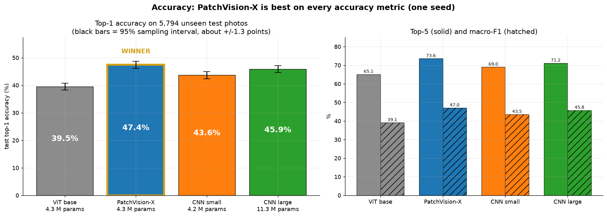

> **Honest caveats, up front.** One seed per model. PatchVision-X also gets training signals the CNN does not (bird bounding boxes, flip-consistency). The CNN was not tuned. ViT and CNN runs used different GPUs, so training and inference times are not like-for-like. Details in [section 8](#8-limits-of-this-study).

---

## 2. What we did, in order

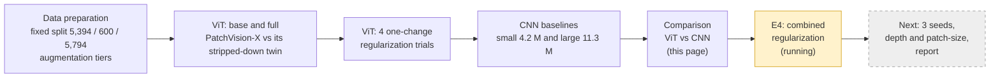

| Step | What happened | Folder |
|---|---|---|
| 1 | Looked at the data, fixed the train/validation/test split, chose augmentation levels | [`DataPreprocessing_Results/`](DataPreprocessing_Results), two notebooks at the repo root |
| 2 | Built **PatchVision-X** from scratch in PyTorch; trained `base` (extras off) and `full` (extras on) | [`ViT_PatchVisionX/`](ViT_PatchVisionX) |
| 3 | Four **one-change** regularization trials on top of `full` | [`ViT_PatchVisionX/`](ViT_PatchVisionX) |
| 4 | Built two **CNN baselines** from scratch, trained with the same recipe | [`CNN_Baseline/`](CNN_Baseline) |
| 5 | Compared everything: accuracy, calibration, cost, per species, significance | this page, [`assets/`](assets) |
| 6 | **E4**: combine the regularization settings that helped | running, [section 7](#7-e4-the-regularization-study-running) |

### The data (shared by both models)

**CUB-200-2011**: 11,788 photos of 200 look-alike bird species (many gulls, terns, warblers, sparrows). The split is fixed in `DataPreprocessing_Results/` and used by every run:

| Split | Photos | Used for |
|---|---|---|
| Train | 5,394 (26 to 27 per species) | learning |
| Validation | 600 (3 per species) | picking the best epoch, early stopping, and **all tuning decisions** |
| Test | 5,794 | the final grade, read once at the end of a run |

The bird bounding boxes that ship with the dataset are **never** given to a model as input. PatchVision-X uses them only as a training-time teaching signal ([section 3](#3-the-two-models-side-by-side)); the CNN does not use them at all.

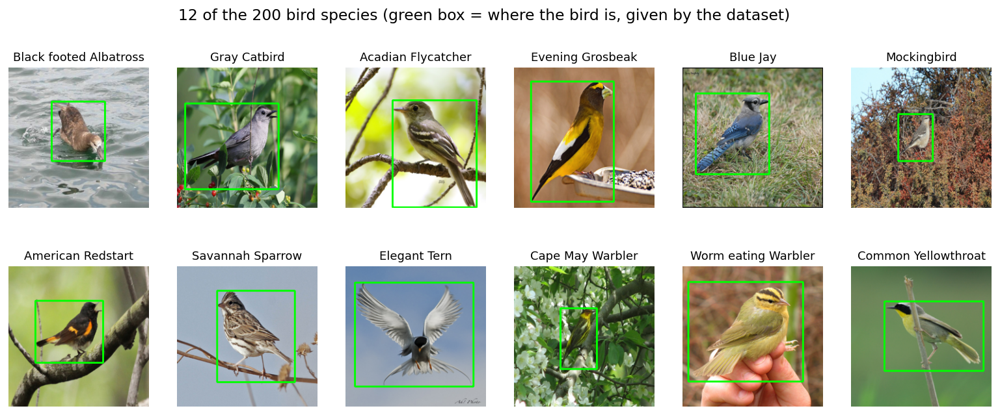

---

## 3. The two models side by side

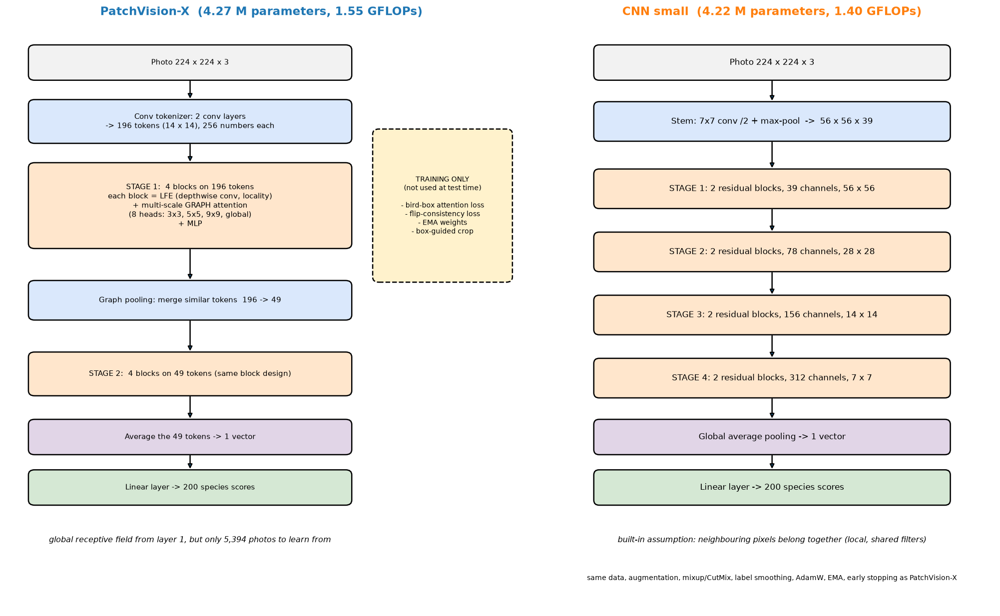

<details>
<summary><b>Same diagram as flowcharts (click to open)</b></summary>

**PatchVision-X** (hybrid transformer, 4.27 M parameters)

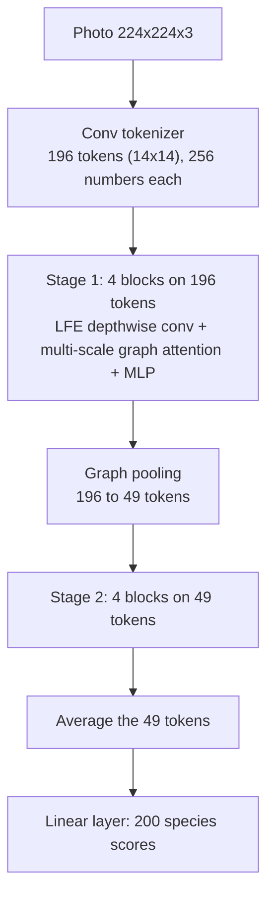

**CNN small** (ResNet-style, 4.22 M parameters)

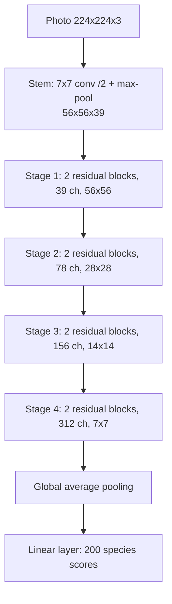

</details>

### How they differ

| | **PatchVision-X** | **CNN small** | **CNN large** |
|---|---|---|---|
| Core operation | Self-attention on a **graph** of image tokens | 3×3 convolutions with shared filters | same as CNN small |
| What each layer sees | Heads see 3×3, 5×5, 9×9 neighbourhoods, or the **whole image** | Local 3×3 windows; the view grows layer by layer | same |
| Built-in assumption | Little. Locality is added by a depthwise-conv block (LFE) and the graph | "Nearby pixels belong together" | same |
| Depth | 8 blocks (4 on 196 tokens, 4 on 49) | 8 residual blocks | 8 residual blocks |
| Width | 256 numbers per token | 39 / 78 / 156 / 312 channels | 64 / 128 / 256 / 512 channels |
| Parameters | 4.27 M | 4.22 M | 11.28 M |
| Compute per photo | 1.55 GFLOPs | 1.40 GFLOPs | 3.63 GFLOPs |
| Origin | Ideas from two small-data ViT papers (GvT and MSCViT), implemented from scratch | Standard ResNet design, from scratch | Standard ResNet-18 layout, from scratch |
| Uses bird boxes in training | **Yes** (attention loss, box-guided crop) | No | No |
| Flip-consistency training | **Yes** | No | No |

Everything not in the last two rows is identical for all three: same photos, same augmentation, same loss, same optimizer, same schedule.

### The same training recipe for both

| Setting | Value (all models) |
|---|---|
| Augmentation | `strong` tier (random crop, flip, rotate, colour jitter, random erase) + mixup / CutMix |
| Loss | cross-entropy with label smoothing 0.1 |
| Optimizer | AdamW, peak learning rate 5e-4, weight decay 0.05 |
| Schedule | 10 warm-up epochs, then cosine decay to 1e-6; batch 64; up to 300 epochs |
| EMA weights | on for PatchVision-X (`full`) and both CNNs; off in the ViT `base` ablation |
| Stopping and choice of epoch | early stopping on **validation** (patience 60); best epoch chosen on validation |
| Test set | evaluated once, with the chosen epoch |

### PatchVision-X: what the "extras" are

`base` is PatchVision-X with its additions switched **off**; `full` has them **on**. That single comparison is worth +7.9 points.

| Extra | Idea | Measured effect |
|---|---|---|
| Bird-box attention loss | Penalize attention that falls outside the bird's box (training only) | Attention inside the box: **0.66** vs 0.36 for `base` (chance is 0.34) |
| Flip consistency | Show every photo and its mirror image; require the same answer and mirrored attention | Same prediction on a mirrored photo: **93.0 %** vs 77.7 % |
| EMA weights | Evaluate a smoothed average of the weights | **+2.4 points** on average (epochs 50 to 213) |
| Box-guided crop | 30 % of training photos are first cropped to the bird | not isolated yet |
| LFE block + multi-scale heads | Locality and multi-scale context | not isolated yet |

*"Not isolated yet" means the single-ingredient ablations exist in the code but have not been run, so we know only that the combination helps.*

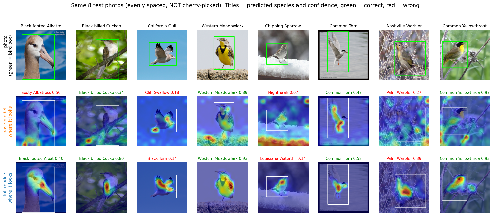

*Eight test photos, evenly spaced (not hand-picked). White rectangle = bird box (never shown to the model). `base` often looks at branches and background; `full` concentrates on the bird.*

---

## 4. Results

### 4.1 Accuracy


Left: top-1 with its 95 % sampling interval. Right: top-5 and macro-F1. PatchVision-X leads on all three.

### 4.2 Scorecard

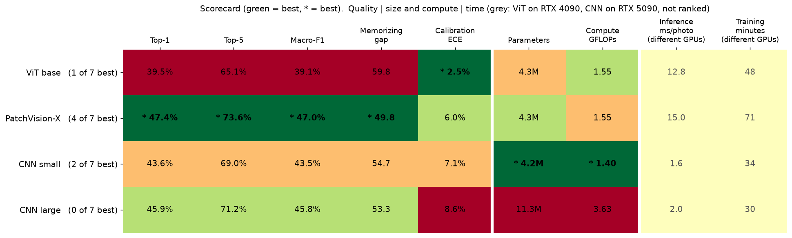

PatchVision-X wins every quality column except calibration; the plain ViT `base` is the best calibrated. The time columns are grey and **not ranked**, because the ViT and CNN runs used different GPUs.

<details>
<summary><b>Full numbers (click to open)</b></summary>

| Model | Params | GFLOPs | Top-1 | Top-5 | Macro-F1 | ECE | Train-val gap | Best epoch / run | Train time* | 1-photo latency* |
|---|---|---|---|---|---|---|---|---|---|---|
| ViT base | 4.31 M | 1.55 | 39.52 % | 65.12 % | 39.12 % | **2.49 %** | 59.8 pts | 186 / 246 | 48.4 min | 12.8 ms |
| PatchVision-X | 4.27 M | 1.55 | **47.39 %** | **73.59 %** | **47.05 %** | 5.95 % | **49.8 pts** | 153 / 213 | 71.2 min | 15.0 ms |
| CNN small | 4.22 M | 1.40 | 43.65 % | 69.02 % | 43.54 % | 7.07 % | 54.7 pts | 163 / 223 | 33.5 min | 1.55 ms |
| CNN large | 11.28 M | 3.63 | 45.86 % | 71.16 % | 45.79 % | 8.56 % | 53.3 pts | 140 / 200 | 30.0 min | 1.95 ms |

\*ViT runs: RTX 4090, PyTorch 2.5.1. CNN runs: RTX 5090, PyTorch 2.11. **Not comparable.** ECE = calibration error, lower is better. Train-val gap = accuracy on augmentation-free training photos minus validation accuracy.

</details>

### 4.3 Learning curves and the memorizing problem

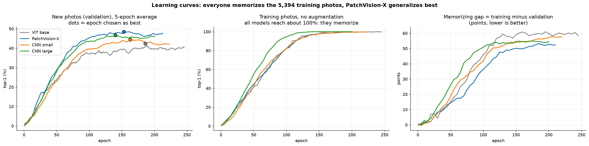

All four models learn the training photos almost perfectly (middle), yet only reach 40 to 48 % on new photos (left). PatchVision-X keeps the smallest gap (right), but it is still about 50 points. This is the central open problem of the project.

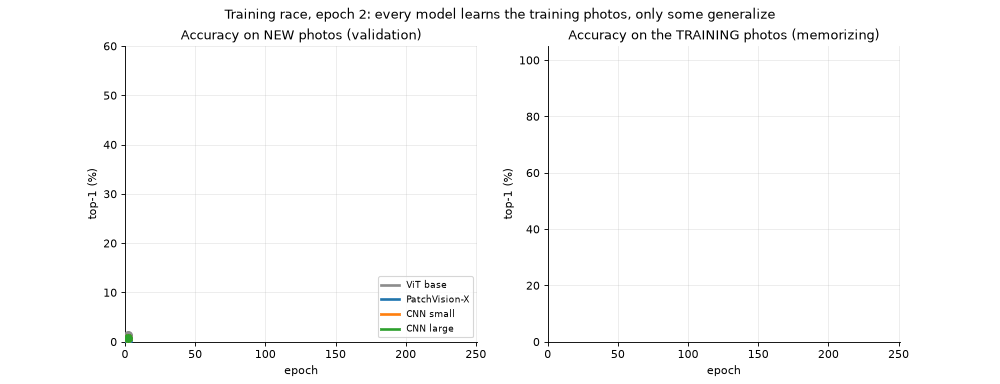

*The race: validation accuracy (left) keeps separating the models, while training accuracy (right) goes to 100 % for everyone.*

### 4.4 Cost

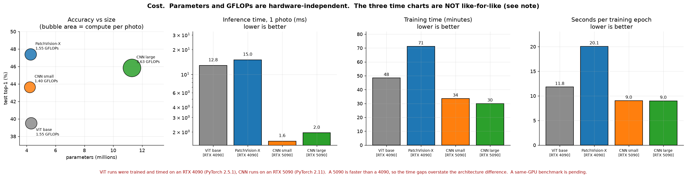

**Hardware-independent facts:** PatchVision-X and CNN small are the same size (4.27 M vs 4.22 M parameters) and need about the same compute (1.55 vs 1.40 GFLOPs). CNN large costs 2.6× the parameters and 2.3× the compute. So the 3.8-point win of PatchVision-X over CNN small is **not** bought with a bigger model.

**What we cannot say yet:** how much slower PatchVision-X is in wall-clock time. The recorded numbers (15 ms vs 1.6 ms per photo; 71 vs 34 minutes) come from different GPUs and software versions. A same-GPU benchmark is on the to-do list. Note also that PatchVision-X trains each batch twice (original and mirrored) for flip-consistency, which costs real time.

### 4.5 Is the lead real? Paired significance test

Both models are tested on the very same photos, so we can ask: on the photos where they disagree, who is right more often?

| Comparison (A vs B) | A minus B, top-1 points | Photos only A gets right | Photos only B gets right | p-value (exact paired test) | Significant at 5 %? |
|---|---|---|---|---|---|
| PatchVision-X vs CNN small | +3.76 | 742 | 524 | < 0.0001 | yes |
| PatchVision-X vs CNN large | +1.55 | 668 | 578 | 0.0117 | yes |
| CNN large vs CNN small | +2.21 | 478 | 350 | < 0.0001 | yes |
| PatchVision-X vs ViT base | +7.85 | 789 | 334 | < 0.0001 | yes |

PatchVision-X is right and both CNNs are wrong on **493** test photos; both CNNs are right and PatchVision-X is wrong on **349**.

> **What this does and does not show.** It shows the lead is not caused by which test photos happened to be drawn. It does **not** show the lead survives a different random seed; that needs the three-seed runs ([section 9](#9-what-is-left-from-the-proposal)).

### 4.6 Species by species

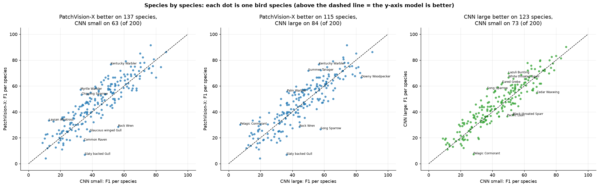

PatchVision-X has the higher F1 on **137 of 200** species against CNN small and on **115 of 200** against CNN large. The CNNs are not beaten everywhere.

| | Hardest species (F1) | Easiest species (F1) | Most frequent mix-ups |
|---|---|---|---|
| **PatchVision-X** | American Crow (4), Slaty backed Gull (7), White necked Raven (11) | Green Violetear (92), Painted Bunting (86), Evening Grosbeak (85) | Herring Gull → California Gull (11×), Great Grey Shrike → Loggerhead Shrike (9×), Arctic Tern → Common Tern (8×) |
| **CNN small** | Fish Crow (9), Lincoln Sparrow (10), American Crow (11) | Painted Bunting (86), Red headed Woodpecker (83), Downy Woodpecker (80) | Elegant Tern → Caspian Tern (9×), American Crow → Fish Crow (8×), Eared Grebe → Horned Grebe (8×) |

Both models fail on the same kinds of pairs (look-alike gulls, terns, crows, sparrows), which are hard for human birders too.

### 4.7 Sample results

Twelve test photos spread evenly through the test set, **not hand-picked**. Green = correct, red = wrong.

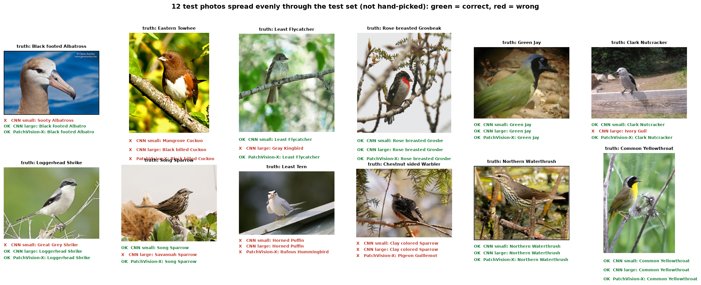

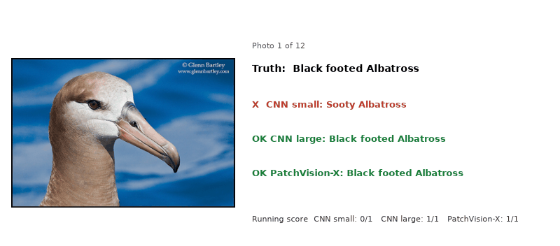

<details>
<summary><b>Where PatchVision-X wins and where the CNNs win (click to open)</b></summary>

Six photos drawn at random from each group:

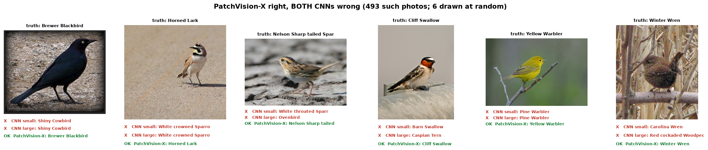

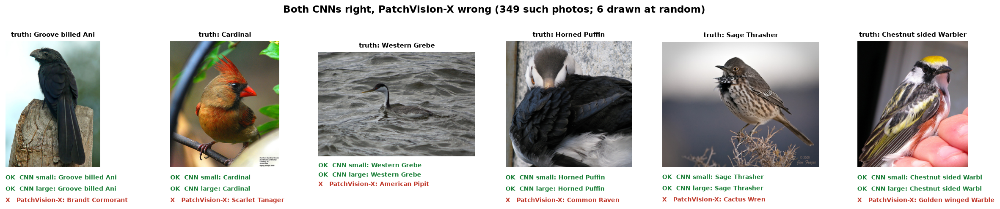

</details>

<details>
<summary><b>More from the individual runs (click to open)</b></summary>

**CNN small** training curves, confusion matrix and calibration:

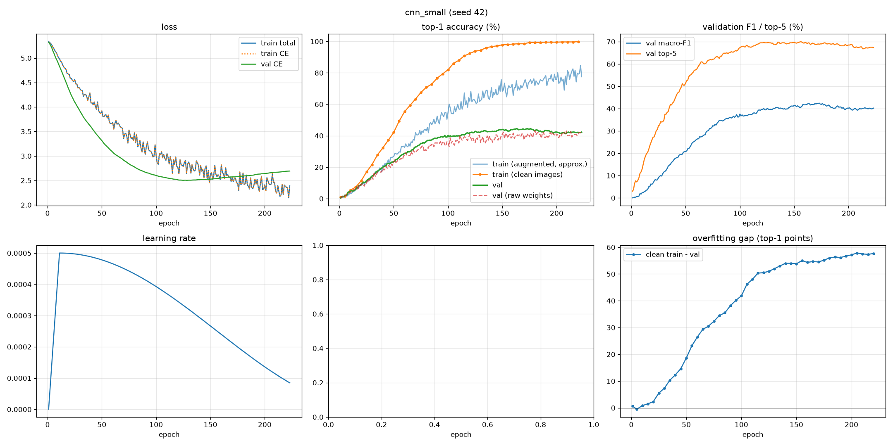
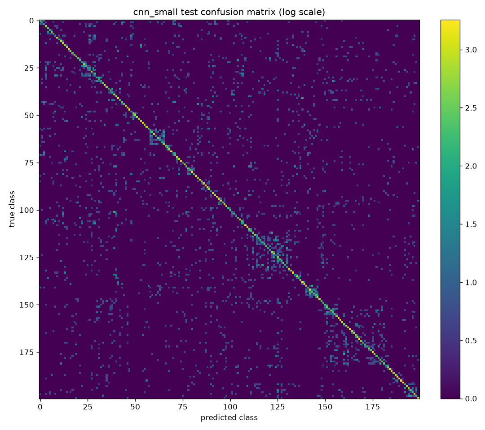
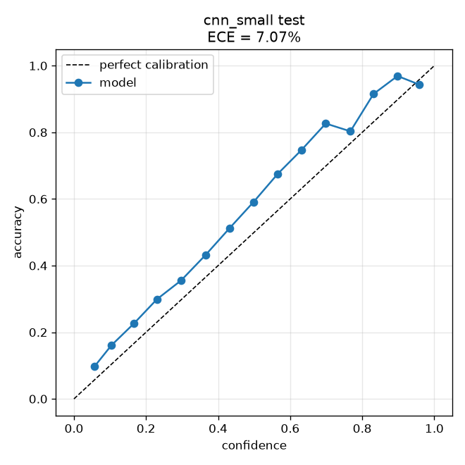

**PatchVision-X** flip test, EMA effect and attention over training:

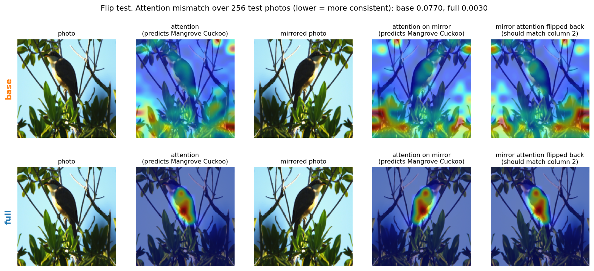
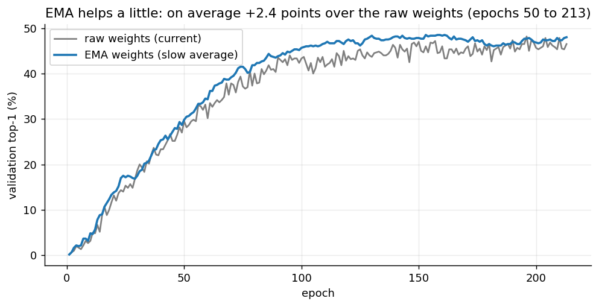
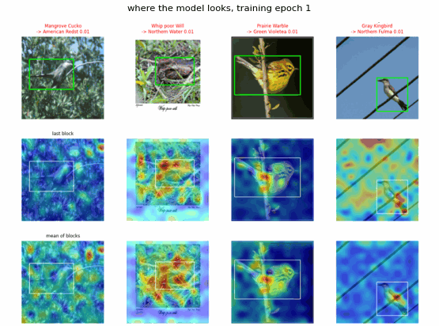

More figures: [`ViT_PatchVisionX/README.md`](ViT_PatchVisionX/README.md) and [`CNN_Baseline/README.md`](CNN_Baseline/README.md).

</details>

---

## 5. The winner and why

<table>
<tr><td>

### 🏆 PatchVision-X is the most accurate model

**47.39 % top-1 · 73.59 % top-5 · 47.05 % macro-F1**, the best of the four on all three, with the smallest memorizing gap (49.8 points).

| vs | Top-1 lead | Significant? |
|---|---|---|
| CNN small (same size) | **+3.76 points** | yes (p < 0.0001) |
| CNN large (2.6× bigger) | **+1.55 points** | yes (p = 0.012) |
| ViT base (same model, extras off) | **+7.85 points** | yes (p < 0.0001) |

</td></tr>
</table>

### Why it wins (what the evidence supports)

1. **The extras, not the transformer itself, make the difference.** The plain version of the same network (`base`) is *worse* than both CNNs (39.5 % vs 43.7 % and 45.9 %). Adding the extras lifts it by 7.9 points and past both CNNs. A bare ViT loses to a CNN on 27 photos per species; a ViT with locality, multi-scale context, and training-time guidance does not.
2. **It looks at the bird.** Its attention falls on the bird's box (0.66) far more than chance (0.34); `base` is at chance (0.36). Cleaner evidence of focus means less learning from background.
3. **It is stable under a mirrored photo** (same answer 93 % of the time vs 78 %), a free regularizer that a CNN did not get.
4. **Smoother final weights** (EMA, +2.4 points). The CNNs also use EMA, so this does not explain the gap to them.

> **What we cannot claim.** We have not run the ablations that would say *which* extra matters most; the code for them exists. Two of the extras (bird boxes, flip-consistency) are extra supervision the CNN never had, so part of the lead may be "more guidance" and not "better architecture". Giving the CNN a comparable boost is future work.

### Where the CNN is the better choice

| Criterion | Better | Why |
|---|---|---|
| Fewest parameters and compute | **CNN small** | 4.22 M, 1.40 GFLOPs (a hair below PatchVision-X) |
| Best calibrated confidence | **ViT base** (ECE 2.5 %) | PatchVision-X is more accurate but more over-confident (ECE 6.0 % vs CNN small 7.1 %) |
| Simplicity | **CNNs** | standard architecture, no custom code, no box annotations needed |
| Speed per photo and training time | *unknown* | CNN runs measured faster, but on a different GPU; same-GPU benchmark pending |

**Bottom line.** If accuracy is the goal and a custom training recipe is acceptable, use **PatchVision-X**. If you need a quick, simple baseline with no special annotations, a **CNN** gets within 2 to 4 points.

---

## 6. The regularization trials (ViT, one change at a time)

To fight memorizing, four cheap fixes were each applied alone on top of `full` (validation decides; test numbers are shown for the record only):

| Run | The one change | Epochs run | Lowest val loss | Val top-1 (smoothed) | Gap (pts) | Test top-1 | Test ECE |
|---|---|---|---|---|---|---|---|
| `full` (reference) | none | 213 | 2.32 | 48.4 % | 49.8 | 47.39 % | 5.95 % |
| `ovf1_droppath0.3` | stochastic depth 0.1 → 0.3 | 300 | **2.14** | **51.3 %** | 48.3 | **52.07 %** | 10.77 % |
| `ovf2_wd0.1` | weight decay 0.05 → 0.1 | 208 | 2.26 | 50.1 % | 49.2 | 50.03 % | 7.38 % |
| `ovf3_autoaug` | `strong` → `auto` augmentation | 239 | **2.14** | 50.6 % | 48.5 | 50.26 % | 8.09 % |
| `ovf4_dropout0.1` | dropout 0 → 0.1 | 253 | 2.23 | 50.8 % | 48.8 | 48.08 % | 5.70 % |

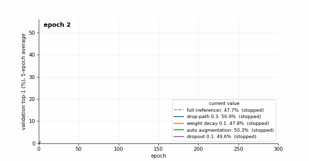

**Reading it honestly:** all four lowered validation loss and raised validation accuracy by 2 to 3 points, but **none closed the memorizing gap** (still about 48 to 50 points), and calibration got worse in three of four. The validation set has only 600 photos, so the four are within noise of each other. `ovf1` is not a perfectly fair comparison: it was the only one that ran all 300 epochs.

---

## 7. E4: the regularization study (running)

This is experiment **E4** from the proposal: *which training choices help a small-data model most?* The four one-change trials above answer "does each help alone". E4 asks the next question: **do they add up?**

| Run | What is combined | Status |
|---|---|---|
| `ovf5_dp0.3_autoaug` | stochastic depth 0.3 + `auto` augmentation (the two best single changes) | **running** |
| `ovf6_all_four` | stochastic depth 0.3 + weight decay 0.1 + `auto` augmentation + dropout 0.1 | **running** |

Both use the full 300-epoch schedule (early stopping off) so they are comparable with `ovf1`, and the best epoch is again chosen on validation only. Only the ViT is being tuned here; the CNN has had no regularization study ([section 8](#8-limits-of-this-study)).

**Results:** not available yet. This section will be filled in with the table, the E4 figure and the race animation when both runs finish (`python assets/make_assets.py e4 e4race` generates them from the saved run files).

---

## 8. Limits of this study

- **One seed.** Every number is seed 42. Differences of a few points could move with other seeds. Three seeds are required by the proposal and not done yet.
- **Unequal help.** PatchVision-X uses bird boxes and flip-consistency in training; the CNN does not. The ViT has had a regularization search ([sections 6 and 7](#6-the-regularization-trials-vit-one-change-at-a-time)); the CNN has had none and uses the ViT's learning rate and weight decay without tuning.
- **Different hardware.** ViT runs: RTX 4090, PyTorch 2.5.1. CNN runs: RTX 5090, PyTorch 2.11. Accuracy is not affected by this in any way we expect, but all timing numbers are.
- **Small validation set.** 600 photos (3 per species) is a noisy yardstick for picking the best epoch and for comparing the trials.
- **Test set seen.** We have looked at test results for all runs. Decisions after this point should be made on validation only.
- **Not the proposal's plain ViT.** The proposal described a textbook ViT (6 blocks, 384 dimensions, class token). We built the stronger PatchVision-X hybrid instead; the `base` run is the nearest "plain" reference but still uses the conv tokenizer and graph attention. The deviation is documented in [`ViT_PatchVisionX/README.md`](ViT_PatchVisionX/README.md#differences-from-the-original-project-proposal).
- **Unverified GvT detail.** The graph-attention parts follow our reading of an under-specified paper and were not checked line by line against it.

---

## 9. How to reproduce

```powershell
# data: download CUB-200-2011 into ./CUB_200_2011 (not stored in Git)
# the split, normalisation and augmentation settings are already in DataPreprocessing_Results/

# ViT (from inside ViT_PatchVisionX/)
python train.py base 42
python train.py full 42
python train.py ovf1_droppath0.3 42

# CNN (from inside CNN_Baseline/)
python train.py cnn_small 42
python train.py cnn_large 42

# rebuild every figure and animation on this page (from the repo root)
python assets/make_assets.py
```

Runs resume automatically from `last.pt` if interrupted. Model weights (`*.pt`) are not stored in Git. Software used: Python 3.11 and PyTorch 2.5.1 (CUDA 12.4) for the ViT runs; Python 3.12 and PyTorch 2.11 (CUDA 12.8) for the CNN runs.

### Repository map

```
patchvision-vit-cub200/
├── README.md                          <- this page
├── DataPreprocessing_Results/         shared: split files, normalisation, augmentation settings
├── patchvision_*_preprocessing.ipynb  shared: data exploration and preparation
├── ViT_PatchVisionX/                  everything about the Vision Transformer (code, results, its own README)
├── CNN_Baseline/                      everything about the CNN baselines (code, results, notebook, its own README)
└── assets/                            figures, animations and tables for this page, plus make_assets.py
```

## References

1. Dosovitskiy et al. *An Image is Worth 16×16 Words: Transformers for Image Recognition at Scale.* ICLR 2021.
2. Touvron et al. *Training Data-Efficient Image Transformers & Distillation through Attention* (DeiT). ICML 2021.
3. Wah et al. *The Caltech-UCSD Birds-200-2011 Dataset.* Caltech, 2011.
4. *Graph-based vision transformer with sparsity for training on small datasets from scratch.* Scientific Reports 15 (2025).
5. *MSCViT: A Small-size ViT architecture with Multi-Scale Self-Attention Mechanism for Tiny Datasets.* arXiv:2501.06040 (2025).
