# PatchVision-X, round 01: a graph-attention ViT with four training-time extras, trained from scratch on 200 bird species

     

This folder is **round 01 of PatchVision-X**, the project's main model. It trains PatchVision-X **from scratch** on 5,394 photos (about 27 per species) with `strong` augmentation, Mixup/CutMix and four training-time extras: the `full` run, four one-change regularization trials, and two combined runs (E4). The plain ViT it is built on (`base`, the same network with the additions switched off) is documented in [`../../Vision_Transformer/01_strongaug_mixup_cutmix`](../../Vision_Transformer/01_strongaug_mixup_cutmix) and serves as the reference here. The code is in the shared package [`../../Vision_Transformer/patchvision`](../../Vision_Transformer/patchvision). Round 02 (`auto` augmentation, no Mixup/CutMix, the same regularization search as the CNNs and the plain ViT, extras still on) is in [`../02_autoaug_nomix_regularization`](../02_autoaug_nomix_regularization): its best run reaches 50.05 %, +2.7 over `full`, still 2.9 below E4.

> **Jump to:** [Result in one minute](#1-the-result-in-one-minute) · [Data](#2-the-data-and-augmentation) · [The model](#3-the-model) · [The four extras](#4-the-four-training-time-extras) · [Training recipe](#5-how-it-was-trained) · [Learning](#6-how-training-went) · [Results](#7-results-in-detail) · [Trials](#8-overfitting-trials-one-change-at-a-time) · [E4](#9-e4-combining-the-best-changes) · [Against the CNNs](#10-against-the-cnns) · [Learned](#11-what-we-learned) · [Limits](#12-limits) · [Run it](#13-run-it-yourself)

---

## 1. The result in one minute

| Run | What it is | Params | GFLOPs | **Top-1** | Top-5 | Macro-F1 | Gap |
|---|---|---|---|---|---|---|---|
| `base` (reference) | plain ViT: additions and extras off | 4.31 M | 1.55 | 39.52 % | 65.12 % | 39.12 % | 59.8 pts |
| `full` | **PatchVision-X**: everything on | 4.27 M | 1.55 | **47.39 %** | 73.59 % | 47.05 % | 49.8 pts |
| `ovf5_dp0.3_autoaug` | PatchVision-X + drop-path 0.3 + `auto` augmentation (**E4 winner**) | 4.27 M | 1.55 | **53.00 %** | 78.10 % | 52.74 % | 46.8 pts |

One seed (42), 5,794 unseen test photos, sampling noise about ±1.3 points. "Gap" = accuracy on clean training photos minus validation accuracy.

1. **PatchVision-X beats the plain ViT by 7.9 points** (789 test photos only `full` gets right, 334 only `base`; p < 0.0001), at the same size and compute. It also looks at the bird: 66 % of its attention falls inside the bird box, against 36 % for `base`.
2. **Regularization adds another 5.6 points.** Drop-path 0.3 plus `auto` augmentation takes PatchVision-X from 47.39 % to **53.00 %** (p < 0.0001), the best test accuracy in the project.
3. **It still memorizes the training photos.** Every run reaches about 100 % on them; the gap falls from 49.8 to 46.8 points but does not close.

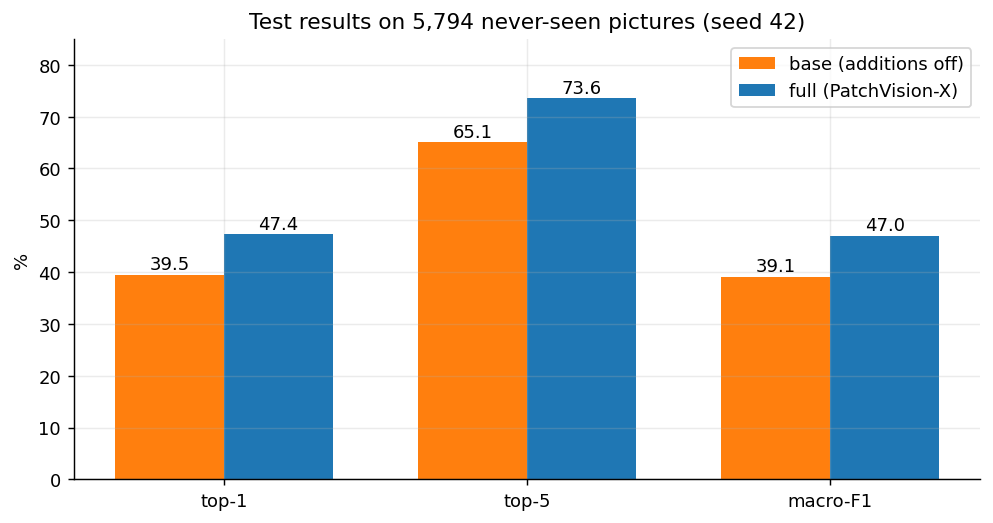

<p align="center">
  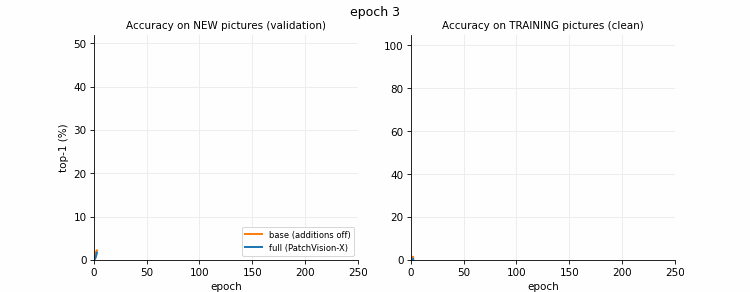
</p>

*Left: accuracy on new photos while training. Right: accuracy on the training photos. Both models reach about 100 % on the training photos; PatchVision-X is clearly better on new ones.*

---

## 2. The data and augmentation

**CUB-200-2011:** 11,788 photos of 200 species, with a bounding box around the bird in every photo. Every run uses the same fixed split from [`../../DataPreprocessing_Results`](../../DataPreprocessing_Results):

| Split | Photos | Per species | Used for |
|---|---|---|---|
| Train | 5,394 | 26 to 27 | learning |
| Validation | 600 | 3 | choosing the best epoch and the early stop |
| Test | 5,794 | 11 to 30 | the final result, read once at the end of each run |

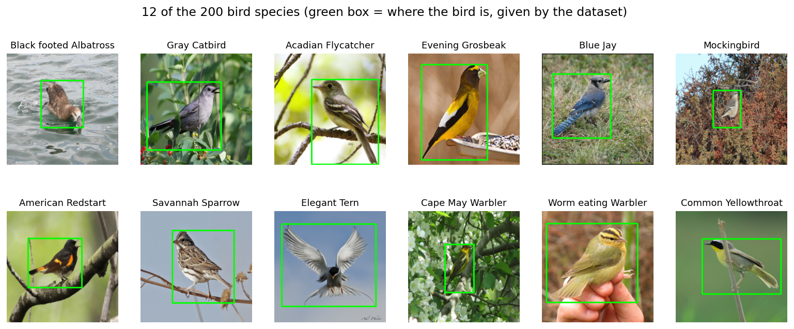

*The green boxes are the bird boxes from the dataset. They are never given to the model as input; PatchVision-X uses them only as a training signal (section 4).*

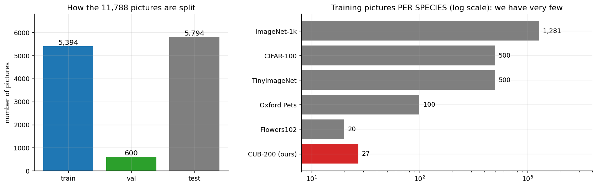

Photos are normalised with the training-set mean `[0.486, 0.499, 0.431]` and std `[0.226, 0.222, 0.261]`.

### Augmentation: `strong` + Mixup/CutMix

| Step | Setting |
|---|---|
| Box-guided crop (PatchVision-X extra) | 30 % of photos first cropped to the bird box + 10 to 40 % margin |
| Random crop | 35 to 100 % of the photo, resized to 224 × 224 |
| Horizontal flip | 50 % |
| Random affine | rotate up to 10°, shift up to 5 %, scale 0.9 to 1.1 |
| Colour jitter | brightness, contrast and saturation ±0.3 (no hue change) |
| Random erasing | 25 % of photos |

Validation and test photos are only resized to 224 × 224 and normalised.

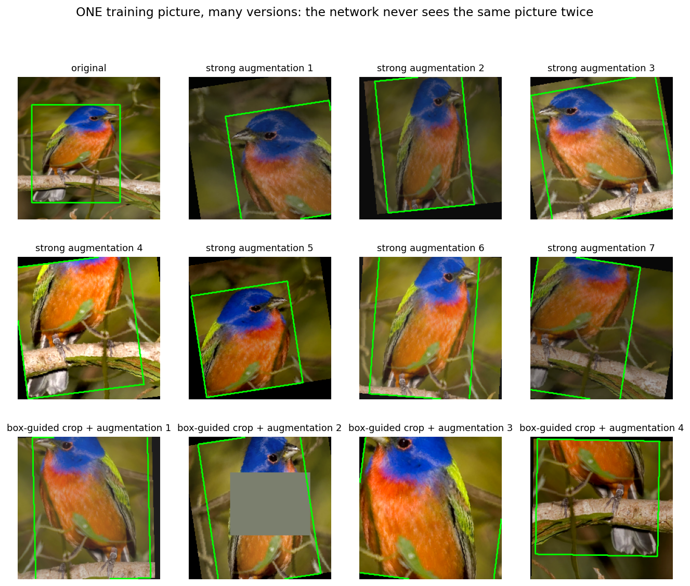

*Bottom row: the box-guided crop. The green outline follows the bird because the box gets the same crop and rotation as the photo.*

<p align="center">
  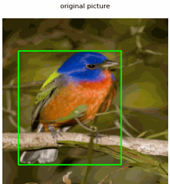
</p>

**Mixup and CutMix** are applied on top, per batch: Mixup blends two photos (strength 0.2), CutMix pastes a rectangle from one photo into another (strength 1.0); half of the batches use CutMix, the other half Mixup. The label is blended in the same proportion. **Label smoothing 0.1** is also used.

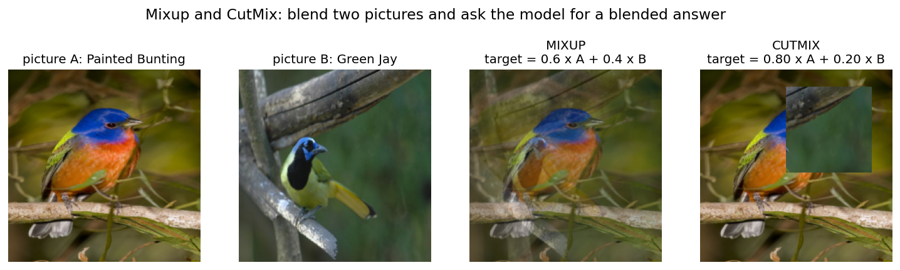

---

## 3. The model

| | `base` (plain ViT, reference) | **PatchVision-X** (`full`) |
|---|---|---|
| Tokenizer | conv tokenizer, 196 tokens of 256 numbers | same |
| Attention | sparse graph attention (GvT style), 8 heads, 3 × 3 neighbourhood | **multi-scale** graph attention: 4 head groups at different ranges |
| Position information | learnable position embedding | **LFE block** (small depthwise convolution) instead |
| Blocks | 4 on 196 tokens, graph pooling to 49, 4 more | same |
| Parameters | 4.31 M | **4.27 M** |
| Compute per photo | 1.55 GFLOPs | 1.55 GFLOPs |
| One photo, batch 1 (RTX 4090) | 12.8 ms | 15.0 ms |
| Photos per second, batch 64 (RTX 4090) | 3,311 | 3,143 |
| Training-time extras (section 4) | off | on |
| Pretrained weights | none | none |

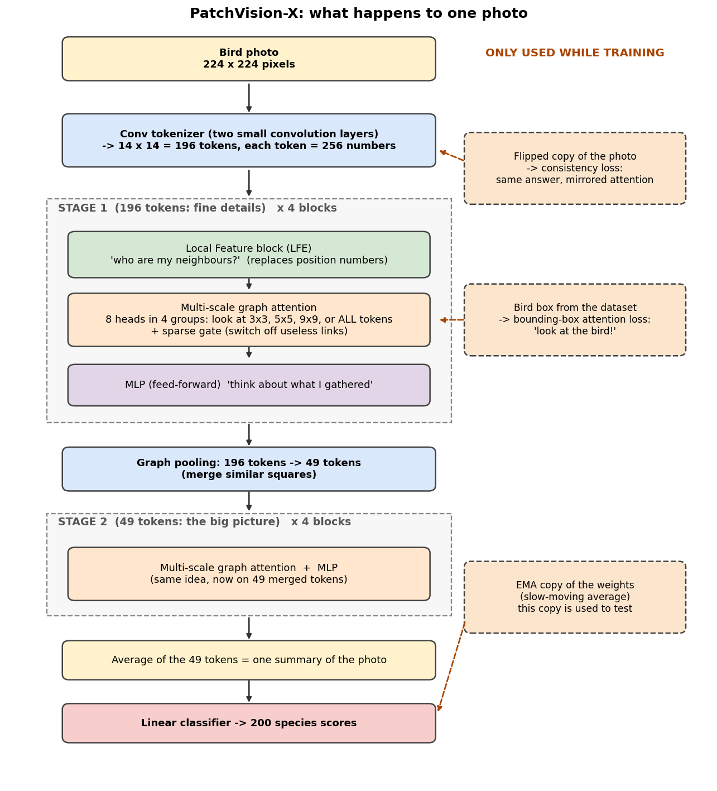

*One photo goes in at the top, 200 species scores come out at the bottom. The dashed orange boxes on the right are used only during training.*

### Step by step

1. **Conv tokenizer.** Two small convolution layers turn the 224 × 224 photo into 14 × 14 = 196 tokens of 256 numbers each.
2. **Stage 1: four blocks on 196 tokens.** Each block: LFE, multi-scale graph attention, then an MLP (ratio 3).
3. **Graph pooling.** Similar tokens are merged: 196 become 49.
4. **Stage 2: four blocks on 49 tokens.**
5. **Average and classify.** The 49 tokens are averaged and a linear layer gives 200 scores. There is no class token.

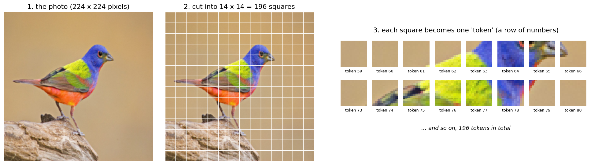

### Multi-scale graph attention

The 8 heads are split into 4 groups of 2. Each group may only attend within its own neighbourhood on the token grid: 3 × 3, 5 × 5, 9 × 9, or the whole photo.

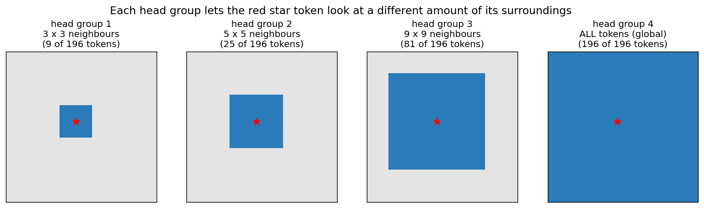

<p align="center">
  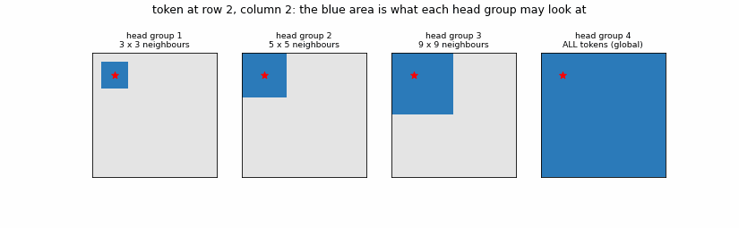
</p>

<details>
<summary><b>What happens inside one attention layer (click to open)</b></summary>

1. **Build the graph.** For every pair of tokens: (inside this head group's neighbourhood?) × (how similar do they look?). Similarity is a cosine similarity passed through a softmax with a learned temperature.
2. **Graph convolution for queries and keys.** Queries and keys are averaged over each token's graph neighbours (degree-normalised).
3. **Attention.** Softmax of query times key.
4. **Sparse talking-heads gate (from GvT).** A gate per head and token can shrink weak links to zero; the heads then mix through a learnable 8 × 8 matrix that starts as the identity.
5. **Values.** Another graph convolution guided by the attention, plus a residual connection.
6. Attention is computed in 32-bit even when the rest runs in bf16.

After pooling there is no grid any more, so the 3 × 3 / 5 × 5 / 9 × 9 neighbourhoods become 1, 2 and 4 hops along the learned graph between the 49 merged tokens (the fourth group still sees everything).

</details>

### Where the ideas come from

| | **GvT**, *Graph-based vision transformer with sparsity for training on small datasets from scratch* (Sci. Rep. 2025) | **MSCViT**, *A Small-size ViT architecture with Multi-Scale Self-Attention Mechanism for Tiny Datasets* (arXiv 2501.06040) |
|---|---|---|
| Taken | conv tokenizer, graph attention, sparse gate, graph pooling | the LFE block and the multi-scale idea |
| Changed | unclear details were interpreted (marked `INTERPRETATION` in `patchvision/models.py`) | no wavelet convolution and no four-stage layout; the multi-scale idea was rebuilt on the graph |

All code was written from scratch in PyTorch ([`../../Vision_Transformer/patchvision/models.py`](../../Vision_Transformer/patchvision/models.py)). The GvT part was not checked line by line against the paper's equations, so it is a GvT-*style* model, not a verified reproduction.

---

## 4. The four training-time extras

Used only during training. At test time the model is just the network in section 3.

| # | Extra | What it does |
|---|---|---|
| 1 | **Bird-box attention loss** (weight 0.1) | penalises attention that falls outside the bird box |
| 2 | **EMA weights** (decay 0.999) | evaluates a slow-moving average of the weights instead of the latest weights |
| 3 | **Flip-consistency loss** | feeds each photo and its mirror image; penalises different predictions and attention maps that do not mirror |
| 4 | **Box-guided crop** (30 %) | crops some training photos to the bird box first (section 2) |

### 1. Bird-box attention loss

The share of attention inside the bird box climbs from about 0.35 (what random attention gives, since the box covers about 34 % of a photo on average) to about 0.70 for PatchVision-X, while `base` stays at chance (bottom-right panel of the training curves in [section 6](#6-how-training-went)).

### 2. EMA weights

The averaged weights were **2.4 points better** than the raw weights on validation (average over epochs 50 to 213):

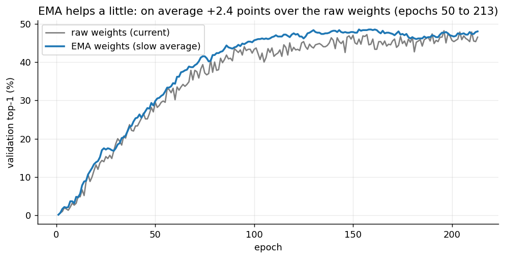

### 3. Flip-consistency loss

Checked on 256 test photos spread evenly through the test set:

| | `base` | **PatchVision-X** |
|---|---|---|
| Same prediction for the mirrored photo | 77.7 % | **93.0 %** |
| Attention mismatch between photo and mirror (lower is better) | 0.077 | **0.003** |

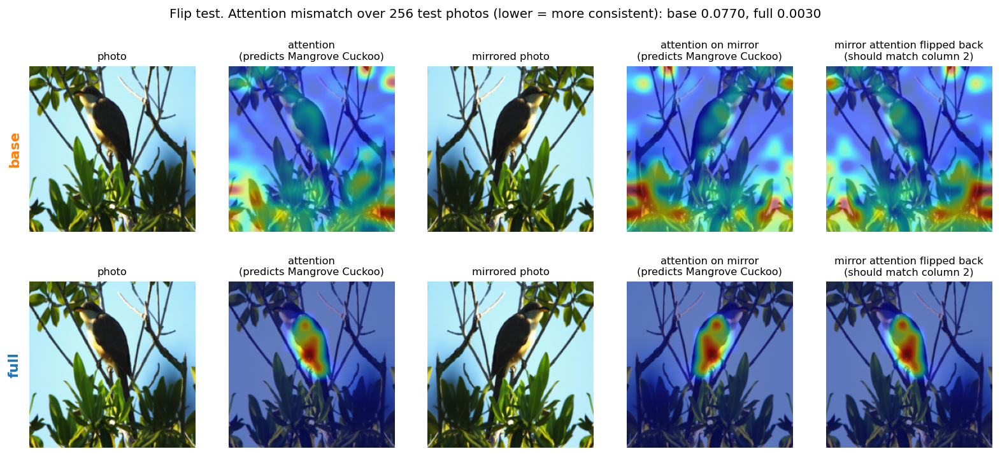

*Right-most column: the attention of the mirrored photo, flipped back. It should match column 2. For PatchVision-X it does; for `base` it does not.*

It doubles the images per step (128 instead of 64), so PatchVision-X takes 20 s per epoch against 12 s for `base`. The size of the two extra loss terms during training:

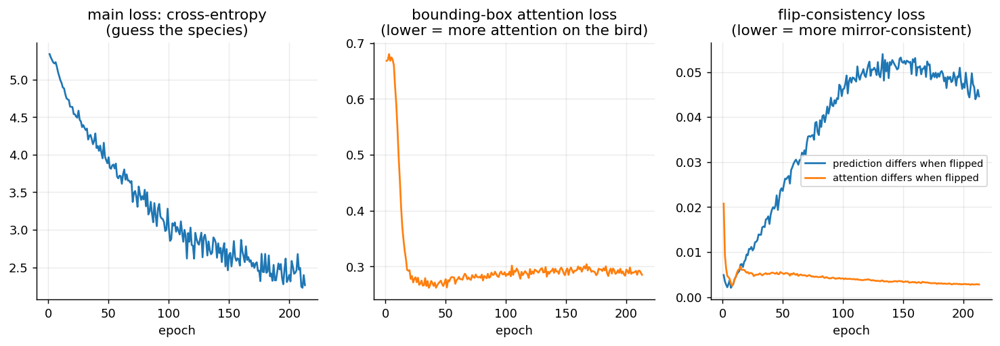

---

## 5. How it was trained

| Setting | Value |
|---|---|
| Data | the shared split: 5,394 train / 600 validation / 5,794 test |
| Augmentation | `strong` + Mixup/CutMix + box-guided crop (section 2) |
| Loss | cross-entropy with label smoothing 0.1, + bird-box loss (0.1) + flip-consistency losses (prediction 1.0, attention 1.0) |
| Optimizer | AdamW, learning rate 5e-4, weight decay 0.05, betas (0.9, 0.999), gradient clipping 1.0 |
| Schedule | 10 warm-up epochs, then cosine decay to 1e-6; batch 64; up to 300 epochs |
| Regularization | drop-path 0.1, no dropout |
| EMA weights | on (decay 0.999); the averaged weights are evaluated |
| Precision | bf16, attention in 32-bit |
| Stopping | early stopping on **validation** (patience 60); best epoch chosen on validation only |
| Test set | read once, at the end, with the chosen epoch |
| Seed | 42 |
| Hardware | RTX 4090, PyTorch 2.5.1 (the two E4 runs: RTX 5090, PyTorch 2.11) |

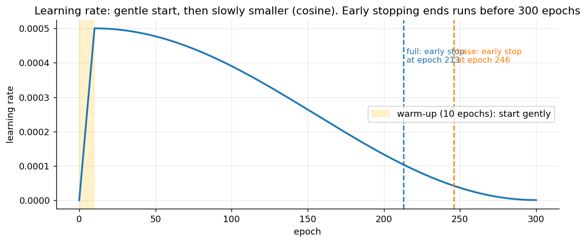

*`full` ended through early stopping at epoch 213 (`base` at epoch 246).*

Every run writes to `results/<run>/seed42/`: `train_log.txt` (every step), `steps.csv` and `history.csv`, `config.json` and `env.json`, `curves.png`, `attention_snapshots/` and `val_reports/` every 10 epochs, `best_model.pt` and `last.pt`, and the `test_*` files (metrics, per-species table, every prediction, confusion matrix, calibration, attention gallery). An interrupted run resumes from `last.pt`.

---

## 6. How training went

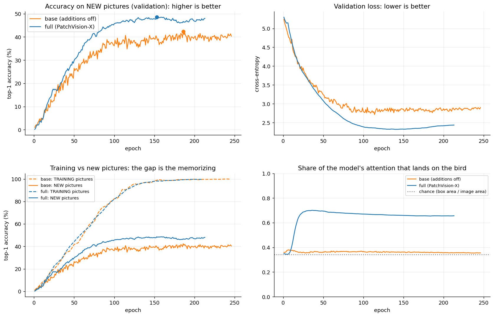

* **Top left:** PatchVision-X learns faster and ends higher on new photos.
* **Top right:** its validation loss is lowest around epoch 140 and then rises slowly, a sign of memorizing.
* **Bottom left:** both reach about 100 % on training photos (dashed); the solid lines are new photos.
* **Bottom right:** only PatchVision-X puts its attention on the bird.

### The memorizing gap

Every 5 epochs each run is tested on 600 training photos **without augmentation**; that clean accuracy is the green line (the training accuracy in the log is measured on augmented, Mixup/CutMix-blended photos and is misleading).

<p align="center">
  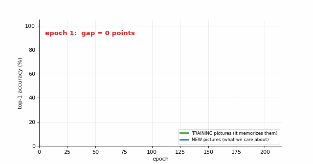
</p>

*PatchVision-X: clean training accuracy (green) climbs to about 100 %, validation (blue) stops near 48 %. The pink area is the gap.*

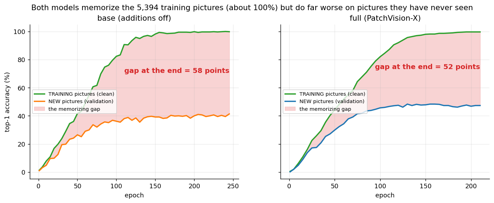

---

## 7. Results in detail

### Numbers

| | `base` (reference) | **PatchVision-X** (`full`) | Difference |
|---|---|---|---|
| **Test top-1** | 39.52 % | **47.39 %** | +7.87 |
| Test top-5 | 65.12 % | **73.59 %** | +8.47 |
| Test macro-F1 | 39.12 % | **47.05 %** | +7.93 |
| Validation top-1 at the chosen epoch | 42.3 % | **48.5 %** | +6.2 |
| Attention inside the bird box (chance 0.34) | 0.36 | **0.66** | |
| Calibration error (ECE, lower is better) | **2.49 %** | 5.95 % | worse |
| Memorizing gap (clean-train minus validation) | 59.8 pts | **49.8 pts** | −10.0 |
| Chosen epoch / epochs run | 186 / 246 | 153 / 213 | |
| Training time (RTX 4090) | 48 min | 71 min | |
| Time per epoch | 11.8 s | 20.1 s | |

**Is the lead real?** On the same 5,794 test photos, both are right on 1,957 and both wrong on 2,714; only PatchVision-X is right on **789**, only `base` on **334** (exact McNemar test, p < 0.0001).

### Where the models look

Eight test photos spread evenly through the test set (not hand-picked). White rectangle = bird box (not shown to the model):

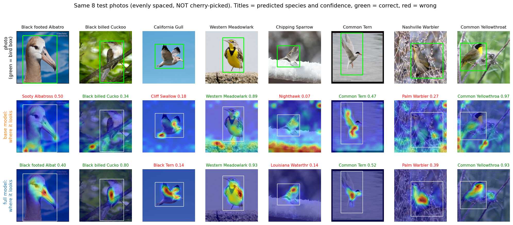

`base` (middle row) often looks at branches, snow and background. PatchVision-X (bottom row) looks at the bird, mostly the head and breast. Looking at the bird does not guarantee the right species: it still gets 3 of these 8 wrong.

How PatchVision-X's attention changed during training (validation photos, every 10 epochs):

<p align="center">
  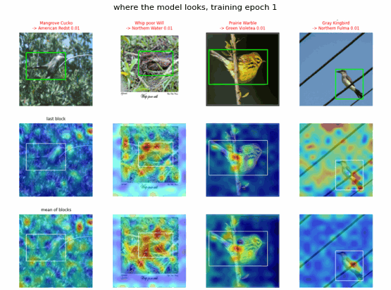
</p>

### Which species are easy and which are hard?

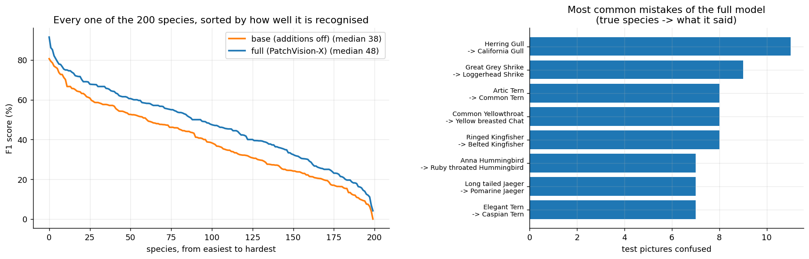

| | `base` | **PatchVision-X** |
|---|---|---|
| Median species F1 | 38.4 | **47.6** |
| Species with F1 above 80 | 1 | **5** |
| Species with F1 below 20 | 31 | **17** |
| Species never recognised (F1 = 0) | 1 | **0** |

* **Easiest:** Green Violetear (91.5), Painted Bunting (86.2), Evening Grosbeak (85.2), Green Jay (82.1), Cerulean Warbler (80.7), all with distinctive colours.
* **Hardest:** American Crow (4.2), Slaty-backed Gull (6.9), White-necked Raven (11.1), Western Wood Pewee (12.0), Herring Gull (12.5), all look-alikes of other species in the dataset.
* **Most common mistakes** (right panel): Herring Gull → California Gull, Great Grey Shrike → Loggerhead Shrike, Arctic Tern → Common Tern.

### Calibration: are the confidence numbers honest?

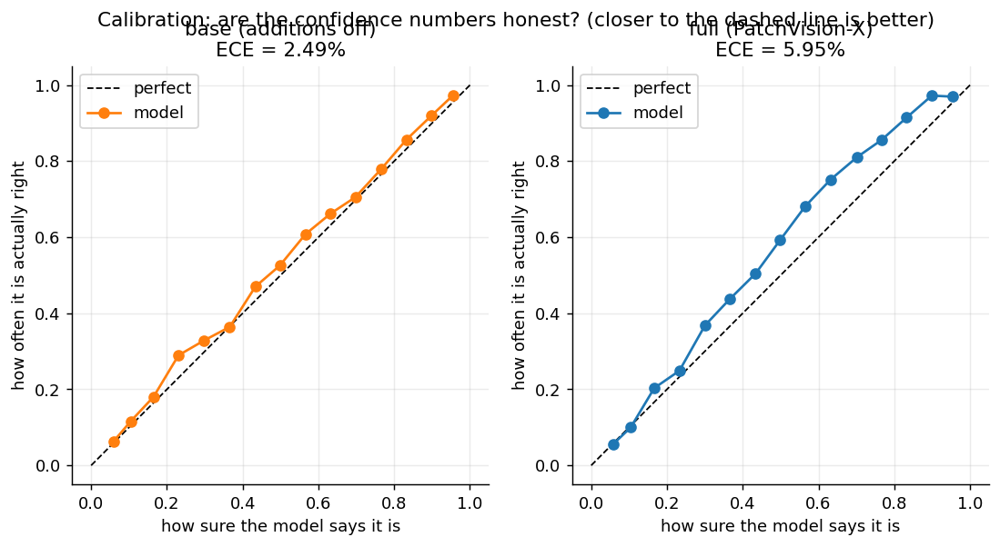

PatchVision-X is more accurate but **less well calibrated** than `base` (ECE 5.95 % against 2.49 %). Its error is on the safe side: it is **under-confident**, 41.5 % sure on average while it is right 47.4 % of the time (curve above the diagonal).

<details>
<summary><b>The run's own plots, as saved by the trainer (click to open)</b></summary>

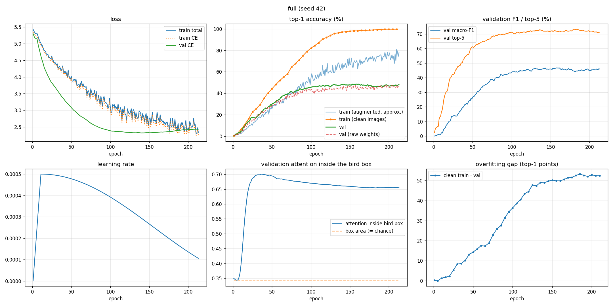
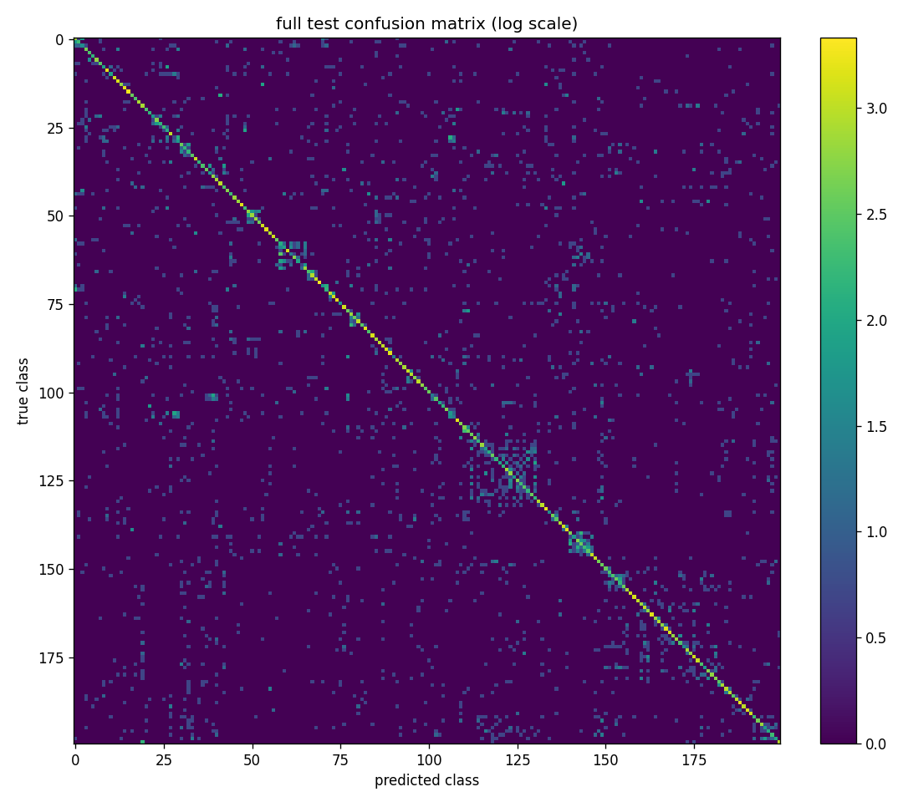
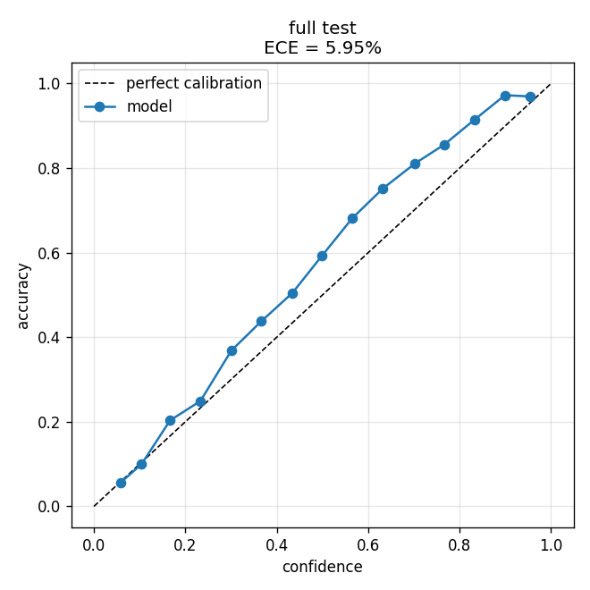
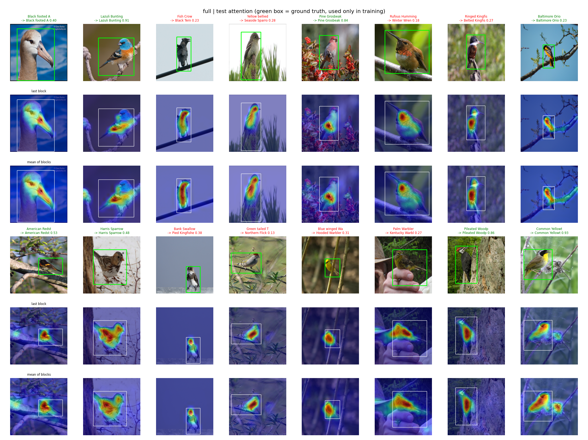

Full per-species tables, every test prediction and the logs are in `results/<run>/seed42/`. The `base` run's files are in [`../../Vision_Transformer/01_strongaug_mixup_cutmix/results/base/seed42/`](../../Vision_Transformer/01_strongaug_mixup_cutmix/results/base/seed42/).

</details>

### Is the sparse gate doing anything?

The gate values stayed near 0.5, and fewer than 1 % fell below 0.1. The "sparsity" the GvT paper is named after hardly appeared here. Whether that is the implementation, the small data or the settings is not known.

---

## 8. Overfitting trials: one change at a time

PatchVision-X still memorizes, so four standard fixes were each tested **alone** on top of `full`: same data, same seed, same 300-epoch schedule, same early stopping. The notebook checks from the saved settings that exactly one thing differs.

| Trial (= results folder) | The one change |
|---|---|
| `ovf1_droppath0.3` | drop-path 0.1 → 0.3 (skip whole blocks at random, up to 30 % for the last block) |
| `ovf2_wd0.1` | weight decay 0.05 → 0.1 |
| `ovf3_autoaug` | augmentation `strong` → `auto` (TrivialAugmentWide; the box follows geometric operations) |
| `ovf4_dropout0.1` | dropout 0 → 0.1 in the MLPs, projections and attention weights |

**The judging rule was fixed before any result** (top of [`overfitting_trials.ipynb`](overfitting_trials.ipynb)), on validation only. A trial counts as an improvement if (1) its lowest validation loss is at least 0.03 below `full`'s, and (2) its smoothed validation top-1 (best 10-epoch average) is no more than 1 point below `full`'s.

### Results (validation decides)

| Run | Epochs run | Lowest val loss | Val top-1 (smoothed) | Gap (pts) | Passes? | Time |
|---|---|---|---|---|---|---|
| `full` (reference) | 213 | 2.32 | 48.4 % | 49.8 | – | 71 min |
| `ovf1_droppath0.3` | **300** | **2.14** | **51.3 %** | 48.3 | yes | 97 min |
| `ovf2_wd0.1` | 208 | 2.26 | 50.1 % | 49.2 | yes | 69 min |
| `ovf3_autoaug` | 239 | **2.14** | 50.6 % | 48.5 | yes | 79 min |
| `ovf4_dropout0.1` | 253 | 2.23 | 50.8 % | 48.8 | yes | 86 min |

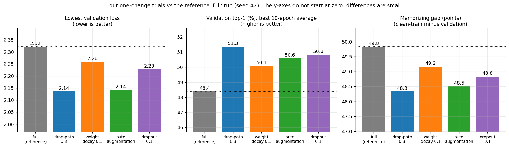

*The y-axes do not start at zero, so small differences look big.*

<p align="center">
  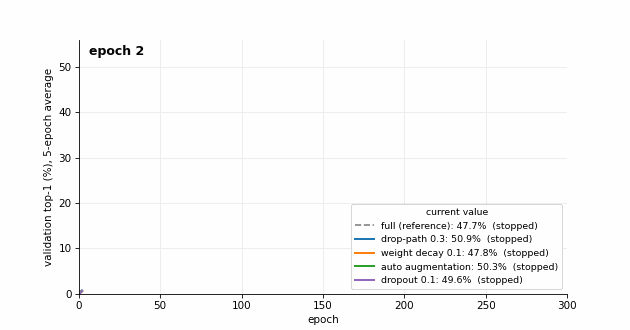
</p>

*Validation accuracy while training. A run stops when early stopping triggers; only `droppath0.3` ran all 300 epochs.*

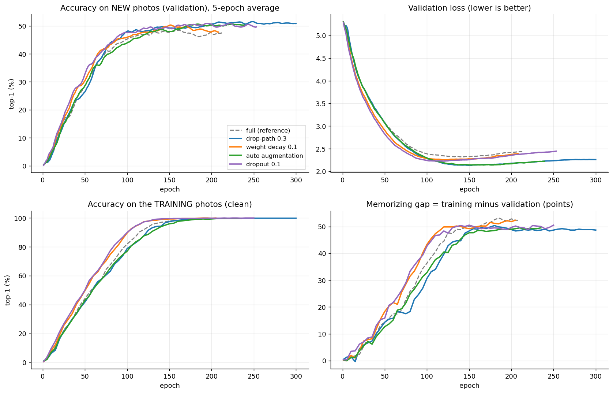

*Bottom right: the memorizing gap stays near 50 points for every run.*

### Test numbers (for the record only)

| Run | Top-1 | Top-5 | Macro-F1 | ECE |
|---|---|---|---|---|
| `full` | 47.39 % | 73.59 % | 47.05 % | 5.95 % |
| `ovf1_droppath0.3` | 52.07 % | 75.15 % | 51.68 % | 10.77 % |
| `ovf2_wd0.1` | 50.03 % | 75.15 % | 49.57 % | 7.38 % |
| `ovf3_autoaug` | 50.26 % | 75.79 % | 50.07 % | 8.09 % |
| `ovf4_dropout0.1` | 48.08 % | 73.16 % | 47.62 % | 5.70 % |

### What the trials show

1. **All four passed and all four helped a little:** lower validation loss and 1.7 to 3.0 points more validation accuracy. The rule turned out to be lenient, so it does not rank them.
2. **The memorizing gap barely moved** (49.8 → 48.3 to 49.2 points). Every run still reaches 99.7 to 100 % on clean training photos.
3. **The differences between the four are about the size of the noise.** One standard error on 600 validation photos is about 2 points near 50 %, and each trial is one seed.
4. **`ovf1_droppath0.3` had a longer schedule.** It was the only trial that ran all 300 epochs (best epoch 246); the others stopped between epochs 208 and 253, before the learning rate had finished falling.
5. **Calibration got worse in three of four trials**; dropout 0.1 stayed about the same.
6. **Attention on the bird did not change** (0.62 to 0.67 inside the box in every run).

The trial comparison table and verdict are in [`results/overfitting_trials/`](results/overfitting_trials/), and the recorded output of all four runs is in [`overfitting_trials.ipynb`](overfitting_trials.ipynb).

---

## 9. E4: combining the best changes

Two combined runs, both with early stopping **off** (all 300 epochs), so they are comparable with `ovf1`:

| Run | What is combined |
|---|---|
| `ovf5_dp0.3_autoaug` | drop-path 0.3 + `auto` augmentation (the two best single changes) |
| `ovf6_all_four` | drop-path 0.3 + weight decay 0.1 + `auto` augmentation + dropout 0.1 |

| Run | Best epoch | Lowest val loss | Val top-1 (smoothed) | Gap (pts) | Test top-1 | Test top-5 | Test macro-F1 | Test ECE |
|---|---|---|---|---|---|---|---|---|
| `full` (reference) | 153 | 2.32 | 48.4 % | 49.8 | 47.39 % | 73.59 % | 47.05 % | 5.95 % |
| drop-path 0.3 alone | 246 | 2.14 | 51.4 % | 48.3 | 52.07 % | 75.15 % | 51.68 % | 10.77 % |
| **`ovf5`: drop-path 0.3 + auto** | 252 | 2.05 | **53.1 %** | 46.8 | **53.00 %** | 78.10 % | **52.74 %** | 10.45 % |
| `ovf6`: all four | 258 | **2.02** | 52.9 % | **46.7** | 52.40 % | **78.22 %** | 52.26 % | 9.19 % |

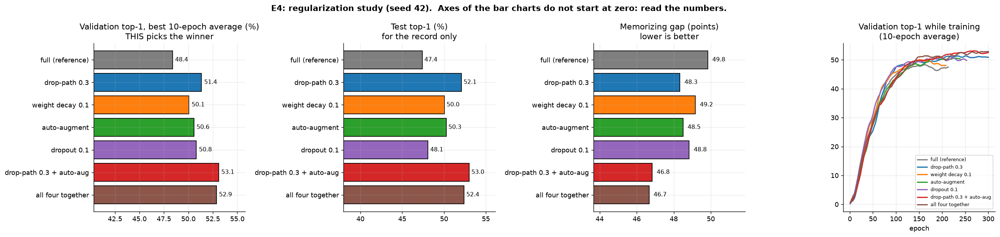

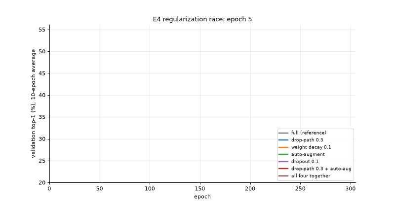

*Validation accuracy while training for all seven runs; the two E4 runs finish on top.*

### Is the improvement real? (paired test on the same test photos)

| A vs B | A minus B (top-1 points) | Only A right | Only B right | p-value | Significant? |
|---|---|---|---|---|---|
| `ovf5` vs `full` | +5.63 | 658 | 332 | < 0.0001 | yes |
| `ovf5` vs drop-path 0.3 alone | +0.97 | 481 | 425 | 0.068 | no |
| `ovf6` vs `full` | +5.06 | 606 | 313 | < 0.0001 | yes |
| `ovf6` vs drop-path 0.3 alone | +0.40 | 437 | 414 | 0.45 | no |
| `ovf5` vs `ovf6` | +0.57 | 396 | 363 | 0.25 | no |
| `ovf5` vs `base` (plain ViT) | +13.48 | 1,045 | 264 | < 0.0001 | yes |

### What E4 shows

1. **Regularization helps a lot; combining helps a little more.** +5.1 to +5.6 points over `full` (significant), but only +0.4 to +1.0 over drop-path 0.3 alone (not significant).
2. **The two combinations are tied** (p = 0.25). By the project's rule (best smoothed validation accuracy) **`ovf5` is the round-01 winner**, chosen at epoch 252.
3. **The clearest gain is in top-5:** 78.1 % and 78.2 % against 73.6 % for `full`.
4. **The gap moved for the first time, but did not close:** 49.8 → 46.7 to 46.8 points.
5. **Calibration got worse:** ECE 10.5 % and 9.2 % against 6.0 % for `full`. Attention inside the bird box is unchanged (0.66).
6. **Both best epochs are late (252 and 258)**, so early stopping would have saved little.

Each run's own plots: [`results/ovf5_dp0.3_autoaug/seed42/`](results/ovf5_dp0.3_autoaug/seed42/) and [`results/ovf6_all_four/seed42/`](results/ovf6_all_four/seed42/).

---

## 10. Against the CNNs

The round-01 CNN baselines ([`../../CNN_Baseline/01_strongaug_mixup_cutmix`](../../CNN_Baseline/01_strongaug_mixup_cutmix)) used the same data, splits, augmentation and recipe as `full`, without the extras that need attention maps.

| Model | Params | GFLOPs | Top-1 | Top-5 | Macro-F1 | Gap |
|---|---|---|---|---|---|---|
| Plain ViT (`base`) | 4.31 M | 1.55 | 39.52 % | 65.12 % | 39.12 % | 59.8 pts |
| CNN small | 4.22 M | 1.40 | 43.65 % | 69.02 % | 43.54 % | 54.7 pts |
| CNN large | 11.28 M | 3.63 | 45.86 % | 71.16 % | 45.79 % | 53.3 pts |
| **PatchVision-X** (`full`) | 4.27 M | 1.55 | **47.39 %** | **73.59 %** | **47.05 %** | **49.8 pts** |
| **PatchVision-X, E4** (`ovf5`) | 4.27 M | 1.55 | **53.00 %** | **78.10 %** | **52.74 %** | **46.8 pts** |

* **PatchVision-X is ahead of both CNNs** under the same recipe: +3.8 over CNN small and +1.5 over CNN large, both significant on the test photos, while the plain ViT is behind both.
* **The comparison is not fully even:** PatchVision-X also trains with the bird boxes and flip-consistency, which the CNNs cannot use, and only PatchVision-X had the regularization search of sections 8 and 9. The CNNs got their own search in round 02 ([`../../CNN_Baseline/02_autoaug_nomix_regularization`](../../CNN_Baseline/02_autoaug_nomix_regularization)), where CNN large reached 51.52 %. PatchVision-X went through the same round 02 in [`../02_autoaug_nomix_regularization`](../02_autoaug_nomix_regularization) and reached 50.05 %.

---

## 11. What we learned

* **The architecture additions and extras matter on small data:** PatchVision-X is +7.9 points over the plain ViT at the same size, and looks at the bird. The additions and extras were switched on together, so how much each one is worth on its own is not measured.
* **Consistency training works as intended:** 93 % of predictions survive a mirror flip, against 78 % for the plain ViT.
* **Regularization helps accuracy, not memorizing:** every single change helped validation by 1.7 to 3 points, the best combination by 5.6 test points, but the gap only fell from 49.8 to 46.8 points.
* **More accuracy came with worse calibration** in almost every run (ECE from 6.0 % up to 10.8 %).
* **With its extras and tuning, PatchVision-X is the most accurate model in the project** (53.00 %).

---

## 12. Limits

- **One seed.** Every number is seed 42; seeds 43 and 44 are not run.
- **Combined changes.** PatchVision-X differs from `base` in six things at once (two architecture changes and four extras). The ablation runs that separate them (`lfe`, `multiscale`, `arch_x`, `arch_x+<extra>`, `full-<component>`) are defined in [`../../Vision_Transformer/patchvision/config.py`](../../Vision_Transformer/patchvision/config.py) but not run.
- **Small validation set.** 600 photos (3 per species) choose the best epoch and the winners, so these choices are noisy.
- **Different schedules.** Most runs stopped early at different epochs; `ovf1`, `ovf5` and `ovf6` ran all 300.
- **Different hardware.** `full` and the four trials: RTX 4090, PyTorch 2.5.1. E4 runs: RTX 5090, PyTorch 2.11. Accuracy should be unaffected; times are not comparable.
- **Test set seen.** All test results of round 01 were read; later choices must use validation only.
- **GvT interpretation.** The GvT parts follow an interpretation of an under-specified paper (section 3).

---

## 13. Run it yourself

Run everything from inside this folder. The code is imported from `../../Vision_Transformer/patchvision/`, the data is read from the repository root (two levels up), and results are written to `results/<run>/seed<seed>/`.

1. Download CUB-200-2011 from the [dataset page](https://www.vision.caltech.edu/datasets/cub_200_2011/) and extract it so that `CUB_200_2011/images/` exists at the repository root. The split files in `DataPreprocessing_Results/` are already in the repository.
2. Train:

```powershell
cd ViT_PatchVisionX/01_strongaug_mixup_cutmix
python train.py full 42
python train.py ovf1_droppath0.3 42        # also ovf2_wd0.1, ovf3_autoaug, ovf4_dropout0.1
python train.py ovf5_dp0.3_autoaug 42      # E4 winner (also ovf6_all_four)
python watch_training.py full 42           # live monitor, in a second terminal
python docs/make_figures.py                # rebuild every figure and animation on this page
```

The plain ViT reference (`base`) is trained in [`../../Vision_Transformer/01_strongaug_mixup_cutmix`](../../Vision_Transformer/01_strongaug_mixup_cutmix) (`python train.py base 42`); `docs/make_figures.py` reads it from there. The four trials can also be run with a recorded notebook: [`overfitting_trials.ipynb`](overfitting_trials.ipynb).

A finished run is skipped and an interrupted one resumes from `last.pt`. Model weights (`*.pt`) are not stored in Git, so train a model before loading it.

Versions used for `full` and the trials: Python 3.11, PyTorch 2.5.1 (CUDA 12.4), torchvision 0.20.1, numpy 1.26.4, pandas 2.2.3, matplotlib 3.9.2, pillow 11.0.0.

<details>
<summary><b>Load a trained model and predict (click to open)</b></summary>

```python
import sys, torch
sys.path.insert(0, "../../Vision_Transformer")           # run from inside ViT_PatchVisionX/01_strongaug_mixup_cutmix/
from patchvision.config import get_trial
from patchvision.models import PatchVisionX

exp = get_trial("ovf5_dp0.3_autoaug")                     # the E4 winner (or get_experiment("full"))
model = PatchVisionX(exp.model)
ck = torch.load("results/ovf5_dp0.3_autoaug/seed42/best_model.pt", map_location="cpu", weights_only=False)
model.load_state_dict(ck["state"])                        # the EMA weights of the chosen epoch
model.eval()
# logits, aux = model(x): x is a normalised (B, 3, 224, 224) tensor; logits are (B, 200), aux holds the attention maps
```

</details>

### Layout

```
ViT_PatchVisionX/01_strongaug_mixup_cutmix/
├── README.md                 this page
├── overfitting_trials.ipynb  runs and records the four trials and their comparison
├── train.py                  one run from a terminal:  python train.py full 42
├── watch_training.py         live monitor
├── docs/
│   ├── make_figures.py       rebuilds every figure and animation on this page
│   └── figures/  animations/
└── results/
    ├── full/seed42/                          logs, curves, metrics, predictions, attention
    ├── ovf1_droppath0.3/ ... ovf6_all_four/  the trials and the E4 runs
    ├── overfitting_trials/                   trial comparison table, plot and verdict
    └── _reference/                           base vs full comparison
```

---

## References

1. A. Dosovitskiy et al. *An Image is Worth 16x16 Words: Transformers for Image Recognition at Scale.* ICLR 2021.
2. H. Touvron et al. *Training Data-Efficient Image Transformers & Distillation through Attention* (DeiT). ICML 2021.
3. C. Wah et al. *The Caltech-UCSD Birds-200-2011 Dataset.* California Institute of Technology, 2011.
4. *Graph-based vision transformer with sparsity for training on small datasets from scratch.* Scientific Reports 15 (2025). <https://www.nature.com/articles/s41598-025-10408-0>
5. *MSCViT: A Small-size ViT architecture with Multi-Scale Self-Attention Mechanism for Tiny Datasets.* arXiv:2501.06040 (2025). <https://arxiv.org/abs/2501.06040>
