# PatchVision-X, round 02: `auto` augmentation, no Mixup/CutMix, and a regularization search

     

Round 01 ([`../01_strongaug_mixup_cutmix`](../01_strongaug_mixup_cutmix)) trained PatchVision-X **from scratch** on 5,394 photos (about 27 per species). Its base run `full` reached 47.39 % test top-1 and **memorized** its training photos (about 100 % right on them, 48.5 % on validation). This round asks: **which training changes reduce that memorizing, without hurting accuracy?**

It is exactly the same round, with the same runs, values and rule, as round 02 of the CNNs ([`../../CNN_Baseline/02_autoaug_nomix_regularization`](../../CNN_Baseline/02_autoaug_nomix_regularization)) and of the plain ViT ([`../../Vision_Transformer/02_autoaug_nomix_regularization`](../../Vision_Transformer/02_autoaug_nomix_regularization)). **Only the data recipe changes from round 01; everything that makes PatchVision-X special (the architecture and the four training-time extras) stays on**, so this round can be compared with round 01 `full` directly.

> **Jump to:** [Result in one minute](#1-the-result-in-one-minute) · [The model](#2-the-model) · [What changed](#3-what-changed-from-round-01) · [The plan](#4-the-plan-three-rounds-of-training) · [Every run](#5-results-every-run) · [Learning](#6-how-training-went) · [Attention](#7-does-it-still-look-at-the-bird) · [Best run](#8-the-best-run-in-detail) · [r8](#9-round-3-r8-the-winners-combined) · [Against round 01 E4](#10-against-round-01-e4) · [Against the other models](#11-against-the-plain-vit-and-the-cnns) · [Learned](#12-what-we-learned) · [Limits](#13-limits) · [Run it](#14-run-it-yourself)

---

## 1. The result in one minute

| | Round 01 `full` | Round 01 E4 (`ovf5`) | Round 02 r0 | Round 02 best single change: r2 | **Round 02 final: r8 combined** |
|---|---|---|---|---|---|
| Recipe | `strong` aug + Mixup/CutMix, early stopping | `full` + drop-path 0.3 + `auto` aug, Mixup/CutMix kept, 300 epochs | `auto` aug, no mixing, 300 epochs | r0 + drop-path 0.4 | r0 + drop-path 0.4 + label smoothing 0.2 + weight decay 0.2 |
| Validation top-1 | 48.50 % | 53.33 % | 46.67 % | 50.17 % | **51.67 %** |
| **Test top-1** | 47.39 % | **53.00 %** | 44.11 % | 46.48 % | **50.05 %** |
| Test top-5 | 73.59 % | **78.10 %** | 69.02 % | 71.88 % | 74.46 % |
| Test macro-F1 | 47.05 % | **52.74 %** | 43.65 % | 46.08 % | 49.50 % |
| Memorizing gap | 49.8 pts | **46.8 pts** | 53.5 pts | 50.2 pts | 48.8 pts |
| Calibration error (ECE) | 5.95 % | 10.45 % | **2.33 %** | 4.01 % | 8.35 % |
| Attention inside the bird box | 0.66 | 0.66 | 0.64 | 0.65 | **0.68** |

One seed (42), 5,794 unseen test photos, sampling noise about ±1.3 points. The final run is the one with the best **validation** accuracy: r8 (51.67 %).

1. **The new base recipe hurt PatchVision-X.** r0 is 3.3 test points **below** round 01 `full` (only r0 right on 448 photos, only `full` right on 638; p < 0.0001). This is the same drop as for the plain ViT (−3.3): removing Mixup/CutMix costs a ViT accuracy.
2. **Every single change helped a little; four of them significantly** on the test photos: drop-path 0.2, 0.4, 0.5 and label smoothing 0.2 (+1.6 to +3.3 points, p < 0.01). Weight decay and SAM did not move test accuracy.
3. **The winners combined (r8) beat round 01 `full` by 2.7 points** (50.05 % against 47.39 %; only r8 right on 592 photos, only `full` on 436; p < 0.0001), and r0 by 6.0.
4. **Round 01's E4 is still the best PatchVision-X** (53.00 %, 2.9 points above r8, p < 0.0001). E4 kept Mixup/CutMix; round 02 removed it.
5. **Memorizing is not solved:** every run reaches about 100 % on the training photos; the gap stays between 49 and 54 points (r8: 48.8, the smallest of round 02).

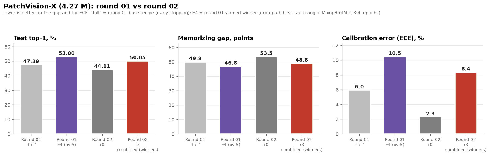

---

## 2. The model

The same PatchVision-X as round 01 (full description: [round 01, section 3](../01_strongaug_mixup_cutmix/README.md#3-the-model)). Nothing in the network was changed.

| | PatchVision-X |
|---|---|
| Tokenizer | convolutional, stride 16 → 196 tokens of 256 numbers |
| Position information | **LFE block** (small depthwise convolution), no position embedding |
| Attention | **multi-scale** sparse graph attention: 8 heads in 4 groups with 3 × 3, 5 × 5, 9 × 9 and whole-photo neighbourhoods |
| Blocks | 4 on 196 tokens, graph pooling to 49 tokens, 4 more (8 in total), MLP ratio 3 |
| Head | LayerNorm → average of the 49 tokens → linear layer → 200 species (no class token) |
| Drop-path in r0 | 0.1 (as in round 01 `full`) |
| Parameters / compute | **4.27 M** / 1.55 GFLOPs |
| Pretrained weights | none |

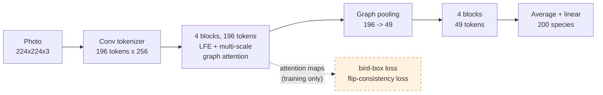

### The four training-time extras: all ON in every run

| # | Extra | Setting (as in round 01 `full`) |
|---|---|---|
| 1 | Bird-box attention loss | weight 0.1: penalises attention outside the bird box |
| 2 | EMA weights | decay 0.999: the averaged weights are evaluated |
| 3 | Flip-consistency loss | each photo and its mirror image; prediction weight 1.0, attention weight 1.0 |
| 4 | Box-guided crop | 30 % of training photos first cropped to the bird box + 10 to 40 % margin |

Details and their measured effects: [round 01, section 4](../01_strongaug_mixup_cutmix/README.md#4-the-four-training-time-extras). The bird boxes are used only as a training signal; the model never gets them as input, and at test time it is just the network above.

---

## 3. What changed from round 01

| Setting | Round 01 `full` | **Round 02 base recipe (r0)** |
|---|---|---|
| Augmentation | `strong`: random crop + flip + rotate + colour jitter + random erase, **all stacked on every photo** | `auto`: random crop (35 to 100 %) + flip + **one** random TrivialAugment operation + random erase (25 %) |
| Mixup / CutMix | on (one of the two on every batch) | **off: photos are never mixed** |
| Stopping | early stopping, patience 60 (`full` stopped at epoch 213) | **off: every run trains the full 300 epochs** |
| Box-guided crop | on (30 %) | on (30 %); the bird box follows every geometric operation |
| Bird-box loss, flip-consistency, EMA | on | on (unchanged) |
| Trainer | [`../../Vision_Transformer/patchvision/engine.py`](../../Vision_Transformer/patchvision/engine.py) | the same trainer, plus an optional SAM step (off unless a run asks for it) |
| Everything else | AdamW 5e-4, weight decay 0.05, label smoothing 0.1, drop-path 0.1, 10 warm-up epochs + cosine to 1e-6, batch 64, gradient clip 1.0, bf16 | unchanged |

Round 02 uses the **round-01 trainer**, not the plain ViT's round-02 trainer, because only the round-01 trainer can compute the bird-box and flip-consistency losses (they need the model's attention maps). The plain ViT and the CNNs had EMA in round 02 as well, so all three models train under the same data recipe.

### The `auto` augmentation

It is the same augmentation chain as the plain ViT's round 02 (figures below are from [its README](../../Vision_Transformer/02_autoaug_nomix_regularization/README.md#3-what-changed-from-round-01)). For PatchVision-X, 30 % of photos are first cropped to the bird box, as in round 01.

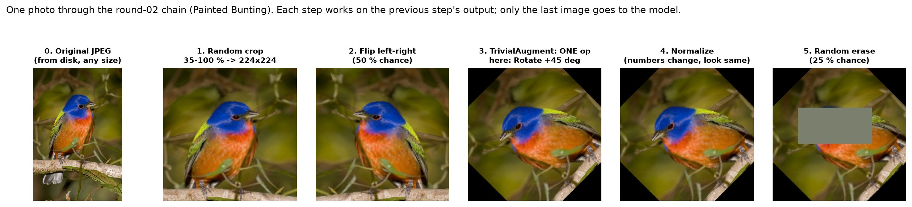

| Step | What happens |
|---|---|
| 0. Box-guided crop (PatchVision-X only) | with 30 % chance, cropped to the bird box + 10 to 40 % margin |
| 1. Random crop | a random region covering 35 to 100 % of the photo (aspect ratio 3/4 to 4/3), resized to 224 × 224 |
| 2. Flip | mirrored left-right with 50 % chance |
| 3. TrivialAugment | **one** of 14 operations (shear, translate, rotate, brightness, colour, contrast, sharpness, posterize, solarize, auto-contrast, equalize, identity), at a random strength |
| 4. Normalize | scaled to 0–1, then normalised with the training-set mean and std |
| 5. Random erasing | with 25 % chance, a random rectangle is blanked out |

Round 01 against round 02 on the same photo: round 01 stacks several small changes, round 02 makes one change that is sometimes strong.

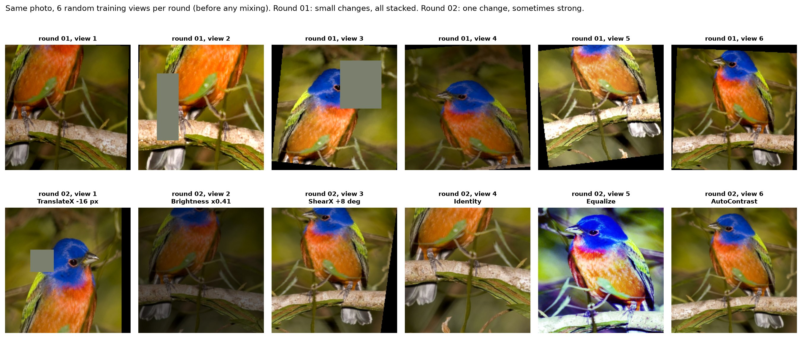

The same photo in 8 epochs: a new crop and a new operation each time.

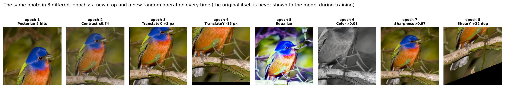

Validation and test photos are only resized to 224 × 224 and normalised.

### Two tools that runs can switch on

<details>
<summary><b>Drop-path (stochastic depth) (click to open)</b></summary>

During training only, each of the 8 blocks is skipped for a random subset of the photos in a batch (the photo takes the residual shortcut around it). The skip chance grows linearly from 0 at the first block to the chosen value at the last block. At test time every block is used. PatchVision-X already uses 0.1 in r0; runs r1 to r3 raise it to 0.2, 0.4 and 0.5.

</details>

<details>
<summary><b>SAM (Sharpness-Aware Minimization) (click to open)</b></summary>

For every batch: compute the gradient, take a small step (rho 0.05) towards higher loss, compute the gradient again at that point (with all losses, including the bird-box and flip-consistency losses), return to the original weights, and update with the second gradient. BatchNorm running statistics are frozen during the second pass. It costs two forward/backward passes per batch, so a SAM run takes about twice as long (Foret et al., ICLR 2021). Code: the `use_sam` branch in [`../../Vision_Transformer/patchvision/engine.py`](../../Vision_Transformer/patchvision/engine.py), switched on by [`pvx/config.py`](pvx/config.py).

</details>

---

## 4. The plan: three rounds of training

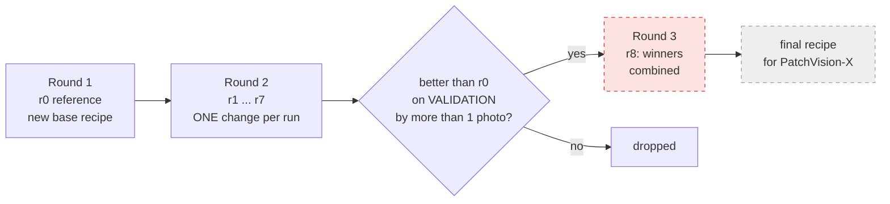

| Run | The one change (on top of r0) |
|---|---|
| r0_reference | nothing |
| r1 / r2 / r3 | drop-path 0.1 → 0.2 / 0.4 / 0.5 |
| r4 | label smoothing 0.1 → 0.2 |
| r5 / r6 | weight decay 0.05 → 0.1 / 0.2 |
| r7 | SAM optimizer (rho 0.05) |
| r8 | **winners of r1 to r7 combined** ([section 9](#9-round-3-r8-the-winners-combined)) |

Rules: **one seed (42)**; winners are picked on **validation only** (600 photos); a change counts as a winner only if it beats r0 by **more than one validation photo**, with one value per setting; the test set is read once per run, at the end, for the record. Round 01's E4 runs are **not** repeated. Hardware: RTX 5090, PyTorch 2.11.

---

## 5. Results: every run

| Run | What changes | Best epoch | **Val top-1** | vs r0 (val photos) | Gap (pts) | Test top-1 | Test top-5 | Test macro-F1 | Test ECE | Attention in box |
|---|---|---|---|---|---|---|---|---|---|---|
| r0_reference | nothing (new base recipe) | 251 | 46.67 % | | 53.5 | 44.11 % | 69.02 % | 43.65 % | 2.33 % | 0.64 |
| r1_droppath0.2 | drop-path 0.1 → 0.2 | 152 | 47.17 % | +3 | 53.5 | 45.72 % | 70.92 % | 45.37 % | 4.44 % | 0.64 |
| r2_droppath0.4 | drop-path 0.1 → 0.4 | 208 | 50.17 % | +21 | 50.2 | 46.48 % | 71.88 % | 46.08 % | 4.01 % | 0.65 |
| r3_droppath0.5 | drop-path 0.1 → 0.5 | 213 | 49.67 % | +18 | 50.7 | 47.46 % | 72.92 % | 46.93 % | 3.19 % | 0.67 |
| r4_labelsmooth0.2 | label smoothing 0.1 → 0.2 | 209 | 49.00 % | +14 | 51.0 | 46.25 % | 70.26 % | 45.64 % | 8.82 % | 0.68 |
| r5_wd0.1 | weight decay 0.05 → 0.1 | 233 | 46.50 % | −1 | 54.3 | 44.63 % | 68.12 % | 43.86 % | **1.68 %** | 0.64 |
| r6_wd0.2 | weight decay 0.05 → 0.2 | 287 | 48.00 % | +8 | 52.0 | 44.91 % | 68.50 % | 44.35 % | 5.02 % | 0.66 |
| r7_sam | SAM optimizer (rho 0.05) | 211 | 47.00 % | +2 | 53.0 | 44.75 % | 68.31 % | 44.39 % | 1.80 % | 0.64 |
| **r8_combined** | drop-path 0.4 + label smoothing 0.2 + weight decay 0.2 | 231 | **51.67 %** | **+30** | **48.8** | **50.05 %** | **74.46 %** | **49.50 %** | 8.35 % | **0.68** |

*Gap = accuracy on augmentation-free training photos minus validation accuracy, at the chosen epoch. ECE = calibration error, lower is better. 1 validation photo = 0.17 points. Every run: 300 epochs, about 2.5 hours on the RTX 5090 (about 30 s per epoch, 128 images per step because of the flip-consistency loss); SAM 4.75 hours (57 s per epoch). All nine runs together: about 25 hours. Tables: [`docs/tables/`](docs/tables).*

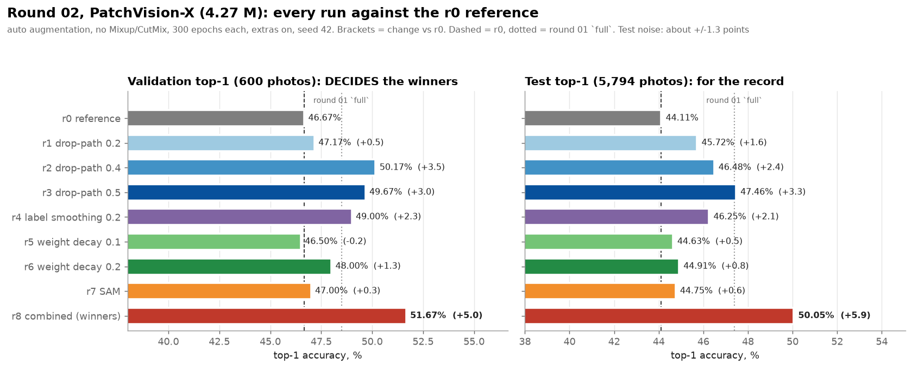

### Are the differences real? Paired test on the same test photos

Each run against r0, on the 5,794 test photos (exact McNemar test):

| Run vs r0 | Change, test top-1 | Only the run right | Only r0 right | p | |
|---|---|---|---|---|---|
| r1 drop-path 0.2 | +1.57 | 498 | 407 | **0.003** | better |
| r2 drop-path 0.4 | +2.33 | 524 | 389 | **< 0.0001** | better |
| **r3 drop-path 0.5** | **+3.33** | 567 | 374 | **< 0.0001** | better |
| r4 label smoothing 0.2 | +2.09 | 489 | 368 | **< 0.0001** | better |
| r5 weight decay 0.1 | +0.57 | 420 | 387 | 0.26 | no difference |
| r6 weight decay 0.2 | +0.79 | 449 | 403 | 0.12 | no difference |
| r7 SAM | +0.64 | 435 | 398 | 0.21 | no difference |
| **r8 combined** | **+5.97** | 646 | 300 | **< 0.0001** | better |

This shows the differences are not caused by which test photos happened to be drawn. It does **not** show they survive a different random seed; that needs the three-seed runs.

### Which changes reduce memorizing without hurting accuracy?

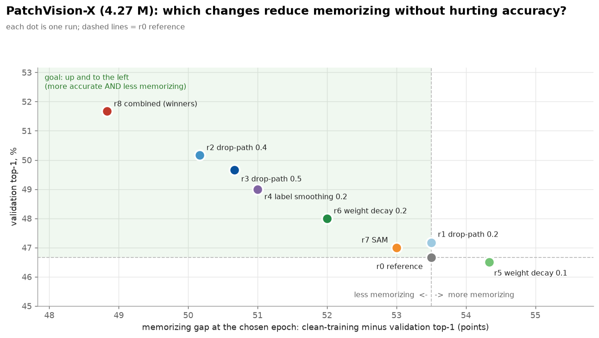

The goal is up and to the left. The runs fall almost on one line: **the more a change raised validation accuracy, the more it also shrank the gap.** r8 is the best on both (51.67 %, gap 48.8). Drop-path 0.4 / 0.5 and label smoothing 0.2 come next. Weight decay 0.1 is the only change that moves down and right.

### How strong should each setting be?

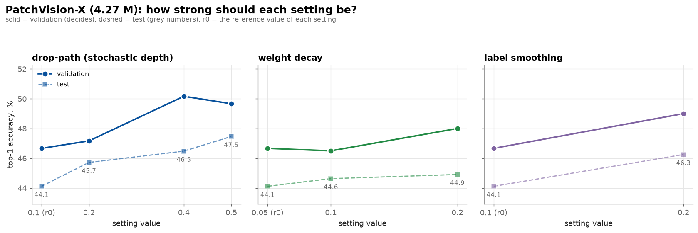

* **Drop-path:** better at every step from 0.1 to 0.4 on validation; 0.5 is slightly lower on validation and the best single run on test (47.46 %). The best value is around 0.4 to 0.5.
* **Weight decay:** 0.1 is the same as r0, 0.2 is better on validation (+8 photos) but not significantly on test.
* **Label smoothing:** 0.2 is +14 validation photos and +2.1 test points (significant), a bigger effect than for the plain ViT (+4 photos, +0.0 test).

---

## 6. How training went

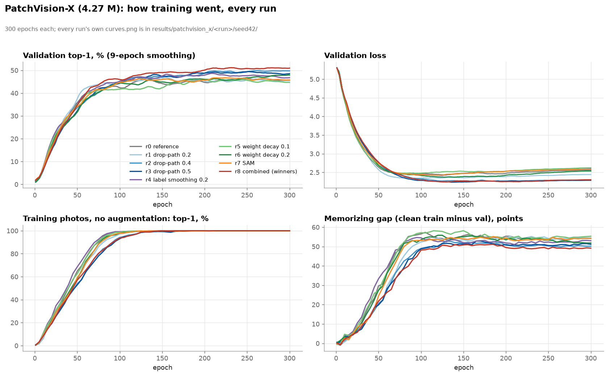

What the four panels show:
* **Validation top-1 (top left):** every run climbs fast until about epoch 60, then slowly. r8 pulls ahead from about epoch 100 and keeps the lead until epoch 300. Most best epochs are late (152 to 287).
* **Validation loss (top right):** every run reaches its lowest validation loss between epochs 94 and 184, then rises only a little. The drop-path 0.4 / 0.5 runs and r8 go lowest (2.24 to 2.27) and stay lowest to the end (2.29 to 2.30, against 2.56 for r0).
* **Training photos (bottom left):** every run reaches 99 % on clean training photos, between epoch 95 (r0, label smoothing 0.2) and epoch 140 (drop-path 0.5); r8 at epoch 130. Drop-path slows memorizing down but does not stop it.
* **Gap (bottom right):** it climbs to about 50 to 55 points by epoch 100 and stays there; at epoch 300 it ranges from 49 (r8) to 55 (weight decay 0.1).

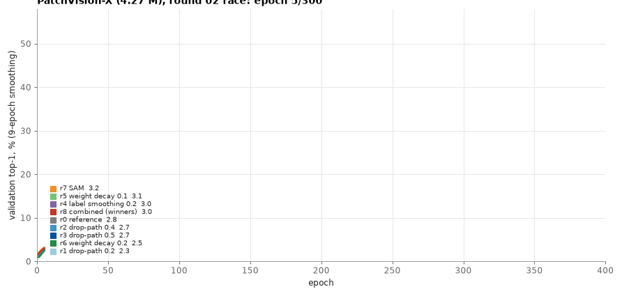

*The race: validation accuracy of every run over 300 epochs.*

### EMA weights

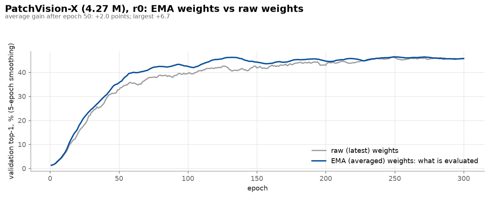

Evaluating the slow-moving average of the weights instead of the latest weights is worth **+2.0 points** on average after epoch 50 (up to +6.7) in r0, about the same as in round 01 (+2.4). By the end, when the learning rate is tiny, the two are the same.

---

## 7. Does it still look at the bird?

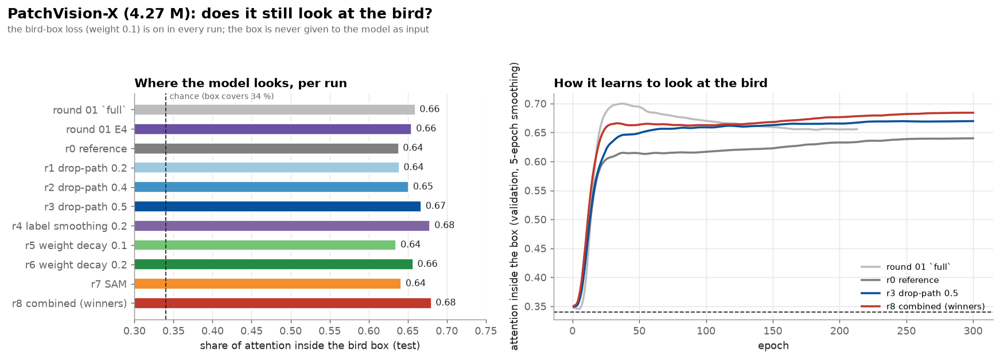

* **Yes, in every run.** 0.64 to 0.68 of the attention falls inside the bird box on the test photos, against 0.34 for attention spread evenly and 0.36 for the plain ViT (round 01 `base`).
* **The new recipe changed how it gets there.** In round 01 `full`, attention on the bird peaks at 0.70 around epoch 40 and then slowly falls to 0.66. In round 02 it rises more slowly and **keeps rising until epoch 300**.
* **The regularizers that helped accuracy also put more attention on the bird:** r8 0.68, label smoothing 0.2 0.68, drop-path 0.5 0.67, against 0.64 for r0. Weight decay 0.1 and SAM stay at r0's level.

Sixteen test photos, spread through the test set (not hand-picked), for r8. Rows: the photo with its bird box (green, not shown to the model), the attention of the last block, and the mean attention over all blocks. Title colour: green = correct, red = wrong.

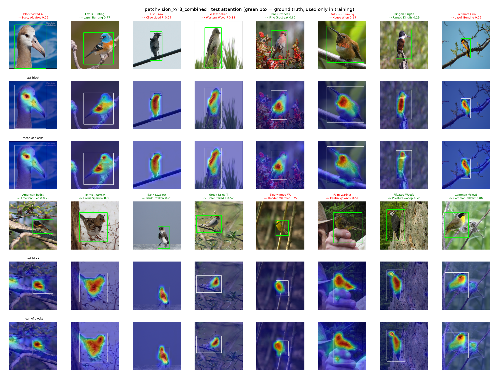

### Is the sparse gate doing anything?

No, as in round 01: in every run the gate stayed near 0.50 and at most 1.3 % of its values fell below 0.1 (r8: 0 %).

---

## 8. The best run in detail

r8 (drop-path 0.4 + label smoothing 0.2 + weight decay 0.2), the run chosen on validation.

| | r8 combined |
|---|---|
| **Test top-1** | **50.05 %** |
| Test top-5 | 74.46 % |
| Test macro-F1 | 49.50 % |
| Validation top-1 at the chosen epoch | 51.67 % |
| Memorizing gap | 48.8 pts |
| Calibration error (ECE) | 8.35 % (under-confident) |
| Attention inside the bird box | 0.68 |
| Chosen epoch / epochs run | 231 / 300 |
| Training time (RTX 5090) | 148 min (29.6 s per epoch) |
| Parameters / compute / latency (batch 1) | 4.27 M / 1.55 GFLOPs / 13.7 ms |

### Did it improve on round 01 `full`?

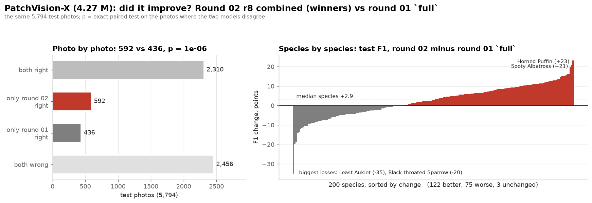

Yes. On the same test photos, only r8 is right on 592 and only `full` on 436 (+2.69 points, p < 0.0001); both are right on 2,310 and both wrong on 2,456. Species by species: 122 species better, 75 worse, 3 unchanged, median change +2.9 F1 points. The biggest gains are Horned Puffin (+23), Sooty Albatross (+21) and Western Grebe (+20); the biggest losses Least Auklet (−35), Black throated Sparrow (−20) and Palm Warbler (−19).

### Are the confidence numbers honest?

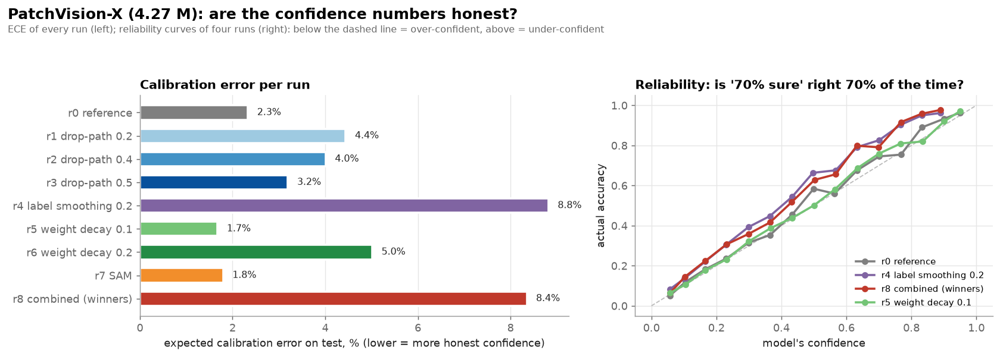

* **r0 is well calibrated** (ECE 2.3 %), better than round 01 `full` (6.0 %).
* **Label smoothing 0.2 makes PatchVision-X under-confident** (curves above the diagonal): r4 is 37.4 % sure on average while it is right 46.3 % of the time, r8 41.7 % sure while right 50.1 % of the time. That is where the high ECE of r4 (8.8 %) and r8 (8.4 %) comes from. Its answers are more often right than it claims, the safer direction.
* This is the **opposite of the plain ViT**, where round 02 made the model over-confident and label smoothing 0.2 fixed it. PatchVision-X's r0 is already slightly under-confident (42.2 % sure, right 44.1 %), so the extra smoothing pushes it further the same way.

### Which species are easy and which are hard?

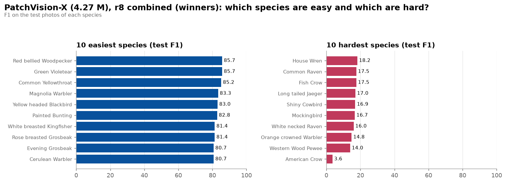

| | Round 01 `full` | **r8 combined** |
|---|---|---|
| Median species F1 | 47.6 | **51.1** |
| Species with F1 above 80 | 5 | **10** |
| Species with F1 below 20 | 17 | **13** |
| Species never recognised (F1 = 0) | 0 | 0 |

* **Easiest:** Red bellied Woodpecker (85.7), Green Violetear (85.7), Common Yellowthroat (85.2), Magnolia Warbler (83.3), Yellow headed Blackbird (83.0): strong, unique colours or patterns.
* **Hardest:** American Crow (3.6), Western Wood Pewee (14.0), Orange crowned Warbler (14.8), White necked Raven (16.0), Mockingbird (16.7): plain brown, grey or black birds with close look-alikes.

### What does the model confuse?

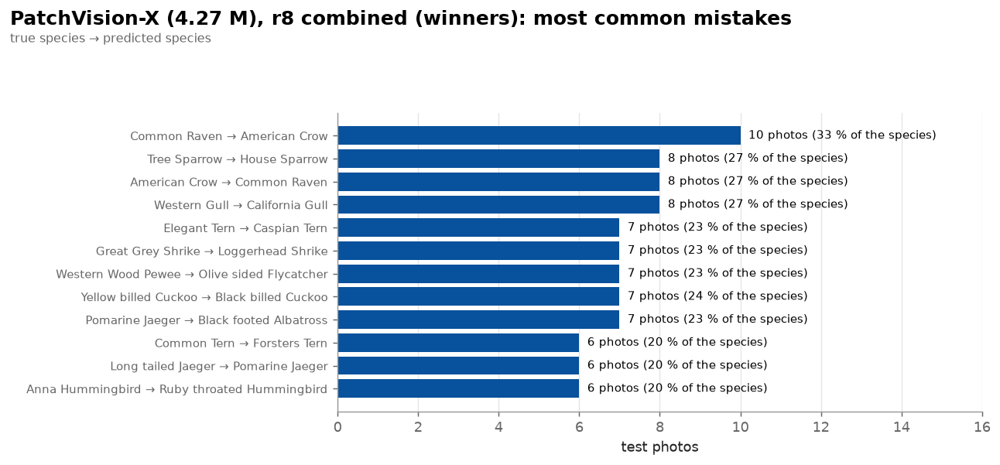

The most common mistakes are between close relatives: **Common Raven → American Crow** (10 photos), **Tree Sparrow → House Sparrow**, **American Crow → Common Raven**, **Western Gull → California Gull** (8 each), **Elegant Tern → Caspian Tern**, **Great Grey Shrike → Loggerhead Shrike**, **Yellow billed Cuckoo → Black billed Cuckoo** (7 each).

<details>
<summary><b>Each run's own plots, as saved by the trainer (click to open)</b></summary>

Every run folder `results/patchvision_x/<run>/seed42/` has `curves.png`, `test_confusion_matrix.png`, `test_reliability.png` and `test_attention_gallery.png`. The final run:

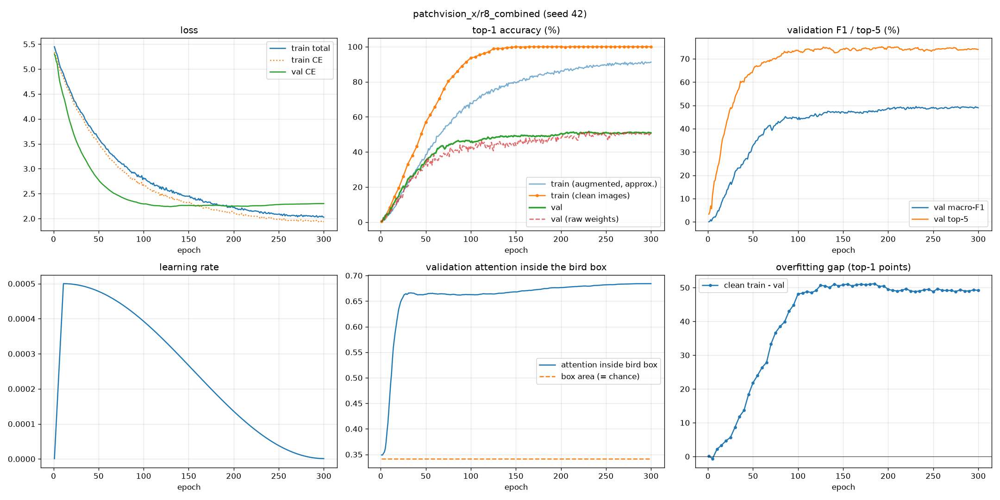
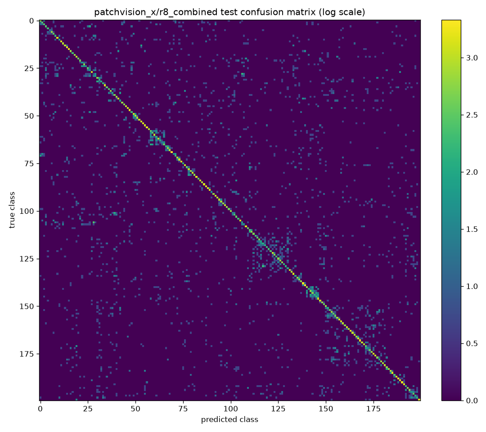
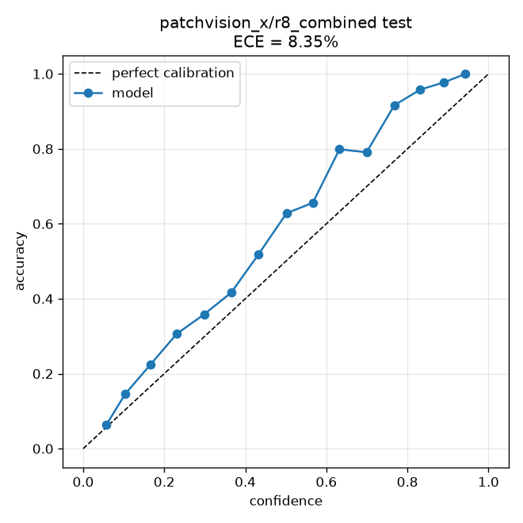

</details>

---

## 9. Round 3: r8, the winners combined

By the rule (beat r0 on validation by more than one photo, one value per setting):

| Setting | Value | Validation vs r0 (alone) | Test vs r0 (alone) | In r8? |
|---|---|---|---|---|
| Drop-path | **0.4** | +21 photos (0.2: +3, 0.5: +18) | +2.33 | yes |
| Label smoothing | **0.2** | +14 photos | +2.09 | yes |
| Weight decay | **0.2** | +8 photos (0.1: −1) | +0.79 | yes |
| SAM | off | +2 photos | +0.64 (not significant) | **no, by choice** |

**SAM passed the rule by one photo but was left out.** Its gain (+2 validation photos, +0.64 test points with p = 0.21) is within noise, and it doubles the training time (4.75 h instead of 2.5 h). This is the only place where round 02 of PatchVision-X departs from the rule. For the plain ViT, SAM lost (−9 photos).

r8 = drop-path 0.4 + label smoothing 0.2 + weight decay 0.2, the same combination the plain ViT ended with.

| Paired test on the test photos | Change, test top-1 | Only r8 right | Only the other right | p |
|---|---|---|---|---|
| r8 vs r0 | **+5.97** | 646 | 300 | < 0.0001 |
| r8 vs r2 (best single change on validation) | **+3.64** | 510 | 299 | < 0.0001 |
| r8 vs r3 (best single change on test) | **+2.64** | 481 | 328 | < 0.0001 |
| r8 vs round 01 `full` | **+2.69** | 592 | 436 | < 0.0001 |
| r8 vs round 01 E4 | **−2.93** | 388 | 558 | < 0.0001 |

* **The winners add up.** On test, r8 gains +5.97 points over r0, more than the three changes alone summed (+5.21). On validation it is +30 photos against +43 summed.
* **r8 is the final PatchVision-X recipe of round 02**, and the first round-02 run to beat round 01 `full`.
* **It is the best round-02 run on every measure except calibration:** top-1, top-5, macro-F1, gap and attention on the bird.

The exact settings are in [`pvx/config.py`](pvx/config.py) (`COMBINED`) and in [`results/patchvision_x/r8_combined/seed42/config.json`](results/patchvision_x/r8_combined/seed42/config.json).

---

## 10. Against round 01 E4

Round 01's E4 winner (`ovf5_dp0.3_autoaug`, [round 01, section 9](../01_strongaug_mixup_cutmix/README.md#9-e4-combining-the-best-changes)) is still the best PatchVision-X model.

| | Round 01 E4 (`ovf5`) | Round 02 r8 |
|---|---|---|
| Augmentation | `auto` | `auto` |
| **Mixup / CutMix** | **on** | **off** |
| Drop-path | 0.3 | 0.4 |
| Label smoothing / weight decay | 0.1 / 0.05 | 0.2 / 0.2 |
| Stopping | 300 epochs | 300 epochs |
| Test top-1 | **53.00 %** | 50.05 % |
| Test top-5 | **78.10 %** | 74.46 % |
| Memorizing gap | **46.8 pts** | 48.8 pts |
| ECE | 10.45 % (over-confident) | 8.35 % (under-confident) |
| Attention inside the bird box | 0.66 | **0.68** |

The two recipes differ mainly in **Mixup/CutMix**: E4 has it, r8 does not. On the same photos E4 is right on 558 that r8 gets wrong, r8 on 388 that E4 gets wrong (p < 0.0001). Together with the r0 drop (−3.3 points against `full`), this points to the same finding as for the plain ViT: **for a ViT trained from scratch on this little data, Mixup/CutMix is worth about 3 points**, and the regularizers of round 02 do not replace it. Removing it did not hurt the CNNs.

---

## 11. Against the plain ViT and the CNNs

All four models went through exactly the same round 02, with the same runs and the same rule.

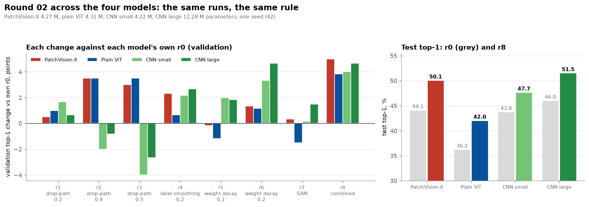

Change in **validation** top-1 against each model's own r0, in points:

| Run | **PatchVision-X** | Plain ViT | CNN small | CNN large |
|---|---|---|---|---|
| r1 drop-path 0.2 | +0.50 | +1.00 | +1.67 | +0.67 |
| r2 drop-path 0.4 | **+3.50** | **+3.50** | −2.00 | −0.83 |
| r3 drop-path 0.5 | +3.00 | **+3.50** | −4.00 | −2.67 |
| r4 label smoothing 0.2 | +2.33 | +0.67 | +2.17 | +2.67 |
| r5 weight decay 0.1 | −0.17 | −1.17 | +2.00 | +1.83 |
| r6 weight decay 0.2 | +1.33 | +1.17 | **+3.33** | **+4.67** |
| r7 SAM | +0.33 | −1.50 | +0.17 | +1.50 |
| **r8 combined** | **+5.00** | **+3.83** | **+4.00** | **+4.67** |

| | **PatchVision-X** | Plain ViT | CNN small | CNN large |
|---|---|---|---|---|
| Parameters | 4.27 M | 4.31 M | 4.22 M | 11.28 M |
| Round 01 test top-1 | 47.39 % (`full`) | 39.52 % | 43.65 % | 45.86 % |
| r0 test top-1 | 44.11 % | 36.24 % | 43.75 % | 46.03 % |
| **Final test top-1 (r8)** | **50.05 %** | 42.03 % | 47.65 % | **51.52 %** |
| Gain over round 01 | +2.66 | +2.51 | +4.00 | +5.66 |

* **PatchVision-X behaves like a ViT, not like a CNN.** Drop-path is its best single change, as for the plain ViT, while it hurts the CNNs at 0.4 and 0.5.
* **It gains the most from combining** (+5.0 validation points over its r0, against +3.8 to +4.7 for the others).
* **It is the best model of its size:** +8.0 points over the plain ViT and +2.4 over CNN small, at about the same parameter count. CNN large, with 2.6 times the parameters and 2.3 times the compute, is 1.5 points ahead.
* **Removing Mixup/CutMix hurt both transformers by the same 3.3 points** and neither CNN.

---

## 12. What we learned

* **Mixup/CutMix matters for PatchVision-X, as for the plain ViT.** Removing it cost 3.3 test points (r0 against `full`), and round 01's E4, which kept it, is still 2.9 points ahead of the best round-02 run.
* **Drop-path and label smoothing are the regularizers that suit PatchVision-X:** drop-path 0.5 alone +3.3 test points, label smoothing 0.2 alone +2.1 (both significant). Weight decay and SAM did little alone.
* **The combination is clearly better than any single change:** r8 reaches **50.05 %**, +2.7 over round 01 `full` and +2.6 over the best single change.
* **Regularization slows memorizing but does not stop it:** every run reaches about 100 % on training photos; the best gap is 48.8 points.
* **The extras keep working under the new recipe:** attention on the bird is 0.64 to 0.68 in every run, and the runs that are more accurate also look more at the bird.
* **Label smoothing 0.2 makes PatchVision-X under-confident** (ECE 8.4 % in r8, 41.7 % sure while right 50.1 %), the opposite of its effect on the plain ViT.

---

## 13. Limits

- **One seed.** Every number is seed 42; seeds 43 and 44 are not run.
- **SAM was left out of r8 by choice**, although it passed the rule by one photo (section 9). r8 with SAM is not run.
- **Small validation set.** 600 photos (3 per species) choose the best epoch and the winners; one photo is 0.17 points.
- **Round 01 and round 02 differ in more than one way.** Round 02 changes augmentation, Mixup/CutMix and stopping at once, so the r0 drop cannot be pinned on one of them alone. The comparison with E4 (same `auto` augmentation and 300 epochs, Mixup/CutMix kept) points at Mixup/CutMix.
- **The extras were not switched off one by one.** How much each extra is worth under the round-02 recipe is not measured.
- **Different hardware.** Round 02: RTX 5090, PyTorch 2.11; round 01 `full`: RTX 4090, PyTorch 2.5.1 (E4: RTX 5090). Accuracy should be unaffected; times are not comparable.
- **Test set seen.** All test results were read; the r8 choice uses validation only.

---

## 14. Run it yourself

Run everything from inside this folder. The code is imported from `../../Vision_Transformer/patchvision/` (via [`pvx/_pv.py`](pvx/_pv.py)), the data is read from the repository root (two levels up), and results are written to `results/patchvision_x/<run>/seed<seed>/`.

```powershell
cd ViT_PatchVisionX/02_autoaug_nomix_regularization
python train.py r0_reference 42                # one run
python run_queue.py                            # r0 to r7, one after another
python run_queue.py r8_combined                # r8, the winners combined
python watch_training.py r0_reference 42       # live monitor, in a second terminal
python docs/make_figures.py                    # rebuild the figures, tables and race on this page
```

A finished run is skipped and an interrupted one resumes from `last.pt`. Model weights (`*.pt`) are not stored in Git, so train a model before loading it. On Windows, set `PYTHONIOENCODING=utf-8` first.

<details>
<summary><b>Load a trained model and predict (click to open)</b></summary>

```python
import sys, torch
sys.path.insert(0, ".")                                   # run from inside ViT_PatchVisionX/02_autoaug_nomix_regularization/
from pvx.config import get_experiment                    # also makes ../../Vision_Transformer importable
from patchvision.models import PatchVisionX

exp = get_experiment("r8_combined")
model = PatchVisionX(exp.model)
ck = torch.load("results/patchvision_x/r8_combined/seed42/best_model.pt", map_location="cpu", weights_only=False)
model.load_state_dict(ck["state"])                        # the EMA weights of the chosen epoch (231)
model.eval()
# logits, aux = model(x): x is a normalised (B, 3, 224, 224) tensor; logits are (B, 200), aux holds the attention maps
```

</details>

### Layout

```
ViT_PatchVisionX/02_autoaug_nomix_regularization/
├── README.md                     this page
├── train.py                      one run:  python train.py r8_combined 42
├── run_queue.py                  several runs one after another
├── watch_training.py             live monitor
├── pvx/
│   ├── config.py                 base recipe (round 01 `full` + round-02 data changes), runs r0-r7, COMBINED (r8)
│   └── _pv.py                    makes ../../Vision_Transformer/patchvision importable
├── docs/
│   ├── make_figures.py           result figures, race, tables, facts.txt
│   └── figures/  animations/  tables/  facts.txt
└── results/patchvision_x/<run>/seed42/   logs, curves, metrics, predictions, attention, checkpoints
```

The model, data pipeline, losses and trainer are in the shared [`../../Vision_Transformer/patchvision`](../../Vision_Transformer/patchvision) package (`models.py`, `data.py`, `engine.py`, `config.py`).

---

## References

1. A. Dosovitskiy et al. *An Image is Worth 16x16 Words: Transformers for Image Recognition at Scale.* ICLR 2021.
2. C. Wah et al. *The Caltech-UCSD Birds-200-2011 Dataset.* California Institute of Technology, 2011.
3. S. G. Müller, F. Hutter. *TrivialAugment: Tuning-free Yet State-of-the-Art Data Augmentation.* ICCV 2021.
4. G. Huang et al. *Deep Networks with Stochastic Depth.* ECCV 2016.
5. P. Foret et al. *Sharpness-Aware Minimization for Efficiently Improving Generalization.* ICLR 2021.
6. *Graph-based vision transformer with sparsity for training on small datasets from scratch.* Scientific Reports 15 (2025). <https://www.nature.com/articles/s41598-025-10408-0>
7. *MSCViT: A Small-size ViT architecture with Multi-Scale Self-Attention Mechanism for Tiny Datasets.* arXiv:2501.06040 (2025). <https://arxiv.org/abs/2501.06040>
