# PatchVision-X

**Teaching a small Vision Transformer to recognise 200 bird species, starting from nothing, with only about 27 training photos per species.**

This page explains everything we have done so far, with pictures and animations that were made from our real runs. If a word is new to you, jump to the [word list](#2-words-you-need).

---

## Contents

0. [The project in one minute](#0-the-project-in-one-minute)
1. [The problem](#1-the-problem)
2. [Words you need](#2-words-you-need)
3. [How a Vision Transformer sees a photo](#3-how-a-vision-transformer-sees-a-photo)
4. [Overfitting: the problem we are really fighting](#4-overfitting-the-problem-we-are-really-fighting)
5. [The data](#5-the-data)
6. [The two papers we built on](#6-the-two-papers-we-built-on)
7. [Our model: PatchVision-X](#7-our-model-patchvision-x)
8. [Our four tricks against memorizing](#8-our-four-tricks-against-memorizing)
9. [How we train](#9-how-we-train)
10. [Results so far](#10-results-so-far)
11. [Overfitting trials: one change at a time](#11-overfitting-trials-one-change-at-a-time)
12. [What we learned, and what we do NOT know yet](#12-what-we-learned-and-what-we-do-not-know-yet)
13. [What comes next](#13-what-comes-next)
14. [Where everything is, and how to re-run it](#14-where-everything-is-and-how-to-re-run-it)
15. [References](#15-references)

---

## 0. The project in one minute

* **Task.** Look at a photo of a bird and say which of **200 species** it is.
* **Catch.** We train the model **from scratch** (no pre-trained weights), and the dataset is tiny: **5,394 training photos, about 27 per species**. Vision Transformers (ViTs) normally need huge datasets, so on small data they tend to *memorize* instead of *learn*.
* **What we built.** A small ViT called **PatchVision-X** (4.3 million numbers to learn). It mixes ideas from two research papers and adds four tricks of our own that discourage memorizing.
* **What we ran so far.** Six training runs on the same data: `base` (our extra ideas switched **off**), `full` (everything **on**), and four follow-up trials that each change **one** setting of `full` to fight memorizing ([section 11](#11-overfitting-trials-one-change-at-a-time)).
* **Result.** Tested on **5,794 photos the model had never seen**:

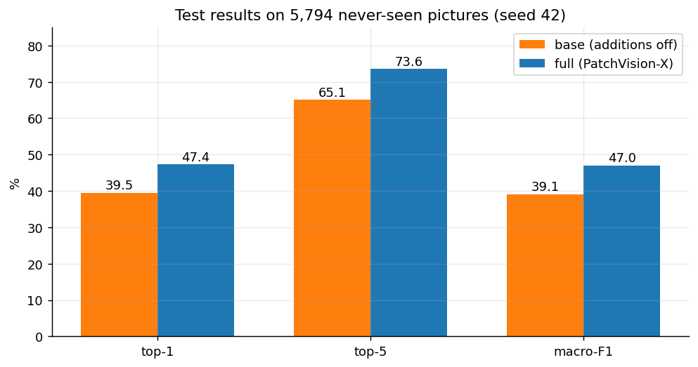

| | `base` | `full` (PatchVision-X) |
|---|---|---|
| Right answer first (top-1) | 39.5 % | **47.4 %** |
| Right answer in the best 5 guesses (top-5) | 65.1 % | **73.6 %** |
| Where the model looks | no better than chance | **mostly at the bird** |

* **The honest part.** Both models still **memorize the training photos** (about 100 % right on photos they trained on, but only 40-48 % on new photos). Our four cheap fixes ([section 11](#11-overfitting-trials-one-change-at-a-time)) raised the accuracy on new photos by about **2 to 3 points** (measured on the validation photos), from 48.4 % to 50.1-51.3 %, but they **did not close the memorizing gap**: it is still about 48 points. Everything here is **one run each (one random seed)**, so the exact numbers are not certain yet.

<p align="center">
  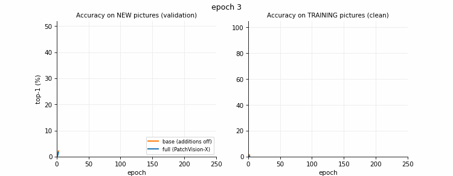
</p>

*Left: accuracy on new photos, growing as training goes on. Right: accuracy on the training photos. Both reach about 100 %. Only `full` is clearly better on new photos.*

---

## 1. The problem

A bird photo goes in, a species name comes out. This is called **fine-grained classification**: the 200 classes all look alike to a beginner (many gulls, terns, warblers, sparrows...). The difference is in small details such as beak shape, wing bars, or an eye ring.


The green boxes show where the bird is. The dataset provides them. We **never give the box to the model as input**; we only use it as a teaching aid during training (see [section 8](#8-our-four-tricks-against-memorizing)).

Two things make the task hard:

1. **Look-alike species.** Our model's most frequent mistakes show it clearly: Herring Gull mistaken for California Gull, Great Grey Shrike for Loggerhead Shrike, Arctic Tern for Common Tern ([see section 10](#per-species-results)).
2. **Very few photos per species.** Compare with the datasets where Vision Transformers shine:

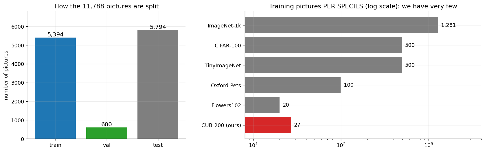

> A Vision Transformer on ImageNet sees about 1,281 photos of every class. We have 27.

---

## 2. Words you need

| Word | Meaning in simple terms |
|---|---|
| **Model / network** | A big formula with millions of adjustable numbers. Training adjusts them so the formula gives the right answer. |
| **Training from scratch** | The numbers start random. We do not borrow a model that was already taught on millions of other photos. |
| **Epoch** | One full pass over all training photos. Our runs lasted 213 and 246 epochs. |
| **Loss** | A score of how wrong the model is. Training tries to push it down. |
| **Token** | A small piece of the photo, turned into a list of numbers that the model can read. |
| **Attention** | The model asking "which other pieces of the photo matter for understanding this piece?". |
| **Overfitting / memorizing** | The model learns the *training photos* by heart instead of learning *what birds look like*. It then fails on new photos. |
| **Training / validation / test photos** | *Training*: the model learns from them. *Validation*: new photos we use while training to choose the best moment to stop. *Test*: photos we only look at at the end for the final grade. |
| **Top-1 accuracy** | How often the model's single best guess is right. |
| **Top-5 accuracy** | How often the right species is among its 5 best guesses. |
| **Macro-F1** | A score that treats every species equally (a mean over the 200 species). |
| **Calibration / ECE** | Are the model's confidence numbers honest? If it says "90 % sure" about 100 photos, about 90 should be right. ECE is the average gap between "sure" and "right"; **lower is better**. |
| **Seed** | The starting point of the random numbers. Different seeds give slightly different results, so one run is not the whole story. |
| **Ablation** | Switching one ingredient off at a time to measure what it is worth. |
| **Augmentation** | Randomly changing a training photo (crop, rotate, colour) so the model sees a new version every time. |

---

## 3. How a Vision Transformer sees a photo

A **Vision Transformer (ViT)** does not slide a small window over the photo like older networks (CNNs). It does this instead:

1. **Cut the photo into squares.** Ours is 224 x 224 pixels, cut into 14 x 14 = **196 squares** of 16 x 16 pixels.
2. **Turn each square into a "token"**, which is a short list of numbers describing it.
3. **Let the tokens talk to each other (attention).** Each token looks at all the others and decides which ones are useful for understanding itself. A token on the beak may pay attention to the tokens on the eye and the wing.
4. **Combine everything into a final answer**: 200 scores, one per species.

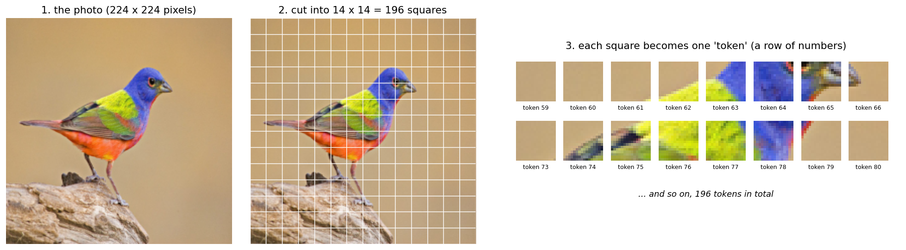

**Why a ViT struggles with little data.** A CNN is built with a hidden assumption: *"things that are close together in the photo belong together."* A plain ViT has no such assumption. It must discover from the data that neighbouring squares are related, and that takes a lot of examples. With only 27 photos per species it often finds shortcuts instead, which is memorizing. This is the central problem of the project, and the idea of both papers we build on is to give the ViT a little of that "neighbours matter" knowledge without turning it into a CNN.

---

## 4. Overfitting: the problem we are really fighting

Imagine a student preparing for an exam with only 27 practice questions per topic. They can either *understand the topic* or *memorize the exact practice questions*. Memorizing gives 100 % on the practice sheet and a bad grade in the real exam.

Our models are that student. This animation shows our real `full` run:

<p align="center">
  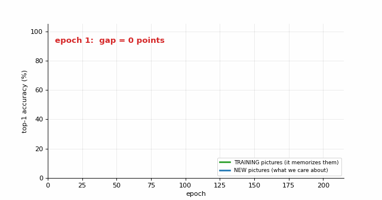
</p>

* **Green** is the accuracy on the training photos (clean, without augmentation). It climbs to about 100 %.
* **Blue** is the accuracy on new photos. It stops improving at about 48 %.
* **The pink area is the memorizing gap.** About 50 points at the end.

The same picture for both runs:

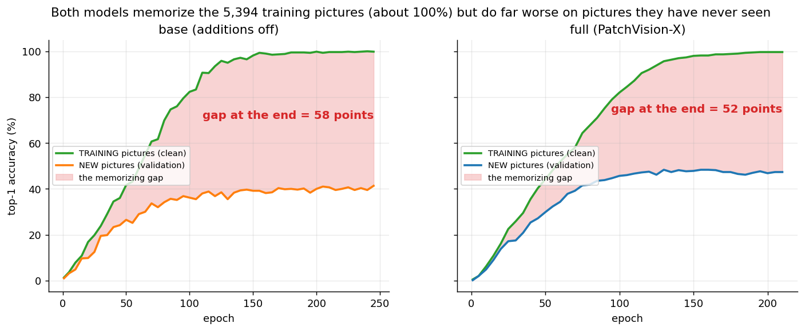

**How we measure it honestly.** The training accuracy that is printed during training is measured on augmented photos while mixup/CutMix blends labels, so it is misleading. Every 5 epochs we therefore also test the model on 600 training photos **without any augmentation**. That "clean" number is what you see in green.

Two things protect us a little from this problem, but do not solve it:

* **Early stopping:** we stop when the validation score has not improved for 60 epochs.
* **Best-checkpoint selection:** the model we finally test is the one from the epoch with the best validation score, not the last one.

---

## 5. The data

### The dataset

**CUB-200-2011** (Caltech-UCSD Birds): 11,788 photos, 200 species. It also comes with a bounding box around the bird in every photo.


| Split | Photos | Per species | Used for |
|---|---|---|---|
| Train | 5,394 | 26 to 27 | the model learns from these |
| Validation | 600 | 3 | choosing when to stop and which epoch is best |
| Test | 5,794 | 11 to 30 | the final grade, only at the end of a run |

The validation photos were taken out of the official training set (10 %) with a fixed random seed. The official test split was left alone. The split files are `DataPreprocessing_Results/train.csv`, `val.csv`, `test.csv`, so **every experiment uses exactly the same photos**.

> **A caution about validation.** 600 photos (3 per species) is a small, noisy yardstick. Differences of one or two points between epochs are mostly noise.

### What the preprocessing notebooks did

Two notebooks prepared everything in `DataPreprocessing_Results/`:

| Notebook | What it covers |
|---|---|
| `patchvision_basic_data_preprocessing.ipynb` | Download and load the metadata, class balance, image sizes and aspect ratios, how much of the frame the bird fills, sample photos with their boxes. |
| `patchvision_advanced_preprocessing.ipynb` | The data budget and how noisy accuracy is, a comparison of resize strategies, an augmentation gallery, how strong random cropping can be before it cuts the bird out, four augmentation levels, mixup and CutMix, a data-quality and leakage audit, and saving the configuration. |

What those notebooks saved, and what our training code reads:

| File | Content |
|---|---|
| `norm_stats.json` | Average colour of the *training* photos (mean `[0.486, 0.499, 0.431]`, std `[0.226, 0.222, 0.261]`). Photos are normalised with it. |
| `preprocess_config.json` | Image size 224, batch size 64, the four augmentation levels, and the mixup/CutMix settings. |
| `train.csv`, `val.csv`, `test.csv` | The fixed splits. |

### Augmentation: never the same photo twice

Because we have so few photos, we change each one randomly every time it is used. The levels defined in `preprocess_config.json` are:

| Level | What happens to a training photo |
|---|---|
| `none` | only resize to 224 x 224 and normalise (used for validation and test) |
| `basic` | random crop (50-100 % of the photo) + mirror |
| **`strong` (we use this)** | random crop (35-100 %) + mirror + rotate up to 10° / shift 5 % / zoom 0.9-1.1 + brightness, contrast, saturation changes + randomly erase a rectangle (25 % of the time) |
| `auto` | random crop + mirror + automatic augmentation (TrivialAugmentWide) + random erase |

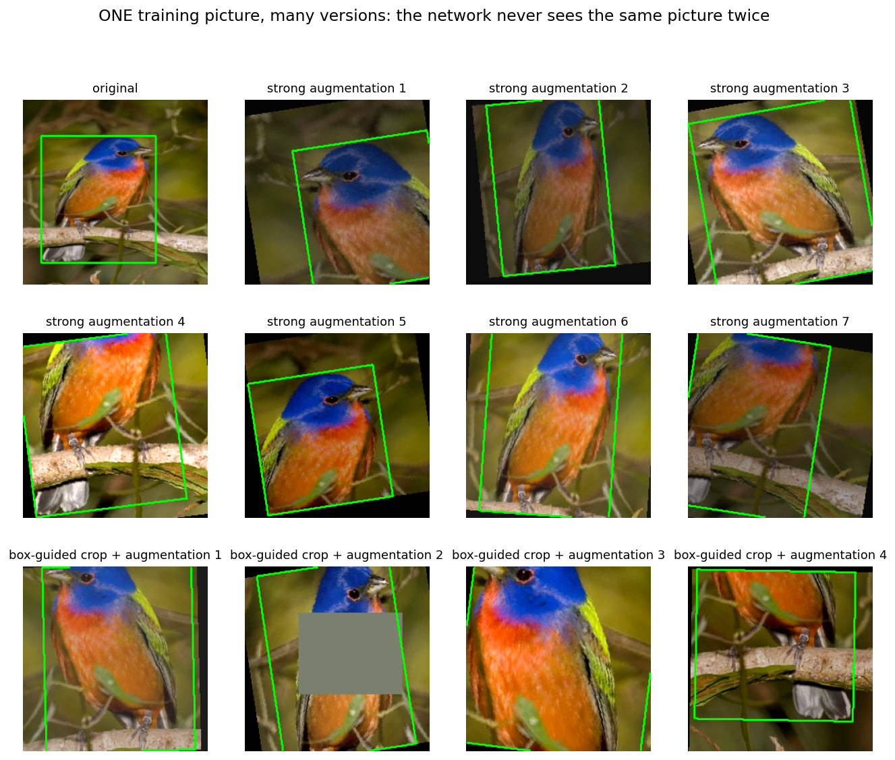

The bottom row shows our own **box-guided crop** ([section 8](#8-our-four-tricks-against-memorizing)). The green outline always follows the bird, because the box receives the same rotation and crop as the photo.

<p align="center">
  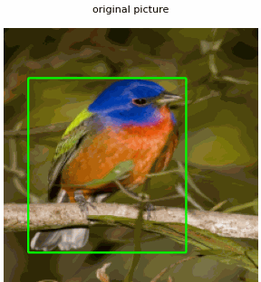
</p>

### Mixup and CutMix: blending two photos

Two more tricks make memorizing harder: *mixup* blends two photos like a double exposure, and *CutMix* pastes a rectangle from one photo onto another. The answer the model must give is blended in the same proportion (for example "60 % Painted Bunting, 40 % Green Jay"). Settings: mixup strength 0.2, CutMix strength 1.0, and 50 % of the batches use CutMix; the rest use mixup. We also use **label smoothing** (0.1), which means the correct answer is "about 90 % sure", not "100 % sure".

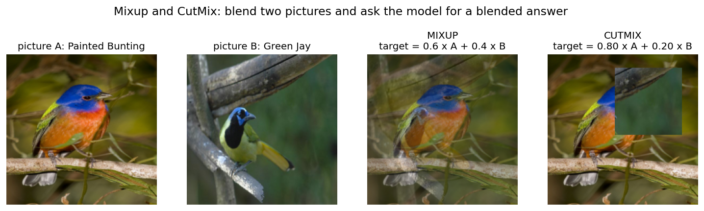

---

## 6. The two papers we built on

We did not copy a model. We took useful ideas from two papers, and wrote the code ourselves in PyTorch without any pre-trained weights.

| | **GvT**: *Graph-based vision transformer with sparsity for training on small datasets from scratch* (Scientific Reports, 2025) | **MSCViT**: *A Small-size ViT architecture with Multi-Scale Self-Attention Mechanism for Tiny Datasets* (arXiv 2501.06040) |
|---|---|---|
| Idea | Treat the tokens as a **graph**: neighbouring squares are connected, and the connection strength depends on how similar they look. Attention then runs on that graph. | Give the ViT a **local sense** with small convolutions, and let different attention heads look at **different scales**. |
| What we took | The convolutional tokenizer, graph attention, a "sparse gate" that can switch off useless links, and graph pooling (merging 196 tokens into 49). | The **Local Feature Extraction block** (a small depthwise convolution that replaces the usual position numbers), and the **multi-scale** idea. |
| What we changed | Some details of the paper are unclear, so we chose an interpretation (marked "INTERPRETATION" in `patchvision/models.py`). | We did **not** use MSCViT's wavelet convolution or its four-stage layout. We rebuilt its multi-scale idea on the graph (next section). |

> **Honest note.** We read the method and experiment-setup parts of the MSCViT paper, but the Nature page for the GvT paper only opened a login page, so our GvT implementation follows the notes we already had in the earlier code. We have **not** compared it line by line against the paper's equations. Treat our `base` model as a GvT-*style* model, not a verified reproduction.

---

## 7. Our model: PatchVision-X

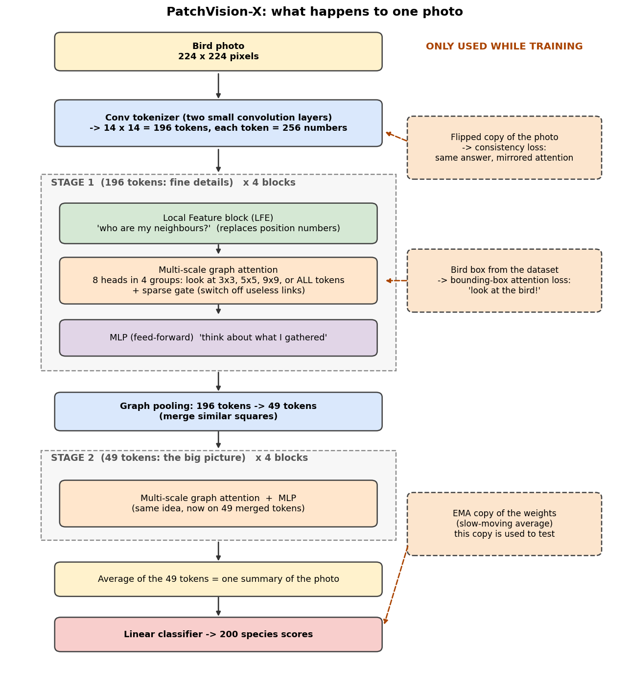

One photo goes in at the top, and 200 species scores come out at the bottom. The dashed orange boxes on the right are only used **during training** (see section 8); at test time the model is just the left column.

### Step by step

1. **Conv tokenizer.** Two small convolution layers turn the 224 x 224 photo into 196 tokens, each with 256 numbers.
2. **Stage 1: four blocks on 196 tokens** (fine details). Each block has three parts:
   * **LFE (Local Feature Extraction)**, from MSCViT. A small depthwise convolution mixes each token with its nearest neighbours. This gives the model a sense of *position and neighbourhood* without separate position numbers.
   * **Multi-scale graph attention**, our combination of both papers (explained below).
   * **MLP**, a small network that "thinks about" what the attention gathered.
3. **Graph pooling.** Similar squares are merged: 196 tokens become 49 (think "all the background squares become one").
4. **Stage 2: four blocks on 49 tokens** (the big picture).
5. **Average and classify.** The 49 tokens are averaged into one summary, and a final layer gives 200 scores. (There is no special "class token".)

### The multi-scale graph attention (our combination)

In GvT every token is connected to its 8 neighbours. In MSCViT different attention heads work at different scales. We combined these: the model has **8 heads in 4 groups of 2**, and each group may look at a different amount of the surroundings:

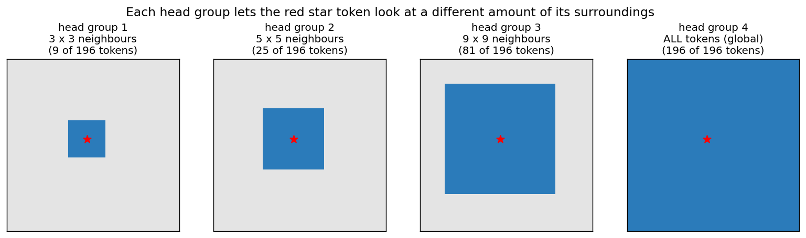

<p align="center">
  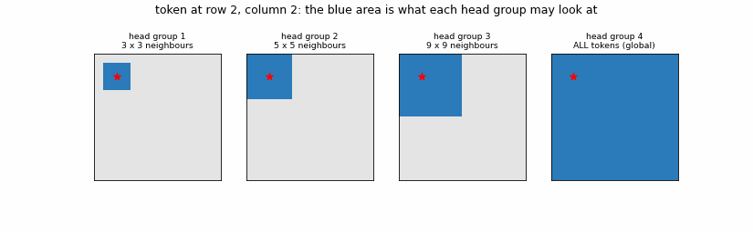
</p>

* **Group 1** (3 x 3) looks only at the closest squares, good for texture.
* **Group 2** (5 x 5) and **Group 3** (9 x 9) look at a bigger region, good for parts like a wing or a head.
* **Group 4** (all 196) can look at the whole photo, good for context.

<details>
<summary><b>More detail: what happens inside one attention layer (click to open)</b></summary>

1. **Build the graph.** For every pair of tokens: *(are they within the allowed neighbourhood of this head group?)* multiplied by *(how similar do they look?)*. Similarity is a cosine similarity passed through a softmax with a learned temperature.
2. **Graph convolution for queries and keys.** Instead of using each token alone, queries and keys are averaged over its graph neighbours (with a standard degree normalisation).
3. **Attention.** The usual softmax of query times key.
4. **Sparse talking-heads (from GvT).** A small gate is computed for every head and token. It can shrink weak links to zero. The heads then exchange information through a learnable 8 x 8 matrix, which starts as the identity.
5. **Values.** Another graph convolution, guided by the attention, plus a residual connection.
6. The attention is computed in 32-bit precision even when the rest uses 16-bit, for numerical safety.

After pooling there is no photo grid any more, so the 3 x 3, 5 x 5, 9 x 9 neighbourhoods are replaced by 1, 2 and 4 steps along the *learned* connections between the 49 merged tokens (the fourth group still sees everything).

</details>

### Size and speed

| | `base` | `full` |
|---|---|---|
| Parameters | 4.31 million | 4.27 million |
| Compute per photo | 1.55 GFLOPs | 1.55 GFLOPs |
| Time for one photo (RTX 4090, batch of 1) | 12.8 ms | 15.0 ms |
| Photos per second (batch of 64) | 3,311 | 3,143 |

Switching the additions on costs almost nothing at test time. `full` has slightly **fewer** parameters because the LFE block replaces a table of position numbers.

### Differences from the original project proposal

The proposal described a plain ViT with 6 blocks, 384 numbers per token and a class token. The model we actually built is the hybrid above (8 blocks, 256 numbers per token, 8 heads, 4.3 M parameters). The proposal also said "ten class logits" by mistake; the correct number is 200.

---

## 8. Our four tricks against memorizing

All four are **only used during training**. At test time the model needs none of them.

| # | Trick | In one sentence |
|---|---|---|
| 1 | **Bounding-box attention loss** | Add a penalty when the model's attention lands outside the bird's box. |
| 2 | **EMA weights** | Evaluate a slow-moving average of the model instead of its latest, jumpy state. |
| 3 | **Flip-consistency loss** | Show the model each photo *and its mirror image*, and require the same answer and the mirrored attention. |
| 4 | **Box-guided crop** | 30 % of the time, crop the training photo to the bird before the other augmentations. |

### 1. Bounding-box attention loss

For each training photo we measure what **share of the model's attention falls inside the bird's box**, and penalise a low share. The dataset's boxes are used *only* as a teaching signal; the model never receives them as input, and they are not used at validation or test time.

The evidence is visible in the training curve (bottom right below): the share of attention inside the bird box climbs from about 0.35 (which is what random attention would give, because the box covers about 34 % of an image on average) to about 0.70 for `full`, while `base` never gets above chance.

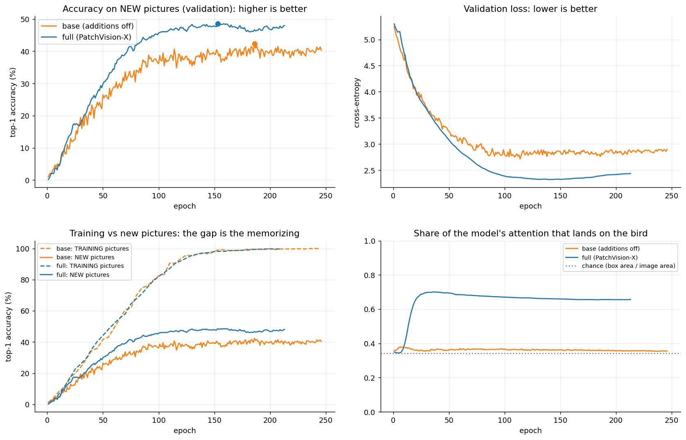

### 2. EMA weights

The model's numbers jump around a little from step to step. Averaging them over time (decay 0.999, roughly the last ten epochs) gives a smoother model. In our `full` run it was **2.4 points better on average than the raw weights** (epochs 50 to 213):


### 3. Flip-consistency loss

A mirrored bird is still the same species, and the places the model looks at should be mirrored too. During training every photo is fed twice (normal and mirrored), and two extra penalties are added: one when the *predictions* differ, and one when the *attention maps* differ after flipping one back. This costs more compute per step (so `full` takes 20 s per epoch against 12 s for `base`) but it gives free extra training signal.

We checked it on 256 test photos that were not used for any choice (evenly spaced through the test set):

| | `base` | `full` |
|---|---|---|
| Same prediction for the mirrored photo | 77.7 % | **93.0 %** |
| Attention mismatch between photo and mirror (lower = more consistent) | 0.077 | **0.003** |


*The right-most column is the attention of the mirrored photo, flipped back. It should look like column 2. For `full` it does, for `base` it does not.*

The small size of the two extra penalties during training:

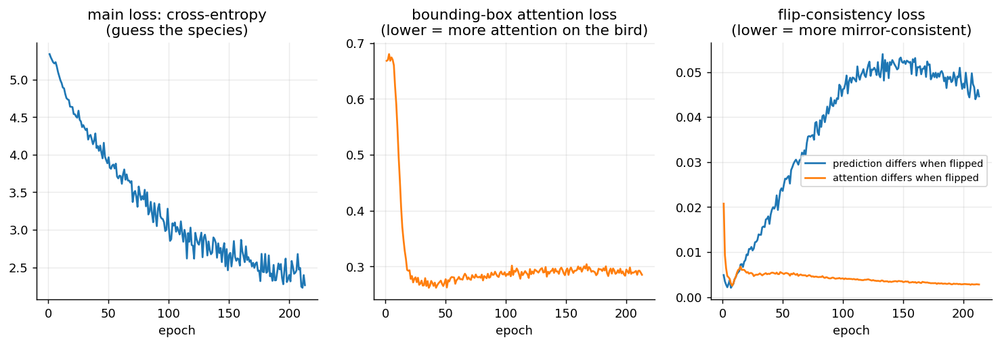

### 4. Box-guided crop

Birds often fill only a small part of the frame, so many training photos show mostly leaves and sky. In 30 % of cases we first crop to the bird's box plus a random margin (10 to 40 %), then apply the normal augmentations. The model therefore also sees *large, detailed* views of birds. This is the bottom row of the augmentation figure in section 5. Validation and test photos are never cropped this way.

### Standard tricks we also use (in both `base` and `full`)

Strong augmentation, mixup/CutMix, label smoothing (0.1), **stochastic depth** (randomly skipping whole blocks while training, up to 10 %), **weight decay** 0.05 (a gentle pull of all numbers towards zero), gradient clipping, early stopping and best-epoch selection.

> **Important.** We have **not yet measured how much each of the four tricks is worth by itself**. The comparison we have switches all of them (plus the two architecture additions) on at once. See [what comes next](#13-what-comes-next).

---

## 9. How we train

| Setting | Value |
|---|---|
| Hardware | 1 x NVIDIA RTX 4090 |
| Optimiser | AdamW, peak learning rate 5e-4, weight decay 0.05 |
| Learning-rate schedule | 10 warm-up epochs, then smoothly down to 1e-6 (cosine) |
| Batch | 64 photos (128 images per step for `full`, because the mirrored copies are added) |
| Maximum epochs | 300, with early stopping (patience 60 epochs) |
| Precision | bfloat16 for most of the model; the attention is always 32-bit |
| Starting point | random numbers; no pre-training |

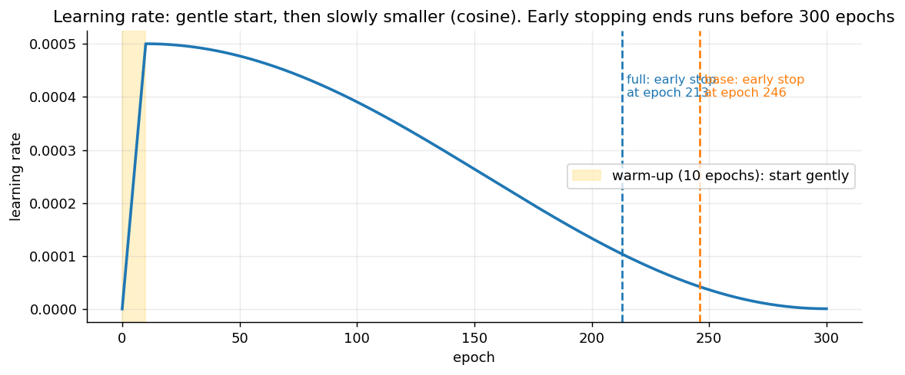

*The learning rate starts gently (warm-up), then slowly becomes smaller. Both runs were ended early by early stopping, at epoch 213 (`full`) and 246 (`base`).*

**What gets saved.** Every run writes everything to `results/<run name>/seed<seed>/`, continuously, so nothing is lost if the run stops:

| File | Content |
|---|---|
| `train_log.txt` | Every training step and a summary after every epoch |
| `steps.csv`, `history.csv` | The same numbers as tables (per step, per epoch) |
| `config.json`, `env.json` | The exact settings and software/hardware |
| `curves.png` | Training curves, refreshed every 10 epochs |
| `attention_snapshots/` | Where the model looks, every 10 epochs |
| `val_reports/` | Per-species results and confusion matrices every 10 epochs |
| `best_model.pt`, `last.pt` | Best model (by validation) and a resumable state |
| `test_*` files | Final results: metrics, per-species table, every prediction, confusion matrix, calibration plot, attention gallery |

If a run is interrupted, running it again continues from the last saved epoch. A live monitor (`watch_training.py`) shows the current epoch and the latest metrics in a terminal.

---

## 10. Results so far

### The setup

Two runs, **same data, same splits, same settings, same seed (42)**:

* **`base`**: the GvT-style model with all of our additions switched off (no LFE block, no multi-scale heads, and none of the four tricks).
* **`full`**: PatchVision-X with everything on.

### Main table (5,794 test photos)

| | `base` | `full` | Difference |
|---|---|---|---|
| Top-1 accuracy | 39.52 % | **47.39 %** | +7.87 |
| Top-5 accuracy | 65.12 % | **73.59 %** | +8.47 |
| Macro-F1 | 39.12 % | **47.05 %** | +7.93 |
| Attention inside the bird's box (random would be 0.34) | 0.36 | **0.66** | |
| Calibration error ECE (lower is better) | **2.49 %** | 5.95 % | worse |
| Best epoch / epochs run | 186 / 246 | 153 / 213 | |
| Training time | 48 min | 71 min | |
| Best validation top-1 | 42.3 % | 48.5 % | |


**How big is the noise?** With 5,794 test photos, sampling alone makes an accuracy of 47 % uncertain by about **±1.3 points** (95 % range). That does not include the variation between different random seeds, which we have not measured yet. An 8-point difference is far bigger than the sampling noise, but we still want 3 seeds before quoting an exact number.

### Training in detail


* **Top-left:** `full` (blue) learns faster and ends higher on new photos.
* **Top-right:** the validation loss of `full` reaches its lowest value around epoch 140 and then rises slowly. That rise is a sign of memorizing.
* **Bottom-left:** both models reach about 100 % on training photos (dashed). The solid lines are the accuracy on new photos.
* **Bottom-right:** only `full` puts its attention on the bird.

### Where the models look

Eight test photos, spread evenly through the test set (not hand-picked). White rectangle = bird box (not shown to the model):


`base` (middle row) often looks at branches, snow and background. `full` (bottom row) concentrates on the bird, usually on the head and breast. Looking at the right bird does **not** guarantee the right species: `full` still gets 3 of these 8 wrong.

How the looking changed during training of the `full` model (validation photos, every 10 epochs):

<p align="center">
  
</p>

### Per-species results

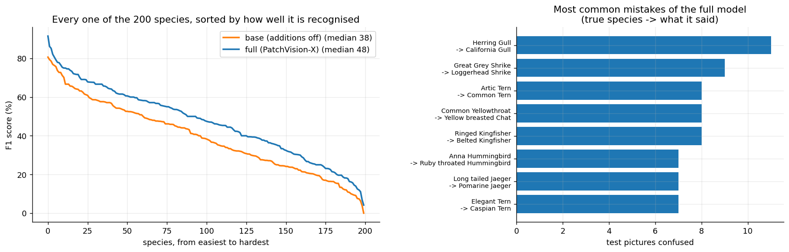

| | `base` | `full` |
|---|---|---|
| Median species F1 | 38.4 | **47.6** |
| Species with F1 above 80 | 1 | **5** |
| Species with F1 below 20 | 31 | **17** |
| Species never recognised (F1 = 0) | 1 | 0 |

* **Best-recognised by `full`:** Green Violetear (91.5), Painted Bunting (86.2), Evening Grosbeak (85.2), Green Jay (82.1), Cerulean Warbler (80.7). These all have a very distinctive colour.
* **Hardest:** American Crow (4.2), Slaty-backed Gull (6.9), White-necked Raven (11.1), Western Wood Pewee (12.0), Herring Gull (12.5). They are look-alikes of other species in the dataset (other crows, gulls, flycatchers).
* **Most common mistakes** are between very similar pairs (right panel), as an expert birder would also find hard.

### Are the confidence numbers honest?

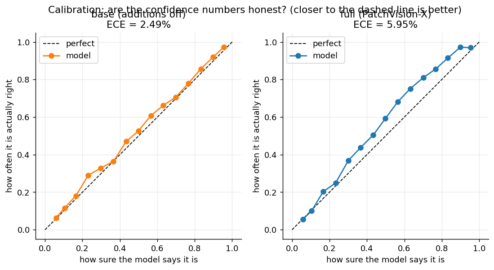

`full` is **more accurate but less well calibrated** than `base` (ECE 5.95 % against 2.49 %): it is more confident than it should be. We have not investigated why (strongly fitting the training photos often makes a model over-confident), so we treat it as something to improve.

---

## 11. Overfitting trials: one change at a time

### Why we ran them

Both `base` and `full` memorize the training photos: about 98 to 100 % right on photos they trained on, but only 40 to 48 % on new photos. We wanted to know whether well-known, cheap fixes reduce that. The scientific way is to **change one thing at a time**, like testing four cake recipes that differ by one ingredient each.

### The design

Each trial is the `full` recipe (same data, same splits, same seed 42, same 300-epoch schedule, same early stopping after 60 epochs without improvement) with **exactly one setting changed**. The notebook checks this automatically from the saved settings.

| Trial (= results folder) | The one change | In simple words |
|---|---|---|
| `ovf1_droppath0.3` | stochastic depth 0.1 → 0.3 | While training, skip whole blocks at random, more often (up to 30 % for the last block). The model cannot rely on any single block. |
| `ovf2_wd0.1` | weight decay 0.05 → 0.1 | A stronger pull of all numbers towards zero, so they cannot grow large just to memorize. |
| `ovf3_autoaug` | augmentation `strong` → `auto` | Random photo changes chosen automatically (shear, rotate, colour, contrast ...). The bird box follows the geometric ones. |
| `ovf4_dropout0.1` | dropout 0 → 0.1 | Randomly switch off 10 % of the numbers inside the MLP and of the attention weights while training. |

### The rule was written before the results

At the top of `overfitting_trials.ipynb` we fixed how to judge, before any trial had finished. Only **validation** numbers decide. A trial counts as an improvement over `full` if both hold:

1. its lowest validation loss is lower than `full`'s by at least 0.03, and
2. its smoothed validation accuracy (best 10-epoch average) is not more than 1 point below `full`'s.

The test photos are evaluated automatically at the end of every run, and are shown below "for the record", but they were **not** used to choose anything.

### Results (validation decides)

| Run | Epochs run | Lowest validation loss | Validation top-1 (smoothed) | Memorizing gap (points) | Passes the rule? | Time |
|---|---|---|---|---|---|---|
| `full` (reference) | 213 | 2.32 | 48.4 % | 49.8 | – | 71 min |
| `ovf1_droppath0.3` | **300** | **2.14** | **51.3 %** | 48.3 | yes | 97 min |
| `ovf2_wd0.1` | 208 | 2.26 | 50.1 % | 49.2 | yes | 69 min |
| `ovf3_autoaug` | 239 | **2.14** | 50.6 % | 48.5 | yes | 79 min |
| `ovf4_dropout0.1` | 253 | 2.23 | 50.8 % | 48.8 | yes | 86 min |

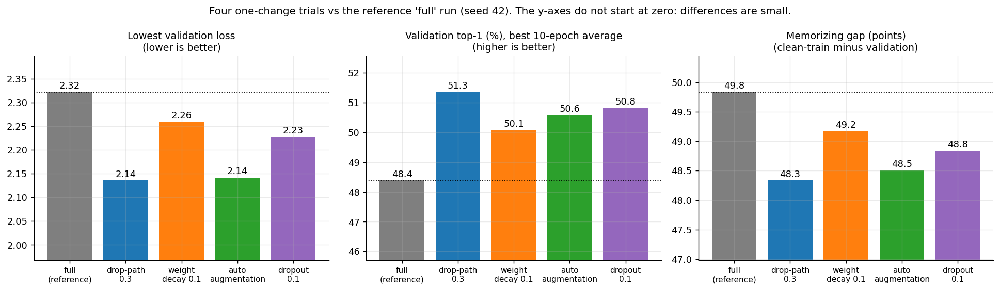

*The y-axes do not start at zero, so small differences look big. Look at the numbers.*

<p align="center">
  
</p>

*Validation accuracy of the five runs while they train. A run stops when early stopping triggers (`full`, `wd0.1`, `autoaug` and `dropout0.1` did; `droppath0.3` ran all 300 epochs).*

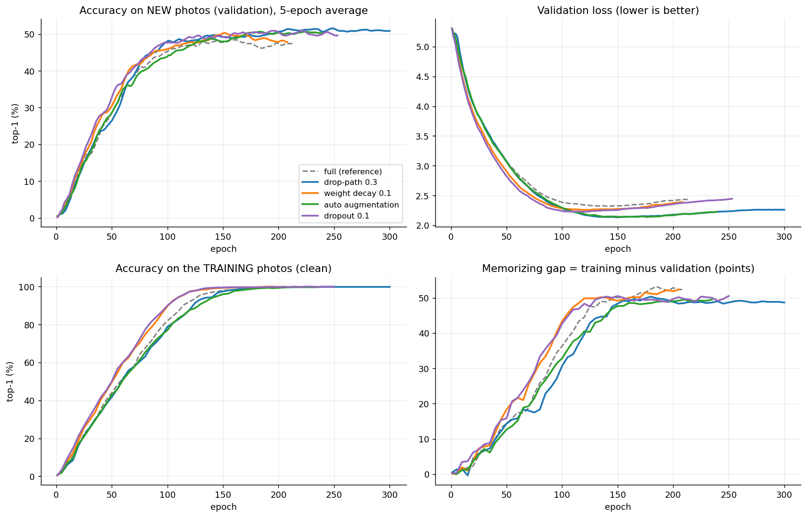

*Top-left: accuracy on new photos. Top-right: validation loss. Bottom-left: accuracy on the training photos (all end at about 100 %). Bottom-right: the memorizing gap, which stays near 50 points for every run.*

### Test numbers (for the record only)

| Run | Top-1 | Top-5 | Macro-F1 | Calibration error (ECE, lower is better) |
|---|---|---|---|---|
| `full` | 47.39 % | 73.59 % | 47.05 | 5.95 % |
| `ovf1_droppath0.3` | 52.07 % | 75.15 % | 51.68 | 10.77 % |
| `ovf2_wd0.1` | 50.03 % | 75.15 % | 49.57 | 7.38 % |
| `ovf3_autoaug` | 50.26 % | 75.79 % | 50.07 | 8.09 % |
| `ovf4_dropout0.1` | 48.08 % | 73.16 % | 47.62 | 5.70 % |

We have now seen these numbers, so from here on every decision must rest on the validation photos only.

### How to read this honestly

1. **All four fixes passed the rule, and all four helped a little**: lower validation loss and 1.7 to 3.0 points higher validation accuracy. But the rule turned out to be lenient (everything passed), so it does not rank the four.
2. **The memorizing gap barely moved.** It went from 49.8 points to 48.3 to 49.2. Every model still reaches 99.7 to 100 % on the clean training photos. The fixes make the model somewhat better on new photos; they do **not** stop it from memorizing.
3. **The differences are about as big as the noise.** The validation set has only 600 photos, and one standard error of an accuracy near 50 % is about 2 points. The same photos are used for every run, which makes the comparison somewhat less noisy, but we have run **one seed each**, so we cannot say which fix is truly best.
4. **`ovf1_droppath0.3` is not a perfectly fair comparison.** It was the only trial that ran all 300 epochs (early stopping never triggered; its best epoch was 246). The others stopped between epochs 208 and 253, before the learning rate had finished falling. Part of its lead may come from the longer schedule.
5. **Calibration got worse in three of four trials** (confidence numbers less honest). Dropout 0.1 stayed about the same.
6. **Attention on the bird did not change** (the share inside the bird box stayed between 0.62 and 0.67 in every run).

### What this means

Cheap regularisation helps a little, but it is not the answer to memorizing on its own. Next we combine the best settings and test them, then repeat with several seeds. If the gap still stays near 50 points, the problem is structural (a 4.3-million-number model against 5,394 photos), and we should look at a smaller model or at learning from the training photos without labels.

### Experiment log: every run so far

| Run | What it is | Epochs | Best epoch | Time | Test top-1 (record) |
|---|---|---|---|---|---|
| [`base`](results/base/seed42/) | additions off | 246 | 186 | 48 min | 39.52 % |
| [`full`](results/full/seed42/) | everything on | 213 | 153 | 71 min | 47.39 % |
| [`ovf1_droppath0.3`](results/ovf1_droppath0.3/seed42/) | `full` + stochastic depth 0.3 | 300 | 246 | 97 min | 52.07 % |
| [`ovf2_wd0.1`](results/ovf2_wd0.1/seed42/) | `full` + weight decay 0.1 | 208 | 148 | 69 min | 50.03 % |
| [`ovf3_autoaug`](results/ovf3_autoaug/seed42/) | `full` + auto augmentation | 239 | 179 | 79 min | 50.26 % |
| [`ovf4_dropout0.1`](results/ovf4_dropout0.1/seed42/) | `full` + dropout 0.1 | 253 | 193 | 86 min | 48.08 % |

**Where the proof is.** The notebook [`overfitting_trials.ipynb`](overfitting_trials.ipynb) contains the recorded output of all four trials. Each run folder holds its complete step-by-step log (`train_log.txt`), `steps.csv`, `history.csv`, `config.json`, test results and plots. The side-by-side table, plot and verdict are in [`results/overfitting_trials/`](results/overfitting_trials/).

---

## 12. What we learned, and what we do NOT know yet

**What the evidence supports**

* On this data, the extra ingredients of PatchVision-X made a clear difference: about **+8 points** on top-1 and a model that looks at the bird (one seed).
* The mirror test shows that the consistency training worked: the model is much more stable when the photo is flipped.
* Even a small ViT can train from scratch on 5,394 photos and reach about 47 % on 200 look-alike species.
* Simple extra regularisation (more stochastic depth, stronger augmentation, more weight decay, dropout) improved validation accuracy by about 2 to 3 points and lowered the validation loss in all four single-change trials (one seed each).

**What we do NOT know yet**

* **Whether the four fixes add up.** We have not yet tried them together. They could stack, or they could over-regularize.
* **Which of the four is truly best.** The differences between them are about as large as the noise of the 600 validation photos, and `ovf1_droppath0.3` also had a longer schedule.

* **Which ingredient does the work.** `full` differs from `base` in six things at once (two architecture changes and four tricks). We only know that the *combination* helps.
* **How stable the numbers are.** One seed per model. Different seeds may differ by a point or more.
* **Whether the sparse gate does anything.** In both runs the gate values stayed near 0.5, and less than 1 % of them dropped below 0.1. In other words, the "sparsity" that gives the GvT paper its name hardly appeared in our training. We cannot say if this is our implementation, our small data, or our settings.
* **How we compare with other models.** We have not yet run a CNN or a plain ViT on the same splits.

**Weak points**

* **Every model memorizes the training set** (gap of about 48 to 60 points; the four trials did not close it). This is the main open problem.
* **`full` is worse calibrated** than `base`, and most trials are worse still (ECE up to 10.8 %).
* **`full` is slower to train** (20 against 12 seconds per epoch) because of the mirrored copies.
* **We have looked at the test results of all six runs.** To keep the final test grade honest, every further choice should be made on the validation photos only, and the test set should be used for the final runs only.
* The GvT parts of our code follow our interpretation of an under-specified paper ([section 6](#6-the-two-papers-we-built-on)).

---

## 13. What comes next

- [x] Prepare the data: fixed splits, normalisation, augmentation levels
- [x] Implement PatchVision-X (model, losses, trainer, logging, monitor)
- [x] Run `full` and `base` once (seed 42)
- [x] **First round against memorizing:** four one-change trials (stochastic depth 0.3, weight decay 0.1, `auto` augmentation, dropout 0.1). All helped a little; the gap stayed near 50 points ([section 11](#11-overfitting-trials-one-change-at-a-time))
- [x] **Second round (E4):** combined the best settings, each for the full 300 epochs. `ovf5_dp0.3_autoaug` (stochastic depth 0.3 + `auto` augmentation) reached **53.00 %** test top-1 and `ovf6_all_four` **52.40 %**, against 47.39 % for `full` and 52.07 % for the best single change. The two combinations are tied with each other, and the gain over drop-path 0.3 alone is not statistically significant. The memorizing gap fell only to about 46.8 points. Details: [section 7 of the top-level README](../README.md#7-e4-the-regularization-study). The two runs were trained on an RTX 5090 with PyTorch 2.11, the earlier ones on an RTX 4090 with PyTorch 2.5.1. Reproduce with `python train.py ovf5_dp0.3_autoaug 42` and `python train.py ovf6_all_four 42`.
- [ ] **If the gap stays near 50 points:** try a smaller model, a larger consistency weight, or learning from the training photos without labels. We would judge each by the *gap* and not only by accuracy.
- [ ] **Ablations:** add the ingredients one at a time (the experiments `lfe`, `multiscale`, `arch_x`, `arch_x+bbox`, `arch_x+ema`, `arch_x+cons`, `arch_x+boxcrop`, and leave-one-out versions `full-...` are already defined in the code)
- [ ] **3 seeds** (42, 43, 44) for the final recipe and for `base`, to report mean and standard deviation
- [x] **CNN baselines:** two ResNet-style CNNs on identical splits are done (see [`../CNN_Baseline`](../CNN_Baseline)); a plain textbook ViT is still not built
- [ ] Final report with the ablation table, curves, confusion matrices and attention figures

---

## 14. Where everything is, and how to re-run it

### Folder map

```
patchvision-vit-cub200/                  <- repo root (shared by the ViT and CNN studies)
├── CUB_200_2011/                 <- the dataset (not in Git, download it yourself)
├── DataPreprocessing_Results/    <- shared splits, normalisation, augmentation settings
├── patchvision_*_preprocessing.ipynb   <- shared data-preparation notebooks
└── ViT_PatchVisionX/             <- EVERYTHING below belongs to the ViT study (this folder)
├── README.md                     <- this file
├── training.ipynb                <- runs and records one experiment (full, base, ablations)
├── overfitting_trials.ipynb      <- runs and records the four overfitting trials + comparison
├── train.py                      <- the same from the terminal:  python train.py base 42
│                                    (also accepts trial names, e.g.  python train.py ovf1_droppath0.3 42)
├── watch_training.py             <- live monitor for a running training
├── patchvision/                  <- all the code
│   ├── config.py                    settings + definitions of all experiments (full, base, ablations, overfitting trials)
│   ├── data.py                      dataset, augmentation, mixup/CutMix, data loaders
│   ├── models.py                    the PatchVision-X architecture
│   ├── losses.py                    cross-entropy, box-attention loss, flip-consistency loss
│   ├── regularization.py            EMA and early stopping
│   ├── optim.py                     optimiser and learning-rate schedule
│   ├── metrics.py                   accuracy, F1, calibration, speed measurements
│   ├── engine.py                    the training loop and everything it saves
│   ├── experiment.py                running experiments, results tables, comparing runs
│   ├── visualize.py, monitor.py     plots and the live monitor
│   └── utils.py
├── DataPreprocessing_Results/    <- splits, normalisation, augmentation settings
├── patchvision_basic_data_preprocessing.ipynb
├── patchvision_advanced_preprocessing.ipynb
├── results/                      <- everything our runs wrote (logs, metrics, plots)
│   ├── full/seed42/   base/seed42/
│   ├── ovf1_droppath0.3/  ovf2_wd0.1/  ovf3_autoaug/  ovf4_dropout0.1/    (each with seed42/)
│   ├── overfitting_trials/       comparison table + plot + verdict of the four trials
│   └── ablation_table.md, all_runs.csv
├── docs/
│   ├── make_figures.py           <- rebuilds every picture and animation on this page
│   ├── figures/   animations/
└── CUB_200_2011/                 <- the dataset (not in Git, download it yourself)
```

### Re-running

Versions we used: Python 3.11, PyTorch 2.5.1 (CUDA 12.4), torchvision 0.20.1, numpy 1.26.4, pandas 2.2.3, matplotlib 3.9.2, pillow 11.0.0 on an RTX 4090.

0. **Run everything from inside the `ViT_PatchVisionX/` folder** (`cd ViT_PatchVisionX`). The code reads the data from the repository root (one level up) and writes results to `ViT_PatchVisionX/results/`.
1. **Get the dataset** from the [CUB-200-2011 page](https://www.vision.caltech.edu/datasets/cub_200_2011/) and extract it so that `CUB_200_2011/images/` exists next to this README. The prepared files in `DataPreprocessing_Results/` are already in the repository.
2. **Smoke test first (a few minutes).** In `training.ipynb` keep `SMOKE_TEST = True` and run all cells. It trains 2 epochs on tiny synthetic data to check that everything works on your machine.
3. **Real run.** Set `SMOKE_TEST = False` and choose `EXPERIMENT` (for example `"full"` or `"base"`), then run all cells. Or from a terminal:
   ```
   python train.py full 42
   python train.py base 42
   python train.py ovf1_droppath0.3 42
   ```
   To re-run all four overfitting trials with a recorded notebook, open `overfitting_trials.ipynb` and run all cells (several hours; a finished trial is skipped and an interrupted one resumes).
4. **Watch it live:** `python watch_training.py base 42` in a second terminal.
5. **Compare runs:** `summarize_results` (in `patchvision/experiment.py`, used by `training.ipynb`) writes `results/ablation_table.md`; `compare_runs` (used by `overfitting_trials.ipynb`) writes `results/overfitting_trials/comparison.*`.
6. **Rebuild the pictures on this page:** `python docs/make_figures.py` (from inside `ViT_PatchVisionX/`). It reads the finished runs, including the `best_model.pt` files, which are not part of the lightweight Git history.

Model weights are large, so `last.pt` and the periodic weight files are not stored in Git (see `.gitignore`).

---

## 15. References

1. A. Dosovitskiy et al. *An Image is Worth 16x16 Words: Transformers for Image Recognition at Scale.* ICLR 2021. The original Vision Transformer.
2. H. Touvron et al. *Training Data-Efficient Image Transformers & Distillation through Attention* (DeiT). ICML 2021. Shows how much training recipe matters when data is limited.
3. C. Wah et al. *The Caltech-UCSD Birds-200-2011 Dataset.* California Institute of Technology, 2011.
4. *Graph-based vision transformer with sparsity for training on small datasets from scratch.* Scientific Reports 15 (2025). <https://www.nature.com/articles/s41598-025-10408-0>
5. *MSCViT: A Small-size ViT architecture with Multi-Scale Self-Attention Mechanism for Tiny Datasets.* arXiv:2501.06040 (2025). <https://arxiv.org/abs/2501.06040>
