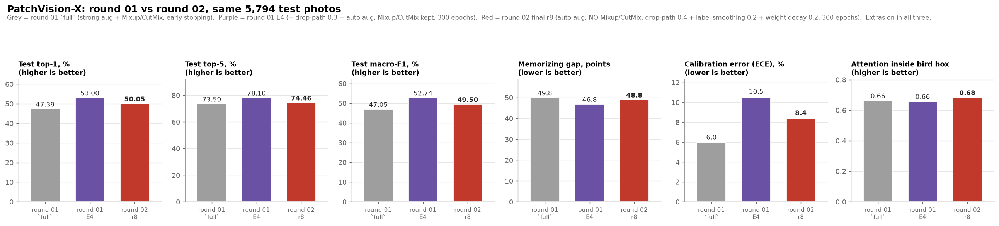
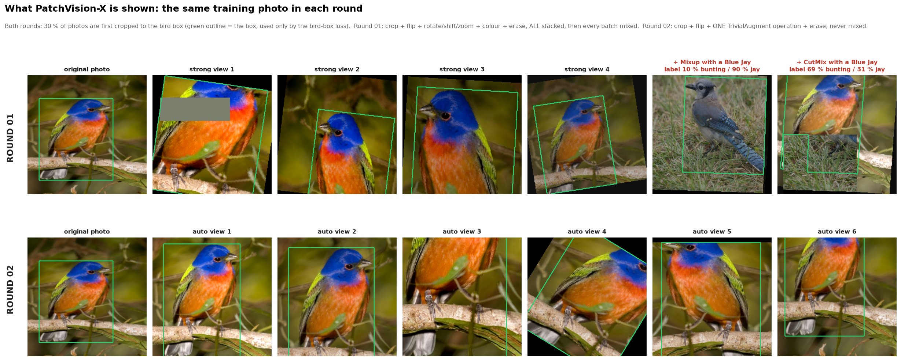
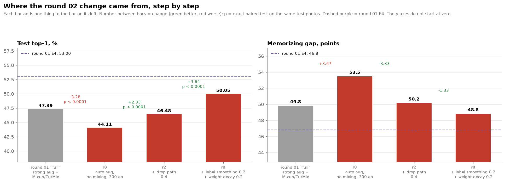
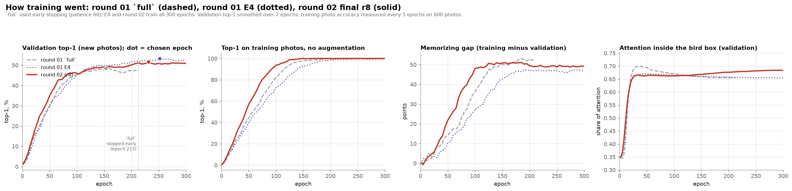
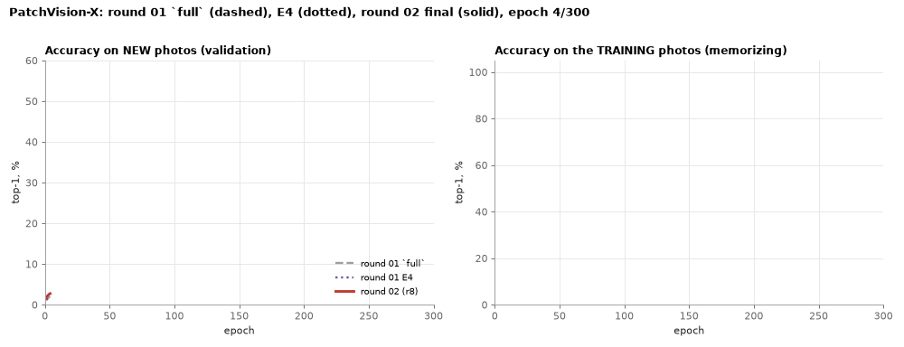
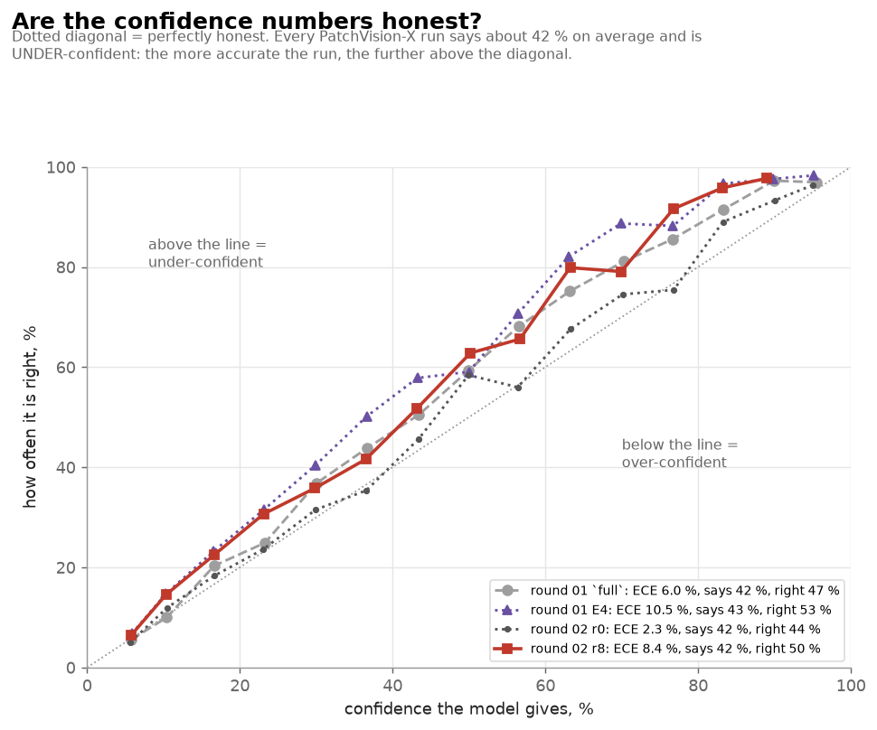
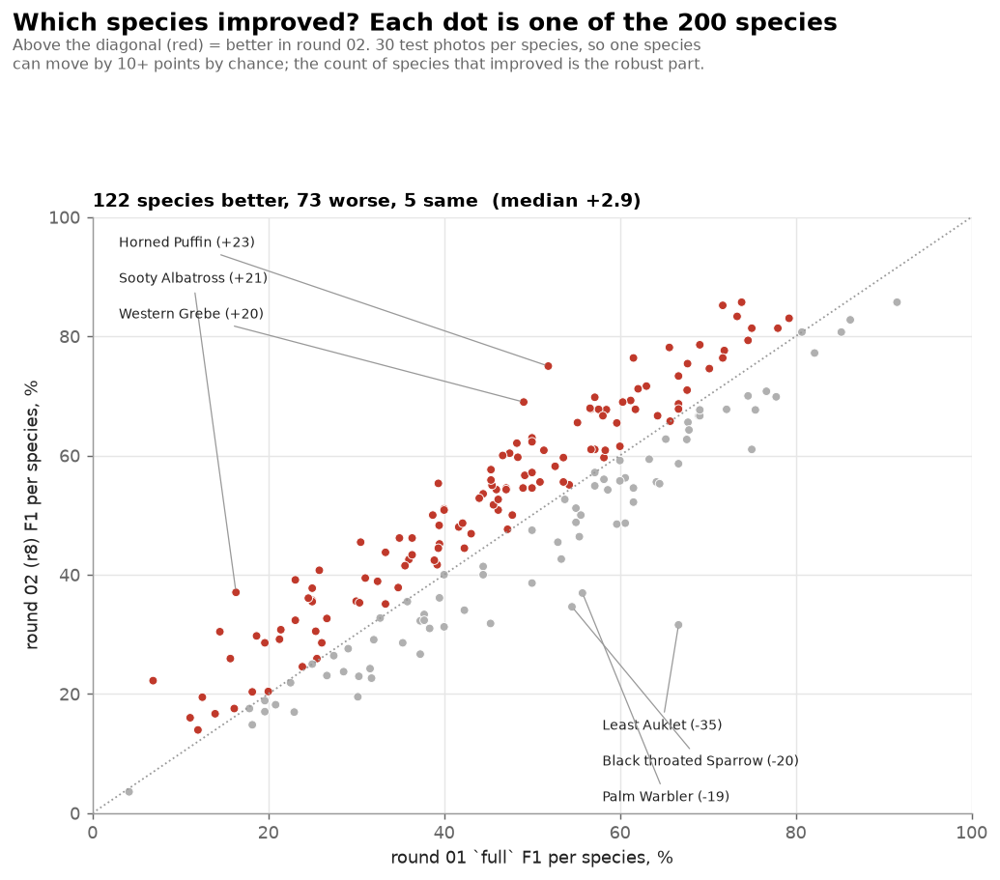
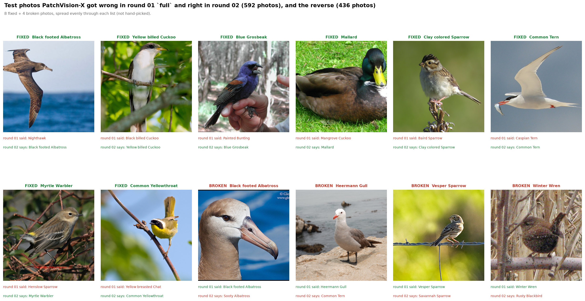

# PatchVision-X: round 01 vs round 02

     -brightgreen) 

PatchVision-X is the project's main model: a 4.27 M-parameter graph-attention Vision Transformer with a local feature block (LFE), multi-scale attention and four training-time extras (bird-box attention loss, flip-consistency loss, box-guided crop, EMA weights), trained **from scratch** on CUB-200-2011 (5,394 training photos, about 27 per species). Each experiment round has its own folder with its own detailed README. **This page compares the two rounds**: what changed in the training recipe, what it did to accuracy, memorizing, confidence and attention, and where the change came from.

| Folder | Training recipe | Result (test top-1) |
|---|---|---|
| [`01_strongaug_mixup_cutmix/`](01_strongaug_mixup_cutmix) | `strong` augmentation (all operations stacked) + Mixup/CutMix, early stopping. `full` run, four one-change trials, and two combined runs (E4). | `full` 47.39 %, **E4 53.00 %** |
| [`02_autoaug_nomix_regularization/`](02_autoaug_nomix_regularization) | `auto` augmentation (one TrivialAugment operation), **no Mixup/CutMix**, 300 epochs, then a one-change-at-a-time search (drop-path, label smoothing, weight decay, SAM) and the winners combined (r8). The same round as the CNNs and the plain ViT. | r8 50.05 % |

The model is identical in both rounds and **the four extras are on in every run**. The code (model, data pipeline, losses, trainer) is in the shared package [`../Vision_Transformer/patchvision`](../Vision_Transformer/patchvision); the data (`CUB_200_2011/`, `DataPreprocessing_Results/`) is read from the repository root. The plain ViT that PatchVision-X is built on is in [`../Vision_Transformer`](../Vision_Transformer).

> **Jump to:** [Result in one minute](#1-the-result-in-one-minute) · [The two recipes](#2-the-two-recipes) · [Where the change came from](#3-where-the-change-came-from) · [Training](#4-how-training-went) · [Results in detail](#5-results-in-detail) · [Against the other models](#6-against-the-plain-vit-and-the-cnns) · [Takeaways](#7-what-we-learned) · [Limits](#8-limits) · [Reproduce](#9-reproduce-the-figures)

---

## 1. The result in one minute

Round 01 has two runs that matter: `full` (the base recipe, the fair comparison for round 02's base) and **E4** (`ovf5_dp0.3_autoaug`, round 01's tuned winner).

| | Round 01 `full` | Round 01 E4 | **Round 02 final (r8)** |
|---|---|---|---|
| Test top-1 | 47.39 % | **53.00 %** | 50.05 % |
| Test top-5 | 73.59 % | **78.10 %** | 74.46 % |
| Test macro-F1 | 47.05 % | **52.74 %** | 49.50 % |
| Validation top-1 (chosen epoch) | 48.50 % | **53.33 %** | 51.67 % |
| Memorizing gap | 49.8 pts | **46.8 pts** | 48.8 pts |
| Calibration error (ECE) | **5.95 %** | 10.45 % | 8.35 % |
| Attention inside the bird box | 0.66 | 0.66 | **0.68** |
| r8 vs this run, test top-1 | **+2.69** (only r8 right 592, only `full` right 436; p ≈ 1e-6) | **−2.93** (only r8 right 388, only E4 right 558; p ≈ 4e-8) | |

One seed (42), the same 5,794 unseen test photos, sampling noise about ±1.3 points. p = exact paired (McNemar) test on the same photos. Round 02 = its final run (r8, best on validation).

**In short:**

1. **Round 02 beats round 01's base run**: r8 is +2.7 points over `full` on top-1, +0.9 on top-5, +2.5 on macro-F1; 122 of 200 species improved.
2. **Round 02 does not beat round 01's best run.** E4 is still 2.9 points ahead. E4 kept Mixup/CutMix; round 02 removed it.
3. **The new augmentation recipe alone made PatchVision-X worse**: −3.3 points (p < 0.0001), exactly as for the plain ViT. Drop-path, label smoothing and weight decay won that back and more.
4. **Memorizing went down only a little** (49.8 → 48.8 points). PatchVision-X still gets about 100 % of its training photos right.
5. **It looks at the bird a little more** (0.66 → 0.68 of its attention inside the bird box), and it keeps improving that until the last epoch.



---

## 2. The two recipes

The model (conv tokenizer, LFE, 8 multi-scale sparse graph-attention blocks, graph pooling, 4.27 M parameters), the four extras, the data split, the optimizer (AdamW, lr 5e-4, 10 warm-up epochs + cosine to 1e-6), batch size 64, gradient clip 1.0, bf16 and the trainer are **identical** in both rounds. Only the training recipe changed:

| Setting | Round 01 `full` | Round 01 E4 | Round 02 (final r8) | Why it was changed in round 02 |
|---|---|---|---|---|
| Augmentation | `strong`: random crop + flip + rotate/shift/zoom + colour change + random erase, **all stacked on every photo** | `auto` | `auto`: random crop (35 to 100 %) + flip + **one** random TrivialAugment operation + random erase (25 %) | the same round as the CNNs and the plain ViT |
| Mixup / CutMix | on, every batch (50/50) | on | **off**, photos are never mixed | to test whether mixing is needed |
| Drop-path | 0.1 | 0.3 | **0.4** | won on validation (r2) |
| Label smoothing | 0.1 | 0.1 | **0.2** | won on validation (r4) |
| Weight decay | 0.05 | 0.05 | **0.2** | won on validation (r6) |
| SAM optimizer | no | no | no | +2 validation photos only, doubles the time: left out by choice |
| Extras (box loss, flip-consistency, box-guided crop 30 %, EMA) | on | on | on | kept, so the rounds are comparable |
| Stopping | early stopping, patience 60 (stopped at epoch 213) | all 300 epochs | **all 300 epochs** | every run gets the same budget |
| Runs | `full` + 4 trials + 2 combined = 7 | | 9 (r0 base, r1–r7 one change each, r8 winners combined) | find what helps, one change at a time |

How the round 02 search worked, and every run's numbers, are in the [round 02 README](02_autoaug_nomix_regularization/README.md). The model, the extras and round 01's trials are described step by step in the [round 01 README](01_strongaug_mixup_cutmix/README.md).

### What the model actually sees



*The same Painted Bunting photo through each round's real training code, including the box-guided crop (30 % of photos are first cropped to the bird box). The green outline is the bird box: it follows every crop, flip and rotation, but it is used only by the bird-box loss, never as an input. Round 01 stacks every operation on every photo and then mixes it with another photo in the batch: the model is asked to answer "10 % bunting, 90 % jay" or "69 % bunting, 31 % jay". Round 02 changes one thing at a time and never mixes, so every photo keeps one clear label.*

Round 02's augmentation in more detail (the 14 operations, the chain, the same photo over 8 epochs): [round 02 README, section 3](02_autoaug_nomix_regularization/README.md#3-what-changed-from-round-01).

---

## 3. Where the change came from

Going from round 01 to round 02 changed several things at once. The round 02 runs let us take them apart, one step at a time, on the same test photos:



| Step | Test top-1 change | Only new right / only old right | p | Gap change |
|---|---|---|---|---|
| round 01 `full` → r0 (`auto` aug, no Mixup/CutMix, 300 epochs) | **−3.28** | 448 / 638 | **< 0.0001** | 49.8 → 53.5 |
| r0 → r2 (+ drop-path 0.4) | **+2.33** | 524 / 389 | **< 0.0001** | 53.5 → 50.2 |
| r2 → r8 (+ label smoothing 0.2 + weight decay 0.2) | **+3.64** | 510 / 299 | **< 0.0001** | 50.2 → 48.8 |
| **round 01 `full` → round 02 final** | **+2.69** | 592 / 436 | **< 0.0001** | 49.8 → 48.8 |
| *for reference: round 01 `full` → E4* | *+5.63* | *658 / 332* | *< 0.0001* | *49.8 → 46.8* |

* **The new base recipe on its own is a clear step back.** Without Mixup/CutMix, PatchVision-X loses 3.3 points and memorizes more (gap +3.7). The plain ViT lost exactly the same 3.3 points; the CNNs lost nothing. The extras (box loss, flip-consistency) do not replace the photo mixing.
* **Drop-path wins back most of it** (+2.3), and **label smoothing + weight decay add more on top** (+3.6). Every step is significant, and each step also shrinks the gap.
* **E4 shows the other route:** round 01's search kept Mixup/CutMix and added drop-path 0.3 + `auto` augmentation. That gained +5.6 over `full`, more than round 02's +2.7.

---

## 4. How training went



* **Validation top-1 (left):** round 02 climbs **faster** for the first 100 epochs (likely because unmixed photos with one clear label are easier to learn early on). `full` levels off near 48 % and early stopping ends it at epoch 213. E4 climbs slowest early but keeps rising and finishes highest (chosen epoch 252); r8 picks epoch 231.
* **Training photos (second panel):** round 02 also **memorizes faster**: 99 % on clean training photos by epoch 130, against 180 for `full` and 210 for E4. All three end at about 100 %.
* **Gap (third panel):** r8 reaches its gap of about 49 to 50 points by epoch 110 and stays there; E4, with Mixup/CutMix, stays lowest the whole way (about 47 at the end).
* **Attention on the bird (right):** in round 01, attention inside the bird box peaks early (0.70 at epoch 36 for `full`, 0.67 at epoch 48 for E4) and then slowly falls to 0.66. In round 02 it **keeps rising until the last epoch** (0.68 at epoch 297). A likely reason: without mixed photos, every training photo has one bird and one box, so the box loss gets a cleaner signal.



*The race: validation accuracy (left) and accuracy on the training photos (right). Dashed = round 01 `full`, dotted = round 01 E4, solid = round 02 final.*

| | Round 01 `full` | Round 01 E4 | Round 02 final (r8) |
|---|---|---|---|
| Epochs run / chosen epoch | 213 / 153 | 300 / 252 | 300 / 231 |
| Training time | 71 min (RTX 4090, 20.1 s per epoch) | 278 min (RTX 5090, 55.5 s per epoch) | 148 min (RTX 5090, 29.6 s per epoch) |
| Runs in the round | 7 | | 9 (about 25 h in total, SAM alone 4.75 h) |

The runs did not all use the same machine or software, so their times are not directly comparable. Each round's own animations: [round 01's trials race](01_strongaug_mixup_cutmix/docs/animations/trials_race.gif) and [round 02's race of all 9 runs](02_autoaug_nomix_regularization/docs/animations/pvx_race.gif).

---

## 5. Results in detail

### 5.1 Confidence: are the numbers honest?



| | Round 01 `full` | Round 01 E4 | Round 02 r0 | **Round 02 final (r8)** |
|---|---|---|---|---|
| Average confidence | 41.5 % | 42.5 % | 42.2 % | 41.7 % |
| Actual accuracy | 47.4 % | 53.0 % | 44.1 % | 50.1 % |
| ECE | 5.95 % | 10.45 % | **2.33 %** | 8.35 % |

* **PatchVision-X is under-confident in both rounds** (curves above the diagonal): it is right more often than it says. That is the safer direction.
* **Its average confidence stays near 42 % whatever the recipe**, while its accuracy goes from 44 % to 53 %. So the more accurate the run, the larger its ECE: E4 has the highest ECE because it is the most accurate, not because it is over-confident.
* **This differs from the plain ViT**, which became over-confident when Mixup/CutMix was removed (r0 said 47 %, was right 36 %). PatchVision-X did not: its r0 is the best calibrated run of all.

### 5.2 Which species improved?



* **122 of 200 species improved** against `full`, 73 got worse, 5 stayed the same (median +2.9 F1 points; median species F1 47.6 → 51.1).
* Biggest gains: Horned Puffin (+23), Sooty Albatross (+21), Western Grebe (+20). Biggest losses: Least Auklet (−35), Black throated Sparrow (−20), Palm Warbler (−19).
* With 30 test photos per species, single-species swings of 20 points are mostly noise; the count of improved species is the reliable signal.
* The hardest species stay hard in both rounds: plain black, grey or brown birds with close look-alikes (crows and ravens, pewees, gulls). Lists per round: [round 01, section 7](01_strongaug_mixup_cutmix/README.md#which-species-are-easy-and-which-are-hard) and [round 02, section 8](02_autoaug_nomix_regularization/README.md#which-species-are-easy-and-which-are-hard).

### 5.3 Photos fixed and broken



* Round 02 **fixed 592 test photos** that round 01 `full` got wrong, and **broke 436** that `full` got right: a net gain of 156 photos out of 5,794.
* 2,310 photos are right in both and 2,456 are wrong in both. Most answers do not change; the recipe moves the border cases.
* Many "broken" photos go to a close relative, the same kind of mistake the "fixed" photos had in round 01.

### 5.4 Where the model looks

Both rounds put about two thirds of the attention on the bird (0.66 for `full` and E4, 0.68 for r8), against 0.34 for attention spread evenly and 0.36 for the plain ViT. Per-run attention and r8's attention gallery: [round 02, section 7](02_autoaug_nomix_regularization/README.md#7-does-it-still-look-at-the-bird). Round 01's attention maps: [round 01, section 7](01_strongaug_mixup_cutmix/README.md#where-the-models-look).

---

## 6. Against the plain ViT and the CNNs

All four models went through the same two rounds with the same settings ([`../Vision_Transformer`](../Vision_Transformer/README.md), [`../CNN_Baseline`](../CNN_Baseline/README.md)):

| Test top-1 | **PatchVision-X (4.27 M)** | Plain ViT (4.31 M) | CNN small (4.22 M) | CNN large (11.28 M) |
|---|---|---|---|---|
| Round 01 (base recipe) | **47.39 %** | 39.52 % | 43.65 % | 45.86 % |
| Round 02 r0 (new recipe, old regularizers) | 44.11 % (**−3.28**) | 36.24 % (**−3.28**) | 43.75 % (+0.10) | 46.03 % (+0.17) |
| Round 02 final (r8) | 50.05 % | 42.03 % | 47.65 % | **51.52 %** |
| Round 01 → round 02 | +2.66 | +2.51 | +4.00 | +5.66 |
| Best single change in round 02 | drop-path (0.4 on validation, 0.5 on test) | drop-path 0.4 | weight decay 0.2 | weight decay 0.2 |
| Best of all rounds | **53.00 % (E4)** | 42.03 % | 47.65 % | 51.52 % |

* **PatchVision-X behaves like a ViT, not like a CNN.** Dropping Mixup/CutMix cost both transformers exactly 3.3 points and neither CNN anything; drop-path is the best single change for both transformers and hurts the CNNs.
* **It is the best model of its size in both rounds**: +8.0 points over the plain ViT and +2.4 over CNN small in round 02. Only CNN large, with 2.6 times the parameters, edges ahead in round 02 (+1.5).
* **Its best result overall (E4, 53.00 %) is the best in the project**, ahead of CNN large's best (51.52 %).

---

## 7. What we learned

1. **For PatchVision-X, as for the plain ViT, Mixup/CutMix matters.** Removing it cost 3.3 points. The extras do not replace it, and the round-02 regularizers only partly do: round 01's E4 (Mixup/CutMix kept) is still 2.9 points ahead.
2. **Drop-path and label smoothing suit PatchVision-X**; weight decay helps on top. The combination (r8) beats `full` by 2.7 points, and every step is significant.
3. **Memorizing is reduced only a little.** The gap moved from 49.8 to 48.8 points (E4: 46.8); PatchVision-X still reaches about 100 % on its training photos with every recipe tried so far.
4. **Without mixed photos the bird-box loss works more cleanly:** attention on the bird keeps rising until the last epoch and ends higher (0.68).
5. **PatchVision-X is under-confident in both rounds**: its confidence stays near 42 % while accuracy rises, so ECE grows with accuracy.
6. **The natural next step is to combine both rounds' lessons**: r8's regularizers with Mixup/CutMix turned back on. It is not run yet.

---

## 8. Limits

- **One seed.** All numbers are seed 42. The differences are significant on the test photos, but they are not shown to hold for another random seed; that needs the three-seed runs.
- **Not a clean A/B test.** Round 01 → round 02 changed augmentation, mixing, stopping and regularization together. Section 3 separates them using round 02's own runs, which shows the order of the steps, not every possible combination (r8's regularizers with Mixup/CutMix kept on was not tried).
- **`full` stopped early, round 02 ran 300 epochs.** E4 also ran 300 epochs, so the E4 vs r8 comparison has equal budgets.
- **SAM left out of r8 by choice** (section 2), although it passed the rule by one validation photo.
- **Different hardware.** `full`: RTX 4090, PyTorch 2.5.1; E4 and round 02: RTX 5090, PyTorch 2.11. Accuracy should be unaffected; times are not comparable.
- **Test set seen.** All test results were read. Every decision (winners, final run) was made on validation only.

---

## 9. Reproduce the figures

```bash
python ViT_PatchVisionX/docs/make_comparison.py
```

It reads only finished results (`01_strongaug_mixup_cutmix/results/{full,ovf5_dp0.3_autoaug}/` and `02_autoaug_nomix_regularization/results/patchvision_x/`) and writes `docs/figures/x01 … x07`, `docs/animations/x_race_round01_vs_round02.gif` and `docs/facts.txt` (every number quoted on this page). Model weights (`*.pt`) are not stored in Git. On Windows, set `PYTHONIOENCODING=utf-8` first.

```
ViT_PatchVisionX/
├── README.md                         this page: round 01 vs round 02
├── docs/
│   ├── make_comparison.py            figures + facts for this page
│   ├── facts.txt
│   ├── figures/                      x01 ... x07
│   └── animations/                   x_race_round01_vs_round02.gif
├── 01_strongaug_mixup_cutmix/        round 01: full, trials, E4: code, results, README
└── 02_autoaug_nomix_regularization/  round 02: r0-r8: code, results, README
```

The shared code (model, data, trainer) is in [`../Vision_Transformer/patchvision`](../Vision_Transformer/patchvision).
