# Vision Transformer, round 01: a plain ViT trained from scratch on 200 bird species

    

This folder is **round 01 of the Vision Transformer study**. It trains a small Vision Transformer (the `base` run) **from scratch** on 5,394 photos (about 27 per species) with `strong` augmentation and Mixup/CutMix. The code shared by every round is in [`../patchvision`](../patchvision); round 02 is in [`../02_autoaug_nomix_regularization`](../02_autoaug_nomix_regularization).

> **Jump to:** [Result in one minute](#1-the-result-in-one-minute) · [Data](#2-the-data-and-augmentation) · [The model](#3-the-model) · [Training recipe](#4-how-it-was-trained) · [Learning](#5-how-training-went) · [Results](#6-results-in-detail) · [Against the CNNs](#7-against-the-cnns) · [Learned](#8-what-we-learned) · [Limits](#9-limits) · [Run it](#10-run-it-yourself)

---

## 1. The result in one minute

| Model | Params | GFLOPs | **Top-1** | Top-5 | Macro-F1 | Gap |
|---|---|---|---|---|---|---|
| **Plain ViT (`base`)** | 4.31 M | 1.55 | **39.52 %** | 65.12 % | 39.12 % | 59.8 pts |

One seed (42), 5,794 unseen test photos, sampling noise about ±1.3 points. Chance is 0.5 %. "Gap" = accuracy on clean training photos minus validation accuracy.

1. **It learns, from nothing:** 39.5 % top-1 and 65.1 % top-5 on 200 look-alike species, about 79 times better than chance.
2. **It memorizes the training photos:** 99.8 % on them against 42.3 % on validation, a gap of about 60 points.
3. **It does not look at the bird:** 36 % of its attention falls inside the bird box, about what random attention gives (the box covers 34 % of a photo on average).
4. **It loses to CNNs of the same size** by 4.1 points ([section 7](#7-against-the-cnns)).

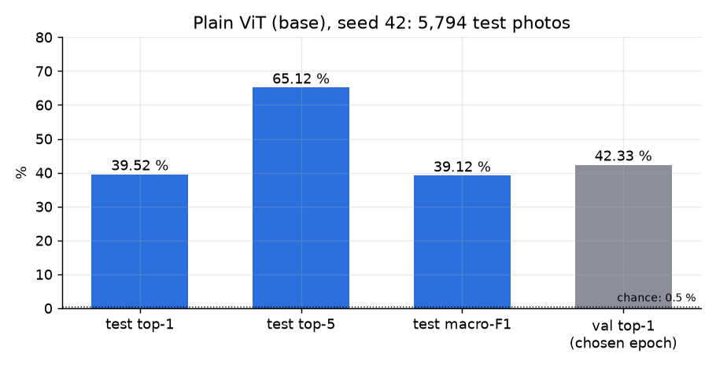

---

## 2. The data and augmentation

**CUB-200-2011:** 11,788 photos of 200 bird species. Every run in the study uses the same fixed split from [`../../DataPreprocessing_Results`](../../DataPreprocessing_Results):

| Split | Photos | Per species | Used for |
|---|---|---|---|
| Train | 5,394 | 26 to 27 | learning |
| Validation | 600 | 3 | choosing the best epoch and the early stop |
| Test | 5,794 | 11 to 30 | the final result, read once at the end |

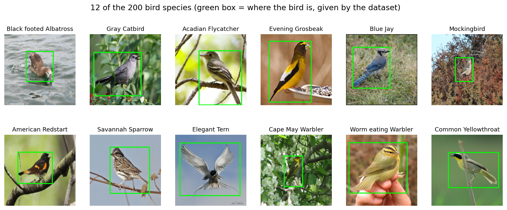

*The green boxes are the bird boxes that come with the dataset. The plain ViT never uses them; they are only used here to measure where the model looks.*

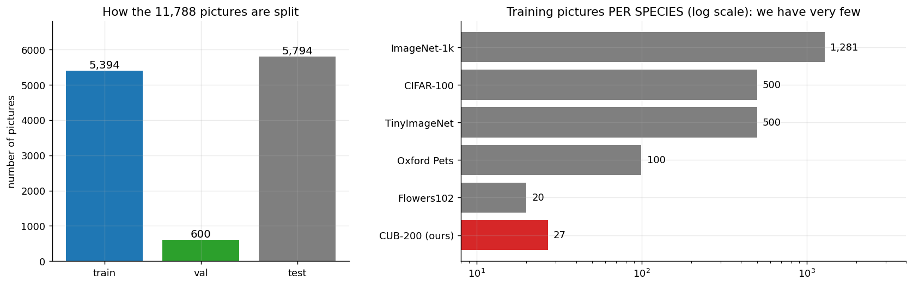

*Training photos per class: ImageNet has about 1,281, this dataset 27.*

Photos are normalised with the training-set mean `[0.486, 0.499, 0.431]` and std `[0.226, 0.222, 0.261]`.

### Augmentation: `strong` tier

Every training photo is changed randomly each time it is used, so the model never sees the same version twice:

| Step | Setting |
|---|---|
| Random crop | 35 to 100 % of the photo, resized to 224 × 224 |
| Horizontal flip | 50 % |
| Random affine | rotate up to 10°, shift up to 5 %, scale 0.9 to 1.1 |
| Colour jitter | brightness, contrast and saturation ±0.3 (no hue change) |
| Random erasing | 25 % of photos |

Validation and test photos are only resized to 224 × 224 and normalised.

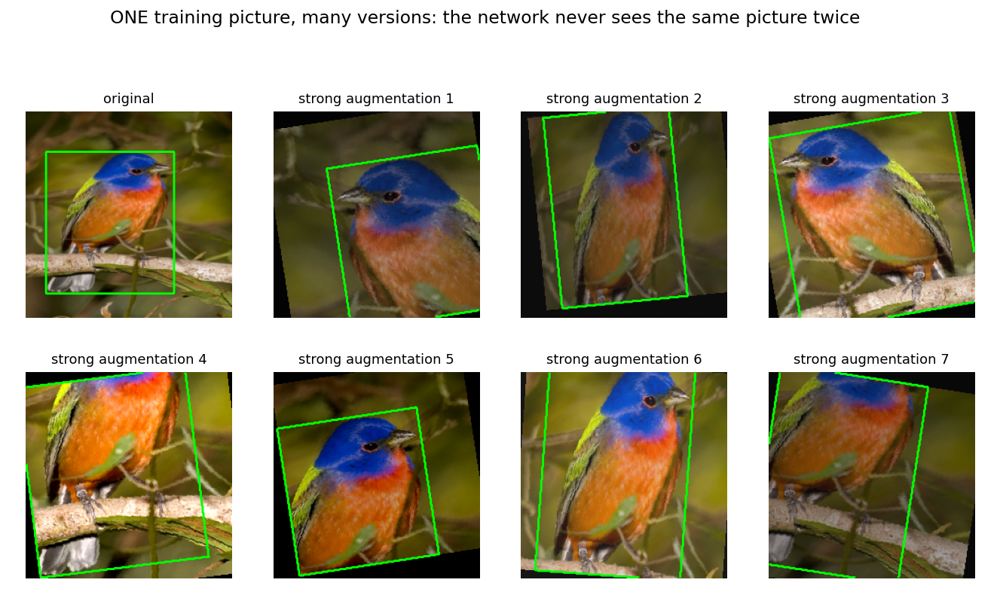

<p align="center">
  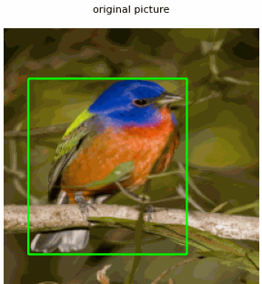
</p>

### Mixup and CutMix

Applied on top, per batch. **Mixup** blends two photos (strength 0.2); **CutMix** pastes a rectangle from one photo into another (strength 1.0). Half of the batches use CutMix, the other half Mixup. The label is blended in the same proportion, for example 60 % species A and 40 % species B. **Label smoothing 0.1** is also used: the correct species gets 0.9005 and every other species 0.0005.

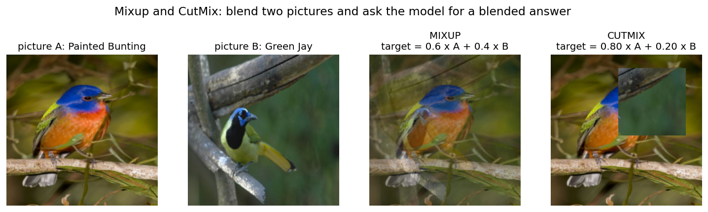

---

## 3. The model

| | Plain ViT (`base`) |
|---|---|
| Input | 224 × 224 × 3 photo |
| Tokenizer | convolutional, total stride 16 → 14 × 14 = **196 tokens** of 256 numbers |
| Position information | learnable position embedding added to the tokens |
| Attention | sparse graph attention, 8 heads; each token attends to its 8 grid neighbours (3 × 3) |
| Blocks | 8 in total: 4 on 196 tokens, **graph pooling** to 49 tokens, 4 more |
| MLP ratio | 3 |
| Head | LayerNorm → average of the 49 tokens → linear layer → 200 species scores (no class token) |
| Stochastic depth (drop-path) | 0.1 |
| Parameters | **4.31 M** |
| Compute per photo | **1.55 GFLOPs** |
| One photo, batch 1 (RTX 4090) | 12.8 ms |
| Photos per second, batch 64 (RTX 4090) | 3,311 |
| Pretrained weights | none |

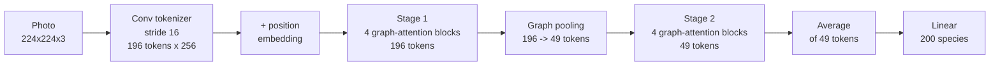

### How a photo becomes tokens

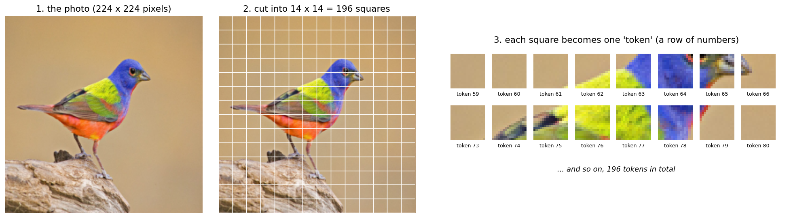

### Inside one block

Each block is `graph attention → MLP`, each with a residual connection and LayerNorm, plus stochastic depth.

1. **Build the graph.** For every pair of tokens: (are they grid neighbours?) × (how similar do they look?). Similarity is a cosine similarity passed through a softmax with a learned temperature.
2. **Graph convolution for queries and keys.** Queries and keys are averaged over each token's graph neighbours (degree-normalised).
3. **Attention.** Softmax of query times key, computed in 32-bit.
4. **Sparse talking-heads gate.** A gate per head and token can shrink weak links to zero; the 8 heads then mix through a learnable 8 × 8 matrix that starts as the identity.
5. **Values.** Another graph convolution guided by the attention, plus a residual connection.

After pooling there is no grid any more, so "neighbours" become the learned connections between the 49 merged tokens.

The design follows **GvT** (*Graph-based vision transformer with sparsity for training on small datasets from scratch*, Sci. Rep. 2025): conv tokenizer, graph attention, sparse gate and graph pooling. All code was written from scratch in PyTorch ([`../patchvision/models.py`](../patchvision/models.py), with the switches `use_lfe=False`, `use_multiscale=False`). Unclear details of the paper were interpreted (marked `INTERPRETATION` in the code), and the implementation was not checked line by line against the paper's equations, so it is a GvT-*style* model, not a verified reproduction.

### Differences from the original project proposal

The proposal described a textbook ViT (6 blocks, 384 numbers per token, a class token). The model trained is the graph-attention ViT above (8 blocks, 256 numbers per token, 8 heads, no class token, 4.31 M parameters). The proposal also said "ten class logits" by mistake; the correct number is 200.

---

## 4. How it was trained

| Setting | Value |
|---|---|
| Data | the shared split: 5,394 train / 600 validation / 5,794 test |
| Augmentation | `strong` + Mixup/CutMix (section 2) |
| Loss | cross-entropy with label smoothing 0.1 |
| Optimizer | AdamW, learning rate 5e-4, weight decay 0.05, betas (0.9, 0.999), gradient clipping 1.0 |
| Schedule | 10 warm-up epochs, then cosine decay to 1e-6; batch 64 (84 steps per epoch); up to 300 epochs |
| Regularization | drop-path 0.1, no dropout |
| EMA weights | off (the latest weights are evaluated) |
| Precision | bf16, attention in 32-bit |
| Stopping | early stopping on **validation** top-1 (patience 60, not before epoch 30); best epoch chosen on validation only |
| Test set | read once, at the end, with the chosen epoch |
| Seed | 42 |
| Hardware | RTX 4090, PyTorch 2.5.1 |

The run stopped early at **epoch 246** (no validation improvement for 60 epochs); the chosen epoch is **186**. Training took **48 minutes**, 11.8 s per epoch.

Everything is written to [`results/base/seed42/`](results/base/seed42/): `train_log.txt` (every step), `steps.csv` and `history.csv`, `config.json` and `env.json`, `curves.png`, `attention_snapshots/` and `val_reports/` every 10 epochs, `best_model.pt` and `last.pt`, and the `test_*` files (metrics, per-species table, every prediction, confusion matrix, calibration, attention gallery). An interrupted run resumes from `last.pt`.

---

## 5. How training went

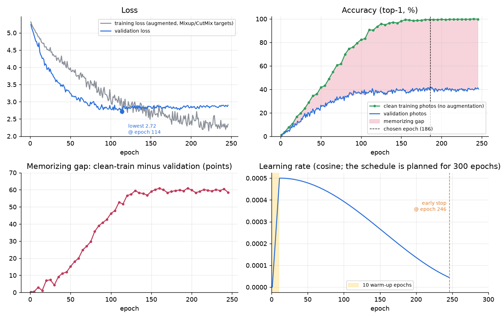

What the four panels show:
* **Top left, loss:** validation loss is lowest at **epoch 114 (2.72)** and then slowly rises (2.90 at the end), while training loss keeps falling. The model keeps improving on the training photos and gets slightly worse on new ones.
* **Top right, accuracy:** on clean training photos (no augmentation, 600 photos checked every 5 epochs) it passes 90 % at epoch 110 and 99 % at epoch 155. Validation flattens near 40 % from about epoch 120 and peaks at **42.3 % at epoch 186**.
* **Bottom left, gap:** the memorizing gap grows steadily until about epoch 130, then stays near **60 points**.
* **Bottom right, learning rate:** 10-epoch warm-up, then cosine decay. The run stopped at epoch 246, before the schedule's end at 300.

The training accuracy printed in the log is measured on augmented, Mixup/CutMix-blended photos, so it understates how well the training photos are learned; the clean accuracy above is the honest number.

<p align="center">
  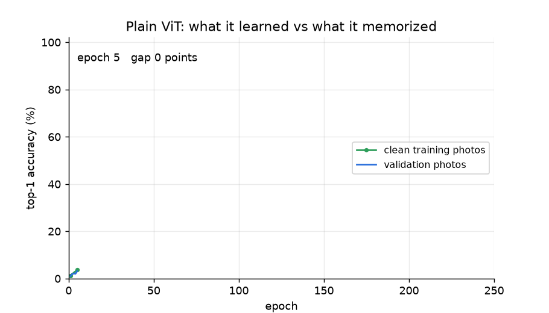
</p>

*Green: clean training photos. Blue: validation photos. The pink area is the memorizing gap.*

---

## 6. Results in detail

### Numbers

| | Plain ViT (`base`) |
|---|---|
| **Test top-1** | **39.52 %** |
| Test top-5 | 65.12 % |
| Test macro-F1 | 39.12 % |
| Test macro precision / recall | 40.40 % / 39.74 % |
| Validation top-1 at the chosen epoch | 42.33 % |
| Calibration error (ECE, lower is better) | 2.49 % |
| Memorizing gap (clean-train minus validation) | 59.8 pts |
| Attention inside the bird box (chance 0.34) | 0.36 |
| Chosen epoch / epochs run | 186 / 246 |
| Training time (RTX 4090) | 48 min (11.8 s per epoch) |

### Where the model looks

Sixteen test photos, spread through the test set (not hand-picked). Rows: the photo with its bird box (green, not shown to the model), the attention of the last block, and the mean attention over all blocks. Title colour: green = correct, red = wrong.

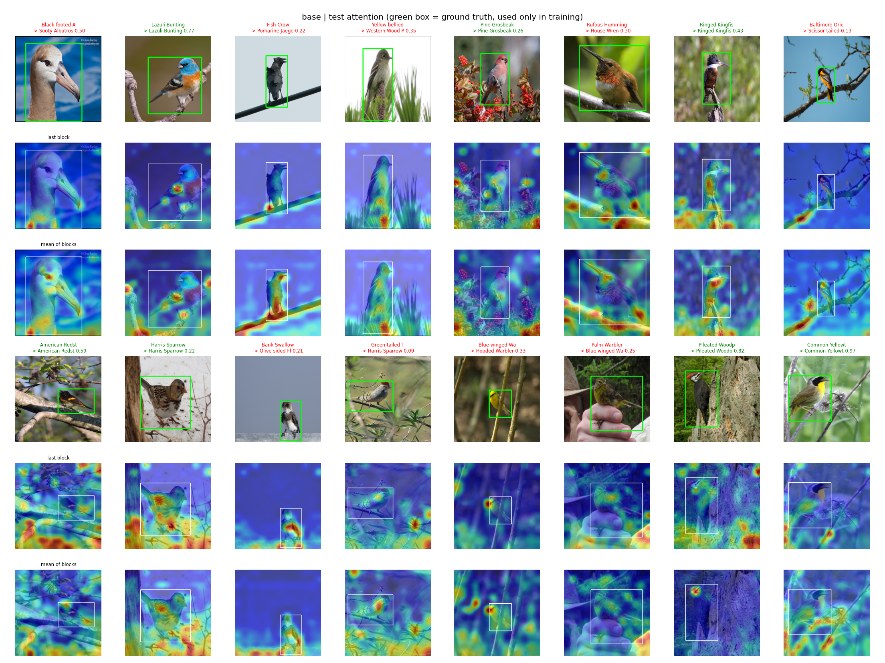

The attention is spread over branches, leaves, wires and background as much as over the bird. Over the whole test set, **0.36** of the attention falls inside the bird box, against **0.34** for attention spread evenly. The plain ViT has not learned to focus on the bird.

How the attention changed during training (validation photos, every 10 epochs):

<p align="center">
  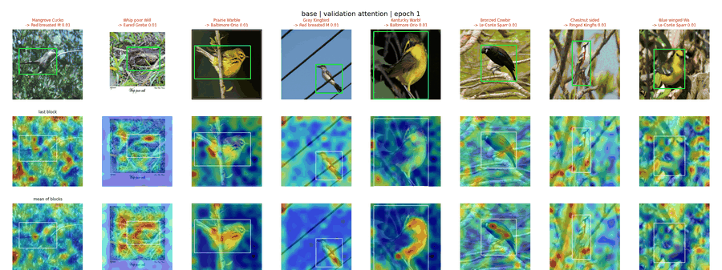
</p>

### Which species are easy and which are hard?

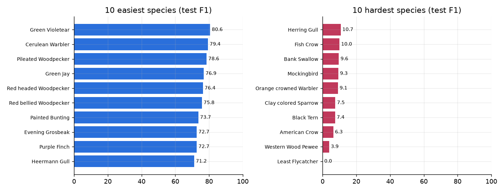

| | Plain ViT |
|---|---|
| Median species F1 | 38.4 |
| Species with F1 above 80 | 1 |
| Species with F1 below 20 | 31 |
| Species never recognised (F1 = 0) | 1 (Least Flycatcher) |

* **Easiest:** Green Violetear (80.6), Cerulean Warbler (79.4), Pileated Woodpecker (78.6), Green Jay (76.9), Red headed Woodpecker (76.4). Strong, unique colours or patterns.
* **Hardest:** Least Flycatcher (0.0), Western Wood Pewee (3.9), American Crow (6.3), Black Tern (7.4), Clay colored Sparrow (7.5). Small brown or black birds with close look-alikes in the dataset.

### What does the model confuse?

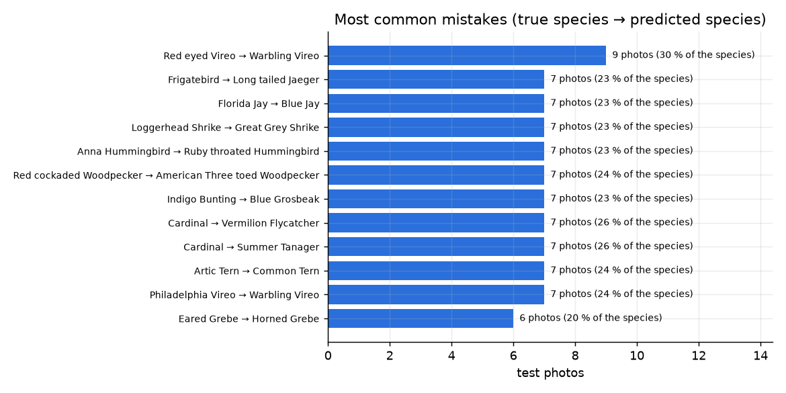

The most frequent mistakes are between close relatives: **Red eyed Vireo → Warbling Vireo** (9 of 30 photos), **Florida Jay → Blue Jay**, **Loggerhead Shrike → Great Grey Shrike**, **Anna → Ruby throated Hummingbird**, **Arctic Tern → Common Tern**, **Eared Grebe → Horned Grebe**. A few are colour matches between unrelated species: **Cardinal → Vermilion Flycatcher** and **Cardinal → Summer Tanager** (all red birds).

### Calibration: are the confidence numbers honest?

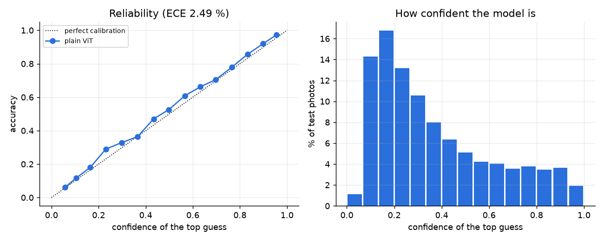

Left: when the model says "x % sure", is it right x % of the time? The curve sits on or slightly above the diagonal: the model is honest, and if anything a little **under-confident** (mean confidence 37.1 % against 39.5 % accuracy; ECE 2.49 %). Right: most answers are given with low confidence (0.1 to 0.3). On the 27 % of photos where it is more than 50 % sure, it is right **74 %** of the time.

### Mirror test

On 256 test photos spread through the test set, the model gives the **same answer for a photo and its mirror image only 77.7 %** of the time, although a mirrored bird is the same species. It was trained with random flips, so this shows how unstable its decisions still are.

### Is the sparse gate doing anything?

The gate stayed at about 0.50 for the whole run, and fewer than 1 % of its values fell below 0.1. The "sparsity" the GvT paper is named after hardly appeared here. Whether that comes from the implementation, the small data or the settings is not known.

<details>
<summary><b>The run's own plots, as saved by the trainer (click to open)</b></summary>

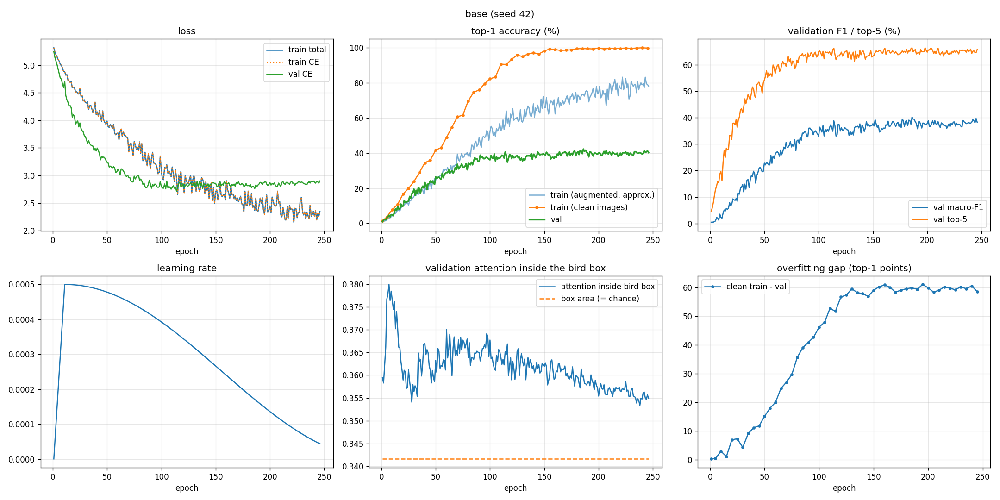
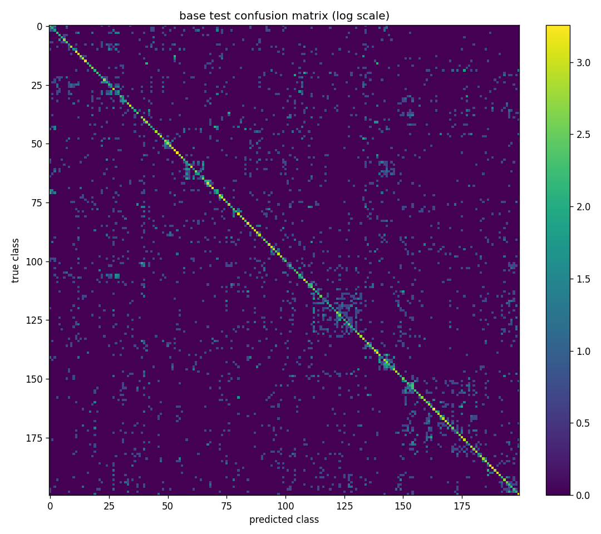
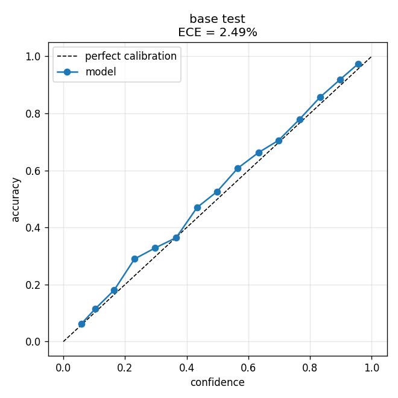

Full per-species table, predictions for every test photo and the logs are in [`results/base/seed42/`](results/base/seed42/).

</details>

---

## 7. Against the CNNs

The round-01 CNN baselines ([`../../CNN_Baseline/01_strongaug_mixup_cutmix`](../../CNN_Baseline/01_strongaug_mixup_cutmix)) used the same data, splits, augmentation, optimizer and schedule (plus EMA weights).

| Model | Params | GFLOPs | Top-1 | Top-5 | Macro-F1 | ECE | Gap |
|---|---|---|---|---|---|---|---|
| **Plain ViT (`base`)** | 4.31 M | 1.55 | 39.52 % | 65.12 % | 39.12 % | **2.49 %** | 59.8 pts |
| CNN small | 4.22 M | 1.40 | 43.65 % | 69.02 % | 43.54 % | 7.07 % | 54.7 pts |
| CNN large | 11.28 M | 3.63 | **45.86 %** | **71.16 %** | **45.79 %** | 8.56 % | **53.3 pts** |

Paired test on the same 5,794 test photos (exact McNemar test):

| Comparison | Only the CNN right | Only the ViT right | p-value |
|---|---|---|---|
| CNN small vs plain ViT | 758 | 521 | < 0.0001 |
| CNN large vs plain ViT | 841 | 476 | < 0.0001 |

* **The plain ViT loses to the CNN of the same size by 4.1 points**, and to the larger CNN by 6.3 points. Both differences are significant.
* **It memorizes more** (gap 59.8 against 53 to 55 points).
* **It is the best calibrated** of the three (ECE 2.5 % against 7 to 9 %): it is less accurate but not over-confident.

---

## 8. What we learned

* **A ViT can train from scratch on 27 photos per species**, but only to 39.5 % top-1.
* **It memorizes much more than it learns:** it reaches about 100 % on training photos and stays near 40 % on new ones; strong augmentation and Mixup/CutMix did not prevent this.
* **It does not find the bird on its own:** its attention is no more on the bird than random attention would be.
* **On this little data, a CNN of the same size is clearly better** (+4.1 points), which matches the common finding that ViTs lack the built-in "nearby pixels belong together" bias that CNNs have.
* **Its confidence numbers are honest** (ECE 2.5 %), unlike the CNNs'.

---

## 9. Limits

- **One seed.** Every number is seed 42; seeds 43 and 44 are not run.
- **No search.** The recipe (learning rate, weight decay, drop-path, augmentation) was not tuned for this model in round 01. Round 02 runs that search.
- **No EMA.** This run evaluated the raw weights, while the CNN baselines used EMA weights, which gave the CNNs 3 to 4 validation points. Part of the gap to the CNNs may come from this.
- **Early stop before the end of the schedule.** The run stopped at epoch 246 of 300, while the learning rate was still 4e-5.
- **Small validation set.** 600 photos (3 per species) choose the best epoch and the early stop, so that choice is noisy.
- **Different hardware for timings.** ViT: RTX 4090, PyTorch 2.5.1. CNN: RTX 5090, PyTorch 2.11. Accuracy is unaffected; times are not comparable.
- **GvT interpretation.** The graph attention follows an interpretation of an under-specified paper (section 3).

---

## 10. Run it yourself

Run everything from inside this folder. The code is imported from `../patchvision/`, the data is read from the repository root (two levels up), and results are written to `results/<run>/seed<seed>/`.

1. Download CUB-200-2011 from the [dataset page](https://www.vision.caltech.edu/datasets/cub_200_2011/) and extract it so that `CUB_200_2011/images/` exists at the repository root. The split files in `DataPreprocessing_Results/` are already in the repository.
2. Train and inspect:

```powershell
cd Vision_Transformer/01_strongaug_mixup_cutmix
python train.py base 42                 # train the plain ViT (seed 42)
python watch_training.py base 42        # live monitor, in a second terminal
python docs/make_vit_figures.py         # rebuild the figures and animations on this page
```

Or open [`training.ipynb`](training.ipynb), set `EXPERIMENT = "base"`, keep `SMOKE_TEST = True` for a first pass (2 epochs on tiny synthetic data), then set it to `False`.

A finished run is skipped and an interrupted one resumes from `last.pt`. Model weights (`*.pt`) are not stored in Git, so train the model before loading it.

Versions used: Python 3.11, PyTorch 2.5.1 (CUDA 12.4), torchvision 0.20.1, numpy 1.26.4, pandas 2.2.3, matplotlib 3.9.2, pillow 11.0.0.

<details>
<summary><b>Load the trained model and predict (click to open)</b></summary>

```python
import sys, torch
sys.path.insert(0, "..")                                  # run from inside Vision_Transformer/01_strongaug_mixup_cutmix/
from patchvision.config import get_experiment
from patchvision.models import PatchVisionX               # the network class; "base" switches its additions off

exp = get_experiment("base")
model = PatchVisionX(exp.model)
ck = torch.load("results/base/seed42/best_model.pt", map_location="cpu", weights_only=False)
model.load_state_dict(ck["state"])                        # the weights of the chosen epoch (186)
model.eval()
# logits, aux = model(x): x is a normalised (B, 3, 224, 224) tensor; logits are (B, 200), aux holds the attention maps
```

</details>

### Layout

```
Vision_Transformer/01_strongaug_mixup_cutmix/
├── README.md                 this page
├── training.ipynb            runs and records one experiment
├── train.py                  the same from a terminal:  python train.py base 42
├── watch_training.py         live monitor
├── docs/
│   ├── make_vit_figures.py   rebuilds the figures and animations on this page (v*.png, v*.gif)
│   ├── vit_facts.txt         the numbers quoted on this page, as computed by that script
│   └── figures/  animations/
└── results/base/seed42/      logs, curves, metrics, predictions, attention snapshots
```

The model, data pipeline, losses, trainer and settings are in the shared [`../patchvision`](../patchvision) package (`models.py`, `data.py`, `engine.py`, `config.py`).

---

## References

1. A. Dosovitskiy et al. *An Image is Worth 16x16 Words: Transformers for Image Recognition at Scale.* ICLR 2021.
2. H. Touvron et al. *Training Data-Efficient Image Transformers & Distillation through Attention* (DeiT). ICML 2021.
3. C. Wah et al. *The Caltech-UCSD Birds-200-2011 Dataset.* California Institute of Technology, 2011.
4. *Graph-based vision transformer with sparsity for training on small datasets from scratch.* Scientific Reports 15 (2025). <https://www.nature.com/articles/s41598-025-10408-0>
