# Vision Transformer, round 02: `auto` augmentation, no Mixup/CutMix, and a regularization search

     

Round 01 ([`../01_strongaug_mixup_cutmix`](../01_strongaug_mixup_cutmix)) trained a plain Vision Transformer **from scratch** on 5,394 photos (about 27 per species) and found that it **memorizes** its training photos: about 100 % right on them, 42 % on new ones. This round asks: **which training changes reduce that memorizing, without hurting accuracy?**

It changes the base recipe (one augmentation operation at a time, no photo mixing, 300 epochs for every run), then tries one regularizer per run, and finally combines the ones that helped. It is exactly the same round, with the same runs and settings, as the CNNs' round 02 ([`../../CNN_Baseline/02_autoaug_nomix_regularization`](../../CNN_Baseline/02_autoaug_nomix_regularization)), so the two can be compared run by run.

> **Jump to:** [Result in one minute](#1-the-result-in-one-minute) · [The model](#2-the-model) · [What changed](#3-what-changed-from-round-01) · [The plan](#4-the-plan-three-rounds-of-training) · [Every run](#5-results-every-run) · [Learning](#6-how-training-went) · [Best run](#7-the-best-run-in-detail) · [r8](#8-round-3-r8-the-winners-combined) · [Against the CNNs](#9-against-the-cnns) · [Learned](#10-what-we-learned) · [Limits](#11-limits) · [Run it](#12-run-it-yourself)

---

## 1. The result in one minute

| | Round 01 (`base`) | Round 02 r0 | Round 02 best single change: r2 | **Round 02 final: r8 combined** |
|---|---|---|---|---|
| Recipe | `strong` aug + Mixup/CutMix, early stopping, no EMA | `auto` aug, no mixing, 300 epochs, EMA | r0 + drop-path 0.4 | r0 + drop-path 0.4 + label smoothing 0.2 + weight decay 0.2 |
| Validation top-1 | 42.33 % | 39.17 % | 42.67 % | **43.00 %** |
| **Test top-1** | 39.52 % | 36.24 % | 39.30 % | **42.03 %** |
| Test top-5 | 65.12 % | 61.81 % | 63.48 % | **67.16 %** |
| Test macro-F1 | 39.12 % | 35.68 % | 38.72 % | **41.43 %** |
| Memorizing gap | 59.8 pts | 61.3 pts | **57.3 pts** | 58.0 pts |
| Calibration error (ECE) | **2.49 %** | 11.08 % | 7.25 % | 3.76 % |

One seed (42), 5,794 unseen test photos, sampling noise about ±1.3 points. The final run is the one with the best **validation** accuracy: r8 (43.00 %).

1. **The new base recipe hurt the ViT.** Round 02 r0 is 3.3 test points **below** round 01 (only r0 right on 490 photos, only round 01 right on 679; p < 0.0001). Removing Mixup/CutMix cost the ViT accuracy.
2. **Drop-path is the one single change that clearly helps:** +3.5 validation and +3.0 test points (0.4 and 0.5), significant on the test photos (p < 0.0001). On its own it only gets back to round 01's level (39.30 % against 39.52 %, p = 0.68).
3. **The winners combined (r8) beat everything:** 42.03 % test top-1, **+2.5 points above round 01** (only r8 right on 641 photos, only round 01 right on 496; p < 0.0001), +2.7 above r2 (p < 0.0001) and +5.8 above r0.
4. **SAM and weight decay 0.1 hurt;** label smoothing 0.2 and weight decay 0.2 do little alone, but add to drop-path in r8.
5. **Memorizing is not solved:** every run reaches about 100 % on the training photos; the gap stays between 57 and 63 points (r8: 58.0).

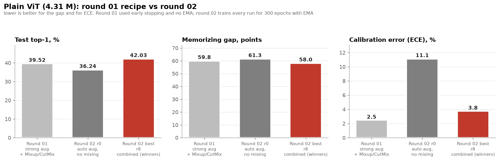

---

## 2. The model

The same plain ViT as round 01 (full description: [round 01, section 3](../01_strongaug_mixup_cutmix/README.md#3-the-model)).

| | Plain ViT (`vit_base`) |
|---|---|
| Tokenizer | convolutional, stride 16 → 196 tokens of 256 numbers, plus a learnable position embedding |
| Attention | sparse graph attention, 8 heads, each token attends to its 8 grid neighbours |
| Blocks | 4 on 196 tokens, graph pooling to 49 tokens, 4 more (8 in total), MLP ratio 3 |
| Head | LayerNorm → average of the 49 tokens → linear layer → 200 species (no class token) |
| Drop-path in r0 | 0.1 (the ViT's default) |
| Parameters / compute | **4.31 M** / 1.55 GFLOPs |
| Pretrained weights | none |

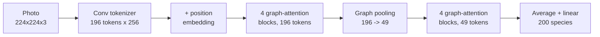

Code: the network is [`../patchvision/models.py`](../patchvision/models.py) (`use_lfe=False`, `use_multiscale=False`), unchanged. [`vit/model.py`](vit/model.py) wraps it so it returns only the 200 species scores, which lets it run through the same trainer as the CNNs.

---

## 3. What changed from round 01

| Setting | Round 01 | **Round 02 base recipe (r0)** |
|---|---|---|
| Augmentation | `strong`: random crop + flip + rotate + colour jitter + random erase, **all stacked on every photo** | `auto`: random crop (35 to 100 %) + flip + **one** random TrivialAugment operation + random erase (25 %) |
| Mixup / CutMix | on (one of the two on every batch) | **off: photos are never mixed** |
| Stopping | early stopping, patience 60 | **off: every run trains the full 300 epochs** |
| EMA weights | off | **on** (decay 0.999); the averaged weights are evaluated |
| Trainer | `patchvision/engine.py` | [`vit/engine.py`](vit/engine.py): a copy of the CNN round-02 trainer, with the SAM option |
| Everything else | AdamW 5e-4, weight decay 0.05, label smoothing 0.1, drop-path 0.1, 10 warm-up epochs + cosine to 1e-6, batch 64, gradient clip 1.0, bf16 | unchanged |

### The `auto` augmentation, step by step

Every training photo goes through this chain, with new random choices every time it is used. Only the last image goes to the model.

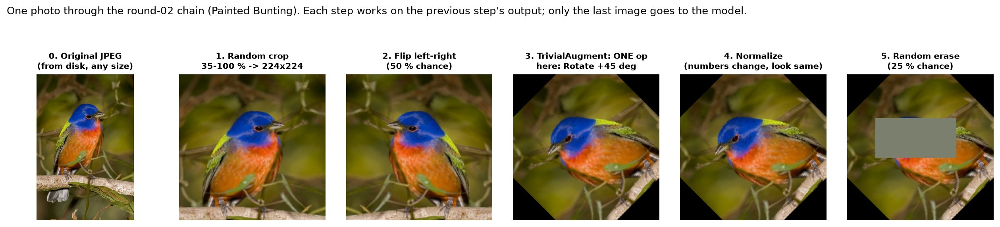

| Step | What happens |
|---|---|
| 1. Random crop | a random region covering 35 to 100 % of the photo (aspect ratio 3/4 to 4/3), resized to 224 × 224 |
| 2. Flip | mirrored left-right with 50 % chance |
| 3. TrivialAugment | **one** of 14 operations, each with chance 1/14, at a random strength (31 levels; random sign where it applies) |
| 4. Normalize | scaled to 0–1, then normalised with the training-set mean and std |
| 5. Random erasing | with 25 % chance, a random rectangle is blanked out |

The 14 operations and their ranges:

| Operation | Range |
|---|---|
| Identity | no change |
| ShearX, ShearY | up to ±45° |
| TranslateX, TranslateY | up to ±32 pixels |
| Rotate | up to ±135° |
| Brightness, Color (saturation), Contrast, Sharpness | factor 0.01 to 1.99 |
| Posterize | 8 down to 2 bits per colour |
| Solarize | invert pixels above a threshold (255 down to 0) |
| AutoContrast, Equalize | no strength |

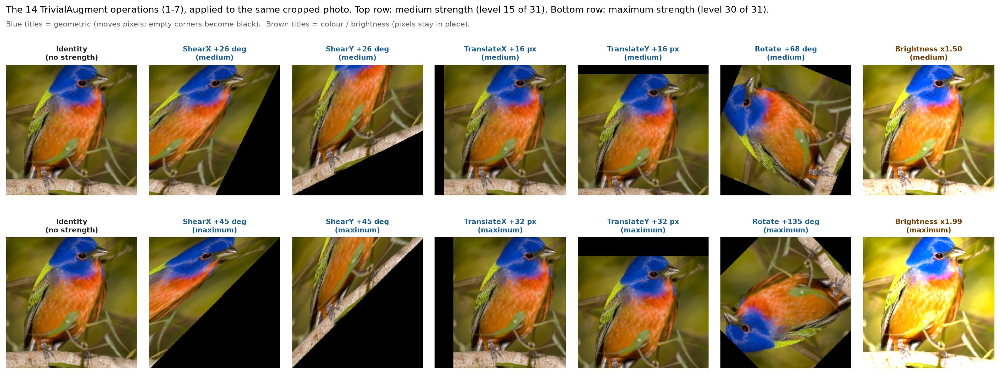
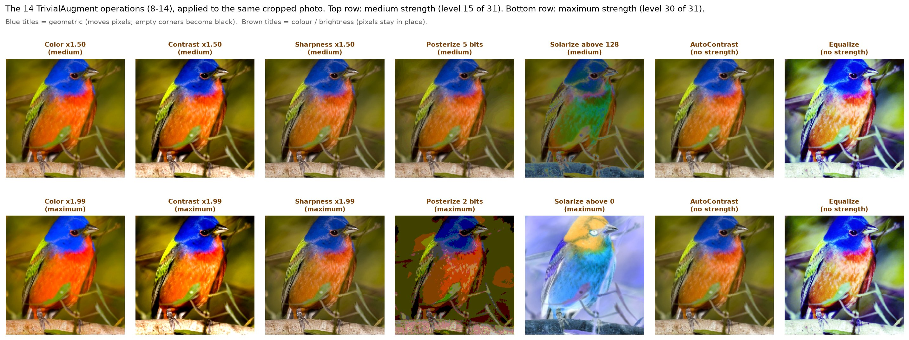

The same photo in 8 epochs: a new crop and a new operation each time. The original photo itself is never shown to the model during training.

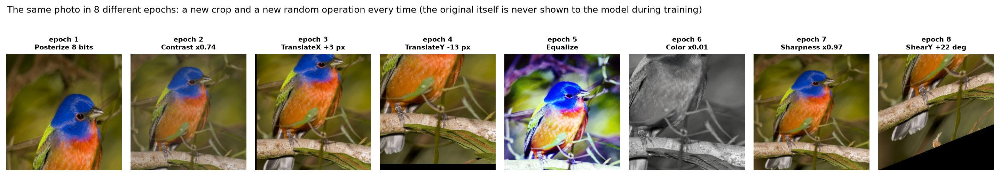

Round 01 against round 02 on the same photo: round 01 stacks several small changes, round 02 makes one change that is sometimes strong.

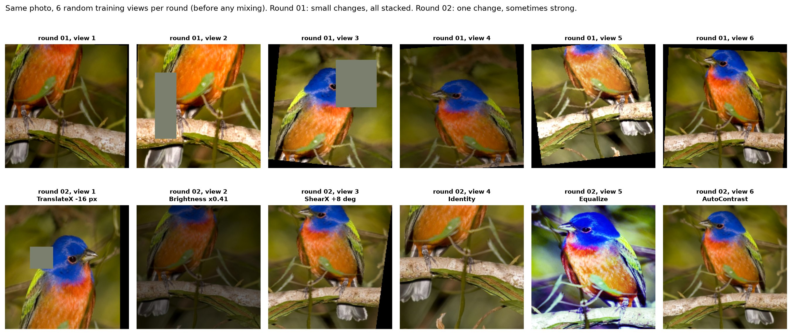

**Label smoothing.** The training target for the correct species is 90.05 % instead of 100 % (0.05 % for each of the other 199). Run r4 uses 0.2 (80.10 % / 0.10 %).

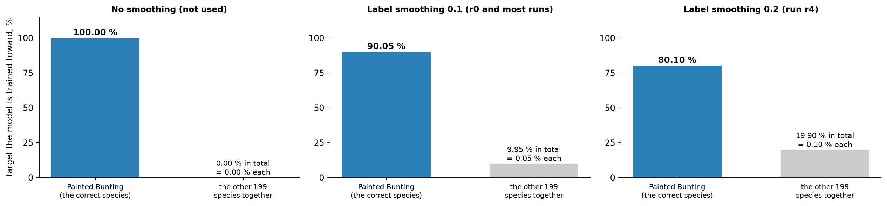

Validation and test photos are only resized to 224 × 224 and normalised.

### Two tools that runs can switch on

<details>
<summary><b>Drop-path (stochastic depth) (click to open)</b></summary>

During training only, each of the 8 blocks is skipped for a random subset of the photos in a batch (the photo takes the residual shortcut around it). The skip chance grows linearly from 0 at the first block to the chosen value at the last block. At test time every block is used. The ViT already uses 0.1 in r0; runs r1 to r3 raise it to 0.2, 0.4 and 0.5.

</details>

<details>
<summary><b>SAM (Sharpness-Aware Minimization) (click to open)</b></summary>

For every batch: compute the gradient, take a small step (rho 0.05) towards higher loss, compute the gradient again at that point, return to the original weights, and update with the second gradient. This favours weights where the loss stays low under small changes. It costs two forward/backward passes per batch, so a SAM run takes about twice as long (Foret et al., ICLR 2021). Code: [`vit/engine.py`](vit/engine.py).

</details>

---

## 4. The plan: three rounds of training

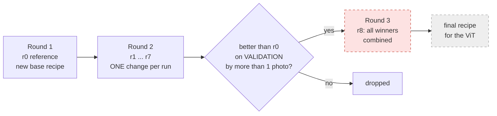

| Run | The one change (on top of r0) |
|---|---|
| r0_reference | nothing |
| r1 / r2 / r3 | drop-path 0.1 → 0.2 / 0.4 / 0.5 |
| r4 | label smoothing 0.1 → 0.2 |
| r5 / r6 | weight decay 0.05 → 0.1 / 0.2 |
| r7 | SAM optimizer (rho 0.05) |
| r8 | **winners of r1 to r7 combined** ([section 8](#8-round-3-r8-the-winners-combined)) |

Rules: **one seed (42)**; winners are picked on **validation only** (600 photos); a change counts as a winner only if it beats r0 by **more than one validation photo**, with one value per setting; the test set is read once per run, at the end, for the record. Hardware: RTX 5090, PyTorch 2.11.

---

## 5. Results: every run

| Run | What changes | Best epoch | **Val top-1** | vs r0 (val photos) | Gap (pts) | Test top-1 | Test top-5 | Test macro-F1 | Test ECE |
|---|---|---|---|---|---|---|---|---|---|
| r0_reference | nothing (new base recipe) | 141 | 39.17 % | | 61.3 | 36.24 % | 61.81 % | 35.68 % | 11.08 % |
| r1_droppath0.2 | drop-path 0.1 → 0.2 | 99 | 40.17 % | +6 | 57.8 | 37.33 % | 63.96 % | 37.02 % | 9.46 % |
| r2_droppath0.4 | drop-path 0.1 → 0.4 | 299 | 42.67 % | +21 | 57.3 | 39.30 % | 63.48 % | 38.72 % | 7.25 % |
| r3_droppath0.5 | drop-path 0.1 → 0.5 | 258 | 42.67 % | +21 | **57.2** | 38.97 % | 65.88 % | 38.54 % | 9.41 % |
| r4_labelsmooth0.2 | label smoothing 0.1 → 0.2 | 205 | 39.83 % | +4 | 60.2 | 36.24 % | 61.49 % | 35.64 % | **2.61 %** |
| r5_wd0.1 | weight decay 0.05 → 0.1 | 233 | 38.00 % | −7 | 62.3 | 35.61 % | 59.86 % | 34.88 % | 4.47 % |
| r6_wd0.2 | weight decay 0.05 → 0.2 | 137 | 40.33 % | +7 | 60.3 | 36.90 % | 62.46 % | 36.44 % | 10.18 % |
| r7_sam | SAM optimizer (rho 0.05) | 122 | 37.67 % | −9 | 63.0 | 34.28 % | 59.99 % | 33.84 % | 10.42 % |
| **r8_combined** | drop-path 0.4 + label smoothing 0.2 + weight decay 0.2 | 268 | **43.00 %** | **+23** | 58.0 | **42.03 %** | **67.16 %** | **41.43 %** | 3.76 % |

*Gap = accuracy on augmentation-free training photos minus validation accuracy, at the chosen epoch. ECE = calibration error, lower is better. 1 validation photo = 0.17 points. Every run: 300 epochs, about 80 minutes on the RTX 5090 (15.9 to 16.4 s per epoch); SAM 146 minutes (29.2 s per epoch). Tables: [`docs/tables/`](docs/tables).*

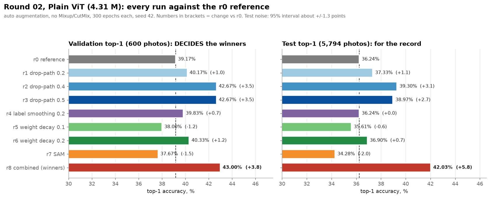

### Are the differences real? Paired test on the same test photos

Each run against r0, on the 5,794 test photos (exact McNemar test):

| Run vs r0 | Change, test top-1 | Only the run right | Only r0 right | p | |
|---|---|---|---|---|---|
| r1 drop-path 0.2 | +1.09 | 436 | 373 | **0.029** | better |
| **r2 drop-path 0.4** | **+3.00** | 498 | 324 | **< 0.0001** | better |
| **r3 drop-path 0.5** | **+2.73** | 525 | 367 | **< 0.0001** | better |
| r4 label smoothing 0.2 | +0.02 | 405 | 404 | 1.00 | no difference |
| r5 weight decay 0.1 | −0.66 | 372 | 410 | 0.19 | no difference |
| r6 weight decay 0.2 | +0.66 | 375 | 337 | 0.17 | no difference |
| r7 SAM | −1.98 | 362 | 477 | **0.0001** | worse |
| **r8 combined** | **+5.76** | 636 | 302 | **< 0.0001** | better |

This shows the differences are not caused by which test photos happened to be drawn. It does **not** show they survive a different random seed; that needs the three-seed runs.

### Which changes reduce memorizing without hurting accuracy?

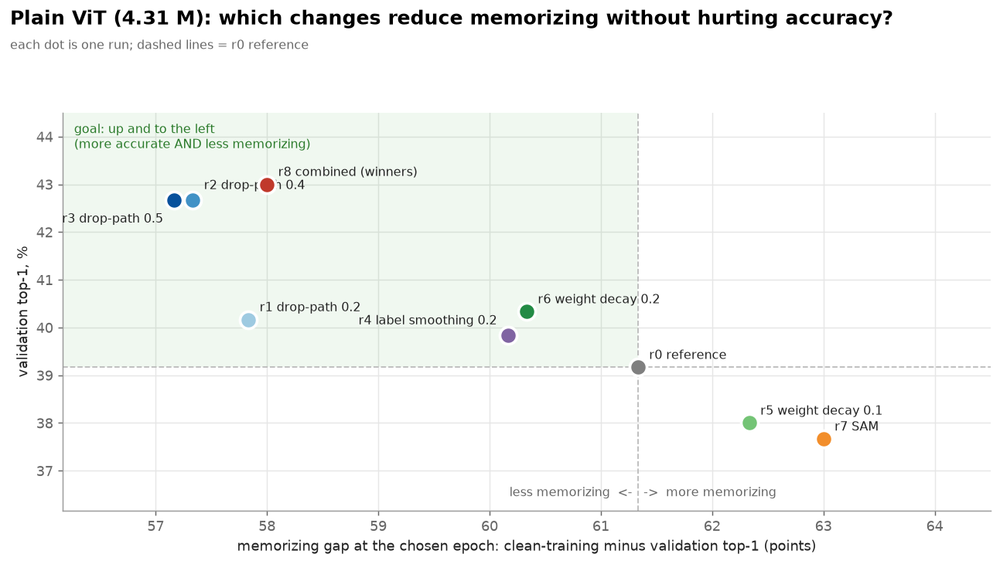

The goal is up and to the left. **r8 is the highest point**, with drop-path 0.4 and 0.5 just below it: about +3.5 to +3.8 validation points and a gap 3 to 4 points smaller than r0. Label smoothing 0.2 and weight decay 0.2 move a little up and left. Weight decay 0.1 and SAM move down and right: less accurate and more memorizing.

### How strong should each setting be?

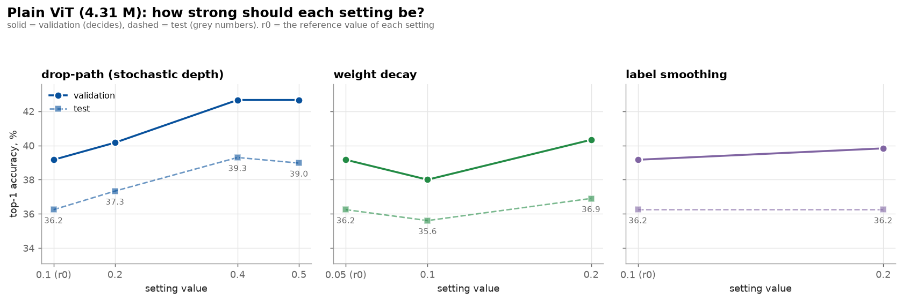

* **Drop-path:** better at every step from 0.1 to 0.4; 0.5 equals 0.4 on validation and is slightly lower on test. The best value is around 0.4 to 0.5.
* **Weight decay:** 0.1 is worse than r0, 0.2 is better on validation (+7 photos) but not significantly on test. No clear trend.
* **Label smoothing:** 0.2 is +4 validation photos and identical on test.

---

## 6. How training went

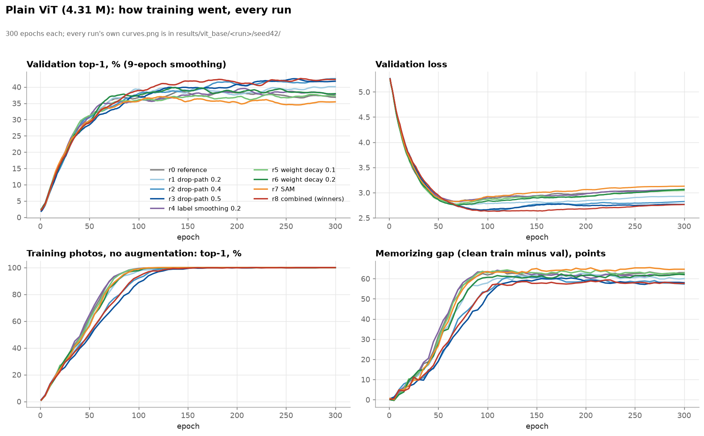

What the four panels show:
* **Validation top-1 (top left):** most runs flatten at 37 to 40 % after about epoch 100. Only the runs with drop-path 0.4 or 0.5 keep climbing until the end (r2's best epoch is 299, r3's 258, r8's 268). SAM peaks early and then declines.
* **Validation loss (top right):** every run reaches its lowest validation loss between epochs 68 and 112 and then rises. r8 goes lowest (2.63 at epoch 110) and, with r3, rises least (to 2.76 at epoch 300, against 3.05 for r0).
* **Training photos (bottom left):** every run reaches 99 % on clean training photos, between epoch 100 (r0, label smoothing, weight decay 0.1) and epoch 150 (drop-path 0.5); r8 at epoch 135. Drop-path slows memorizing down but does not stop it.
* **Gap (bottom right):** it climbs to about 60 points by epoch 100 and stays there; at epoch 300 it ranges from 57 (drop-path) to 65 (SAM).

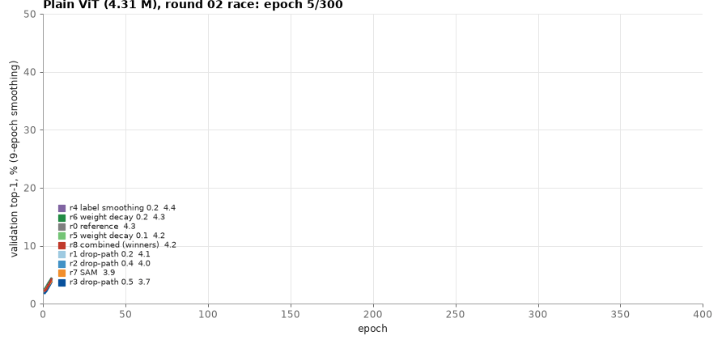

*The race: validation accuracy of every run over 300 epochs.*

### EMA weights

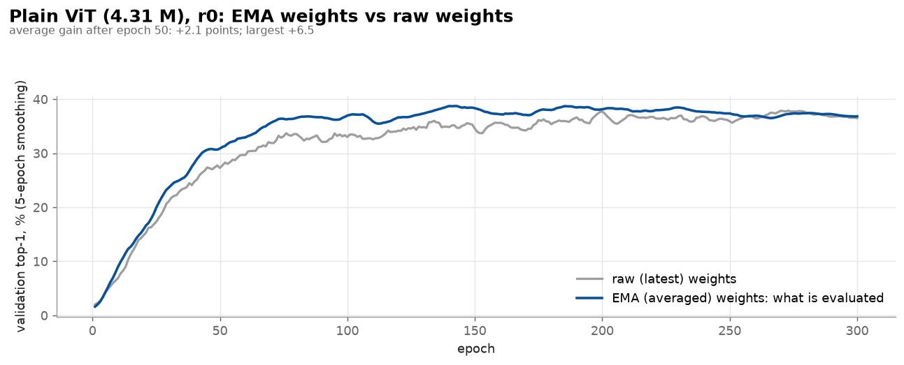

Evaluating the slow-moving average of the weights instead of the latest weights is worth **+2.1 points** on average after epoch 50 (up to +6.5) in r0. By the end, when the learning rate is tiny, the two are the same. Round 01's plain ViT did not use EMA.

---

## 7. The best run in detail

r8 (drop-path 0.4 + label smoothing 0.2 + weight decay 0.2), the run chosen on validation.

| | r8 combined |
|---|---|
| **Test top-1** | **42.03 %** |
| Test top-5 | 67.16 % |
| Test macro-F1 | 41.43 % |
| Validation top-1 at the chosen epoch | 43.00 % |
| Memorizing gap | 58.0 pts |
| Calibration error (ECE) | 3.76 % |
| Chosen epoch / epochs run | 268 / 300 |
| Training time (RTX 5090) | 82 min (16.3 s per epoch) |
| Parameters / compute / latency (batch 1) | 4.31 M / 1.55 GFLOPs / 15.8 ms |

### Did it improve on round 01?

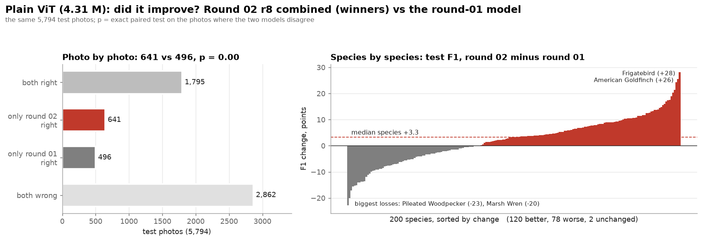

Yes. On the same test photos, only r8 is right on 641 and only round 01 on 496 (+2.5 points, p < 0.0001). Species by species: 120 species better, 78 worse, 2 unchanged, median change +3.3 F1 points. The biggest gains are Frigatebird (+28), American Goldfinch (+26) and Yellow breasted Chat (+24); the biggest losses Pileated Woodpecker (−23), Marsh Wren (−20) and Least Auklet (−17).

### Are the confidence numbers honest?

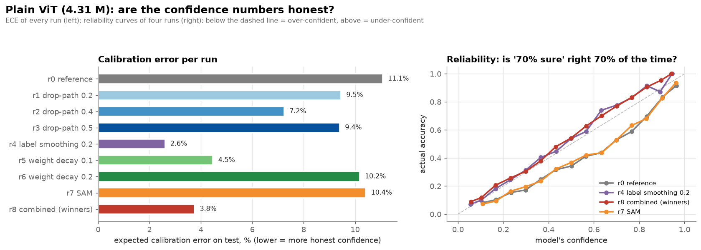

* Most round-02 runs are **over-confident** (curves below the diagonal): r0 has an ECE of 11.1 %, against 2.5 % in round 01. A likely reason: Mixup/CutMix train on blended labels, which keeps confidence down; without them that effect is gone.
* **Label smoothing 0.2** brings it back: r4 has an ECE of 2.6 % and r8 3.8 %. r8 is slightly **under-confident**: it is 38.3 % sure on average while it is right 42.0 % of the time.

### Which species are easy and which are hard?

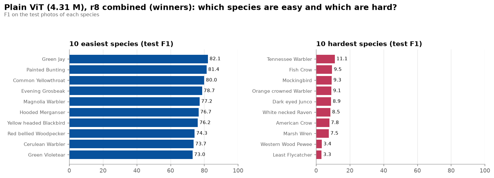

| | r8 combined |
|---|---|
| Median species F1 | 41.4 |
| Species with F1 above 80 | 2 |
| Species with F1 below 20 | 30 |
| Species never recognised (F1 = 0) | 0 |

* **Easiest:** Green Jay (82.1), Painted Bunting (81.4), Common Yellowthroat (80.0), Evening Grosbeak (78.7), Magnolia Warbler (77.2): strong, unique colours or patterns.
* **Hardest:** Least Flycatcher (3.3), Western Wood Pewee (3.4), Marsh Wren (7.5), American Crow (7.8), White necked Raven (8.5): plain brown, grey or black birds with close look-alikes.

### What does the model confuse?

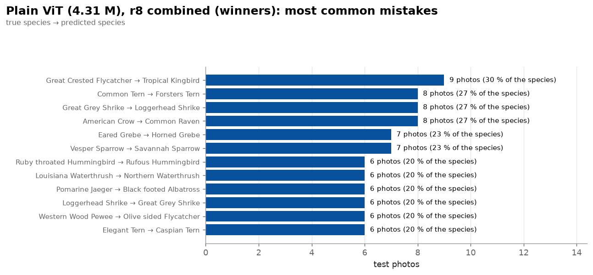

The most common mistakes are between close relatives: **Great Crested Flycatcher → Tropical Kingbird** (9 photos), **Common Tern → Forsters Tern**, **Great Grey Shrike → Loggerhead Shrike**, **American Crow → Common Raven** (8 each), **Eared Grebe → Horned Grebe**, **Vesper Sparrow → Savannah Sparrow** (7 each).

<details>
<summary><b>Each run's own plots, as saved by the trainer (click to open)</b></summary>

Every run folder `results/vit_base/<run>/seed42/` has `curves.png`, `test_confusion_matrix.png` and `test_reliability.png`. The final run:

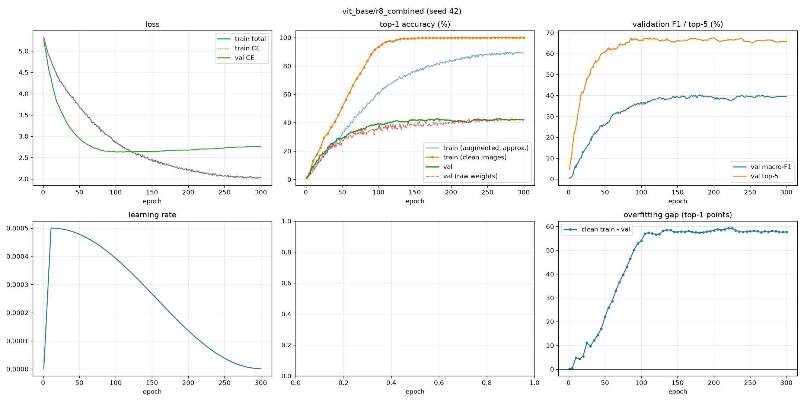
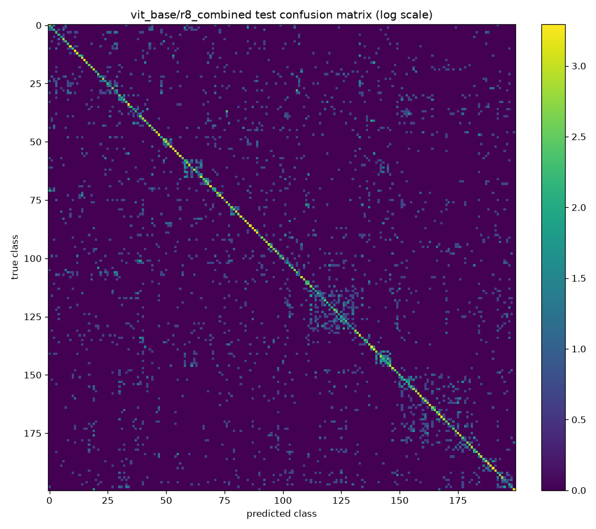
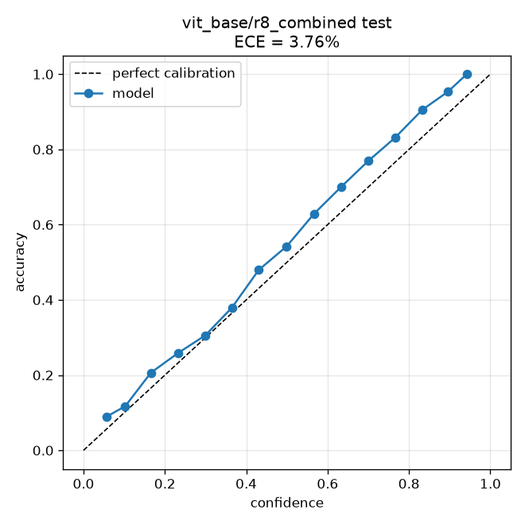

</details>

---

## 8. Round 3: r8, the winners combined

By the rule (beat r0 on validation by more than one photo, one value per setting), the winners are:

| Setting | Value | Validation vs r0 (alone) | Test vs r0 (alone) | In r8? |
|---|---|---|---|---|
| Drop-path | **0.4** | +21 photos (0.5 ties at +21; the tie goes to the smaller change) | +3.00 | yes |
| Label smoothing | **0.2** | +4 photos | +0.02 | yes |
| Weight decay | **0.2** | +7 photos (0.1: −7) | +0.66 | yes |
| SAM | off | −9 photos | −1.98 | no |

r8 = drop-path 0.4 + label smoothing 0.2 + weight decay 0.2.

| Paired test on the test photos | Change, test top-1 | Only r8 right | Only the other right | p |
|---|---|---|---|---|
| r8 vs r0 | **+5.76** | 636 | 302 | < 0.0001 |
| r8 vs r2 (best single change) | **+2.75** | 468 | 308 | < 0.0001 |
| r8 vs round 01 | **+2.50** | 641 | 496 | < 0.0001 |

* **The winners add up on test, not on validation.** On validation r8 is +23 photos against +32 for the three changes summed; on test it is +5.76 points against +3.68 summed. The 600 validation photos are too few to show small gains clearly; the 5,794 test photos show that label smoothing and weight decay add about 2.7 points on top of drop-path.
* **r8 is the final plain-ViT recipe of round 02** and the first round-02 run to beat round 01.
* **Calibration also improves:** ECE 3.76 % against 7.25 % for r2, thanks to label smoothing 0.2.
* **The gap does not shrink further:** 58.0 points, about the same as r2 (57.3).

The exact settings are in [`vit/config.py`](vit/config.py) (`COMBINED`) and in [`results/vit_base/r8_combined/seed42/config.json`](results/vit_base/r8_combined/seed42/config.json).

---

## 9. Against the CNNs

The CNNs went through exactly the same round 02 ([`../../CNN_Baseline/02_autoaug_nomix_regularization`](../../CNN_Baseline/02_autoaug_nomix_regularization)). Change in **validation** top-1 against each model's own r0, in points:

| Run | Plain ViT | CNN small | CNN large |
|---|---|---|---|
| r1 drop-path 0.2 | +1.00 | +1.66 | +0.67 |
| r2 drop-path 0.4 | **+3.50** | −2.00 | −0.83 |
| r3 drop-path 0.5 | **+3.50** | −4.00 | −2.66 |
| r4 label smoothing 0.2 | +0.67 | +2.16 | +2.67 |
| r5 weight decay 0.1 | −1.17 | +2.00 | +1.84 |
| r6 weight decay 0.2 | +1.17 | **+3.33** | **+4.67** |
| r7 SAM | −1.50 | +0.16 | +1.50 |
| **r8 combined** | **+3.83** | **+4.00** | **+4.67** |

| | Plain ViT | CNN small | CNN large |
|---|---|---|---|
| Parameters | 4.31 M | 4.22 M | 11.28 M |
| r0 test top-1 | 36.24 % | 43.75 % | 46.03 % |
| **Final test top-1 (r8)** | **42.03 %** | **47.65 %** | **51.52 %** |
| Round 01 test top-1 | 39.52 % | 43.65 % | 45.86 % |
| Gain over round 01 | +2.51 | +4.00 | +5.66 |

* **The two architectures need opposite things.** Drop-path is the ViT's best change and hurts the CNNs at 0.4 and 0.5; weight decay 0.2 is the CNNs' best change and does little for the ViT alone.
* **Combining the winners helps all three models about equally** on validation (+3.8 to +4.7 points over each model's own r0).
* **Removing Mixup/CutMix hurt only the ViT:** the CNNs' r0 matched their round 01, the ViT's r0 is 3.3 points below.
* **The gap to the CNNs grew:** the plain ViT is now 5.6 points behind the CNN of the same size (round 01: 4.1), because the CNNs gained more from round 02.

---

## 10. What we learned

* **For a ViT trained from scratch on this little data, Mixup/CutMix matters.** Removing it cost 3.3 test points; the CNNs lost nothing.
* **Drop-path is the regularizer that suits the ViT:** +3 test points at 0.4, and the only single change that keeps validation accuracy rising until epoch 300.
* **One change is not enough; the combination is.** Drop-path alone only recovers round 01's level (39.30 % against 39.52 %); drop-path + label smoothing 0.2 + weight decay 0.2 reaches **42.03 %**, +2.5 points above round 01 (p < 0.0001).
* **Small gains hide on a small validation set.** Label smoothing and weight decay looked useless alone, but added about 2.7 test points in r8.
* **Regularization slows memorizing but does not stop it:** every run reaches about 100 % on training photos; the best gap is 57 to 58 points.
* **Without Mixup/CutMix the ViT becomes over-confident** (ECE 7 to 11 % against 2.5 %); label smoothing 0.2 fixes that (r4 2.6 %, r8 3.8 %).
* **SAM hurts the ViT** (−2 test points, significant), although it helped CNN large.

---

## 11. Limits

- **One seed.** Every number is seed 42; seeds 43 and 44 are not run.
- **The r8 gain over the single changes is seen on test, not on validation.** r8 was chosen by the rule fixed in advance, but its margin on validation is small (+2 photos over r2 and r3).
- **Small validation set.** 600 photos (3 per species) choose the best epoch and the winners. r2 and r3 tie exactly; one photo is 0.17 points.
- **Different settings than round 01 in more than one way.** Round 02 changes augmentation, Mixup/CutMix, stopping and EMA at once, so the r0 drop cannot be pinned on one of them (the CNN results point at Mixup/CutMix, since the CNNs used EMA in both rounds).
- **Different hardware.** Round 02: RTX 5090, PyTorch 2.11; round 01: RTX 4090, PyTorch 2.5.1. Accuracy should be unaffected; times are not comparable.
- **One interrupted run.** r3 crashed at epoch 15 (a plotting-library crash, since fixed) and resumed from its epoch-14 checkpoint; the training itself was not affected.
- **Test set seen.** All test results were read; the r8 choice uses validation only.

---

## 12. Run it yourself

Run everything from inside this folder. The code is imported from `../patchvision/` (via [`vit/_pv.py`](vit/_pv.py)), the data is read from the repository root (two levels up), and results are written to `results/vit_base/<run>/seed<seed>/`.

```powershell
cd Vision_Transformer/02_autoaug_nomix_regularization
python train.py vit_base r0_reference 42             # one run
python run_queue.py vit_base                         # r0 to r7, one after another
python run_queue.py vit_base r8_combined             # r8, the winners combined
python watch_training.py vit_base r0_reference 42    # live monitor, in a second terminal
python docs/make_figures.py                          # rebuild the result figures, tables and race
python docs/make_augmentation_figures.py             # rebuild the augmentation figures
```

A finished run is skipped and an interrupted one resumes from `last.pt`. Model weights (`*.pt`) are not stored in Git, so train a model before loading it. On Windows, set `PYTHONIOENCODING=utf-8` first.

<details>
<summary><b>Load a trained model and predict (click to open)</b></summary>

```python
import sys, torch
sys.path.insert(0, ".")                                   # run from inside Vision_Transformer/02_autoaug_nomix_regularization/
from vit.config import get_experiment
from vit.model import build_model

exp = get_experiment("vit_base", "r8_combined")
model = build_model(exp.model)
ck = torch.load("results/vit_base/r8_combined/seed42/best_model.pt", map_location="cpu", weights_only=False)
model.load_state_dict(ck["state"])                        # the EMA weights of the chosen epoch
model.eval()
# model(x) takes a normalised (B, 3, 224, 224) tensor and returns (B, 200) species scores
```

</details>

### Layout

```
Vision_Transformer/02_autoaug_nomix_regularization/
├── README.md                     this page
├── train.py                      one run:  python train.py vit_base r8_combined 42
├── run_queue.py                  several runs one after another
├── watch_training.py             live monitor
├── vit/
│   ├── config.py                 base recipe, models, runs r0-r7, COMBINED (r8)
│   ├── model.py                  wrapper: the plain ViT returning species scores only
│   ├── engine.py                 training / validation / test loop, SAM, EMA, everything it saves
│   └── _pv.py                    makes ../patchvision importable
├── docs/
│   ├── make_figures.py           result figures, race, tables, facts.txt
│   ├── make_augmentation_figures.py
│   ├── figures/  figures/augmentation/  animations/  tables/  facts.txt
└── results/vit_base/<run>/seed42/   logs, curves, metrics, predictions, checkpoints
```
