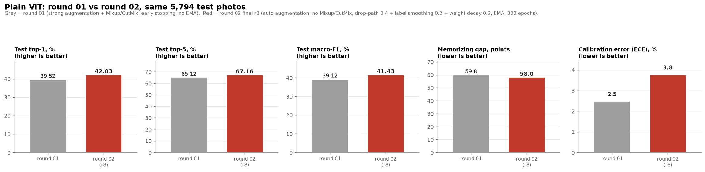
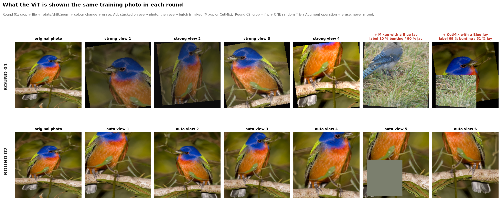
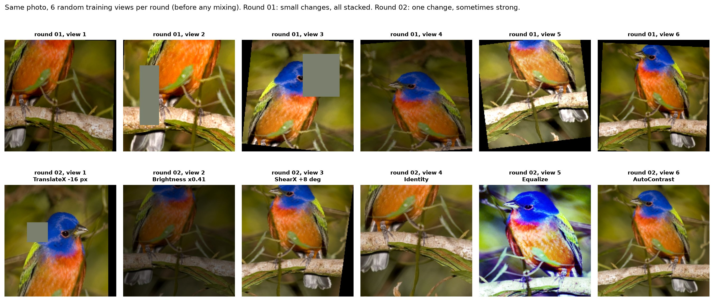
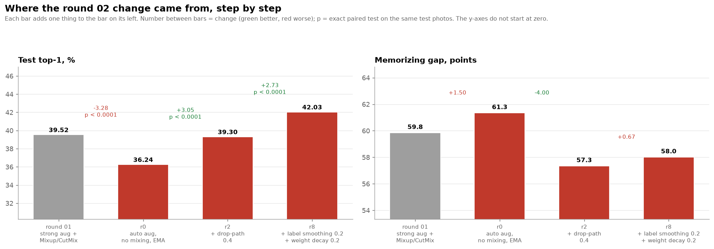
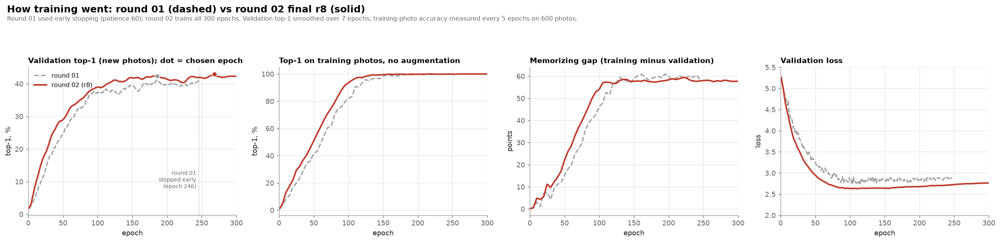
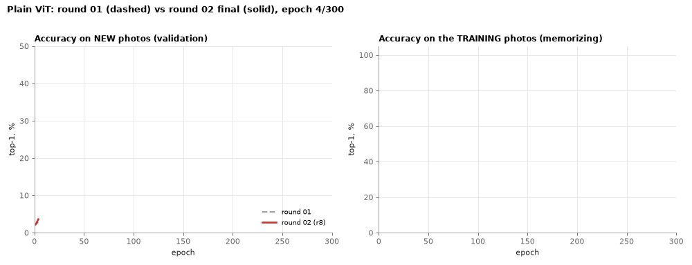
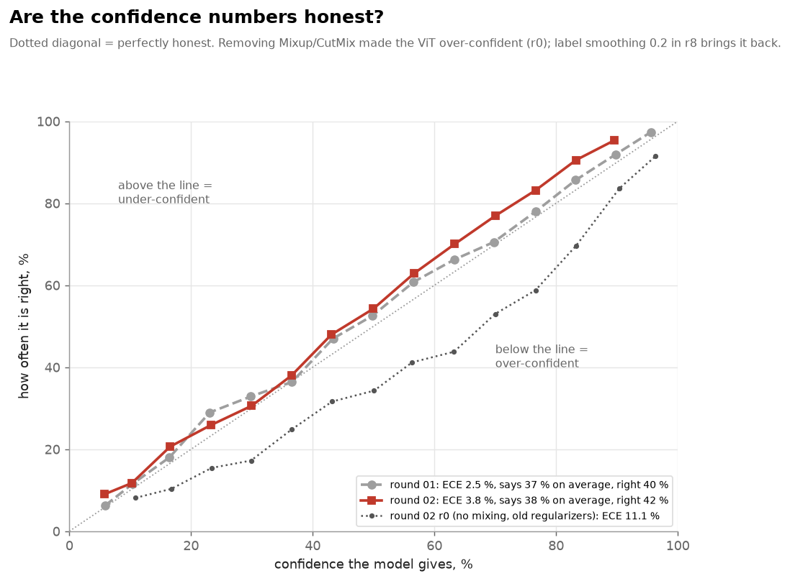
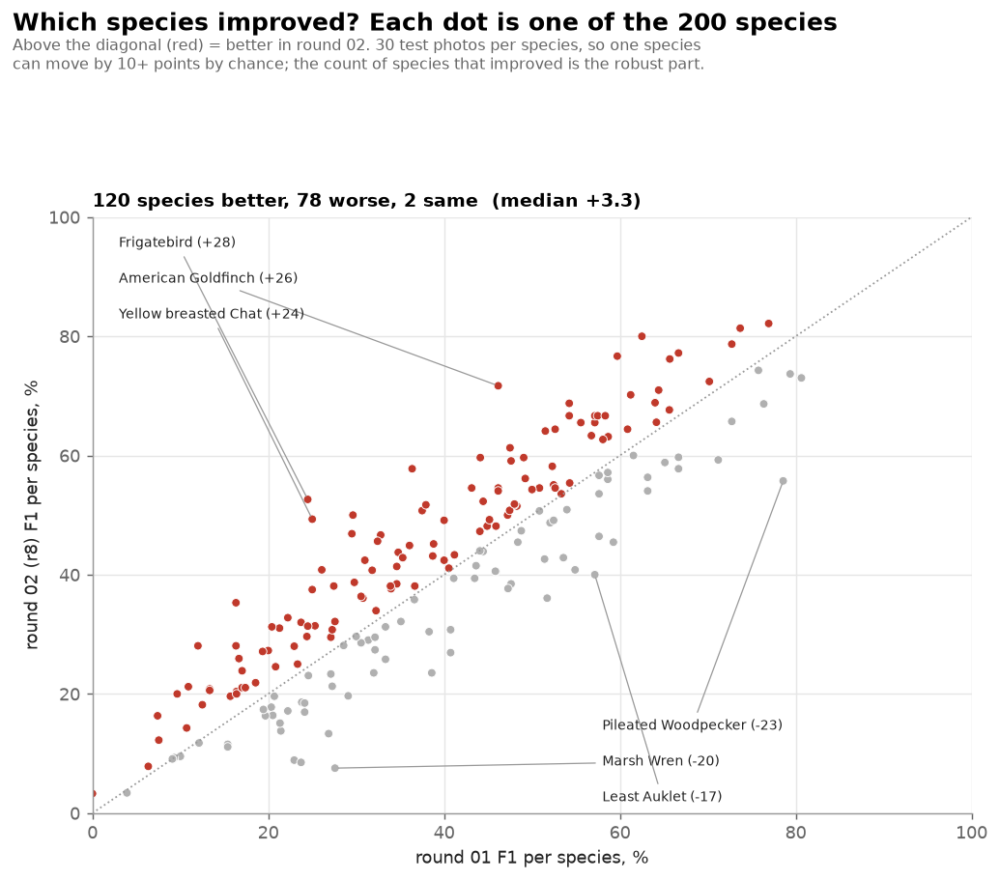
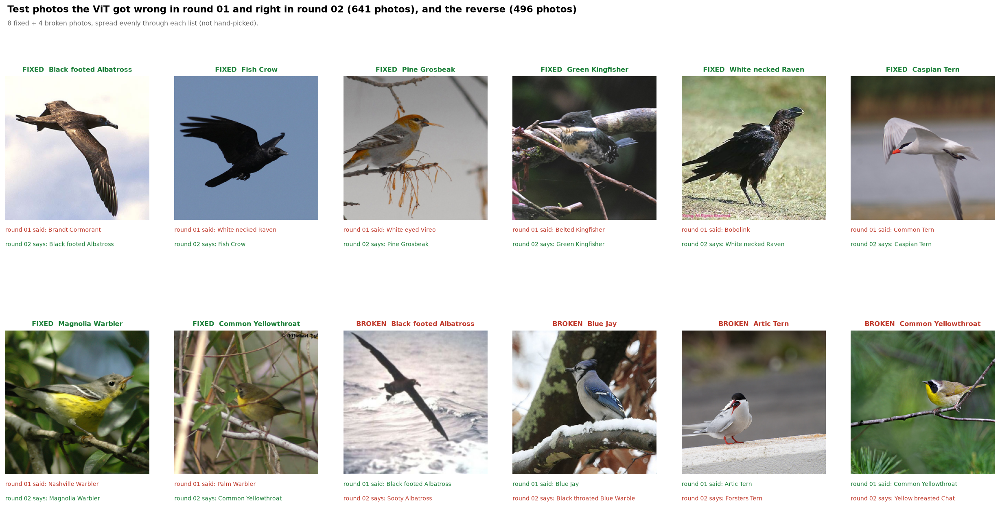

# Plain Vision Transformer: round 01 vs round 02

     

The plain-ViT side of the PatchVision study: a 4.31 M-parameter Vision Transformer trained **from scratch** on CUB-200-2011 (5,394 training photos, about 27 per species). Each experiment round has its own folder with its own detailed README. **This page compares the two rounds**: what changed in the training recipe, what it did to accuracy, memorizing and confidence, and where the change came from.

| Folder | Training recipe | Result (test top-1) |
|---|---|---|
| [`01_strongaug_mixup_cutmix/`](01_strongaug_mixup_cutmix) | `strong` augmentation (all operations stacked) + Mixup/CutMix, label smoothing 0.1, weight decay 0.05, drop-path 0.1, early stopping, no EMA. One run (`base`). | 39.52 % |
| [`02_autoaug_nomix_regularization/`](02_autoaug_nomix_regularization) | `auto` augmentation (one TrivialAugment operation), **no Mixup/CutMix**, EMA, 300 epochs, then a one-change-at-a-time search (drop-path, label smoothing, weight decay, SAM) and the winners combined (r8) | **42.03 %** |
| [`patchvision/`](patchvision) | shared code: the model, data pipeline and round-01 trainer, used by both rounds | |

The shared data (`CUB_200_2011/`, `DataPreprocessing_Results/`) is read from the repository root. PatchVision-X, the full architecture, has its own folder: [`../ViT_PatchVisionX`](../ViT_PatchVisionX).

> **Jump to:** [Result in one minute](#1-the-result-in-one-minute) · [The two recipes](#2-the-two-recipes) · [Where the change came from](#3-where-the-change-came-from) · [Training](#4-how-training-went) · [Results in detail](#5-results-in-detail) · [Against the CNNs](#6-against-the-cnns) · [Takeaways](#7-what-we-learned) · [Limits](#8-limits) · [Reproduce](#9-reproduce-the-figures)

---

## 1. The result in one minute

| | Round 01 (`base`) | **Round 02 final (r8)** |
|---|---|---|
| Test top-1 | 39.52 % | **42.03 %** |
| Test top-5 | 65.12 % | **67.16 %** |
| Test macro-F1 | 39.12 % | **41.43 %** |
| Validation top-1 (chosen epoch) | 42.33 % | **43.00 %** |
| Memorizing gap | 59.8 pts | **58.0 pts** |
| Calibration error (ECE) | **2.49 %** | 3.76 % |
| Change in top-1 | | **+2.50** (only r8 right 641, only round 01 right 496; p ≈ 2e-5) |

One seed (42), the same 5,794 unseen test photos, sampling noise about ±1.3 points. p = exact paired (McNemar) test on the same photos. Round 02 = the final run (r8, best on validation).

**In short:**

1. **The ViT got better**: +2.5 test points on top-1, +2.0 on top-5, +2.3 on macro-F1; 120 of 200 species improved.
2. **The new augmentation recipe alone made it worse.** Switching to `auto` augmentation and dropping Mixup/CutMix cost **−3.3 points** (p < 0.0001). The ViT, unlike the CNNs, needs the photo mixing or something that replaces it.
3. **Drop-path won that back**, and label smoothing + weight decay put it ahead. Drop-path 0.4: +3.0. Label smoothing 0.2 + weight decay 0.2 on top: +2.7. Each step is significant.
4. **Memorizing went down only a little** (59.8 → 58.0 points). The ViT still gets about 100 % of its training photos right.
5. **Confidence stays honest**: ECE 2.5 % → 3.8 %, both slightly under-confident.



---

## 2. The two recipes

The model (tokenizer, 8 sparse graph-attention blocks, graph pooling, 4.31 M parameters), the data split, the optimizer (AdamW, lr 5e-4, 10 warm-up epochs + cosine to 1e-6), batch size 64, gradient clip 1.0 and bf16 are **identical** in both rounds. Only the training recipe changed:

| Setting | Round 01 | Round 02 (final r8) | Why it was changed |
|---|---|---|---|
| Augmentation | `strong`: random crop + flip + rotate/shift/zoom + colour change + random erase, **all stacked on every photo** | `auto`: random crop (35 to 100 %) + flip + **one** random TrivialAugment operation + random erase (25 %) | lighter, more varied changes per photo |
| Mixup / CutMix | on, every batch (50/50) | **off**, photos are never mixed | the same round as the CNNs, to test whether mixing is needed |
| Drop-path (stochastic depth) | 0.1 | **0.4** | won on validation (r2), the biggest single gain |
| Label smoothing | 0.1 | **0.2** | won on validation (r4) |
| Weight decay | 0.05 | **0.2** | won on validation (r6) |
| SAM optimizer | no | no | lost on validation (r7) |
| EMA weights | off | **on** (decay 0.999) | same trainer as the CNNs' round 02 |
| Stopping | early stopping, patience 60 (stopped at epoch 246) | **all 300 epochs** | every run gets the same budget |
| Trainer | [`patchvision/engine.py`](patchvision/engine.py) | [`02_.../vit/engine.py`](02_autoaug_nomix_regularization/vit/engine.py) (copy of the CNN round-02 trainer) | one trainer for the ViT and the CNNs |
| Runs | 1 | 9 (r0 base, r1–r7 one change each, r8 winners combined) | find what helps, one change at a time |

How the round 02 search worked, and every run's numbers, are in the [round 02 README](02_autoaug_nomix_regularization/README.md). The model and the round 01 augmentation are described step by step in the [round 01 README](01_strongaug_mixup_cutmix/README.md).

### What the model actually sees



*The same Painted Bunting photo through each round's real training code. Round 01 stacks every operation on every photo and then mixes it with another photo in the batch: the model is asked to answer "10 % bunting, 90 % jay" or "69 % bunting, 31 % jay". Round 02 changes one thing at a time and never mixes, so every photo keeps one clear label. In both rounds the model sees only the changed version, never the plain original, during training.*

Round 02's augmentation in more detail (the 14 operations, the chain, the same photo over 8 epochs): [round 02 README, section 3](02_autoaug_nomix_regularization/README.md#3-what-changed-from-round-01).



---

## 3. Where the change came from

Going from round 01 to round 02 changed several things at once. The round 02 runs let us take them apart, one step at a time, on the same test photos:



| Step | Test top-1 change | Only new right / only old right | p | Gap change |
|---|---|---|---|---|
| round 01 → r0 (`auto` aug, no Mixup/CutMix, EMA, 300 epochs) | **−3.28** | 490 / 679 | **< 0.0001** | 59.8 → 61.3 |
| r0 → r2 (+ drop-path 0.4) | **+3.05** | 498 / 324 | **< 0.0001** | 61.3 → 57.3 |
| r2 → r8 (+ label smoothing 0.2 + weight decay 0.2) | **+2.73** | 468 / 308 | **< 0.0001** | 57.3 → 58.0 |
| **round 01 → round 02 final** | **+2.50** | 641 / 496 | **< 0.0001** | 59.8 → 58.0 |

* **The new base recipe on its own is a clear step back.** Without Mixup/CutMix the ViT loses 3.3 points and memorizes more (gap +1.5). The CNNs lost nothing from the same change, so this is a ViT-specific need: with only 27 photos per species, the ViT relies on the photo mixing as its main regularizer.
* **Drop-path is the ViT's replacement for it**: +3.05 points and the smallest gap of all runs. Alone, it brings the ViT back to round 01's level (39.30 % vs 39.52 %, p = 0.68).
* **Label smoothing and weight decay add the rest.** Alone, each did almost nothing on test (+0.02 and +0.66). On top of drop-path they add +2.73, which is the step that puts round 02 ahead.

---

## 4. How training went



* **Validation top-1 (left):** round 02 climbs **faster** for the first 100 epochs (the EMA weights and the lighter augmentation make early learning easier) and stays 1 to 2 points above round 01 after that. Round 01 levels off at about 40 % and early stopping ends it at epoch 246; round 02 keeps a slow climb and picks epoch 268.
* **Training photos (second panel):** round 02 also **memorizes faster**: 99 % on clean training photos by epoch 135, against 155 in round 01. Both end at about 100 %.
* **Gap (third panel):** both rise to about 58 to 60 points by epoch 120 and stay there; round 02 ends slightly lower (57.7 vs 59.5 at the last epoch).
* **Validation loss (right):** round 02 goes lower (2.63 vs 2.72) and stays flat, while round 01's loss is noisy and higher.



*The race: validation accuracy (left) and accuracy on the training photos (right). Dashed = round 01, solid = round 02 final.*

| | Round 01 | Round 02 final (r8) |
|---|---|---|
| Epochs run / chosen epoch | 246 / 186 | 300 / 268 |
| Training time | 48.4 min (RTX 4090, 11.8 s per epoch) | 81.6 min (RTX 5090, 16.3 s per epoch) |
| Runs needed to get there | 1 | 9 (about 13 h in total, SAM alone 2.4 h) |

The two rounds ran on different machines, so their times are not directly comparable. Each round's own animations: [round 01's memorizing gap](01_strongaug_mixup_cutmix/docs/animations/v03_memorizing_gap.gif) and [round 02's race of all 9 runs](02_autoaug_nomix_regularization/docs/animations/vit_race.gif).

---

## 5. Results in detail

### 5.1 Confidence: are the numbers honest?



| | Round 01 | Round 02 r0 | **Round 02 final (r8)** |
|---|---|---|---|
| Average confidence | 37.1 % | 47.3 % | 38.3 % |
| Actual accuracy | 39.5 % | 36.2 % | 42.0 % |
| ECE | **2.5 %** | 11.1 % | 3.8 % |

* Round 01 and round 02's final run are both **slightly under-confident** (curves just above the diagonal): they are right a little more often than they say.
* **Removing Mixup/CutMix made the ViT over-confident** (r0: says 47 %, right 36 %). Mixup/CutMix train on blended labels, which keeps confidence down.
* **Label smoothing 0.2 brings it back** in r8. This is the opposite of the CNNs, where the round 02 regularizers made the models strongly under-confident (ECE 14 to 16 %).

### 5.2 Which species improved?



* **120 of 200 species improved**, 78 got worse, 2 stayed the same (median +3.3 F1 points; median species F1 38.4 → 41.4).
* Biggest gains: Frigatebird (+28), American Goldfinch (+26), Yellow breasted Chat (+24). Biggest losses: Pileated Woodpecker (−23), Marsh Wren (−20), Least Auklet (−17).
* With 30 test photos per species, single-species swings of 20 points are mostly noise; the count of improved species is the reliable signal.
* The hardest species stay hard in both rounds: plain brown, grey or black birds with close look-alikes (flycatchers, pewees, crows and ravens). Lists per round: [round 01, section 6](01_strongaug_mixup_cutmix/README.md#which-species-are-easy-and-which-are-hard) and [round 02, section 7](02_autoaug_nomix_regularization/README.md#which-species-are-easy-and-which-are-hard).

### 5.3 Photos fixed and broken



* Round 02 **fixed 641 test photos** that round 01 got wrong, and **broke 496** that round 01 got right: a net gain of 145 photos out of 5,794.
* 1,795 photos are right in both rounds and 2,862 are wrong in both. Most answers do not change; the recipe moves the border cases.
* Many "broken" photos go to a close relative (Black footed → Sooty Albatross, Artic → Forsters Tern), the same kind of mistake that the "fixed" photos had in round 01.

---

## 6. Against the CNNs

The CNNs went through the same two rounds with the same settings ([`../CNN_Baseline`](../CNN_Baseline/README.md)):

| Test top-1 | Plain ViT (4.31 M) | CNN small (4.22 M) | CNN large (11.28 M) |
|---|---|---|---|
| Round 01 | 39.52 % | 43.65 % | 45.86 % |
| Round 02 r0 (new recipe, old regularizers) | 36.24 % (**−3.28**) | 43.75 % (+0.10) | 46.03 % (+0.17) |
| Round 02 final (r8) | **42.03 %** | **47.65 %** | **51.52 %** |
| Round 01 → round 02 | +2.51 | +4.00 | +5.66 |
| Best single change | drop-path 0.4 | weight decay 0.2 | weight decay 0.2 |

* **The same change affects the two architectures very differently.** Dropping Mixup/CutMix hurt only the ViT; drop-path 0.4 helps the ViT and hurts the CNNs; weight decay 0.2 is the CNNs' main fix but does little for the ViT alone.
* **All three models improved**, but the CNNs improved more, so the ViT's gap to the CNN of the same size grew from 4.1 to 5.6 points.

---

## 7. What we learned

1. **For a ViT trained from scratch on 27 photos per species, Mixup/CutMix matters.** Removing it cost 3.3 points and made the model over-confident. The CNNs did not need it.
2. **Drop-path is the regularizer that suits the ViT.** It is the only single change that clearly helped (+3 points) and the one that keeps validation accuracy rising until the end of training.
3. **The winners add up.** Label smoothing 0.2 and weight decay 0.2 looked useless alone (600 validation photos are too few to see small gains), but added 2.7 points on top of drop-path. The final recipe beats round 01 by 2.5 points.
4. **Memorizing is reduced only a little.** The gap fell by about 2 points; the ViT still reaches about 100 % on its training photos with every recipe tried so far.
5. **Confidence stays honest** with label smoothing 0.2 (ECE 3.8 %), unlike the CNNs.
6. **Running a search costs more**: round 01 was one run, round 02 nine (about 13 hours). The final recipe could have been found with four runs (r0, r2, r4, r6) plus r8.

**Next**: PatchVision-X (the full architecture) goes through the same round 02 search, in [`../ViT_PatchVisionX`](../ViT_PatchVisionX).

---

## 8. Limits

- **One seed.** All numbers are seed 42. The +2.5 point gain is significant on the test photos, but it is not shown to hold for another random seed; that needs the three-seed runs.
- **Not a clean A/B test.** Round 01 → round 02 changed augmentation, mixing, stopping, EMA and regularization together. Section 3 separates them using round 02's own runs, which shows the order of the steps, not every possible combination (for example, drop-path 0.4 with Mixup/CutMix kept on was not tried).
- **Round 01 stopped early, round 02 ran 300 epochs.** Round 01's validation was flat when it stopped, so more epochs would likely not have helped it, but the budgets are not identical.
- **Different hardware.** Round 01: RTX 4090, PyTorch 2.5.1; round 02: RTX 5090, PyTorch 2.11. Accuracy should be unaffected; times are not comparable.
- **Test set seen.** All test results were read. Every decision (winners, final run) was made on validation only.

---

## 9. Reproduce the figures

```bash
python Vision_Transformer/docs/make_comparison.py
```

It reads only finished results (`01_strongaug_mixup_cutmix/results/base/` and `02_autoaug_nomix_regularization/results/vit_base/`) and writes `docs/figures/x01 … x07`, `docs/animations/x_race_round01_vs_round02.gif` and `docs/facts.txt` (every number quoted on this page). Model weights (`*.pt`) are not stored in Git. On Windows, set `PYTHONIOENCODING=utf-8` first.

```
Vision_Transformer/
├── README.md                         this page: round 01 vs round 02
├── docs/
│   ├── make_comparison.py            figures + facts for this page
│   ├── facts.txt
│   ├── figures/                      x01 ... x07
│   └── animations/                   x_race_round01_vs_round02.gif
├── patchvision/                      shared code: model, data, round-01 trainer
├── 01_strongaug_mixup_cutmix/        round 01: code, results, README
└── 02_autoaug_nomix_regularization/  round 02: code, results, README
```
